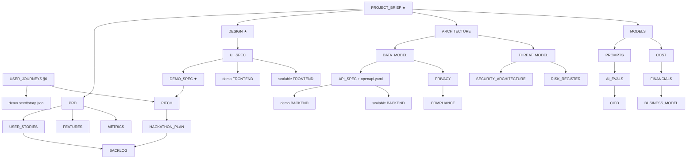

# MAP: how to find anything in Tola
> Project: Tola · Owner: Tech lead · Status: Draft v0.1 · Last updated: 2026-10-20
> Built from the files actually on disk. **Rule:** `docs/` is shared by both builds; `implementation/demo` is the stage prototype; `implementation/scalable` is the production path.

## 1. Directory tree
```
TECH4BHARAT_GAVS_TOLA/
├─ README.md                  front door: problem, features, quick start, two tracks
├─ MAP.md                     this file
├─ CLAUDE.md · AGENTS.md      instructions for AI coding agents (AGENTS → CLAUDE)
├─ CONTRIBUTING.md            branches, Conventional Commits, PR template, definition of done
├─ SECURITY.md                vulnerability reporting, response targets (CERT-In 6 h)
├─ CHANGELOG.md · CODE_OF_CONDUCT.md
├─ .env.example               every env var for both tracks, grouped
├─ .github/workflows/
│  ├─ demo-ci.yml             path-filtered: implementation/demo/** (lint, test, build, Playwright story)
│  ├─ scalable-ci.yml         path-filtered: implementation/scalable/** (ruff, mypy, pytest, vitest, scans)
│  ├─ scalable-deploy.yml     tag v* → Artifact Registry → Cloud Run (asia-south1), Alembic migrate
│  └─ evals.yml               AI evals on prompt/agent changes; fails below thresholds
├─ api/
│  └─ openapi.yaml            the ONE contract (OpenAPI 3.1, API-01…API-23, x-tola-track tags)
├─ docs/                      ── SHARED BY BOTH BUILDS ──
│  ├─ 00-overview/
│  │  ├─ PROJECT_BRIEF.md     ★ single source of truth: IDs, stack, env, canonical demo numbers
│  │  ├─ VISION.md            north star, 1/5/10-year picture, why now
│  │  ├─ PITCH.md             3-min script, demo clicks, fallbacks, Q&A bank per judge
│  │  ├─ HACKATHON_PLAN.md    timeline to 27 Dec, roles, cut list, submission checklist
│  │  └─ TOLA_Pitch_Deck.pdf · TOLA_Pitch_Deck.pptx   12-slide JanAI / Tech4Bharat pitch deck
│  ├─ assets/                 ── VISUAL ASSETS, SCREENSHOTS & DIAGRAMS ──
│  │  ├─ branding/            Tola emblem (`tola-emblem.png`) & hero banner (`tola-hero-banner.png`)
│  │  ├─ architecture/        6-layer system architecture, tech stack, DAG, prism & roadmap diagrams
│  │  ├─ screenshots/         high-DPI live prototype captures (`01`–`06`) & UX overview cards
│  │  └─ slides/              12 rendered pitch deck slide PNGs (`slide-01.png`…`slide-12.png`)
│  ├─ 01-product/
│  │  ├─ PRD.md               requirements and acceptance per F-01…F-14, NFRs, release criteria
│  │  ├─ PERSONAS.md          P-01…P-05 with sourced research
│  │  ├─ USER_JOURNEYS.md     today vs with Tola; §6 = scripted demo week (canonical numbers)
│  │  ├─ USER_STORIES.md      US-01…US-35 with Gherkin
│  │  ├─ FEATURES.md          feature matrix, demo vs scalable columns, flags
│  │  ├─ ROADMAP.md · METRICS.md · COMPETITIVE_ANALYSIS.md
│  ├─ 02-design/
│  │  ├─ DESIGN.md            ★ design language from Sarvam + Vakyam + Apple fluid principles; paste-ready tokens
│  │  ├─ DESIGN_SYSTEM.md     tokens and components reference (HeroUI v3 mapping)
│  │  ├─ UI_SPEC.md           screens S-01…S-18 (S-01…S-12 demo, S-13…S-18 scalable): wireframes, states, copy, events
│  │  ├─ ACCESSIBILITY.md · LOCALIZATION.md
│  │  └─ reference/           Vakyam tokens/animations/motion source + extracted Sarvam tokens
│  ├─ 03-engineering/
│  │  ├─ ARCHITECTURE.md      C4 + both deployment views + sequences + hash-chain algorithm
│  │  ├─ TECH_STACK.md · DATA_MODEL.md (E-01…E-19) · API_SPEC.md · INTEGRATIONS.md · HARDWARE.md
│  │  └─ adr/                 ADR-0000 template, ADR-0001…0009
│  ├─ 04-ai/                  MODELS (M-01…M-05, cost gate) · PROMPTS · AI_EVALS · DATA_PIPELINE · RESPONSIBLE_AI
│  ├─ 06-security-compliance/ SECURITY_ARCHITECTURE · THREAT_MODEL · PRIVACY (DPDP) · COMPLIANCE · RISK_REGISTER (R-01…R-32)
│  ├─ 07-business/            BUSINESS_MODEL · GTM · FINANCIALS · IMPACT
│  └─ 08-project/             BACKLOG (TOLA-xxx) · TEAM (RACI) · GLOSSARY
├─ scripts/
│  ├─ generate_tola_assets.py deterministic vector & RGBA visual generator for Tola diagrams
│  └─ build_tola_pitch_deck.py 12-slide 16:9 PPTX pitch deck compiler
└─ implementation/
   ├─ demo/                   ── STAGE PROTOTYPE: no login, role switcher, story mode ──
   │  ├─ README.md · CLAUDE.md · .env.example · docker-compose.yml
   │  ├─ docs/                DEMO_SPEC ★ · FRONTEND · BACKEND · TESTING · DEPLOYMENT · ENVIRONMENT_SETUP · CODING_STANDARDS
   │  ├─ apps/web/            Next.js 16.4 app: HeroUI v3.2 + Tailwind 4.3 + Motion 14.4 + Playwright E2E
   │  ├─ services/api/        FastAPI 0.153 + SQLite + ledger-core (integer mg, RFC 8785 JCS, Ed25519)
   │  ├─ seed/                story.json (S01–S13), audio/ (Sarvam Bulbul/Saaras clips), ai-cache/
   │  └─ scripts/ · tests/    bake_audio.py, bake_ai_cache.py, stage-check.sh, canonical-vectors.json
   └─ scalable/               ── PRODUCTION PATH ──
      ├─ README.md · CLAUDE.md · .env.example · package.json · pnpm-workspace.yaml
      ├─ docs/                FRONTEND · BACKEND · CODING_STANDARDS · GIT_WORKFLOW · TESTING · PERFORMANCE · ENVIRONMENT_SETUP
      │                       CICD · INFRASTRUCTURE · DEPLOYMENT · OBSERVABILITY · RUNBOOK · COST   (ops docs live here)
      ├─ apps/web/            PWA (empty skeleton)
      ├─ services/api/        pyproject.toml · services/worker/ (empty)
      ├─ packages/ui/ · packages/ledger-core/   (empty skeletons)
      ├─ ai/prompts/          manager · intake · reconcile · settle (match PROMPTS.md)
      ├─ ai/evals/README.md   eval harness layout
      └─ infra/               docker/docker-compose.yml · terraform/main.tf
```
*Ops docs are in `implementation/scalable/docs/`, not `docs/05-ops/`, because they apply only to the production path. The demo's deploy and runbook notes are in `implementation/demo/docs/DEPLOYMENT.md` and `DEMO_SPEC.md`.*

## 2. Where do I find…?
| Question | Go to |
|---|---|
| What are we building, and what are the IDs? | [PROJECT_BRIEF](docs/00-overview/PROJECT_BRIEF.md) |
| What exactly happens in the 3-minute demo? | [DEMO_SPEC](implementation/demo/docs/DEMO_SPEC.md) · [PITCH](docs/00-overview/PITCH.md) |
| The demo numbers (40.000 g, +380 mg, ₹5,040)? | [PROJECT_BRIEF §2](docs/00-overview/PROJECT_BRIEF.md) · [USER_JOURNEYS §6](docs/01-product/USER_JOURNEYS.md) · [seed/story.json](implementation/demo/seed/story.json) |
| How should it look and move (Sarvam / Vakyam / Apple)? | [DESIGN](docs/02-design/DESIGN.md) → [UI_SPEC](docs/02-design/UI_SPEC.md) → [demo tokens.css](implementation/demo/apps/web/src/styles/tokens.css) · [springs.ts](implementation/demo/apps/web/src/lib/springs.ts) |
| Requirements and acceptance criteria? | [PRD](docs/01-product/PRD.md) · [USER_STORIES](docs/01-product/USER_STORIES.md) |
| How does the hash chain and dual signing work? | [ARCHITECTURE](docs/03-engineering/ARCHITECTURE.md) · [ADR-0005](docs/03-engineering/adr/ADR-0005-hash-chain-dual-ed25519.md) |
| Tables and fields? | [DATA_MODEL](docs/03-engineering/DATA_MODEL.md) |
| Endpoints? | [API_SPEC](docs/03-engineering/API_SPEC.md) · [openapi.yaml](api/openapi.yaml) |
| Lyzr agents and prompts? | [MODELS](docs/04-ai/MODELS.md) · [PROMPTS](docs/04-ai/PROMPTS.md) · [ai/prompts](implementation/scalable/ai/prompts/) |
| Sarvam / UPI / WhatsApp / scale integration? | [INTEGRATIONS](docs/03-engineering/INTEGRATIONS.md) · [HARDWARE](docs/03-engineering/HARDWARE.md) |
| Run the demo on my laptop? | [demo README](implementation/demo/README.md) · [demo ENVIRONMENT_SETUP](implementation/demo/docs/ENVIRONMENT_SETUP.md) |
| Deploy production? | [DEPLOYMENT](implementation/scalable/docs/DEPLOYMENT.md) · [INFRASTRUCTURE](implementation/scalable/docs/INFRASTRUCTURE.md) · [CICD](implementation/scalable/docs/CICD.md) |
| What does it cost per karigar? | [COST](implementation/scalable/docs/COST.md) · [FINANCIALS](docs/07-business/FINANCIALS.md) |
| Is it legal (DPDP, CERT-In, Legal Metrology, GST)? | [COMPLIANCE](docs/06-security-compliance/COMPLIANCE.md) · [PRIVACY](docs/06-security-compliance/PRIVACY.md) |
| What could kill us? | [RISK_REGISTER](docs/06-security-compliance/RISK_REGISTER.md) · [THREAT_MODEL](docs/06-security-compliance/THREAT_MODEL.md) |
| Who pays and how we grow? | [BUSINESS_MODEL](docs/07-business/BUSINESS_MODEL.md) · [GTM](docs/07-business/GTM.md) |
| What do I do this week? | [HACKATHON_PLAN](docs/00-overview/HACKATHON_PLAN.md) · [BACKLOG](docs/08-project/BACKLOG.md) · [TEAM](docs/08-project/TEAM.md) |
| What does "karigar", "916" or "Rule 55" mean? | [GLOSSARY](docs/08-project/GLOSSARY.md) |
| Something broke on stage | [DEMO_SPEC fallbacks](implementation/demo/docs/DEMO_SPEC.md) · [RUNBOOK §8](implementation/scalable/docs/RUNBOOK.md) |

## 3. Doc dependency graph


## 4. Reading orders
| Reader | Order |
|---|---|
| **New developer (demo)** | README → PROJECT_BRIEF → DEMO_SPEC → DESIGN → UI_SPEC → demo FRONTEND / BACKEND → DATA_MODEL → API_SPEC → demo ENVIRONMENT_SETUP |
| **New developer (scalable)** | README → PROJECT_BRIEF → ARCHITECTURE → DATA_MODEL → API_SPEC → scalable BACKEND / FRONTEND → TESTING → CICD → SECURITY_ARCHITECTURE |
| **Judge / mentor** | README → VISION → PITCH → PRD (§1–3) → ARCHITECTURE (diagrams) → RESPONSIBLE_AI → BUSINESS_MODEL → IMPACT |
| **Designer** | DESIGN → DESIGN_SYSTEM → UI_SPEC → ACCESSIBILITY → LOCALIZATION → `docs/02-design/reference/` → PERSONAS |
| **AI coding agent** | CLAUDE.md → the track's CLAUDE.md → PROJECT_BRIEF → DEMO_SPEC (demo) or ARCHITECTURE (scalable) → DATA_MODEL → api/openapi.yaml → PROMPTS |
| **Pitch lead** | PITCH → DEMO_SPEC §10 → HACKATHON_PLAN → COMPETITIVE_ANALYSIS → FINANCIALS → RISK_REGISTER top 5 |
