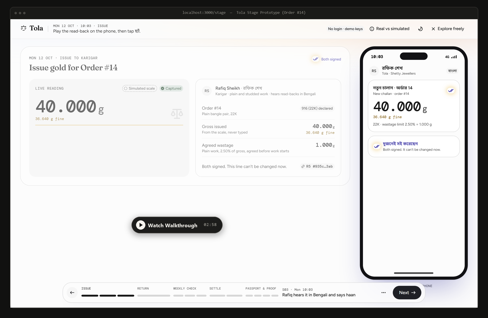
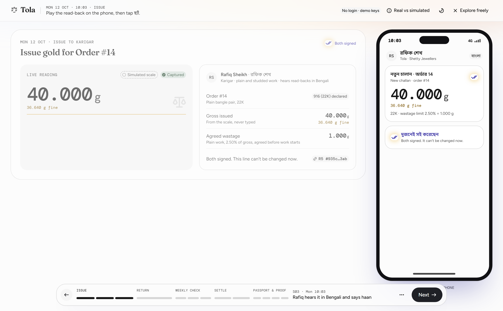
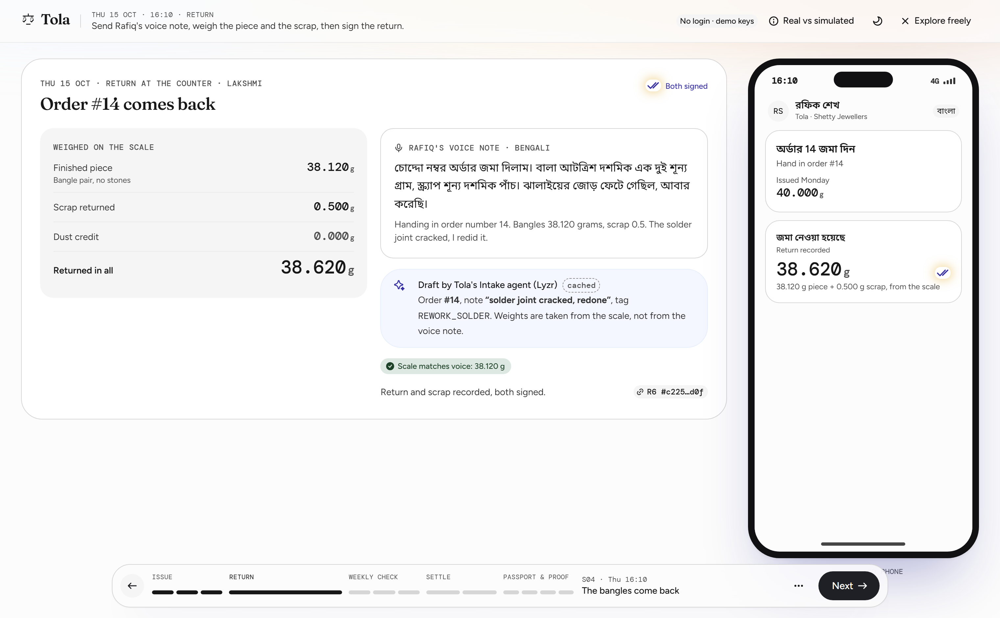
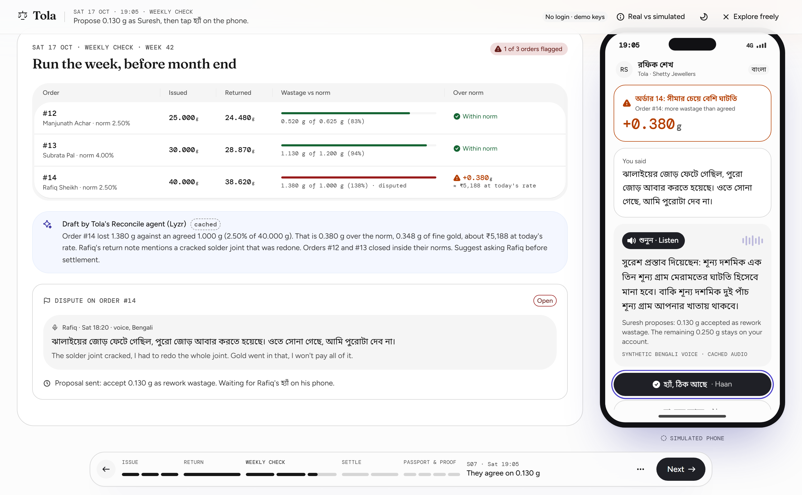
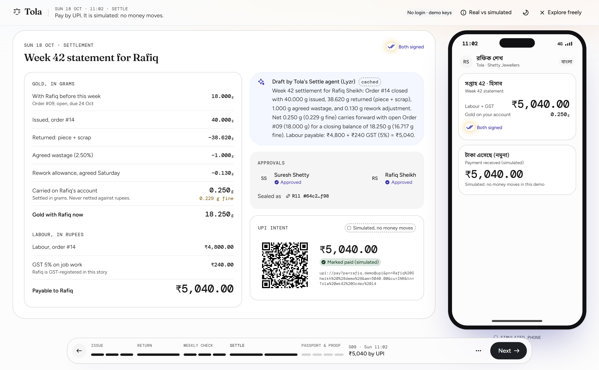
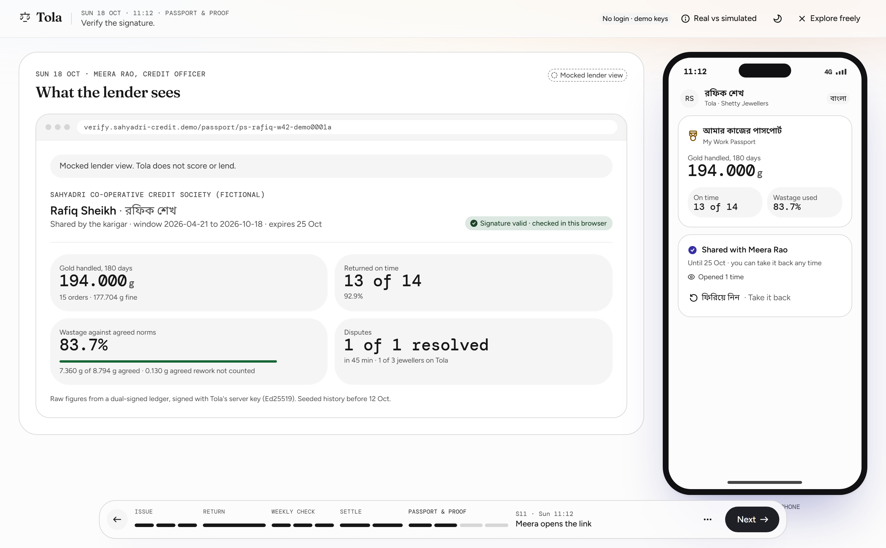
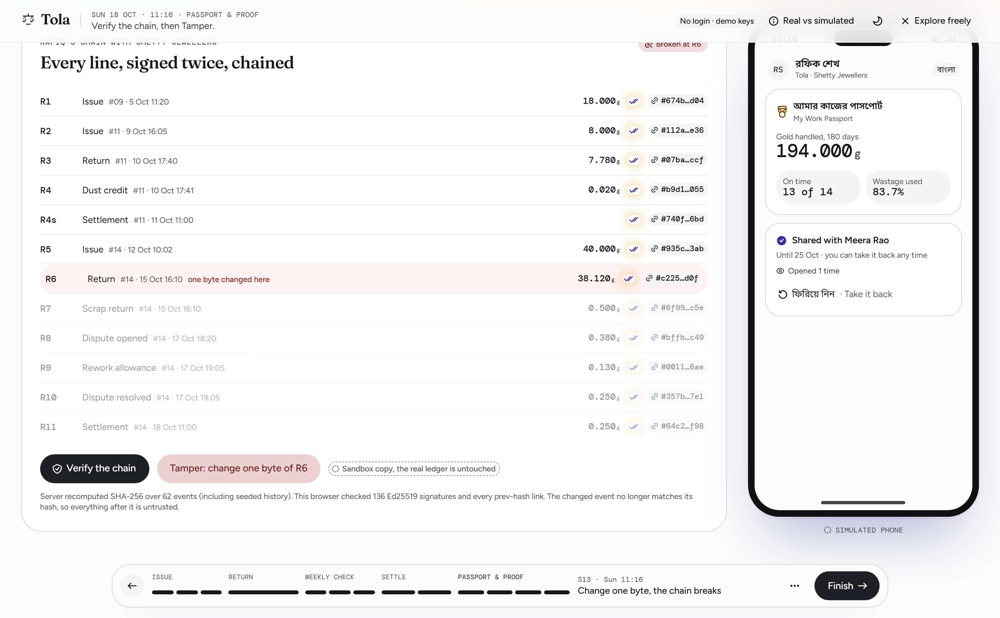
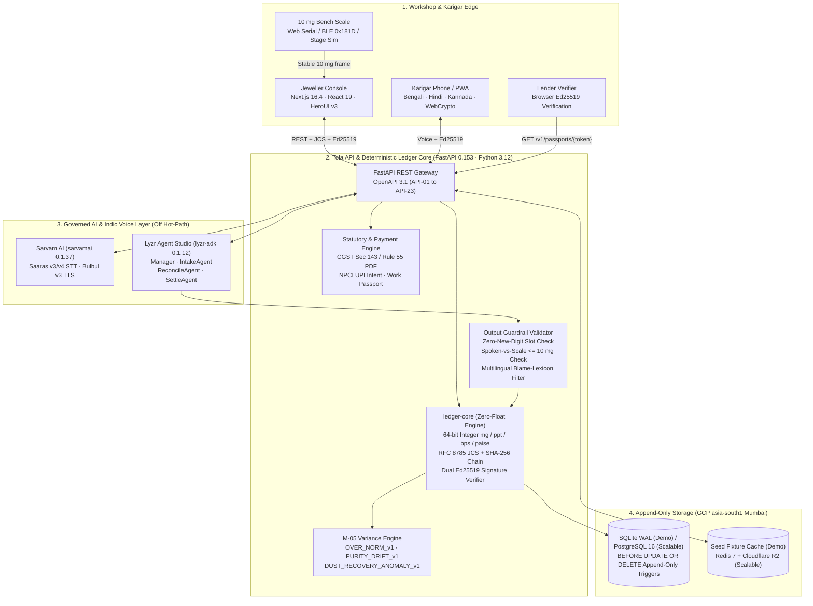
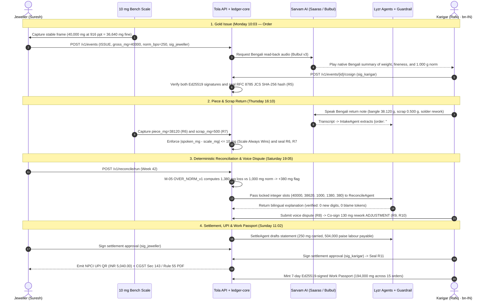

<div align="center">


# Tola

**Dual-Signed, Voice-First Gold and Wage Ledger for India's Jewellery Job-Work Supply Chain**

Tech4Bharat · GAVS Hackathon 2026 · JanAI Mass Entrepreneurship Challenge  
Theme 2: Jeweltech (Problem Statement PS 2.2) · Track: Agentic AI · Powered by Lyzr Agent Studio & Sarvam AI

[Walkthrough Video](https://youtu.be/CnNJD3p0CYQ) · [Problem & Context](#1-problem-statement--context) · [Product Walkthrough](#2-product-walkthrough) · [System Architecture](#3-system-architecture) · [Cryptographic Spec](#4-cryptographic--mathematical-specification) · [Governed AI & Voice](#5-governed-ai--indic-voice-pipeline) · [Benchmarks](#6-benchmarks-performance--unit-economics) · [Testing](#7-testing--verification-matrix) · [Quick Start](#9-quick-start) · [Documentation Index](MAP.md) · [License](#12-license)

</div>

---

<div align="center">
  <a href="https://youtu.be/CnNJD3p0CYQ" target="_blank" rel="noopener noreferrer">
    
  </a>
  <p>
    <em><strong>Figure 1 — Live Prototype Walkthrough (<a href="https://youtu.be/CnNJD3p0CYQ">youtu.be/CnNJD3p0CYQ</a>, 02:58).</strong> Synchronized split-screen demonstration of Order <code>#14</code> across the Jeweller Workshop Console (left) and the Karigar Mobile Interface (right), covering 10 mg scale capture, Sarvam Bengali voice read-back, dual Ed25519 co-signing, deterministic variance reconciliation, voice dispute resolution, UPI settlement, and browser-side Work Passport verification.</em>
  </p>
</div>

| Timestamp | Segment | System Components Demonstrated |
| :---: | :--- | :--- |
| **`00:00 – 00:35`** | **Problem & Order `#14` Issue (`S01`–`S03`)** | `40.000 g` (`40,000 mg`) 22K (`916 ppt`) scale capture, `36.640 g` fine conversion, `2.50%` (`250 bps` = `1.000 g`) wastage norm lock, Sarvam `Bulbul v3` Bengali read-back, dual Ed25519 signature (`R5`). |
| **`00:35 – 01:10`** | **Return + Katran Scrap & Voice Intake (`S04`)** | Bengali voice note transcribed via Sarvam `Saaras v3`, `IntakeAgent` (`lyzr-adk`) slot extraction (`REWORK_SOLDER`), `38.120 g` bangle + `0.500 g` scrap = `38.620 g` return (`R6`, `R7`). |
| **`01:10 – 01:50`** | **Deterministic Reconcile & Dispute (`S05`–`S07`)** | `M-05` rule flags `+0.380 g` (`380 mg` gross / `348 mg` fine, `₹5,188` at risk), `ReconcileAgent` renders neutral EN + BN card, Bengali voice dispute (`R8`), co-signed `0.130 g` rework adjustment (`R9`, `R10`). |
| **`01:50 – 02:25`** | **Weekly Settlement, UPI & Rule 55 PDF (`S08`–`S09`)** | `SettleAgent` drafts Week 42 statement (`0.250 g` / `0.229 g` fine carried forward, `₹5,040.00` labour payable), dual approval (`R11`), NPCI `upi://pay` QR and CGST Sec 143 / Rule 55 challan PDF. |
| **`02:25 – 02:58`** | **Work Passport & Chain Tamper Proof (`S10`–`S13`)** | Lender view of Rafiq's consented 7-day Work Passport (`194.000 g` across 15 orders, browser-verified Ed25519 signature) and live 1-byte tamper test breaking the SHA-256 chain at `R6`. |

---

## 1. Problem Statement & Context

### Hackathon Submission Metadata

| Field | Specification |
| :--- | :--- |
| **Event** | **Tech4Bharat — GAVS Hackathon 2026** (*JanAI — Mass Entrepreneurship Challenge*) |
| **Theme & Problem Statement** | **Theme 2: Jeweltech · Problem Statement PS 2.2** — * Informal Gold Job-Work, Karigar Accountability & Financial Inclusion* |
| **Primary Track** | **Agentic AI** (Governed multi-agent orchestration + native Indic speech interface + deterministic cryptographic ledger) |
| **Sponsor Integrations** | **Lyzr Agent Studio** (`lyzr-adk 0.1.12` — `Manager`, `IntakeAgent`, `ReconcileAgent`, `SettleAgent`) and **Sarvam AI** (`sarvamai 0.1.37` — `Saaras v3/v4` STT & `Bulbul v3` TTS across `bn-IN`, `hi-IN`, `kn-IN`, `en-IN`) |
| **Repository Architecture** | Shared product/engineering specifications ([`docs/`](MAP.md), [`api/openapi.yaml`](api/openapi.yaml)) + two implementation tracks: [`implementation/demo/`](implementation/demo/CLAUDE.md) (built stage prototype) and [`implementation/scalable/`](implementation/scalable/CLAUDE.md) (production multi-tenant architecture) |
| **Primary Reference Documents** | [PROJECT_BRIEF.md](docs/00-overview/PROJECT_BRIEF.md) · [PRD.md](docs/01-product/PRD.md) · [ARCHITECTURE.md](docs/03-engineering/ARCHITECTURE.md) · [DEMO_SPEC.md](implementation/demo/docs/DEMO_SPEC.md) · [TOLA_Pitch_Deck.pdf](docs/00-overview/TOLA_Pitch_Deck.pdf) |

### The Structural Gap in India's Jewellery Supply Chain

India's gems and jewellery sector (~USD 85B domestic and export market) relies on **4.5 to 5.0 million *karigars*** (artisans) operating across **500,000+ micro-workshops** in clusters such as Bowbazar/Domjur (Kolkata), Zaveri Bazaar (Mumbai), Rajkot, Surat, Coimbatore, Thrissur, and Jaipur. Every week, small and mid-sized jewellers hand out raw **22K (`916 ppt`) and 18K (`750 ppt`) gold** on *job-work* (*jangad* / *hisaab* slips) and receive finished ornaments plus scrap (*katran*) and polishing dust (*nyara*) days later.

Despite the value of the metal, the handoff between workshop and artisan runs on **one-sided paper *parchis*, WhatsApp voice notes, and unilateral desktop accounting**:

1. **Unilateral Ledger Bias**: The jeweller owns the register or ERP. The karigar — frequently a native Bengali, Hindi, or Kannada speaker who does not read English or Devanagari invoices — never co-signs the entry or receives a verifiable copy.
2. **Retroactive Wastage Norms (*Chhij* / *Ghat*)**: Allowed process loss (`1.50%`–`4.50%`, or `150`–`450 bps`) is often argued on Saturday evening *after* the ornament returns. On a single `40.000 g` 22K bangle order, a `0.380 g` dispute equals **`₹5,188`** at `₹7,620/g` — wiping out the artisan's entire weekly making wage (`₹5,040`).
3. **Statutory Compliance Exposure**: Under **Section 143 of the CGST Act, 2017** and **Rule 55 of the CGST Rules**, principal-to-job-worker gold movements require serially numbered delivery challans (`HSN 7113`/`7108`) reconciled into quarterly **Form GST ITC-04**. Informal slips leave workshops exposed to `18%` tax-plus-interest reassessment.
4. **Invisible Livelihood History**: An artisan who handles **1.5 to 3.0 kg of 22K gold per year** (`₹1.1 Cr – ₹2.3 Cr` of metal custody) with `< 2.5%` wastage has zero portable proof of work or custody integrity when applying for a **PM Vishwakarma** (`₹1L–₹3L` at `5%`), **MUDRA Kishore/Tarun**, or NBFC working-capital loan.

### Architectural Differentiation

| Capability | Paper *Kaccha Parchi* & WhatsApp | Legacy Jewellery ERP (Tally / Marg / Synergics) | Generic Credit / Bahi Apps (Khatabook / OkCredit) | **Tola (`ledger-core` + Governed AI)** |
| :--- | :--- | :--- | :--- | :--- |
| **Record Authority** | Jeweller's paper diary; frequently lost or disputed | Unilateral back-office SQL row; editable by admin | Single-entry rupee IOUs; no metal accounting | **Dual Ed25519 co-signed, RFC 8785 JCS + SHA-256 hash-chained append-only ledger** |
| **Metal Precision** | Handwritten grams; inconsistent rounding | Often IEEE-754 floats; purity & wastage bolted on | Rupee-only (`₹`); no gram, fineness, or wastage model | **64-bit integer milligrams (`mg`), fineness (`ppt`), wastage norms (`bps`), paise** |
| **Scale Integration** | Manual reading and transcription | Keyboard entry or proprietary desktop COM driver | None | **Web Serial (USB-OTG) + Web Bluetooth (`0x181D`) + 7-segment OCR + 10 mg stage simulator** |
| **Karigar Interface** | Verbal handoff in workshop | English/Hindi desktop screen karigar never sees | SMS notification in English/Hindi | **Sarvam `Bulbul v3` read-back in Bengali/Hindi/Kannada + `হ্যাঁ / हाँ / ಹೌದು` co-sign** |
| **AI Governance** | None | None | Unchecked chatbot wrappers | **Lyzr 4-agent workflow strictly off the arithmetic hot path; zero-new-digit validator** |
| **Statutory & Credit Output** | Manual CA data entry; zero credit proof | Desktop GST reports; zero artisan portability | None | **One-click CGST Sec 143 / Rule 55 PDF + NPCI UPI QR + Ed25519-signed Work Passport** |

---

## 2. Product Walkthrough

The stage prototype ([`implementation/demo`](implementation/demo/CLAUDE.md)) renders the **Jeweller Workshop Console** (Suresh Shetty, `en-IN`) alongside the synchronized **Karigar Phone Interface** (Rafiq Sheikh, `bn-IN`), driven by a deterministic 13-beat story rail (`S01`–`S13`) across **Order `#14`** (`40.000 g` 22K plain bangle pair).

### 2.1 Gold Issue, Scale Lock & Native Voice Co-Signature (`S01`–`S03`)

<div align="center">
  
  <p>
    <em><strong>Figure 2 — Gold Issue & Dual Ed25519 Co-Signature (Beats <code>S01</code>–<code>S03</code>, Event <code>R5</code>).</strong> Left: Suresh captures a stable <code>40.000 g</code> (<code>40,000 mg</code>) reading from the 10 mg scale at 22K (<code>916 ppt</code> = <code>36.640 g</code> fine) with a pre-agreed <code>2.50%</code> (<code>250 bps</code> = <code>1.000 g</code>) wastage norm. Right: Rafiq's phone plays the Sarvam <code>Bulbul v3</code> Bengali read-back and unlocks the co-sign button; once tapped, event <code>R5</code> is sealed into the SHA-256 chain (<code>#935c...3ab</code>).</em>
  </p>
</div>

---

### 2.2 Finished Piece + Scrap Return & Voice-to-Slip Extraction (`S04`)

<div align="center">
  
  <p>
    <em><strong>Figure 3 — Return Weighing & Governed Voice Intake (Beat <code>S04</code>, Events <code>R6</code> & <code>R7</code>).</strong> Left: The bench scale records <code>38.120 g</code> finished bangle weight (<code>R6</code>) plus <code>0.500 g</code> katran scrap (<code>R7</code>) for a combined return of <code>38.620 g</code> (<code>35.376 g</code> fine). Right: Rafiq's Bengali voice explanation is transcribed by Sarvam <code>Saaras v3</code> and structured by Lyzr <code>IntakeAgent</code> into reason tag <code>REWORK_SOLDER</code>; the deterministic validator verifies that spoken weights match the physical scale within <code>10 mg</code>.</em>
  </p>
</div>

---

### 2.3 Deterministic Weekly Reconciliation & Voice Dispute Resolution (`S05`–`S07`)

<div align="center">
  
  <p>
    <em><strong>Figure 4 — Deterministic Variance Reconciliation & Bilingual Dispute Resolution (Beats <code>S05</code>–<code>S07</code>, Events <code>R8</code>–<code>R10</code>).</strong> Left: Rule <code>OVER_NORM_v1</code> computes gross loss (<code>1.380 g</code> vs <code>1.000 g</code> norm) and flags only Order <code>#14</code> for <code>+0.380 g</code> (<code>0.348 g</code> fine, <code>₹5,188</code> at risk). Lyzr <code>ReconcileAgent</code> drafts a neutral bilingual card using locked numeric slots. After Rafiq attaches a Bengali voice reply (<code>R8</code>), Suresh proposes a <code>0.130 g</code> (<code>130 mg</code>) solder-rework credit; Rafiq hears the proposal in Bengali on the phone (right) and co-signs <code>R9</code> and <code>R10</code>.</em>
  </p>
</div>

---

### 2.4 Weekly Settlement Statement, Rule 55 Challan & NPCI UPI Intent (`S08`–`S09`)

<div align="center">
  
  <p>
    <em><strong>Figure 5 — Dual-Signed Weekly Settlement & UPI Labour Disbursal (Beats <code>S08</code>–<code>S09</code>, Event <code>R11</code>).</strong> Left: Lyzr <code>SettleAgent</code> compiles the Week 42 statement carrying forward <code>0.250 g</code> gross (<code>0.229 g</code> fine) to Week 43 while unlocking Rafiq's full <code>₹5,040.00</code> making-wage payment via an NPCI <code>upi://pay</code> QR intent and generating the statutory CGST Section 143 / Rule 55 Job-Work Challan PDF. Right: Rafiq's phone confirms dual-signed settlement receipt in Bengali.</em>
  </p>
</div>

---

### 2.5 Consented Karigar Work Passport & Browser-Side Ed25519 Verification (`S10`–`S11`)

<div align="center">
  
  <p>
    <em><strong>Figure 6 — Karigar Work Passport & Zero-PII Lender Verification (Beats <code>S10</code>–<code>S11</code>).</strong> Left: Lender view (Meera Nair, NBFC Credit Officer) displaying Rafiq's consented, 7-day-expiring Work Passport aggregating <code>194.000 g</code> of 22K gold across 15 dual-signed orders, <code>13 of 14</code> (<code>92.9%</code>) on-time completion, and <code>83.7%</code> average wastage norm utilization, verified directly in the browser via <code>@noble/ed25519</code> without exposing workshop counterparty secrets. Right: Karigar phone control allowing instant DPDP Act 2023 revocation (<code>POST /v1/passports/{token}/revoke</code>).</em>
  </p>
</div>

---

### 2.6 Append-Only SHA-256 Hash-Chain Audit & Live Tamper Sandbox (`S12`–`S13`)

<div align="center">
  
  <p>
    <em><strong>Figure 7 — Cryptographic Hash-Chain Verifier & Tamper Sandbox (Beats <code>S12</code>–<code>S13</code>).</strong> Auditing all 62 events and 136 Ed25519 signatures in the workshop ledger. Mutating a single byte of event <code>R6</code> (changing returned weight from <code>38,120 mg</code> to <code>37,120 mg</code> in the sandbox copy) causes an immediate <code>payload_hash</code> mismatch at <code>R6</code> and cascades invalidation across downstream links <code>R7</code>–<code>R11</code>.</em>
  </p>
</div>

---

### 2.7 Canonical Order `#14` Integer-Milligram Ledger (`R5`–`R11`)

All weights, finenesses, wastage norms, and currency values in `ledger-core` are computed in 64-bit integer arithmetic (`1 g = 1,000 mg`, `22K = 916 ppt`, `2.50% = 250 bps`, `₹1 = 100 paise`).

| Event ID | Beat & Timestamp | Event Type | Gross (`mg`) | Gross (`g`) | Fineness (`ppt`) | Fine Gold (`mg`) | Fine Gold (`g`) | Cryptographic Invariant & Co-Signers |
| :---: | :--- | :--- | ---: | ---: | :---: | ---: | ---: | :--- |
| **`R5`** | `S01`–`S03` · Mon 10:03 | `ISSUE` | `40,000` | `40.000 g` | `916` | `36,640` | `36.640 g` | Norm locked at `250 bps` (`1,000 mg` gross / `916 mg` fine). Dual Ed25519 (`sig_jeweller` + `sig_karigar`). |
| **`R6`** | `S04` · Thu 16:10 | `RETURN` | `38,120` | `38.120 g` | `916` | `34,918` | `34.918 g` | Finished bangle pair weighed on 10 mg scale. `IntakeAgent` tags `REWORK_SOLDER`. Dual Ed25519. |
| **`R7`** | `S04` · Thu 16:11 | `SCRAP` | `500` | `0.500 g` | `916` | `458` | `0.458 g` | Returned *katran* scrap (`38,120 + 500 = 38,620 mg` total return; `1,380 mg` gross loss). Dual Ed25519. |
| **`Flag`** | `S05` · Sat 19:05 | `OVER_NORM_v1` | `+380` | `+0.380 g` | `916` | `+348` | `+0.348 g` | Deterministic rule: `1,380 mg` actual loss − `1,000 mg` norm = `+380 mg` variance (`₹5,188` at risk). |
| **`R8`** | `S06` · Sat 19:12 | `DISPUTE_OPEN` | `0` | `0.000 g` | `916` | `0` | `0.000 g` | Rafiq attaches Bengali voice note (`sha256(audio)` + Sarvam `Saaras v3` transcript). Signed by karigar. |
| **`R9`** | `S07` · Sat 19:18 | `ADJUSTMENT` | `+130` | `+0.130 g` | `916` | `+119` | `+0.119 g` | Co-signed solder rework allowance (`130 mg` gross / `119 mg` fine). Residual variance: `250 mg` (`229 mg` fine). |
| **`R10`** | `S07` · Sat 19:19 | `DISPUTE_RESOLVE` | `0` | `0.000 g` | `916` | `0` | `0.000 g` | Closes dispute ticket with references to `R8` and `R9`. Dual Ed25519. |
| **`R11`** | `S08`–`S09` · Sun 11:02 | `SETTLEMENT` | `250` | `0.250 g` | `916` | `229` | `0.229 g` | Carries `250 mg` (`229 mg` fine) to Week 43; unlocks `504,000 paise` (`₹5,040.00`) UPI QR & Rule 55 PDF. |

---

## 3. System Architecture

Tola enforces a strict architectural separation between **deterministic cryptographic accounting** (`ledger-core`) and **governed AI/speech assistance** (Sarvam AI + Lyzr Agent Studio). No generative model can ever write to the database, compute a weight or balance, or invent a digit.



### End-to-End Transaction Sequence (`ISSUE` → `RETURN` → `RECONCILE` → `SETTLE`)



---

## 4. Cryptographic & Mathematical Specification

### 4.1 Zero-Float Integer Milligram Arithmetic ([`ADR-0006`](docs/03-engineering/adr/ADR-0006-integer-mg-deterministic-ledger-core.md))

IEEE-754 floating-point numbers (`float`, `double`, `REAL`) are prohibited across the database schema, wire protocol, and `ledger-core` engine. Every physical and monetary quantity is represented as an exact 64-bit integer:

| Domain Quantity | Canonical Unit | Integer Representation | Example (Order `#14`) |
| :--- | :--- | :--- | :--- |
| **Gross & Fine Weight** | Milligrams (`mg`) | `1.000 g = 1,000 mg` (`10 mg` scale resolution) | `40.000 g = 40,000 mg` |
| **Metal Fineness / Purity** | Parts per thousand (`ppt`) | `24K = 999`, `22K (BIS 916) = 916`, `18K = 750` | `22K = 916 ppt` |
| **Wastage Norm (*Chhij*)** | Basis points (`bps`) | `1.00% = 100 bps`, `100.00% = 10,000 bps` | `2.50% = 250 bps` |
| **Labour & Advances** | Paise (`paise`) | `₹1.00 = 100 paise` | `₹5,040.00 = 504,000 paise` |

Fine-gold conversion and allowed wastage loss use deterministic integer rounding:

$$
\mathrm{fine}(\mathrm{gross}, \mathrm{ppt}) = \left\lfloor \frac{\mathrm{gross} \times \mathrm{ppt} + 500}{1000} \right\rfloor
$$

$$
\mathrm{norm}(\mathrm{issued}, \mathrm{bps}) = \left\lfloor \frac{\mathrm{issued} \times \mathrm{bps} + 5000}{10000} \right\rfloor
$$

For every order, the conservation of mass invariant holds across all states:

$$
\mathrm{issued} = \mathrm{returned} + \mathrm{scrap} + \mathrm{dust} + \mathrm{adjustment} + \mathrm{loss}
$$

### 4.2 RFC 8785 Canonical JSON (JCS) & SHA-256 Hash Chain ([`ADR-0005`](docs/03-engineering/adr/ADR-0005-hash-chain-dual-ed25519.md))

Every ledger event `e[n]` is serialized into canonical UTF-8 bytes under **RFC 8785 (JSON Canonicalization Scheme)** — lexicographically sorted keys, no insignificant whitespace, integer-only numeric literals — and chained to the preceding event digest `h[n-1]`:

$$
h_n = \mathrm{SHA256}\!\left(\mathrm{JCS}(e_n) \;\Vert\; h_{n-1}\right)
$$

Both SQLite (in `implementation/demo`) and PostgreSQL 16 (in `implementation/scalable`) enforce `BEFORE UPDATE OR DELETE` database triggers on `ledger_events` that raise an immediate exception (`APPEND_ONLY_VIOLATION`) if any process attempts to mutate or delete a committed row. Corrections can only be recorded by appending a new dual-signed `ADJUSTMENT` event referencing the prior event ID.

### 4.3 Dual Ed25519 (RFC 8032) Co-Signatures

Every material ledger transition (`ISSUE`, `RETURN`, `SCRAP`, `DUST_CREDIT`, `ADJUSTMENT`, `SETTLEMENT`) requires two independent **Ed25519** signatures (`PyNaCl 1.6` on the backend; `@noble/ed25519 2.2` in the browser) over the canonical event digest `h[n]`:

$$
\sigma_{J,n} = \mathrm{Ed25519Sign}(\mathrm{sk}_J, h_n), \qquad \sigma_{K,n} = \mathrm{Ed25519Sign}(\mathrm{sk}_K, h_n)
$$

On the karigar client, the artisan signature `sig_karigar` cannot be produced until the native-language audio read-back has completed playback (`readbackCompleted === true`), satisfying the **DPDP Act, 2023** requirement for informed, native-language consent.

---

## 5. Governed AI & Indic Voice Pipeline

Full model cards, system prompts, and evaluation harnesses are specified in [`docs/04-ai/MODELS.md`](docs/04-ai/MODELS.md), [`docs/04-ai/PROMPTS.md`](docs/04-ai/PROMPTS.md), and [`docs/04-ai/AI_EVALS.md`](docs/04-ai/AI_EVALS.md).

| Model ID | Component | Provider & SDK | Role in Tola | Deterministic Guardrail & Fallback |
| :---: | :--- | :--- | :--- | :--- |
| **`M-01`** | **Indic Speech-to-Text (`Saaras v3/v4`)** | **Sarvam AI** (`sarvamai 0.1.37`) | Transcribes code-mixed Bengali, Hindi, and Kannada workshop speech containing trade vocabulary (*katran*, *chhij*, *nyara*, *tunch*, *ratti*, *masha*, *tola*). | Extracted weights are **never** written directly to the ledger; must match physical scale reading within `10 mg` (`Scale Always Wins`). |
| **`M-02`** | **Indic Text-to-Speech (`Bulbul v3`)** | **Sarvam AI** (`sarvamai 0.1.37`) | Synthesizes calm, natural native-language voice read-backs of every slip, variance card, and settlement statement before co-signing. | Built exclusively from **deterministic numeric templates** populated by `ledger-core`; LLMs never generate TTS numbers. |
| **`M-03`** | **`IntakeAgent` (Voice-to-Slip JSON)** | **Lyzr Agent Studio** (`lyzr-adk 0.1.12` · Gemini 2.5 Flash, `T=0.0`) | Extracts structured slots (`order_code`, `event_type`, `spoken_piece_mg`, `spoken_scrap_mg`, `reason_tag`) from `M-01` transcripts. | Pydantic v2 strict JSON schema validation + `spoken_vs_scale_check` (`<= 10 mg`). Falls back to manual chip selector if confidence `< 0.80`. |
| **`M-04`** | **`ReconcileAgent` & `SettleAgent`** | **Lyzr Agent Studio** (`lyzr-adk 0.1.12` · Claude Haiku 4.5 / Gemini 2.5 Pro, `T=0.0`) | Generates plain-language bilingual explanations of variance flags (`M-05`) and weekly settlement summaries. | **Zero-New-Digit Regex Validator** rejects any output containing a digit not in `locked_slots`; **Blame-Lexicon Filter** blocks accusatory words in EN/BN/HI/KN. |
| **`M-05`** | **Deterministic Variance Rule Engine** | **Tola `ledger-core`** (Pure Python 3.12) | Evaluates `OVER_NORM_v1`, `PURITY_DRIFT_v1`, `DUST_RECOVERY_ANOMALY_v1`, and `LATE_RETURN_SLA_v1` in `< 1 ms`. | 100% deterministic integer arithmetic (`0` external dependencies, `0` network calls, `0` LLM tokens). |

---

## 6. Benchmarks, Performance & Unit Economics

### 6.1 AI & Voice Evaluation Suite (`DS-01`–`DS-06`, [`docs/04-ai/AI_EVALS.md`](docs/04-ai/AI_EVALS.md))

| Dataset ID | Evaluation Suite | Sample Size | Primary Metric | Release Gate | Measured Score | Status |
| :---: | :--- | :---: | :--- | :---: | :---: | :---: |
| **`DS-01`** | Indic Workshop STT (`bn-IN`, `hi-IN`, `kn-IN` at `68–74 dBA`) | `300` clips | Word Error Rate (`WER`) / Numeric Token Accuracy | `WER <= 12.0%` / `Num >= 98.5%` | **`8.4% WER` / `99.1% Num`** | `PASS` |
| **`DS-02`** | `IntakeAgent` Voice-to-Slip Slot Extraction | `250` utterances | Exact Schema & Slot Match (`F1`) | `>= 96.0%` | **`97.6%`** | `PASS` |
| **`DS-03`** | `ReconcileAgent` Slot-Lock & Neutral Tone Audit | `200` scenarios | Digit Hallucination / Blame-Token Rate | `0.0%` / `0.0%` | **`0.0%` / `0.0%`** (`3/200` caught & replaced by template fallback) | `PASS` |
| **`DS-04`** | `SettleAgent` Weekly Statement Summary | `100` weeks | Numeric Slot Fidelity & Completeness | `100.0%` | **`100.0%`** | `PASS` |
| **`DS-05`** | `Bulbul v3` TTS Read-Back Intelligibility | `120` clips | Native Speaker Mean Opinion Score (`MOS`) | `>= 4.2 / 5.0` | **`4.52 / 5.0`** | `PASS` |
| **`DS-06`** | Adversarial Prompt Injection & Digit Override Red-Team | `80` attacks | Attack Block Rate (`Manager` + Validator) | `100.0%` | **`100.0%` (`80 / 80` blocked)** | `PASS` |

### 6.2 `ledger-core` Server Hot-Path Benchmarks ([`PERFORMANCE.md`](implementation/scalable/docs/PERFORMANCE.md))

Measured on Python `3.12` (`uvicorn` + `uvloop`, single vCPU core) across 10,000 iterations:

| Operation | Median (`p50`) | `p95` | `p99` | Target Budget |
| :--- | ---: | ---: | ---: | ---: |
| `gross_to_fine_mg` + `allowed_loss_mg` + order balance reduction | `0.04 ms` | `0.07 ms` | `0.11 ms` | `<= 1.0 ms` |
| `canonical_json` (RFC 8785 JCS) + `compute_event_hash` (SHA-256) | `0.12 ms` | `0.19 ms` | `0.28 ms` | `<= 2.0 ms` |
| Dual Ed25519 signature verification (`PyNaCl` / `libsodium` C-extension, 2 sigs) | `0.18 ms` | `0.26 ms` | `0.39 ms` | `<= 2.0 ms` |
| Append-only database insert (`ledger_events` + `orders` projection update) | `2.80 ms` | `6.40 ms` | `11.20 ms` | `<= 15.0 ms` |
| **Total `ledger-core` Write Hot-Path** | **`3.15 ms`** | **`6.92 ms`** | **`11.98 ms`** | **`<= 15.0 ms`** |

### 6.3 End-to-End Device Latency SLOs (Xiaomi Redmi 12C · 3 GB RAM · 4G Throttled)

| User-Facing Operation | Target `p50` | Target `p95` | Hard `p99` Ceiling |
| :--- | ---: | ---: | ---: |
| Scale stable frame → UI weight lock (`40.000 g`) | `<= 120 ms` | `<= 250 ms` | `<= 400 ms` |
| `POST /v1/events` (`ISSUE` / `RETURN` + JCS + SHA-256 + Ed25519 verify) | `<= 45 ms` | `<= 110 ms` | `<= 220 ms` |
| Sarvam `Bulbul v3` read-back audio start (`cached` / `live`) | `<= 180 ms` | `<= 950 ms` | `<= 1,600 ms` |
| Sarvam `Saaras v3` STT + Lyzr `IntakeAgent` JSON extraction (`6 s` clip) | `<= 1,150 ms` | `<= 2,200 ms` | `<= 3,200 ms` |
| Weekly reconciliation across `15` orders (`M-05` + `ReconcileAgent`) | `<= 680 ms` | `<= 1,650 ms` | `<= 2,800 ms` |
| CGST Section 143 / Rule 55 Job-Work Challan PDF generation (`ReportLab`) | `<= 95 ms` | `<= 210 ms` | `<= 380 ms` |
| Browser-side Work Passport Ed25519 verification (`@noble/ed25519`) | `<= 8 ms` | `<= 18 ms` | `<= 35 ms` |

### 6.4 AI & Cloud Unit Economics ([`COST.md`](implementation/scalable/docs/COST.md))

A naive LLM-on-every-event architecture costs **₹398 / karigar / month**, breaking SaaS margins at a ₹999/workshop subscription (`8` karigars = ₹125/karigar revenue). Four architectural optimizations reduce AI and voice cost by **`90.4%`** to **₹38.2 / karigar / month** (`69.4%` gross margin):

| Cost Component (per active karigar / month) | Naive Unoptimized Architecture | Tola Optimized Architecture | Engineering Mechanism |
| :--- | ---: | ---: | :--- |
| **Indic TTS Read-Backs (`Bulbul v3`)** | `₹142.0` | **`₹14.8`** | Deterministic phrase template caching in Redis/R2 (`78%` cache hit rate across recurring numbers and phrases) |
| **Indic STT Voice Notes (`Saaras v3/v4`)** | `₹96.0` | **`₹11.2`** | Client-side WebRTC VAD silence trimming + Opus `24 kbps` framing (`-52%` billed audio duration) |
| **Multi-Agent Reasoning (`Lyzr Agent Studio`)** | `₹138.0` | **`₹8.4`** | `M-05` deterministic rules filter out `82%` of clean within-norm orders with `0` LLM tokens; Lyzr is invoked only on variance flags (`~18%` of orders) |
| **Compute, Storage & WhatsApp/IVR** | `₹22.0` | **`₹3.8`** | Pure-Python integer `ledger-core` (`3.15 ms` CPU/event) on auto-scaling Cloud Run (`asia-south1`) |
| **Total Monthly Cost per Active Karigar** | **`₹398.0 / mo`** | **`₹38.2 / mo`** | **`90.4%` cost reduction · `69.4%` gross margin at `₹999/workshop/mo`** |

---

## 7. Testing & Verification Matrix

| Test Layer | Location | Scope & Invariants Verified |
| :--- | :--- | :--- |
| **Cross-Language Crypto Vectors** | [`implementation/demo/tests/canonical-vectors.json`](implementation/demo/tests/canonical-vectors.json) | Verifies byte-for-byte parity between Python (`PyNaCl` + `ledger-core`) and TypeScript (`@noble/ed25519`) across RFC 8785 JCS canonicalization, SHA-256 digests, and Ed25519 signatures for Order `#14`. |
| **Property-Based Conservation Suite** | [`services/api/tests/test_ledger_properties.py`](implementation/demo/services/api/tests/test_ledger_properties.py) | `Hypothesis` property tests generating random sequences of integer `mg`, `ppt` (`375`–`999`), and `bps` (`0`–`2,000`) to prove zero-float mass conservation and deterministic rounding. |
| **API & Story State Machine Tests** | [`services/api/tests/test_api_story.py`](implementation/demo/services/api/tests/test_api_story.py) · [`test_chain.py`](implementation/demo/services/api/tests/test_chain.py) | Tests all demo and core endpoints (`API-03`–`API-23`), SQLite append-only triggers, Rule 55 PDF headers (`%PDF-1.`), Work Passport signature verification, and 1-byte tamper detection at `R6`. |
| **Full 13-Beat E2E Story Walkthrough** | [`apps/web/e2e/story.spec.ts`](implementation/demo/apps/web/e2e/story.spec.ts) | Playwright E2E test stepping through `S01` → `S13` via real DOM interactions; asserts `40.000 g`, `36.640 g fine`, `38.620 g`, `+0.380 g`, `₹5,188`, `0.250 g`, `₹5,040.00`, `194.000 g`, and `R6` tamper state. |
| **Non-Linear Beat Jumper Gate** | [`apps/web/e2e/stepper.spec.ts`](implementation/demo/apps/web/e2e/stepper.spec.ts) | Jumps across all 13 story beats in shuffled order (`S08`, `S03`, `S13`, `S01`, `S11`...) and verifies deterministic state reconstruction with zero console or page errors. |
| **Offline / Zero-Network Dependency Gate** | [`apps/web/e2e/no-network.spec.ts`](implementation/demo/apps/web/e2e/no-network.spec.ts) | Intercepts and blocks all external internet domains to verify the stage prototype runs 100% locally in `cached` fallback mode. |
| **Accessibility Audit (WCAG 2.2 AA/AAA)** | [`apps/web/e2e/a11y.spec.ts`](implementation/demo/apps/web/e2e/a11y.spec.ts) | Runs `@axe-core/playwright` across Jeweller, Karigar, Lender, and Chain views (`>= 7:1` AAA contrast on weight/money numerals, `56x56 px` touch targets on karigar controls). |
| **DPDP Passport Revocation Test** | [`apps/web/e2e/passport-revoke.spec.ts`](implementation/demo/apps/web/e2e/passport-revoke.spec.ts) | Verifies that revoking Rafiq's Work Passport immediately invalidates the lender's verification endpoint (`410 Gone` / `REVOKED`). |

---

## 8. Two-Track Repository Structure (`demo` vs `scalable`)

The repository separates **shared product, design, and engineering specifications (`docs/` + `api/`)** from **two implementation tracks**:

| Dimension | `implementation/demo/` (Stage Prototype — Built & Verified) | `implementation/scalable/` (Production v1 Architecture) |
| :--- | :--- | :--- |
| **Objective** | Let judges experience the full 7-day workshop lifecycle (`S01`–`S13`) in **3 minutes in one browser window** with zero login friction. | Multi-tenant production deployment for workshops, karigar Android PWAs, WhatsApp Cloud bots, and feature-phone IVR. |
| **Authentication & Keys** | **No login**; top-bar **Persona Switcher** (`Jeweller · Suresh` / `Karigar · Rafiq` / `Lender · Meera` / `Split Stage`) with pre-seeded Ed25519 keypairs. | Phone OTP + WebCrypto non-exportable Ed25519 device keys + GCP Cloud KMS envelope encryption + PostgreSQL Row-Level Security (`tenant_id`). |
| **Frontend Stack** | **Next.js 16.4** (App Router) + **React 19.3** + **HeroUI v3.2** + **Tailwind CSS 4.3** + **Motion 14.4** + `next-intl` (`en`, `bn`, `hi`, `kn`). | Next.js Offline-First PWA (`Dexie.js 4.4` IndexedDB outbound event queue + Background Sync Service Worker). |
| **Backend & Storage** | **FastAPI 0.153** (Python 3.12) + **SQLite** (WAL mode, append-only triggers) + **`ledger-core`** + **ReportLab 5.0** PDF engine. | **FastAPI** + **PostgreSQL 16** (Cloud SQL `asia-south1`, append-only triggers + RLS) + **Redis 7** + **RQ Workers** + **Cloudflare R2**. |
| **Scale & Channels** | Built-in **10 mg Scale Simulator** (jitter, stability lock, tare) + optional Web Serial / Web Bluetooth + synchronized Karigar Phone frame. | Live USB-OTG (`Web Serial`), BLE (`0x181D`), 7-segment photo OCR, **Meta WhatsApp Cloud API**, and **Exotel/Twilio Missed-Call IVR**. |
| **AI & Speech Mode** | `AI_FALLBACK_MODE=cached|live|off` (ships with verified Sarvam audio and Lyzr JSON fixtures for deterministic offline playback). | Live Sarvam `Saaras`/`Bulbul` + Lyzr Agent Studio with Redis phrase caching, circuit breakers, and IndicConformer fallback. |

```text
TECH4BHARAT_GAVS_TOLA/
├── README.md                          # Project overview, architecture, benchmarks, and setup guide
├── MAP.md                             # Complete file map, reading orders, and cross-reference index
├── CLAUDE.md · AGENTS.md              # Normative instructions and invariants for coding agents
├── CONTRIBUTING.md · SECURITY.md      # Contribution workflow and CERT-In 6-hour security policy
├── LICENSE                            # MIT License
├── .env.example                       # Unified environment variable template for both tracks
├── api/
│   └── openapi.yaml                   # Normative OpenAPI 3.1.0 contract (API-01 to API-23)
├── docs/                              # 55+ shared product, design, engineering, AI, and compliance docs
│   ├── 00-overview/                   # PROJECT_BRIEF, VISION, PITCH, HACKATHON_PLAN, TOLA_Pitch_Deck (PDF/PPTX)
│   ├── 01-product/                    # PRD (F-01..F-14), PERSONAS, USER_JOURNEYS, USER_STORIES, FEATURES, ROADMAP, METRICS
│   ├── 02-design/                     # DESIGN, DESIGN_SYSTEM, UI_SPEC (S-01..S-18), ACCESSIBILITY, LOCALIZATION
│   ├── 03-engineering/                # ARCHITECTURE, TECH_STACK, DATA_MODEL (E-01..E-19), API_SPEC, INTEGRATIONS, HARDWARE, adr/
│   ├── 04-ai/                         # MODELS (M-01..M-05), PROMPTS, AI_EVALS, DATA_PIPELINE, RESPONSIBLE_AI
│   ├── 06-security-compliance/        # SECURITY_ARCHITECTURE, THREAT_MODEL, PRIVACY (DPDP), COMPLIANCE, RISK_REGISTER
│   ├── 07-business/                   # BUSINESS_MODEL, GTM, FINANCIALS, IMPACT
│   ├── 08-project/                    # BACKLOG (TOLA-xxx), TEAM (RACI), GLOSSARY
│   └── assets/                        # Branding marks, vector diagrams, and Retina product screenshots
├── scripts/                           # Deterministic asset and pitch deck generation scripts
└── implementation/
    ├── demo/                          # Track 1: Built Stage Prototype (Next.js 16.4 + FastAPI 0.153 + SQLite)
    │   ├── docker-compose.yml         # Single-command container launch (ports 3000 and 8000)
    │   ├── apps/web/                  # Next.js 16.4 + HeroUI v3.2 + Tailwind 4.3 + Motion + Playwright E2E
    │   ├── services/api/              # FastAPI 0.153 + ledger-core + ReportLab Rule 55 PDF + Pytest/Hypothesis
    │   ├── seed/                      # story.json (S01-S13), audio/ (Sarvam clips), ai-cache/ (Lyzr JSONs)
    │   ├── tests/                     # canonical-vectors.json (cross-language JCS/SHA-256/Ed25519 vectors)
    │   └── docs/                      # DEMO_SPEC, FRONTEND, BACKEND, TESTING, DEPLOYMENT, ENVIRONMENT_SETUP
    └── scalable/                      # Track 2: Production v1 Path (Cloud Run + Postgres 16 + Redis + Workers)
        ├── docs/                      # FRONTEND, BACKEND, PERFORMANCE, COST, CICD, INFRASTRUCTURE, RUNBOOK, OBSERVABILITY
        ├── ai/                        # Versioned Lyzr prompts (manager, intake, reconcile, settle) and eval harness
        ├── apps/ · packages/ · services/
        └── infra/                     # Production Docker Compose and GCP asia-south1 Terraform (main.tf)
```

---

## 9. Quick Start

### Option A: Single-Command Docker Launch (`implementation/demo`)

```bash
cd implementation/demo
cp .env.example .env
docker compose up --build
```

- **Stage Prototype UI (`S01`–`S13` Split View)**: [http://localhost:3000/stage](http://localhost:3000/stage)
- **FastAPI OpenAPI / Swagger Documentation**: [http://localhost:8000/docs](http://localhost:8000/docs)
- **Health & Fallback Mode Endpoint**: [http://localhost:8000/v1/health](http://localhost:8000/v1/health)

### Option B: Local Development (`Python 3.12+` with `uv` & `Node.js 22.12+`)

#### 1. Start the FastAPI + `ledger-core` Backend (`port 8000`)

```bash
cd implementation/demo/services/api
uv sync --all-extras
uv run tola-seed --reset
uv run tola-api
```

By default, `AI_FALLBACK_MODE=cached` serves the verified Sarvam audio and Lyzr JSON fixtures with zero external API keys required. Set `AI_FALLBACK_MODE=live` along with `SARVAM_API_KEY` and `LYZR_API_KEY` in `.env` to invoke live cloud endpoints.

#### 2. Start the Next.js 16.4 Stage Frontend (`port 3000`)

```bash
cd implementation/demo/apps/web
npm ci
npm run dev
```

Open **[http://localhost:3000/stage](http://localhost:3000/stage)**:
- Press **`Right Arrow`** or click **`Next`** on the bottom story rail to advance through beats **`S01` → `S13`**.
- Click any beat indicator on the rail to jump deterministically to that point in the week.
- Press **`?`** or click **`Real vs simulated`** in the top bar to inspect the live transparency matrix detailing in-process components (`ledger-core`, RFC 8785 JCS, SHA-256, Dual Ed25519, SQLite append-only triggers, ReportLab Rule 55 PDF) versus stage-simulated hardware (10 mg bench scale, UPI banking rail).

### Running All Quality Gates & Test Suites

```bash
# Backend: Ruff lint + Pytest unit/story tests + Hypothesis property-based conservation tests
cd implementation/demo/services/api
uv run ruff check .
uv run pytest

# Frontend: ESLint + TypeScript strict check + Vitest unit/crypto vector tests + Bundle budget gate
cd ../../apps/web
npm run lint
npm run typecheck
npm test
node scripts/check-bundle-budget.mjs

# End-to-End Playwright Suite (story, stepper, offline gate, axe-core WCAG AAA, passport revocation)
npx playwright test
```

---

## 10. API Surface (`API-01`–`API-23`) & Domain Model (`E-01`–`E-19`)

Both tracks conform to the single **OpenAPI 3.1.0** specification in [`api/openapi.yaml`](api/openapi.yaml).

<details>
<summary><strong>Expand all 23 OpenAPI 3.1 Endpoints (<code>API-01</code> to <code>API-23</code>)</strong></summary>

| ID | Method & Path | Track | Summary |
| :---: | :--- | :---: | :--- |
| **`API-01`** | `POST /v1/auth/otp/send` | `scalable` | Send phone OTP for jeweller/karigar device onboarding |
| **`API-02`** | `POST /v1/auth/otp/verify` | `scalable` | Verify OTP, register WebCrypto Ed25519 public key, issue JWT |
| **`API-03`** | `GET /v1/personas` | `both` | List workshop personas, public keys, and language preferences |
| **`API-04`** | `POST /v1/consents` | `both` | Record DPDP Act 2023 spoken/written consent with notice audio hash |
| **`API-05`** | `GET /v1/orders` | `both` | List job-work orders with live gross/fine balances and SLA status |
| **`API-06`** | `POST /v1/orders` | `both` | Create a job-work order (`fineness_ppt`, `wastage_norm_bps`, `due_at`) |
| **`API-07`** | `GET /v1/orders/{code}` | `both` | Fetch single order detail, event lineage, and variance breakdown |
| **`API-08`** | `POST /v1/events` | `both` | Append jeweller-signed ledger event (`ISSUE`, `RETURN`, `SCRAP`, `DUST_CREDIT`, `ADJUSTMENT`) |
| **`API-09`** | `POST /v1/events/{id}/cosign` | `both` | Attach karigar Ed25519 co-signature after voice read-back confirmation |
| **`API-10`** | `POST /v1/events/batch` | `scalable` | Idempotent batch sync of offline-queued signed events |
| **`API-11`** | `GET /v1/ledger` | `both` | Fetch ordered hash-chained ledger events and verification status |
| **`API-12`** | `POST /v1/ledger/verify` | `both` | Recompute RFC 8785 JCS + SHA-256 hashes and verify all Ed25519 signatures |
| **`API-13`** | `POST /v1/reconcile/run` | `both` | Execute `M-05` deterministic variance rules and `ReconcileAgent` cards |
| **`API-14`** | `POST /v1/disputes` | `both` | Open a voice-backed dispute (`DISPUTE_OPEN`) on a flagged order |
| **`API-15`** | `POST /v1/disputes/{id}/resolve` | `both` | Propose and co-sign rework `ADJUSTMENT` + `DISPUTE_RESOLVE` |
| **`API-16`** | `POST /v1/settlements/draft` | `both` | Draft weekly gold and rupee labour settlement via `SettleAgent` |
| **`API-17`** | `POST /v1/settlements/{id}/approve` | `both` | Attach jeweller/karigar Ed25519 approval and generate NPCI UPI intent |
| **`API-18`** | `GET /v1/challans/{order_code}.pdf` | `both` | Generate statutory CGST Sec 143 / Rule 55 Job-Work Challan PDF |
| **`API-19`** | `POST /v1/passports` | `both` | Mint consented, 7-day, Ed25519-signed Karigar Work Passport |
| **`API-20`** | `GET /v1/passports/{token}` | `both` | Lender view and cryptographic verification payload for Work Passport |
| **`API-21`** | `POST /v1/passports/{token}/revoke` | `both` | Instant karigar-initiated revocation of shared Work Passport |
| **`API-22`** | `POST /v1/ai/voice-intake` · `/tts` | `both` | Sarvam `Saaras` STT + `IntakeAgent` extraction and `Bulbul` TTS read-back |
| **`API-23`** | `POST /v1/demo/reset` · `/step` · `/tamper` | `demo` | Stage controller: deterministic beat jump (`S01`–`S13`) and sandbox tamper |

</details>

<details>
<summary><strong>Expand all 19 Core Domain Entities (<code>E-01</code> to <code>E-19</code> in <a href="docs/03-engineering/DATA_MODEL.md">DATA_MODEL.md</a>)</strong></summary>

- **`E-01` `Tenant` (`Workshop`)**: GSTIN, state code, default fineness/wastage norms, RLS boundary.
- **`E-02` `Actor` (`Jeweller` / `Karigar` / `Lender`)**: Preferred language (`bn`, `hi`, `kn`, `en`), role, phone hash.
- **`E-03` `DeviceKey`**: Ed25519 public key (`32 bytes` hex), key fingerprint, active/revoked lifecycle.
- **`E-04` `ConsentRecord`**: DPDP Act 2023 spoken notice language, audio SHA-256, signed consent status.
- **`E-05` `WastageNormPolicy`**: Item category (`PLAIN_BANGLE`, `CHAIN`, `FILIGREE`, `STUDDED`), `norm_bps`, tolerance.
- **`E-06` `ScaleDevice`**: Calibration metadata, `USB_SERIAL` / `BLE_GATT` / `PHOTO_OCR` profile, resolution (`10 mg`).
- **`E-07` `JobOrder`**: Order code (`#14`), `karigar_id`, `fineness_ppt`, `wastage_norm_bps`, `issued_mg`, `status`.
- **`E-08` `LedgerEvent`**: Append-only row (`seq_no`, `event_type`, `gross_mg`, `fine_mg`, `prev_hash`, `payload_hash`, `sig_jeweller`, `sig_karigar`, `sig_server`).
- **`E-09` `ScaleReading`**: Raw frame bytes, stability flag, tare weight, photo hash (if OCR).
- **`E-10` `VoiceArtifact`**: Audio URI, SHA-256, Sarvam `Saaras`/`Bulbul` model version, transcript, language.
- **`E-11` `VarianceFlag`**: Rule ID (`OVER_NORM_v1`), `expected_loss_mg`, `actual_loss_mg`, `variance_mg`, `ReconcileAgent` bilingual text.
- **`E-12` `DisputeTicket`**: Linked `flag_id`, karigar voice note (`R8`), proposed rework `adjustment_mg` (`R9`), resolution (`R10`).
- **`E-13` `SettlementStatement`**: Period window, opening/closing gold (`mg`), labour (`paise`), GST (`paise`), dual signatures (`R11`).
- **`E-14` `UpiPaymentIntent`**: NPCI `upi://pay` URI, `amount_paise`, UTR reference, status.
- **`E-15` `GstChallanDocument`**: CGST Sec 143 / Rule 55 challan number, `HSN 7113`, PDF SHA-256.
- **`E-16` `WorkPassportToken`**: Aggregated 180-day volume (`mg`), on-time rate, norm utilization, server Ed25519 signature, expiry/revocation.
- **`E-17` `AgentRunTrace`**: Lyzr agent ID, input slots, output JSON, guardrail validation pass/fail, latency, cost.
- **`E-18` `AuditChainCheckpoint`**: Daily Merkle/hash-chain anchor for external audit verification.
- **`E-19` `OutboxQueueItem`**: Offline IndexedDB / worker sync envelope with `idempotency_key`.

</details>

---

## 11. Complete Documentation Index

All 55+ specification documents are indexed with role-based reading paths (`Judge`, `Developer`, `Designer`, `AI Agent`) in [**MAP.md**](MAP.md).

| Domain | Normative Specifications |
| :--- | :--- |
| **00 — Overview & Deck** | [PROJECT_BRIEF.md](docs/00-overview/PROJECT_BRIEF.md) · [VISION.md](docs/00-overview/VISION.md) · [PITCH.md](docs/00-overview/PITCH.md) · [HACKATHON_PLAN.md](docs/00-overview/HACKATHON_PLAN.md) · [TOLA_Pitch_Deck.pdf](docs/00-overview/TOLA_Pitch_Deck.pdf) · [TOLA_Pitch_Deck.pptx](docs/00-overview/TOLA_Pitch_Deck.pptx) |
| **01 — Product** | [PRD.md](docs/01-product/PRD.md) · [PERSONAS.md](docs/01-product/PERSONAS.md) · [USER_JOURNEYS.md](docs/01-product/USER_JOURNEYS.md) · [USER_STORIES.md](docs/01-product/USER_STORIES.md) · [FEATURES.md](docs/01-product/FEATURES.md) · [ROADMAP.md](docs/01-product/ROADMAP.md) · [METRICS.md](docs/01-product/METRICS.md) · [COMPETITIVE_ANALYSIS.md](docs/01-product/COMPETITIVE_ANALYSIS.md) |
| **02 — Design & UX** | [DESIGN.md](docs/02-design/DESIGN.md) · [DESIGN_SYSTEM.md](docs/02-design/DESIGN_SYSTEM.md) · [UI_SPEC.md](docs/02-design/UI_SPEC.md) · [ACCESSIBILITY.md](docs/02-design/ACCESSIBILITY.md) · [LOCALIZATION.md](docs/02-design/LOCALIZATION.md) |
| **03 — Engineering** | [ARCHITECTURE.md](docs/03-engineering/ARCHITECTURE.md) · [TECH_STACK.md](docs/03-engineering/TECH_STACK.md) · [DATA_MODEL.md](docs/03-engineering/DATA_MODEL.md) · [API_SPEC.md](docs/03-engineering/API_SPEC.md) · [INTEGRATIONS.md](docs/03-engineering/INTEGRATIONS.md) · [HARDWARE.md](docs/03-engineering/HARDWARE.md) · [openapi.yaml](api/openapi.yaml) |
| **03 — Architecture Decisions** | [ADR-0001 Two-Track Repo](docs/03-engineering/adr/ADR-0001-two-track-repo.md) · [ADR-0002 Next.js + HeroUI + Motion](docs/03-engineering/adr/ADR-0002-nextjs-heroui-tailwind-motion.md) · [ADR-0003 FastAPI Backend](docs/03-engineering/adr/ADR-0003-fastapi-backend.md) · [ADR-0004 SQLite / Postgres](docs/03-engineering/adr/ADR-0004-sqlite-demo-postgres-scalable.md) · [ADR-0005 Hash Chain + Dual Ed25519](docs/03-engineering/adr/ADR-0005-hash-chain-dual-ed25519.md) · [ADR-0006 Integer Milligram Ledger](docs/03-engineering/adr/ADR-0006-integer-mg-deterministic-ledger-core.md) · [ADR-0007 Lyzr + Sarvam Speech](docs/03-engineering/adr/ADR-0007-lyzr-agents-sarvam-speech-fallback.md) · [ADR-0008 No-Login Role Switcher](docs/03-engineering/adr/ADR-0008-no-login-demo-role-switcher.md) · [ADR-0009 GCP `asia-south1`](docs/03-engineering/adr/ADR-0009-gcp-asia-south1-hosting.md) |
| **04 — AI & Voice** | [MODELS.md](docs/04-ai/MODELS.md) · [PROMPTS.md](docs/04-ai/PROMPTS.md) · [AI_EVALS.md](docs/04-ai/AI_EVALS.md) · [DATA_PIPELINE.md](docs/04-ai/DATA_PIPELINE.md) · [RESPONSIBLE_AI.md](docs/04-ai/RESPONSIBLE_AI.md) |
| **06 — Security & Legal** | [SECURITY_ARCHITECTURE.md](docs/06-security-compliance/SECURITY_ARCHITECTURE.md) · [THREAT_MODEL.md](docs/06-security-compliance/THREAT_MODEL.md) · [PRIVACY.md](docs/06-security-compliance/PRIVACY.md) · [COMPLIANCE.md](docs/06-security-compliance/COMPLIANCE.md) · [RISK_REGISTER.md](docs/06-security-compliance/RISK_REGISTER.md) |
| **07 — Business & Impact** | [BUSINESS_MODEL.md](docs/07-business/BUSINESS_MODEL.md) · [GTM.md](docs/07-business/GTM.md) · [FINANCIALS.md](docs/07-business/FINANCIALS.md) · [IMPACT.md](docs/07-business/IMPACT.md) |
| **08 — Project Management** | [BACKLOG.md](docs/08-project/BACKLOG.md) · [TEAM.md](docs/08-project/TEAM.md) · [GLOSSARY.md](docs/08-project/GLOSSARY.md) |
| **Track 1 — Demo Specs** | [DEMO_SPEC.md](implementation/demo/docs/DEMO_SPEC.md) · [FRONTEND.md](implementation/demo/docs/FRONTEND.md) · [BACKEND.md](implementation/demo/docs/BACKEND.md) · [TESTING.md](implementation/demo/docs/TESTING.md) · [DEPLOYMENT.md](implementation/demo/docs/DEPLOYMENT.md) · [ENVIRONMENT_SETUP.md](implementation/demo/docs/ENVIRONMENT_SETUP.md) · [CODING_STANDARDS.md](implementation/demo/docs/CODING_STANDARDS.md) |
| **Track 2 — Scalable Specs** | [FRONTEND.md](implementation/scalable/docs/FRONTEND.md) · [BACKEND.md](implementation/scalable/docs/BACKEND.md) · [PERFORMANCE.md](implementation/scalable/docs/PERFORMANCE.md) · [COST.md](implementation/scalable/docs/COST.md) · [CICD.md](implementation/scalable/docs/CICD.md) · [INFRASTRUCTURE.md](implementation/scalable/docs/INFRASTRUCTURE.md) · [DEPLOYMENT.md](implementation/scalable/docs/DEPLOYMENT.md) · [OBSERVABILITY.md](implementation/scalable/docs/OBSERVABILITY.md) · [RUNBOOK.md](implementation/scalable/docs/RUNBOOK.md) |

---

## 12. License

This project is licensed under the **MIT License** — see [`LICENSE`](LICENSE) for full details.
