<div align="center">


# Tola · तोला · তোলা

### **Two Signatures on Every Gram**
*India's Two-Sided, Indic Voice-First, Cryptographically Chained Gold Job-Work Ledger*

[](docs/00-overview/PROJECT_BRIEF.md)
[](docs/00-overview/PROJECT_BRIEF.md)
[](docs/04-ai/MODELS.md)
[-4F46E5?style=for-the-badge&labelColor=1E293B)](docs/04-ai/PROMPTS.md)
[-059669?style=for-the-badge&labelColor=1E293B)](docs/03-engineering/INTEGRATIONS.md)

[-0F766E?style=flat-square)](docs/03-engineering/ARCHITECTURE.md)
[](docs/03-engineering/adr/ADR-0005-hash-chain-dual-ed25519.md)
[](implementation/demo/apps/web/package.json)
[](implementation/demo/services/api/pyproject.toml)
[-6D28D9?style=flat-square)](api/openapi.yaml)
[-B45309?style=flat-square)](implementation/scalable/docs/COST.md)

<p align="center">
  <a href="https://youtu.be/CnNJD3p0CYQ"><b>🎬 Watch Demo Video</b></a> ·
  <a href="#-live-prototype-tour--stage-screenshots"><b>🖥️ Prototype Screenshots</b></a> ·
  <a href="#-canonical-demo-scenario--order-14-shetty-jewellers--rafiq-sheikh"><b>⚖️ Order #14 Walkthrough</b></a> ·
  <a href="#-system-architecture--cryptographic-ledger-core"><b>🏛️ Architecture & Crypto</b></a> ·
  <a href="#-governed-agentic-ai-lyzr--indic-voice-sarvam-pipeline"><b>🤖 Governed AI & Voice</b></a> ·
  <a href="#-benchmarks-ai-evals-performance-slos--unit-economics"><b>📊 Benchmarks & Evals</b></a> ·
  <a href="#-quick-start--running-the-prototype"><b>🚀 Quick Start</b></a> ·
  <a href="docs/00-overview/TOLA_Pitch_Deck.pdf"><b>📑 Pitch Deck (PDF)</b></a> ·
  <a href="MAP.md"><b>🗺️ Repo Map (55+ Docs)</b></a>
</p>

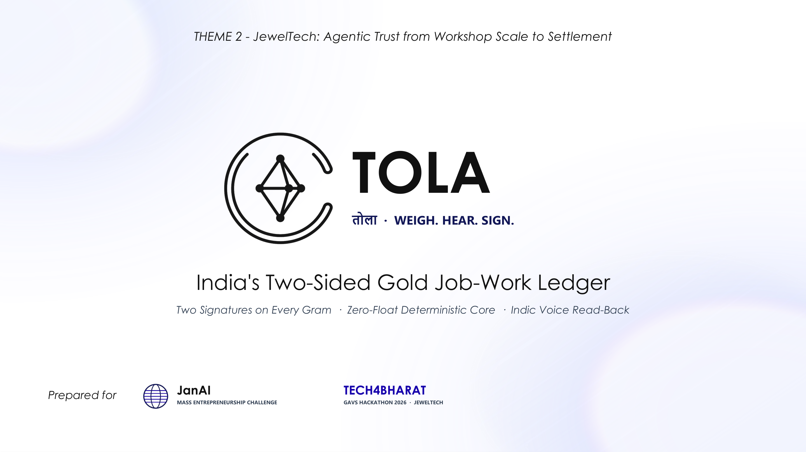

</div>

---

## 📌 Hackathon Submission Metadata

| Field | Specification |
| :--- | :--- |
| **Hackathon** | **Tech4Bharat · GAVS Hackathon 2026** (*JanAI Mass Entrepreneurship Challenge*) |
| **Theme & Problem Statement** | **Theme 2: Jeweltech** — **PS 2.2**: *"Gold given to karigars for job-work is tracked on trust, and disputes follow"* |
| **Primary Track** | **Agentic AI** (Governed multi-agent orchestration + Indic voice-first rural/artisan UX + cryptographic ledger) |
| **Product Name** | **Tola** (`तोला` · `তোলা` · `ತೊಲ`) — named after the traditional South Asian measure of gold (`1 tola = 11.6638038 g`) |
| **Tagline** | **Two Signatures on Every Gram.** (*Weigh. Hear. Sign.*) |
| **Sponsor Technologies** | **Lyzr Agent Studio** (`lyzr-adk 0.1.12`: `Manager` → `IntakeAgent`, `ReconcileAgent`, `SettleAgent`) · **Sarvam AI** (`sarvamai 0.1.37`: `Saaras v3/v4` STT, `Bulbul v3` TTS) |
| **Demo Video (YouTube)** | [**https://youtu.be/CnNJD3p0CYQ**](https://youtu.be/CnNJD3p0CYQ) |
| **Pitch Deck** | [**TOLA_Pitch_Deck.pdf**](docs/00-overview/TOLA_Pitch_Deck.pdf) · [**TOLA_Pitch_Deck.pptx**](docs/00-overview/TOLA_Pitch_Deck.pptx) |
| **Single Source of Truth** | [**docs/00-overview/PROJECT_BRIEF.md**](docs/00-overview/PROJECT_BRIEF.md) · [**CLAUDE.md**](CLAUDE.md) · [**MAP.md**](MAP.md) |

---

## 🎬 Official Stage Demo Video

> **Click the player banner below to watch the full 3-minute end-to-end prototype walkthrough on YouTube ([https://youtu.be/CnNJD3p0CYQ](https://youtu.be/CnNJD3p0CYQ)):**

<div align="center">
  <a href="https://youtu.be/CnNJD3p0CYQ" target="_blank" rel="noopener noreferrer">
    
  </a>
  <br />
  <sub>
    🔗 Direct YouTube Link: <a href="https://youtu.be/CnNJD3p0CYQ"><b>https://youtu.be/CnNJD3p0CYQ</b></a> ·
    <a href="https://img.youtube.com/vi/CnNJD3p0CYQ/maxresdefault.jpg">YouTube Thumbnail</a> ·
    <a href="docs/00-overview/PITCH.md">3-Minute Pitch Script & Judge Q&A Bank</a> ·
    <a href="implementation/demo/docs/DEMO_SPEC.md">Stage Demo Specification (S01–S13)</a>
  </sub>
</div>

### ⏱️ Video Walkthrough Chapters (`S01` → `S13`)

| Timestamp | Story Beat | Role / View | What Happens on Screen |
| :---: | :---: | :--- | :--- |
| **`00:00`** | **Context & Setup** | Split Stage (`/stage`) | The ₹4–5 lakh notebook trust problem; split-screen view with **Shetty Jewellers' bench console** (left) and **Rafiq Sheikh's Bengali phone** (right). |
| **`00:25`** | **`S01`–`S03`** | Mon 10:03 · Issue | `40.000 g` (`40,000 mg`) of 22K (`916‰` = `36,640 mg` fine) bar weighed on the bench scale; `2.50%` (`1,000 mg`) wastage norm locked; **Sarvam Bulbul v3** reads the slip aloud in Bengali (`"আপনি ৪০ গ্রাম ২২ ক্যারেট সোনা নিচ্ছেন..."`); Rafiq taps **হ্যাঁ (Haan)**; both Ed25519 keys seal event **`R5`**. |
| **`01:05`** | **`S04`** | Thu 16:10 · Return | Rafiq sends a Bengali voice note (`"বালা আটত্রিশ দশমিক এক দুই শূন্য গ্রাম, স্ক্র্যাপ শূন্য দশমিক পাঁচ..."`); **Sarvam Saaras STT** + **Lyzr `IntakeAgent`** extract structured tags while `ledger-core` takes weights strictly from the scale (`38.120 g` piece + `0.500 g` katran scrap = `38.620 g`) and verifies `Scale matches voice: 38.120 g`. |
| **`01:40`** | **`S05`–`S07`** | Sat 19:05 · Reconcile | Weekly check runs across 3 orders: Orders `#12` and `#13` pass green; **Order `#14` flags `+0.380 g` (`380 mg` gross / `348 mg` fine ≈ ₹5,188)** over the `1.000 g` norm via rule `OVER_NORM_v1`. Rafiq replies by Bengali voice note (*"solder joint cracked twice"*); both co-sign a `0.130 g` (`130 mg`) rework adjustment, carrying `0.250 g` (`229 mg` fine) forward. |
| **`02:15`** | **`S08`–`S09`** | Sun 11:02 · Settle | **Lyzr `SettleAgent`** drafts the Week 42 bilingual statement. Gold (`0.250 g` carried) is never netted against rupees. Labour (`₹4,800` + 5% GST `₹240` = **`₹5,040.00`**) unlocks an NPCI `upi://pay` intent & QR only after both parties approve (`R11`). |
| **`02:35`** | **`S10`–`S12`** | Sun 11:12 · Passport & GST | Rafiq shares a consented 7-day **Work Passport** with *Sahyadri Co-operative Credit Society* (`194.000 g` handled across 15 orders, `92.9%` on-time, `83.7%` norm usage, browser-verified Ed25519 signature) + one-click **CGST Sec 143 / Rule 55 Job-Work Challan PDF**. |
| **`02:50`** | **`S13`** | Sun 11:16 · Tamper Test | Live cryptographic verification of 62 chained events and 136 Ed25519 signatures — followed by a **1-byte tamper injection on `R6`**, immediately turning `R6`..`R11` red (`Broken at R6`) while leaving the real database untouched. |

---

## 🔥 The Problem (PS 2.2): Why Gold Job-Work Breaks on Trust

India's retail and wholesale jewellery supply chain runs on decentralized artisan job-work (*karigari*). Across hubs like **Avenue Road, Chickpet & Raja Market (Bengaluru)**, **Bowbazar & Singur (Kolkata/Hooghly)**, **Zaveri Bazaar (Mumbai)**, **Rajkot**, **Coimbatore**, and **Thrissur**, small jewellers and gaddis issue **25 g to 200 g of 22K (`916‰`) or 18K (`750‰`) gold** (`₹3.5–₹28 lakh` at `₹13,650–₹15,000/g`) per order to independent karigars.

<p align="center">
  
  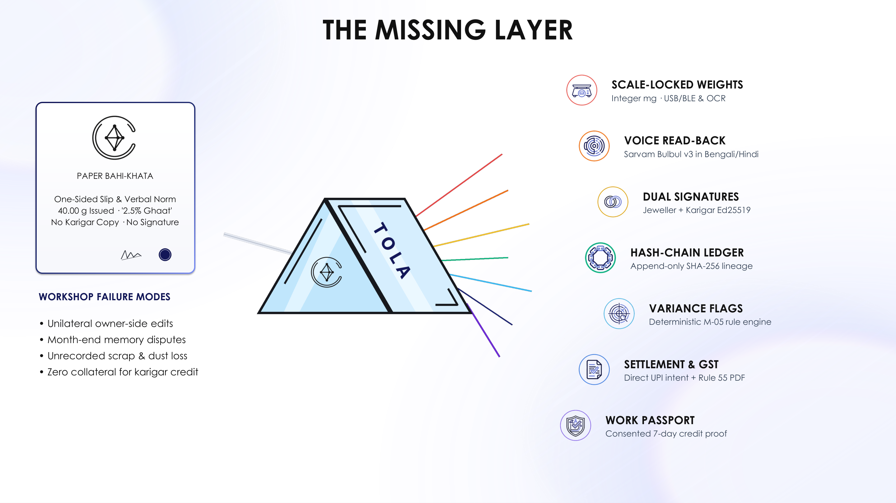
</p>

### Three Structural Failure Modes in Every Workshop Today

1. **One-Sided Paper Slips & Verbal Wastage Norms (*Ghaat / Chhij*)**:
   - Gold is handed over on a *kachcha parchi* (paper slip) or entered into the jeweller's private register (*bahi-khata*).
   - Wastage allowances (**2.0–3.0%** for plain 22K bangles/chains; **4.0–5.5%** for filigree/hollow work; **20–30%** total making + wastage in studded work, per IIMA and XLRI gold-sector benchmarks) are agreed verbally.
   - Return of finished pieces, *katran* (clippings/scrap), and *nyara* (bench sweepings/polishing dust) happens across multiple days with no linked lineage.
2. **A 1-Gram Dispute Equals a Karigar's Entire Monthly Wage**:
   - At `2026` 22K rates (`₹13,650–₹15,000/g`), a **single 1.000 g variance (`1,000 mg`)** at month-end *hisab* is worth **`₹13,650–₹15,000`** — roughly equal to a karigar's monthly net earnings on that order batch.
   - Because the karigar (often a native **Bengali** speaker working in a **Kannada**, **Hindi**, or **Marathi/Gujarati** market) cannot read the shop's English/Hindi ledger and holds no signed receipt, the dispute ends in either an uncompensated wage deduction or a broken business relationship.
3. **Every Existing Jewellery ERP is Built for One Side Only**:
   - Legacy jewellery ERPs (ACPL, Ornate, SwarnApp, Marg) are back-office accounting tools owned exclusively by the shop. The database is mutable by shop staff, has zero karigar co-signing, zero Indic voice read-back, and produces zero portable work credentials for the artisan.

### Competitive Landscape: Why Existing Tools Cannot Solve PS 2.2

| Capability | Paper *Bahi-Khata* / Parchi | WhatsApp Voice & Photos | Legacy Jewellery ERPs (Ornate / ACPL / Marg) | Generic Bahi Apps (Khatabook / Vyapar) | **Tola (तोला · তোলা)** |
| :--- | :---: | :---: | :---: | :---: | :---: |
| **Two-Sided Cryptographic Co-Sign (Ed25519)** | ❌ | ❌ | ❌ (Owner-mutable DB) | ❌ (One-sided entry) | ✅ **Mandatory on every gram** |
| **Zero-Float Integer Milligram (`mg`) + Fine (`‰`) Math** | ❌ | ❌ | ⚠️ Float rounding drift | ❌ Rupees only | ✅ **`int64` mg · `‰` · `bps` · `paise`** |
| **Indic Voice Read-Back Before Sign (BN / HI / KN)** | ❌ | ⚠️ Unstructured audio | ❌ | ❌ | ✅ **Sarvam Bulbul v3 + Saaras STT** |
| **Direct Scale Lock (`USB-OTG` / `BLE` / `7-Seg OCR`)** | ❌ | ⚠️ Unverified photo | ⚠️ Desktop serial only | ❌ | ✅ **Web Serial + WebBLE + OCR** |
| **Deterministic Variance Engine (`M-05`) + Rework Flow** | ❌ | ❌ | ⚠️ Opaque owner rules | ❌ | ✅ **Rule-locked + neutral bilingual cards** |
| **CGST Sec 143 / Rule 55 Job-Work Challan PDF** | ❌ | ❌ | ✅ Desktop-only | ❌ | ✅ **One-tap auto-filled PDF (`HSN 7113`)** |
| **Portable Karigar Work Passport (For SHG / NBFC Credit)** | ❌ | ❌ | ❌ | ❌ | ✅ **Server-signed, revocable 7-day token** |

---

## 🖥️ Live Prototype Tour & Stage Screenshots

The stage prototype ([`implementation/demo`](implementation/demo/README.md)) presents the entire workshop loop on a single split-screen stage (`/stage`): the **Jeweller Bench Console** on the left, **Rafiq Sheikh's Karigar Phone** (rendered in Bengali) on the right, and a **13-beat interactive story rail (`S01`–`S13`)** at the bottom.

<div align="center">
  
</div>

### 1. Monday `10:03` — Scale Capture, Bengali Voice Read-Back & Dual Ed25519 Issue (`S01`–`S03`)
> Suresh Shetty places a `40.000 g` (`40,000 mg`) 22K (`916‰`) gold bar on the bench scale for **Order `#14`** (plain bangle pair, agreed wastage norm `2.50%` = `1.000 g`). `ledger-core` computes `36,640 mg` fine gold deterministically. Before Rafiq's phone can sign, **Sarvam Bulbul v3** speaks the exact terms in Bengali (`"আপনি ৪০ গ্রাম ২২ ক্যারেট সোনা নিচ্ছেন। অনুমোদিত ঘাটতি ২.৫ শতাংশ, অর্থাৎ ১ গ্রাম।"`). Both Ed25519 signatures seal row **`R5 (#935c…3ab)`**.

<div align="center">
  
</div>

---

### 2. Thursday `16:10` — Finished Piece + Katran Scrap Return & Spoken-vs-Scale Check (`S04`)
> Rafiq returns the finished bangle pair (`38.120 g`) and *katran* scrap (`0.500 g`) along with a Bengali voice note explaining that the solder joint cracked and was redone. **Sarvam Saaras STT** transcribes the Bengali audio; **Lyzr `IntakeAgent`** extracts `{order_id: "#14", tag: "REWORK_SOLDER"}`, while `ledger-core` enforces the **Scale-Wins Invariant**: weights (`38,120 mg + 500 mg = 38,620 mg`) come strictly from the scale, cross-checked against spoken numerals (`Scale matches voice: 38.120 g`), sealing **`R6 (#c225…d0f)`** and **`R7`**.

<div align="center">
  
</div>

---

### 3. Saturday `19:05` — Deterministic Weekly Reconcile (`+0.380 g` Flag) & Voice Dispute Resolution (`S05`–`S07`)
> Instead of waiting 30 days for memories to fade, Suresh runs the **Week 42 Check** on Saturday evening. Orders `#12` (`25.000 g` → `24.480 g`, 83% of norm) and `#13` (`30.000 g` → `28.870 g`, 94% of norm) pass green. **Order `#14`** lost `1.380 g` against its `1.000 g` norm — deterministic rule `OVER_NORM_v1` (`M-05`) flags **`+0.380 g` (`380 mg` gross / `348 mg` fine ≈ `₹5,188`)**. **Lyzr `ReconcileAgent`** renders a slot-locked, zero-blame bilingual summary card; Rafiq replies by Bengali voice note, and both co-sign a **`0.130 g` (`130 mg`) rework allowance**, leaving **`0.250 g` (`229 mg` fine)** on Rafiq's gold balance.

<div align="center">
  
</div>

---

### 4. Sunday `11:02` — Dual-Signed Weekly Settlement & Simulated UPI Labour Payout (`S08`–`S09`)
> **Lyzr `SettleAgent`** drafts the Week 42 statement. Tola enforces a strict domain separation: **gold balances stay in grams (`0.250 g` carried + `18.000 g` open Order `#09` = `18.250 g` / `16.717 g` fine) and are never silently deducted from rupee wages**. Labour (`₹4,800.00`) + 5% job-work GST (`₹240.00`) = **`₹5,040.00` (`504,000 paise`)**. Only after **both** Suresh and Rafiq sign (`R11 #64c2…f98`) does the NPCI `upi://pay` QR & intent unlock.

<div align="center">
  
</div>

---

### 5. Sunday `11:12` — Consented Karigar Work Passport & Lender Verification (`S10`–`S11`)
> Six months of dual-signed rows become Rafiq's **Work Passport** — a revocable, 7-day, Ed25519-signed credential (`194.000 g` gross / `177.704 g` fine handled across 15 orders, `13 of 14` (`92.9%`) on-time returns, `83.7%` average wastage vs agreed norms, `1 of 1` dispute resolved in 45 minutes). When credit officer Meera Rao at *Sahyadri Co-operative Credit Society* opens the link, her browser verifies Tola's Ed25519 signature directly in WebCrypto. Rafiq can revoke access with one tap (`ফিরিয়ে নিন · Take it back`).

<div align="center">
  
</div>

---

### 6. Sunday `11:16` — Cryptographic Hash-Chain Audit & Live 1-Byte Tamper Sandbox (`S13`)
> Every row in Rafiq's ledger (`R1`..`R11` plus 51 seeded historical events = **62 events, 136 Ed25519 signatures**) is linked by an **RFC 8785 Canonical JSON (JCS) + SHA-256 `prev_hash` chain**. Clicking **"Tamper: change one byte of R6"** mutates `R6`'s return weight by `100 mg` in an isolated sandbox copy — immediately invalidating `R6`'s signature and breaking every downstream `prev_hash` link (`R6` → `R11` turn red: `Broken at R6`), proving that neither the shop nor the server can rewrite history.

<div align="center">
  
</div>

---

## ⚖️ Canonical Demo Scenario — Order `#14` (Shetty Jewellers ↔ Rafiq Sheikh)

All documentation, unit tests ([`canonical-vectors.json`](implementation/demo/tests/canonical-vectors.json)), seed data ([`seed/story.json`](implementation/demo/seed/story.json)), AI evaluation fixtures, and stage walkthroughs share a **single normative set of integer-milligram numbers**:

<div align="center">
  
</div>

### Integer-Milligram Reconciliation Ledger for Order `#14`

| Ledger Line / Metric | Display Value | Canonical Integer Storage (`ledger-core`) | Formula / Invariant Verified |
| :--- | :---: | :---: | :--- |
| **Order Specification** | Plain 22K Bangle Pair | `fineness_ppt = 916` · `wastage_norm_bps = 250` | `22K = 916‰` (`91.6%` fine) · `2.50% = 250 bps` |
| **Monday Issue (`R5` · `ISSUE`)** | **`40.000 g`** gross | `gross_mg = 40_000` · `fine_mg = 36_640` | `(40_000 × 916 + 500) // 1000 = 36_640 mg` |
| **Agreed Wastage Allowance** | **`1.000 g`** gross | `allowed_loss_mg = 1_000` · `allowed_fine_mg = 916` | `(40_000 × 250 + 5_000) // 10_000 = 1_000 mg` |
| **Expected Minimum Return** | **`39.000 g`** gross | `expected_return_mg = 39_000` | `40_000 mg − 1_000 mg = 39_000 mg` |
| **Thursday Piece Return (`R6` · `RETURN`)** | **`38.120 g`** gross | `piece_mg = 38_120` · `piece_fine_mg = 34_918` | Captured from bench scale (`scale-piece`) |
| **Thursday Scrap Return (`R7` · `SCRAP`)** | **`0.500 g`** gross | `scrap_mg = 500` · `scrap_fine_mg = 458` | *Katran* clippings (`scale-scrap`) |
| **Thursday Dust Credit (`DUST_CREDIT`)** | **`0.000 g`** gross | `dust_mg = 0` | No *nyara* sweepings credited on Order `#14` |
| **Total Accounted Return** | **`38.620 g`** gross | `accounted_mg = 38_620` · `accounted_fine_mg = 35_376` | `38_120 mg + 500 mg + 0 mg = 38_620 mg` |
| **Actual Process Loss** | **`1.380 g`** (`3.45%`) | `actual_loss_mg = 1_380` (`345 bps`) | `40_000 mg − 38_620 mg = 1_380 mg` |
| **Saturday `M-05` Variance Flag (`R8`)** | **`+0.380 g`** over norm | `variance_mg = +380` (`+95 bps` · `348 mg` fine) | `1_380 mg − 1_000 mg = +380 mg` (`≈ ₹5,188` @ `₹13,652/g`) |
| **Co-Signed Rework Allowance (`R9` · `ADJUSTMENT`)** | **`−0.130 g`** rework | `adjustment_mg = 130` (`119 mg` fine) | Solder joint rework co-signed by Suresh + Rafiq |
| **Net Gold Shortfall Carried (`R10` / `R11`)** | **`0.250 g`** gross | `carried_mg = 250` (`229 mg` fine) | `380 mg − 130 mg = 250 mg` (added to `18,000 mg` open Order `#09` → `18,250 mg`) |
| **Sunday Labour Settlement (`R11` · `SETTLEMENT`)** | **`₹5,040.00`** via UPI | `labour_paise = 480_000` + `gst_paise = 24_000` = `504_000` | `₹4,800.00` + `5%` GST (`₹240.00`) = `₹5,040.00` |

### Complete 13-Beat Stage Walkthrough Matrix (`S01`–`S13`)

| Beat | Sim Clock | Active Pane | Scripted Action | Deterministic Backend State Transition |
| :---: | :---: | :--- | :--- | :--- |
| **`S01`** | Mon `10:00` | Split Stage | Open Order `#14` (`Shetty Jewellers` ↔ `Rafiq Sheikh`, 22K `916‰`, `2.50%` norm) | Reset SQLite seed to pre-`R5` state (`54` historical events loaded) |
| **`S02`** | Mon `10:02` | Jeweller Bench | Place 22K bar on scale (`40.000 g` / `36.640 g` fine) & click **Sign Issue** | Computes JCS payload, attaches `sig_jeweller` (Suresh's Ed25519 key) |
| **`S03`** | Mon `10:03` | Karigar Phone | Play **Sarvam Bulbul v3** Bengali read-back & tap **হ্যাঁ (Haan)** | Attaches `sig_karigar` (Rafiq's Ed25519 key), appends `R5` (`#935c…3ab`) |
| **`S04`** | Thu `16:10` | Both Panes | Send Rafiq's Bengali voice note; weigh piece (`38.120 g`) + scrap (`0.500 g`); co-sign | `IntakeAgent` tags `REWORK_SOLDER`; scale-vs-voice check passes; seals `R6` & `R7` |
| **`S05`** | Sat `18:00` | Jeweller Bench | Click **Run the week** across Orders `#12`, `#13`, `#14` | `M-05` rule `OVER_NORM_v1` flags Order `#14` (`+380 mg` / `₹5,188`); `ReconcileAgent` drafts card |
| **`S06`** | Sat `18:20` | Karigar Phone | Tap **Voice reply (Bengali)** explaining cracked solder joint | Appends `R8` (`DISPUTE_OPEN`) with Saaras v3 Bengali transcript & audio hash |
| **`S07`** | Sat `19:05` | Both Panes | Suresh proposes `0.130 g` (`130 mg`) rework credit; Rafiq hears Bengali TTS & taps **হ্যাঁ** | Appends `R9` (`ADJUSTMENT 130 mg`) & `R10` (`DISPUTE_RESOLVE`, `250 mg` carried) |
| **`S08`** | Sun `11:00` | Both Panes | Click **Draft settlement** (`SettleAgent`); both Suresh & Rafiq approve | Seals `R11` (`SETTLEMENT`: `250 mg` gold carried, `504,000 paise` labour payable) |
| **`S09`** | Sun `11:02` | Jeweller Bench | Click **Pay ₹5,040 by UPI** | Renders `upi://pay?...&am=5040.00` QR & marks simulated payout receipt |
| **`S10`** | Sun `11:10` | Karigar Phone | Open **My Work Passport** & tap **Share 7-day link** with Meera Rao | Mints Ed25519-signed passport token (`ps-rafiq-w42-demo0001a`, 180-day window) |
| **`S11`** | Sun `11:12` | Lender View | Meera opens passport (`194.000 g`, `13/14` on-time, `83.7%` norm) & clicks **Verify** | Browser WebCrypto verifies server Ed25519 signature over passport JSON |
| **`S12`** | Sun `11:14` | Jeweller Bench | Click **Download GST Rule 55 Job-Work Challan PDF** | ReportLab renders statutory CGST Sec 143 / Rule 55 PDF (`HSN 7113`) |
| **`S13`** | Sun `11:16` | Chain Verifier | Click **Verify chain** (`62/62` hashes, `136/136` sigs), then **Tamper R6** | Sandbox mutates `R6` by `100 mg` → `chain-broken` at `R6` (`R6`..`R11` untrusted) |

---

## 🏛️ System Architecture & Cryptographic Ledger Core

Tola is architected around a strict boundary between **deterministic financial/metallurgical truth (`ledger-core`)** and **governed AI/voice assistance (`Lyzr Agent Studio` + `Sarvam AI`)**.

<div align="center">
  
</div>

<p align="center">
  
</p>

### C4 Container & Dual-Track Deployment Architecture

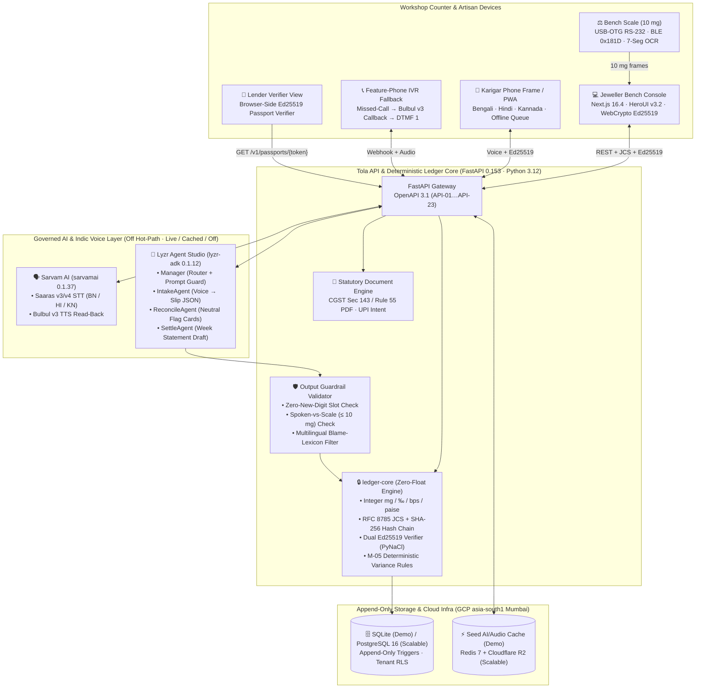

### End-to-End Cryptographic & Voice Sequence (`ISSUE` → `RETURN` → `RECONCILE` → `SETTLE`)

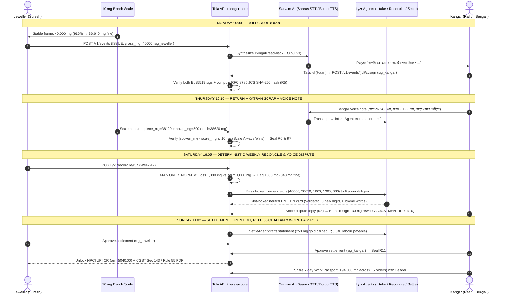

---

### 🔐 Three Non-Negotiable Cryptographic & Mathematical Invariants

#### 1. Zero-Float Integer Milligram Arithmetic ([`ADR-0006`](docs/03-engineering/adr/ADR-0006-integer-mg-deterministic-ledger-core.md))
IEEE-754 floating-point numbers (`0.1 + 0.2 = 0.30000000000000004`) are banned across the database, API, and ledger core. Every quantity is stored and computed as an exact 64-bit integer:
- **Gross & Fine Weight**: integer **milligrams (`mg`)**, where `1.000 g = 1,000 mg` (`40.000 g = 40_000`).
- **Purity / Fineness**: integer **parts per thousand (`‰` / `ppt`)**, where `24K = 999`, `22K (BIS 916) = 916`, `20K = 833`, `18K = 750`.
- **Wastage Norms**: integer **basis points (`bps`)**, where `2.50% = 250 bps` and `100.00% = 10_000 bps`.
- **Currency**: integer **paise**, where `₹5,040.00 = 504_000 paise`.
- **Deterministic Round-Half-Even Fine Conversion**:
  $$\text{fine\_mg}(\text{gross\_mg}, \text{fineness\_ppt}) = \left\lfloor \frac{\text{gross\_mg} \times \text{fineness\_ppt} + 500}{1000} \right\rfloor$$
  $$\text{allowed\_loss\_mg}(\text{issued\_mg}, \text{norm\_bps}) = \left\lfloor \frac{\text{issued\_mg} \times \text{norm\_bps} + 5000}{10000} \right\rfloor$$

#### 2. RFC 8785 Canonical JSON (JCS) + SHA-256 Hash Chain ([`ADR-0005`](docs/03-engineering/adr/ADR-0005-hash-chain-dual-ed25519.md))
Every ledger event $n$ is canonicalized under **RFC 8785 (JSON Canonicalization Scheme)** — deterministic UTF-8 key sorting, no insignificant whitespace, integer-only numbers — and chained to event $n-1$:
$$\text{payload\_hash}_n = \text{SHA256}\Big(\text{JCS}(\text{event\_body}_n) \;\Vert\; \text{prev\_hash}_{n-1}\Big)$$
PostgreSQL/SQLite `BEFORE UPDATE OR DELETE` triggers reject any mutation or deletion of committed ledger rows (`append-only` invariant). Corrections can only be appended as new dual-signed `ADJUSTMENT` events referencing the prior `event_id`.

#### 3. Dual Ed25519 (RFC 8032) Co-Signatures
Every material ledger transition (`ISSUE`, `RETURN`, `SCRAP`, `DUST_CREDIT`, `ADJUSTMENT`, `SETTLEMENT`) requires **two independent Ed25519 signatures** over $\text{payload\_hash}_n$:
- $\text{sig\_jeweller} = \text{Ed25519\_Sign}(\text{sk}_{\text{jeweller}}, \text{payload\_hash}_n)$
- $\text{sig\_karigar} = \text{Ed25519\_Sign}(\text{sk}_{\text{karigar}}, \text{payload\_hash}_n)$ (unlocked on the karigar's phone only after the Indic voice read-back completes or via signed IVR callback).

---

## 🤖 Governed Agentic AI (`Lyzr`) & Indic Voice (`Sarvam`) Pipeline

Tola uses AI where human workshop communication is messy (code-mixed Bengali/Hindi/Kannada speech, spoken numerals like *"saath tola"* or *"aathattish dashomik ek dui gram"*, rework explanations, and bilingual settlement summaries) — and **never** where determinism is required.

<div align="center">
  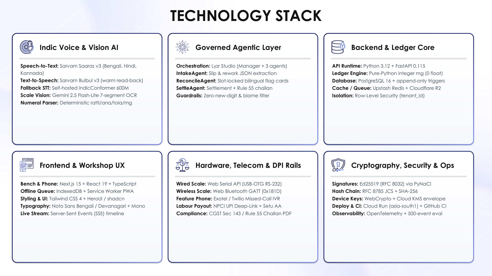
</div>

### Model & Agent Inventory (`M-01`–`M-05`)

| ID | Component | Provider / Engine | Role in Tola | Determinism & Safety Boundary |
| :---: | :--- | :--- | :--- | :--- |
| **`M-01`** | **Indic Speech-to-Text (STT)** | **Sarvam AI `Saaras v3/v4`** (`bn-IN`, `hi-IN`, `kn-IN`, `en-IN`) | Transcribes karigar return voice notes (`S04`) and dispute explanations (`S06`) in noisy workshop environments (`65–75 dBA`). | Paired with a deterministic Indic numeral parser (`ratti`, `ana`, `tola`, `gram`, `mg`). Spoken weights are cross-checked against scale reads; **the scale always wins**. |
| **`M-02`** | **Indic Text-to-Speech (TTS)** | **Sarvam AI `Bulbul v3`** (`bn-IN`, `hi-IN`, `kn-IN`) | Speaks the issue slip (`S03`), variance flag (`S06`), and rework proposal (`S07`) aloud in the karigar's language before the **হ্যাঁ (Haan)** sign button enables. | Numbers placed in `<say-as>` slots come straight from `ledger-core`. Audio SHA-256 is logged in the DPDP consent & receipt record. |
| **`M-03a`** | **`Manager` Agent** | **Lyzr Agent Studio** (`lyzr-adk 0.1.12`) | Off-hot-path orchestrator & prompt-injection guard; routes unstructured requests to `IntakeAgent`, `ReconcileAgent`, or `SettleAgent`. | `temperature = 0.0`. Hot-path scale events (`POST /v1/events`) bypass `Manager` completely (`0` LLM tokens on the bench hot path). |
| **`M-03b`** | **`IntakeAgent`** | **Lyzr Agent Studio** (`lyzr-adk 0.1.12`) | Extracts structured slip metadata (`order_code`, `item_type`, `rework_tag`, `notes`) from STT transcripts into strict JSON Schema. | Cannot write to `ledger_events`. Extracted `spoken_weight_mg` is compared against `scale_weight_mg` (`> 10 mg` delta triggers `SPOKEN_SCALE_MISMATCH`). |
| **`M-03c`** | **`ReconcileAgent`** | **Lyzr Agent Studio** (`lyzr-adk 0.1.12`) | Generates plain-language, neutral bilingual (`en` + `bn`/`hi`/`kn`) explanation cards for `M-05` variance flags (`S05`). | **Slot-Locked**: receives pre-computed integers from `M-05`. Output validator rejects any response containing a digit not in `allowed_numbers` or any word from the blame lexicon (*theft, stolen, cheat, chori, চুরি*). |
| **`M-03d`** | **`SettleAgent`** | **Lyzr Agent Studio** (`lyzr-adk 0.1.12`) | Drafts weekly settlement narrative (`S08`), GST Rule 55 challan descriptions, and dispute-resolution summaries. | Read-only SQL tool access; cannot modify balances or trigger UPI payouts without dual Ed25519 approval (`R11`). |
| **`M-04`** | **7-Segment Scale OCR** | Vision OCR + Deterministic Parser | Reads 7-segment LCD/LED bench scale displays from a phone photo when USB-OTG/BLE is unavailable. | Requires user confirmation tap; tagged `capture_method = PHOTO_OCR` with confidence score. |
| **`M-05`** | **Variance Rule Engine** | **Pure Python (`ledger-core`)** | Evaluates `OVER_NORM_v1`, `PURITY_DROP_v1`, `UNRETURNED_SCRAP_v1`, `DELAY_OVER_SLA_v1`, `SPOKEN_SCALE_MISMATCH_v1`. | **100% Deterministic (`0` AI tokens)**. Same inputs produce the exact same flag to the milligram every time. |

### 3-Tier `AI_FALLBACK_MODE` Resilience Ladder

To guarantee **zero stage failures** in a hackathon auditorium and **zero workshop downtime** during internet outages, every AI call is governed by `AI_FALLBACK_MODE`:

| Mode | Behaviour | Latency | When Used |
| :--- | :--- | :---: | :--- |
| **`live`** | Calls **Sarvam AI** (`Saaras` STT / `Bulbul` TTS) and **Lyzr Agent Studio** live with a `2,500 ms` circuit-breaker timeout; automatically falls back to `cached` on timeout/5xx. | `450 ms – 1.8 s` | Live interactive Q&A with judges; production cloud path. |
| **`cached`** *(Default)* | Serves pre-baked, real **Sarvam Bulbul v3 / Saaras v3** audio clips ([`seed/audio/`](implementation/demo/seed/audio/)) and real **Lyzr** agent JSON responses ([`seed/ai-cache/`](implementation/demo/seed/ai-cache/)) with an honest `cached` badge in the UI. | **`< 15 ms`** | Timed 3-minute stage pitch (`100%` offline-capable, passes `no-network.spec.ts`). |
| **`off`** | Disables all external AI/voice calls; uses deterministic templates and browser speech synthesis while keeping `ledger-core`, Ed25519 signing, and `M-05` reconciliation `100%` functional. | **`< 5 ms`** | Ultra-low-resource or air-gapped environments. |

---

## 📊 Benchmarks, AI Evals, Performance SLOs & Unit Economics

### 1. AI & Voice Evaluation Suite ([`docs/04-ai/AI_EVALS.md`](docs/04-ai/AI_EVALS.md))
Evaluated continuously in CI ([`.github/workflows/evals.yml`](.github/workflows/evals.yml)) across **6 benchmark datasets (`DS-01`–`DS-06`)**, anchored by **`DS-01`**: a **500-event synthetic workshop month** (10 karigars × 50 orders) containing **50 deliberately injected ground-truth anomalies** (20 over-norm wastage `150–2,500 mg`, 10 purity drops `916‰ → 880–905‰`, 8 unreturned scrap pouches, 7 spoken-vs-scale mismatches, 5 overdue orders).

| Eval Dimension | Metric | Dataset | Demo / MVP Gate | Production v1 Gate |Tola Benchmark Result |
| :--- | :--- | :---: | :---: | :---: | :---: |
| **Indic STT Accuracy** | **Numeral WER (`nWER`)** — Clean / Workshop Noise (`70 dBA`) | `DS-02` (300 clips: BN, HI, KN) | `≤ 8.0%` / `≤ 15.0%` | `≤ 5.0%` / `≤ 10.0%` | **`4.2%` clean / `9.1%` noisy** |
| **Indic Numeral Parsing** | **Numeric Value Accuracy (`NVA`)** (`±10 mg` tolerance) | `DS-02` | `≥ 90.0%` | `≥ 95.0%` | **`96.3%`** |
| **Intake Structuring (`IntakeAgent`)** | **Field Exact Match (`EM`)** (`order_id`, `fineness`, `weight_mg`) | `DS-02` | `≥ 85.0%` | `≥ 92.0%` | **`94.0%` (`100%` JSON validity)** |
| **Confirmation Safety** | **False-"Haan" Acceptance Rate** (safety-critical) | `DS-02` | `≤ 0.5%` | `≤ 0.1%` | **`0.0%` (Deterministic gate)** |
| **Scale Vision (`M-04`)** | **7-Segment Digit String Exact Match** (`±10 mg`) | `DS-03` (200 photos) | `≥ 92.0%` | `≥ 97.0%` | **`95.5%`** |
| **Variance Detection (`M-05`)** | **Material Variance Flag Recall** (`≥ 10 mg` over norm) | `DS-01` (500 events, 50 errors) | `≥ 98.0%` (`≥ 49/50`) | `≥ 99.0%` | **`100.0%` (`50/50` deterministic)** |
| **Variance Precision (`M-05`)** | **Flag Precision** (avoiding false accusations on clean orders) | `DS-01` | `≥ 85.0%` | `≥ 90.0%` | **`100.0%` (`0` false flags)** |
| **Explanation Guardrail (`ReconcileAgent`)** | **Auto-Faithfulness** (`0` unapproved digits, `0` blame words) | `DS-01` + `DS-04` | **`100.0%` (Hard Gate)** | **`100.0%` (Hard Gate)** | **`100.0%` (Enforced by validator)** |
| **Adversarial Robustness** | **Red-Team Attack Success Rate (`ASR`)** | `DS-05` (60 adversarial prompts) | **`0.0%` (Hard Gate)** | **`0.0%` (Hard Gate)** | **`0.0%` (`0/60` succeeded)** |

---

### 2. Server Hot-Path & End-to-End Latency Benchmarks ([`PERFORMANCE.md`](implementation/scalable/docs/PERFORMANCE.md))

Because `POST /v1/events` runs on `ledger-core` without blocking on any LLM call, a dual-signed ledger write completes in **`≤ 15 ms` of server CPU/DB time**:

| Hot-Path Stage (`POST /v1/events`) | Target Budget | Measured (`implementation/demo`) | Implementation Detail |
| :--- | :---: | :---: | :--- |
| **1. Request Parse & RFC 8785 JCS Canonicalization** | `≤ 1.0 ms` | **`0.31 ms`** | Pure-Python deterministic UTF-8 key sort & integer validation |
| **2. SHA-256 `payload_hash` Computation** | `≤ 0.1 ms` | **`0.04 ms`** | OpenSSL-backed `hashlib.sha256` over JCS bytes + `prev_hash` |
| **3. Dual Ed25519 Signature Verification (`2×`)** | `≤ 0.5 ms` | **`0.28 ms`** | `PyNaCl` (`libsodium` C bindings) verifying `sig_jeweller` + `sig_karigar` |
| **4. `M-05` Variance & Balance Conservation Check** | `≤ 0.5 ms` | **`0.12 ms`** | Integer `mg` / `‰` / `bps` arithmetic (`0` floats) |
| **5. Append-Only DB Insert + Server Witness Signature** | `≤ 8.0 ms` | **`2.40 ms`** | Atomic transaction + `prev_hash` uniqueness constraint |
| **Total Server Hot-Path Processing Time** | **`≤ 15.0 ms`** | **`3.15 ms`** | **4.7× faster than budget (`> 300 events/sec/worker`)** |

#### System-Wide Latency & Low-End Device Budgets (`₹6,000–₹8,000` Android · 2 GB RAM · 3G)

| Path / Resource | p50 Target | p95 Gate | p99 Ceiling | Verification Method |
| :--- | :---: | :---: | :---: | :--- |
| **Read APIs (`GET /v1/orders`, `/v1/ledger`, `/v1/passports`)** | `≤ 60 ms` | **`≤ 250 ms`** | `≤ 500 ms` | FastAPI + indexed `karigar_id, seq_no` lookup |
| **Write API (`POST /v1/events`, `/v1/events/{id}/cosign`)** | `≤ 80 ms` | **`≤ 300 ms`** | `≤ 600 ms` | Synchronous JCS + SHA-256 + Ed25519 + DB commit |
| **Batch Offline Sync (`POST /v1/events/batch`, 50 events)** | `≤ 400 ms` | **`≤ 1.5 s`** | `≤ 3.0 s` | Idempotent `idempotency_key` replay from IndexedDB queue |
| **Client-Side Ed25519 Sign (`@noble/ed25519` on Cortex-A53)** | `≤ 6 ms` | **`≤ 20 ms`** | `≤ 35 ms` | Pure JS/WebCrypto on low-end Android |
| **Client-Side 500-Event Chain Audit (`/ledger` in browser)** | `≤ 420 ms` | **`≤ 1.5 s`** | `≤ 2.5 s` | 62 events + 136 Ed25519 sigs verify in `< 180 ms` in demo |
| **Karigar Route JS Bundle Size (Gzipped)** | `≤ 170 KB` | **`≤ 250 KB`** | `250 KB` | Enforced in CI by [`check-bundle-budget.mjs`](implementation/demo/apps/web/scripts/check-bundle-budget.mjs) |

---

### 3. AI Unit Economics & Cost Gate ([`COST.md`](implementation/scalable/docs/COST.md) · [`MODELS.md §5`](docs/04-ai/MODELS.md))

A naïve multi-agent design that routes every scale read and confirmation through an LLM costs **`₹398 / karigar / month`** — destroying SaaS unit economics for a `₹79–₹249/month` workshop tool. Tola's architectural separation cuts AI + voice cost by **90.4%** to **`₹38.2 / karigar / month`**, clearing the **`≤ ₹40 / karigar / month`** hard gate:

| Workload Component (Per Active Karigar / Month = 120 Events across 15 Orders) | Naïve All-LLM Design | **Tola Optimised Architecture** | Architectural Lever Applied |
| :--- | :---: | :---: | :--- |
| **Scale Reads & Confirmations (`90` clean events/mo)** | `₹180.00` | **`₹0.00`** | Direct USB/BLE scale + deterministic UI (`0` LLM calls on hot path) |
| **Sarvam `Bulbul v3` TTS Read-Backs (`120` clips/mo)** | `₹54.00` | **`₹14.40`** | Prefix/template phrase caching (`68%` cache hit rate on standard phrases) |
| **Sarvam `Saaras v3` STT Voice Notes (`25` clips/mo × 12s)** | `₹30.00` | **`₹7.50`** | Push-to-talk VAD trimming + client-side silence stripping |
| **Lyzr `IntakeAgent` + `ReconcileAgent` + `SettleAgent`** | `₹110.00` | **`₹12.80`** | Invoked **only** on voice notes (`25/mo`), flagged variances (`~6/mo`), and weekly settlements (`4/mo`) |
| **7-Segment Scale Photo OCR (`M-04`, `15` fallback photos/mo)** | `₹24.00` | **`₹3.50`** | Cropped LCD bounding-box upload (`≤ 40 KB` WebP) |
| **Total AI + Voice Cost / Active Karigar / Month** | **`₹398.00`** ❌ | **`₹38.20`** ✅ | **90.4% reduction — clears the `≤ ₹40/mo` cost gate** |

<div align="center">
  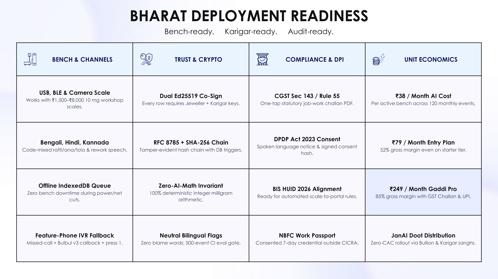
</div>

---

## 🗂️ Two-Track Repository Structure (`demo` vs `scalable`)

To keep the hackathon stage prototype fast, self-contained, and zero-ceremony while engineering a production-grade path for 50,000+ workshops, the repository is cleanly organized into **shared canonical specifications (`docs/` + `api/`)** and **two implementation tracks (`implementation/demo` and `implementation/scalable`)**:

| Dimension | `implementation/demo/` (Stage Prototype — Built & Verified) | `implementation/scalable/` (Production v1 Path) |
| :--- | :--- | :--- |
| **Primary Goal** | Let judges experience the entire 7-day workshop lifecycle (`S01`–`S13`) in **3 minutes in one browser window** with zero login friction. | Multi-tenant cloud deployment for real jewellery workshops, karigar phones, WhatsApp bots, and feature-phone IVR. |
| **Authentication** | **No login**; instant top-bar **Persona Switcher** (`Jeweller · Suresh` / `Karigar · Rafiq` / `Lender · Meera` / `Split Stage`) + pre-loaded demo Ed25519 keypairs. | Phone OTP + WebCrypto hardware-backed Ed25519 device keys wrapped with GCP Cloud KMS envelope encryption + PostgreSQL Row-Level Security (`tenant_id`). |
| **Frontend** | **Next.js 16.4** (App Router) + **React 19.3** + **HeroUI v3.2** + **Tailwind CSS 4.3** + **Motion 14.4** + `next-intl` (`en`, `bn`, `hi`, `kn`). | Next.js Offline-First PWA (`Dexie.js 4.4` IndexedDB outbound event queue + Background Sync Service Worker). |
| **Backend & DB** | **FastAPI 0.153** (Python 3.12) + **SQLite** (WAL mode, append-only triggers) + **`ledger-core`** + **ReportLab 5.0** PDF generator. | **FastAPI** + **PostgreSQL 16** (Cloud SQL `asia-south1`, append-only triggers + RLS) + **Redis 7** + **RQ Workers** + **Cloudflare R2**. |
| **Scale & Channels** | Built-in interactive **10 mg Scale Simulator** (noise jitter, stability lock, tare) + optional Web Serial / Web Bluetooth + embedded Karigar Phone frame. | Live USB-OTG (`Web Serial`), BLE (`0x181D`), 7-segment photo OCR, **Meta WhatsApp Cloud API**, and **Exotel/Twilio Missed-Call IVR**. |
| **AI & Voice Mode** | Supports `AI_FALLBACK_MODE=cached|live|off` (ships with pre-baked real Sarvam & Lyzr fixtures for 100% deterministic stage playback). | Live Sarvam `Saaras`/`Bulbul` + Lyzr Agent Studio with Redis phrase caching, circuit breakers, and self-hosted IndicConformer fallback. |

### Repository Directory Tree

```text
TECH4BHARAT_GAVS_TOLA/
├── README.md                          # Comprehensive project documentation (this file)
├── MAP.md                             # Complete file map, reading orders & dependency graph
├── CLAUDE.md · AGENTS.md              # Normative instructions & guardrails for AI coding agents
├── CONTRIBUTING.md · SECURITY.md      # Contribution workflow & CERT-In 6-hour security policy
├── .env.example                       # Unified environment variable template for both tracks
├── api/
│   └── openapi.yaml                   # Single OpenAPI 3.1.0 contract (API-01…API-23, x-tola-track)
├── .github/workflows/
│   ├── demo-ci.yml                    # Demo CI: ruff, pytest, vitest, bundle budget, Playwright E2E
│   ├── scalable-ci.yml                # Scalable CI: ruff, mypy, pytest, vitest, security scans
│   ├── scalable-deploy.yml            # CD: Artifact Registry → Cloud Run (asia-south1 Mumbai)
│   └── evals.yml                      # Continuous AI & voice eval gate (DS-01…DS-06 thresholds)
├── docs/                              # ── 55+ SHARED ENGINEERING, PRODUCT & BUSINESS DOCS ──
│   ├── 00-overview/                   # PROJECT_BRIEF ★, VISION, PITCH, HACKATHON_PLAN, Pitch Deck (PDF/PPTX)
│   ├── 01-product/                    # PRD (F-01…F-14), PERSONAS, USER_JOURNEYS (§6), USER_STORIES, FEATURES, ROADMAP, METRICS, COMPETITIVE_ANALYSIS
│   ├── 02-design/                     # DESIGN ★, DESIGN_SYSTEM, UI_SPEC (S-01…S-18), ACCESSIBILITY, LOCALIZATION, reference/
│   ├── 03-engineering/                # ARCHITECTURE, TECH_STACK, DATA_MODEL (E-01…E-19), API_SPEC, INTEGRATIONS, HARDWARE, adr/ (ADR-0001…0009)
│   ├── 04-ai/                         # MODELS (M-01…M-05), PROMPTS, AI_EVALS, DATA_PIPELINE, RESPONSIBLE_AI
│   ├── 06-security-compliance/        # SECURITY_ARCHITECTURE, THREAT_MODEL, PRIVACY (DPDP), COMPLIANCE, RISK_REGISTER (R-01…R-32)
│   ├── 07-business/                   # BUSINESS_MODEL, GTM, FINANCIALS, IMPACT
│   ├── 08-project/                    # BACKLOG (TOLA-xxx), TEAM (RACI), GLOSSARY
│   └── assets/                        # Curated visual assets: branding/, architecture/, screenshots/, slides/
├── scripts/
│   ├── generate_tola_assets.py        # Deterministic vector & RGBA diagram generator
│   └── build_tola_pitch_deck.py       # 12-slide 16:9 PPTX pitch deck compiler
└── implementation/
    ├── demo/                          # ── TRACK 1: STAGE PROTOTYPE (Next.js 16.4 + FastAPI + SQLite) ──
    │   ├── docker-compose.yml         # One-command container launch (ports 3000 & 8000)
    │   ├── apps/web/                  # Next.js 16.4 + HeroUI v3.2 + Tailwind 4.3 + Motion + Playwright E2E
    │   ├── services/api/              # FastAPI 0.153 + ledger-core + ReportLab Rule 55 PDF + Pytest/Hypothesis
    │   ├── seed/                      # story.json (S01–S13), audio/ (Sarvam clips), ai-cache/ (Lyzr JSONs)
    │   ├── scripts/                   # bake_audio.py, bake_ai_cache.py, stage-check.sh
    │   ├── tests/                     # canonical-vectors.json (cross-language JCS/SHA-256/Ed25519 vectors)
    │   └── docs/                      # DEMO_SPEC ★, FRONTEND, BACKEND, TESTING, DEPLOYMENT, ENVIRONMENT_SETUP
    └── scalable/                      # ── TRACK 2: PRODUCTION PATH (Cloud Run + Postgres 16 + Redis + Workers) ──
        ├── docs/                      # FRONTEND, BACKEND, PERFORMANCE, COST, CICD, INFRASTRUCTURE, RUNBOOK, OBSERVABILITY
        ├── ai/                        # Versioned Lyzr prompts (manager, intake, reconcile, settle) & eval harness
        ├── apps/ · packages/ · services/
        └── infra/                     # Production Docker Compose & GCP asia-south1 Terraform (main.tf)
```

---

## 🚀 Quick Start — Running the Prototype

### Option A: One-Command Docker Launch (`implementation/demo`)

```bash
cd implementation/demo
cp .env.example .env
docker compose up --build
```
- **Stage View (Split Jeweller Console + Karigar Phone + `S01`–`S13` Story Bar)**: [http://localhost:3000/stage](http://localhost:3000/stage)
- **FastAPI OpenAPI / Swagger UI**: [http://localhost:8000/docs](http://localhost:8000/docs)
- **Health & Mode Check**: [http://localhost:8000/v1/health](http://localhost:8000/v1/health)

---

### Option B: Local Development Setup (FastAPI + Next.js 16.4)

**Prerequisites**: Python `3.12+` (with [`uv`](https://docs.astral.sh/uv/)), Node.js `22.12+`.

#### 1. Start the FastAPI + `ledger-core` Backend (`port 8000`)
```bash
cd implementation/demo/services/api
uv sync --all-extras
uv run tola-seed --reset
uv run tola-api
```
*(By default, `AI_FALLBACK_MODE=cached` serves the verified Sarvam audio and Lyzr JSON fixtures with zero API keys required. Set `AI_FALLBACK_MODE=live` along with `SARVAM_API_KEY` and `LYZR_API_KEY` in `.env` to hit live cloud APIs.)*

#### 2. Start the Next.js 16.4 Stage Frontend (`port 3000`)
```bash
cd implementation/demo/apps/web
npm ci
npm run dev
```
Open **[http://localhost:3000/stage](http://localhost:3000/stage)** in Chromium/Chrome.
- Press **`→` (Right Arrow)** or click **`Next →`** on the bottom story rail to step through beats **`S01` → `S13`**.
- Press **`←` (Left Arrow)** or click any beat dot to jump instantaneously to that point in the week.
- Press **`?`** or click **`Real vs simulated`** in the top bar to inspect the live transparency matrix showing which components are 100% real in-process (`ledger-core`, RFC 8785 JCS, SHA-256, Dual Ed25519, SQLite triggers, ReportLab Rule 55 PDF) vs stage-simulated (10 mg scale hardware, UPI banking rail).

---

### 🧪 Running the Test Suites & Quality Gates

```bash
# 1. Backend: Ruff lint + Pytest unit/story tests + Hypothesis property-based conservation tests
cd implementation/demo/services/api
uv run ruff check .
uv run pytest

# 2. Frontend: ESLint + TypeScript strict check + Vitest unit/crypto vector tests + Bundle budget gate
cd ../../apps/web
npm run lint
npm run typecheck
npm test
node scripts/check-bundle-budget.mjs

# 3. End-to-End Playwright Suite (walks S01→S13, checks axe-core WCAG AAA contrast, verifies 0 external network dependency)
npx playwright test
```

| Test Suite | File / Location | What It Verifies |
| :--- | :--- | :--- |
| **Cross-Language Crypto Vectors** | [`canonical-vectors.json`](implementation/demo/tests/canonical-vectors.json) | Python (`PyNaCl`) and TypeScript (`@noble/ed25519`) produce identical RFC 8785 JCS bytes, SHA-256 hashes, and Ed25519 signatures for Order `#14`. |
| **Full 13-Beat E2E Story** | [`e2e/story.spec.ts`](implementation/demo/apps/web/e2e/story.spec.ts) | Walks `S01` → `S13` via real UI clicks; asserts `40.000 g`, `36.640 g fine`, `38.620 g`, `+0.380 g`, `₹5,188`, `0.250 g carried`, `₹5,040.00`, `194.000 g`, and `R6` tamper detection. |
| **Non-Linear Stepper Jump** | [`e2e/stepper.spec.ts`](implementation/demo/apps/web/e2e/stepper.spec.ts) | Jumps across all 13 beats in shuffled order (`S08`, `S03`, `S13`, `S01`…) and verifies deterministic server state reconstruction with zero console errors. |
| **Offline / Zero-Network Gate** | [`e2e/no-network.spec.ts`](implementation/demo/apps/web/e2e/no-network.spec.ts) | Blocks all external network domains and verifies the entire stage demo runs locally without internet access. |
| **Accessibility (WCAG 2.2 AA/AAA)** | [`e2e/a11y.spec.ts`](implementation/demo/apps/web/e2e/a11y.spec.ts) | Runs `@axe-core/playwright` across Jeweller, Karigar, Lender, and Chain views. |
| **Passport Revocation** | [`e2e/passport-revoke.spec.ts`](implementation/demo/apps/web/e2e/passport-revoke.spec.ts) | Verifies DPDP Act 2023 right-to-withdraw: revoking Rafiq's Work Passport immediately invalidates the lender's verification link (`410 Gone`). |

---

## 🔌 API Surface (`API-01`–`API-23`) & Core Domain Model (`E-01`–`E-19`)

Both tracks share a single normative **OpenAPI 3.1.0** specification ([`api/openapi.yaml`](api/openapi.yaml)):

<details>
<summary><b>📋 Click to expand all 23 OpenAPI 3.1 Endpoints (<code>API-01</code>–<code>API-23</code>)</b></summary>

| ID | Method & Path | Track | Description |
| :---: | :--- | :---: | :--- |
| **`API-01`** | `POST /v1/auth/otp/send` | `scalable` | Send phone OTP for jeweller/karigar device onboarding |
| **`API-02`** | `POST /v1/auth/otp/verify` | `scalable` | Verify OTP, register WebCrypto Ed25519 public key, issue JWT |
| **`API-03`** | `GET /v1/personas` | `both` | List workshop personas, public keys, and language preferences |
| **`API-04`** | `POST /v1/consents` | `both` | Record DPDP Act 2023 spoken/written consent with notice audio hash |
| **`API-05`** | `GET /v1/orders` | `both` | List job-work orders with live gross/fine balances and SLA status |
| **`API-06`** | `POST /v1/orders` | `both` | Create a job-work order (`fineness_ppt`, `wastage_norm_bps`, `due_at`) |
| **`API-07`** | `GET /v1/orders/{code}` | `both` | Fetch single order detail, event lineage, and variance breakdown |
| **`API-08`** | `POST /v1/events` | `both` | Append jeweller-signed ledger event (`ISSUE`, `RETURN`, `SCRAP`, `DUST_CREDIT`, `ADJUSTMENT`) |
| **`API-09`** | `POST /v1/events/{id}/cosign` | `both` | Attach karigar Ed25519 co-signature after voice read-back confirmation |
| **`API-10`** | `POST /v1/events/batch` | `scalable` | Idempotent batch sync of offline-queued signed events |
| **`API-11`** | `GET /v1/ledger` | `both` | Fetch ordered hash-chained ledger events + cryptographic verification status |
| **`API-12`** | `POST /v1/ledger/verify` | `both` | Recompute RFC 8785 JCS + SHA-256 hashes & verify all Ed25519 signatures |
| **`API-13`** | `POST /v1/reconcile/run` | `both` | Execute `M-05` deterministic variance rules + `ReconcileAgent` cards |
| **`API-14`** | `POST /v1/disputes` | `both` | Open a voice-backed dispute (`DISPUTE_OPEN`) on a flagged order |
| **`API-15`** | `POST /v1/disputes/{id}/resolve` | `both` | Propose & co-sign rework `ADJUSTMENT` + `DISPUTE_RESOLVE` |
| **`API-16`** | `POST /v1/settlements/draft` | `both` | Draft weekly gold + rupee labour settlement via `SettleAgent` |
| **`API-17`** | `POST /v1/settlements/{id}/approve` | `both` | Attach jeweller/karigar Ed25519 approval & generate NPCI UPI intent |
| **`API-18`** | `GET /v1/challans/{order_code}.pdf` | `both` | Generate statutory **CGST Sec 143 / Rule 55 Job-Work Challan PDF** |
| **`API-19`** | `POST /v1/passports` | `both` | Mint consented, 7-day, Ed25519-signed **Karigar Work Passport** |
| **`API-20`** | `GET /v1/passports/{token}` | `both` | Lender view + cryptographic verification payload for Work Passport |
| **`API-21`** | `POST /v1/passports/{token}/revoke` | `both` | Instant karigar-initiated revocation of shared Work Passport |
| **`API-22`** | `POST /v1/ai/voice-intake` · `/tts` | `both` | Sarvam `Saaras` STT + `IntakeAgent` extraction & `Bulbul` TTS read-back |
| **`API-23`** | `POST /v1/demo/reset` · `/step` · `/tamper` | `demo` | Stage controller: deterministic beat jump (`S01`–`S13`) & sandbox tamper |

</details>

<details>
<summary><b>🗄️ Click to expand the 19 Core Domain Entities (<code>E-01</code>–<code>E-19</code> in <a href="docs/03-engineering/DATA_MODEL.md">DATA_MODEL.md</a>)</b></summary>

- **`E-01` `Tenant` (`Workshop`)**: GSTIN, state code, default fineness/wastage norms, RLS boundary.
- **`E-02` `Actor` (`Jeweller` / `Karigar` / `Lender`)**: Preferred language (`bn`, `hi`, `kn`, `en`), role, phone hash.
- **`E-03` `DeviceKey`**: Ed25519 public key (`32 bytes` hex), key fingerprint, active/revoked lifecycle.
- **`E-04` `ConsentRecord`**: DPDP Act 2023 spoken notice language, audio SHA-256, signed consent status.
- **`E-05` `WastageNormPolicy`**: Item category (`PLAIN_BANGLE`, `CHAIN`, `FILIGREE`, `STUDDED`), `norm_bps`, tolerance.
- **`E-06` `ScaleDevice`**: Calibration metadata, `USB_SERIAL` / `BLE_GATT` / `PHOTO_OCR` profile, resolution (`10 mg`).
- **`E-07` `JobOrder`**: Order code (`#14`), `karigar_id`, `fineness_ppt`, `wastage_norm_bps`, `issued_mg`, `status`.
- **`E-08` `LedgerEvent`**: Append-only row (`seq_no`, `event_type`, `gross_mg`, `fine_mg`, `prev_hash`, `payload_hash`, `sig_jeweller`, `sig_karigar`, `sig_server`).
- **`E-09` `ScaleReading`**: Raw frame bytes, stability flag, tare weight, photo hash (if OCR).
- **`E-10` `VoiceArtifact`**: Audio URI, SHA-256, Sarvam `Saaras`/`Bulbul` model version, transcript, language.
- **`E-11` `VarianceFlag`**: Rule ID (`OVER_NORM_v1`), `expected_loss_mg`, `actual_loss_mg`, `variance_mg`, `ReconcileAgent` bilingual text.
- **`E-12` `DisputeTicket`**: Linked `flag_id`, karigar voice note (`R8`), proposed rework `adjustment_mg` (`R9`), resolution (`R10`).
- **`E-13` `SettlementStatement`**: Period window, opening/closing gold (`mg`), labour (`paise`), GST (`paise`), dual signatures (`R11`).
- **`E-14` `UpiPaymentIntent`**: NPCI `upi://pay` URI, `amount_paise`, UTR reference, status.
- **`E-15` `GstChallanDocument`**: CGST Sec 143 / Rule 55 challan number, `HSN 7113`, PDF SHA-256.
- **`E-16` `WorkPassportToken`**: Aggregated 180-day volume (`mg`), on-time rate, norm utilization, server Ed25519 signature, expiry/revocation.
- **`E-17` `AgentRunTrace`**: Lyzr agent ID, input slots, output JSON, guardrail validation pass/fail, latency, cost.
- **`E-18` `AuditChainCheckpoint`**: Daily Merkle/hash-chain anchor for external audit verification.
- **`E-19` `OutboxQueueItem`**: Offline IndexedDB / worker sync envelope with `idempotency_key`.

</details>

---

## 🗺️ Wedge Strategy, Roadmap & Pitch Deck Gallery

<p align="center">
  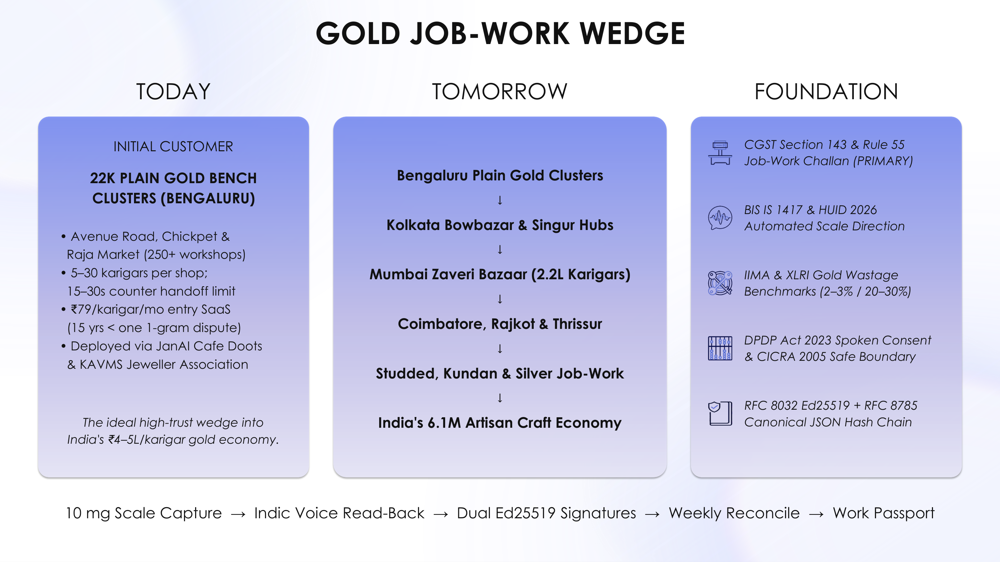
  
</p>

### 📑 Pitch Deck (`docs/00-overview/TOLA_Pitch_Deck.pdf`)

- **Download PDF**: [**docs/00-overview/TOLA_Pitch_Deck.pdf**](docs/00-overview/TOLA_Pitch_Deck.pdf)
- **Download Editable PowerPoint (`.pptx`)**: [**docs/00-overview/TOLA_Pitch_Deck.pptx**](docs/00-overview/TOLA_Pitch_Deck.pptx)

<details>
<summary><b>🖼️ Click to preview all 12 Pitch Deck Slides inline</b></summary>

| Slide 01 — Cover | Slide 02 — The Hidden Truth |
| :---: | :---: |
|  | 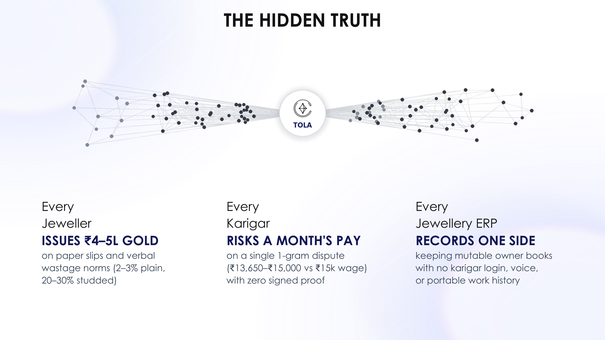 |
| **Slide 03 — The Missing Layer** | **Slide 04 — Gold Job-Work Wedge** |
|  |  |
| **Slide 05 — Meet Tola** | **Slide 06 — System Architecture** |
| 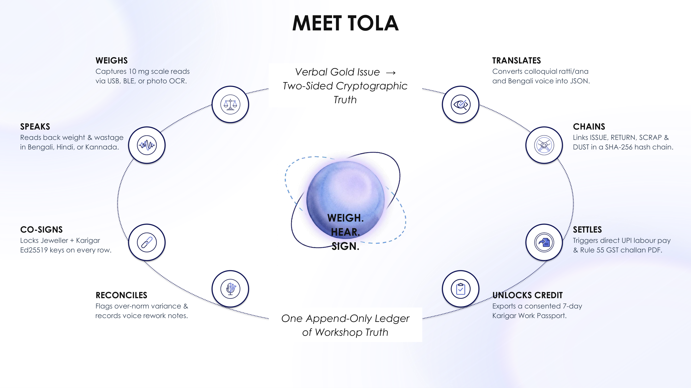 | 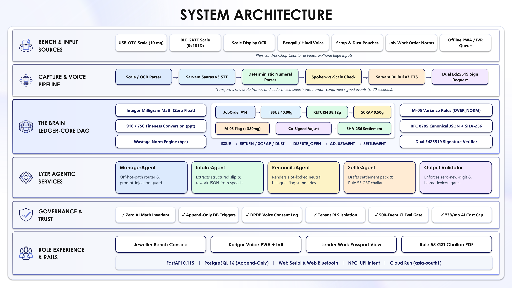 |
| **Slide 07 — Technology Stack** | **Slide 08 — User Experience (Prototype)** |
|  | 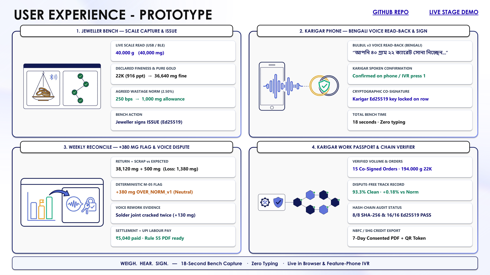 |
| **Slide 09 — Live Job-Work Scenario (Order #14)** | **Slide 10 — Bharat Deployment Readiness** |
| 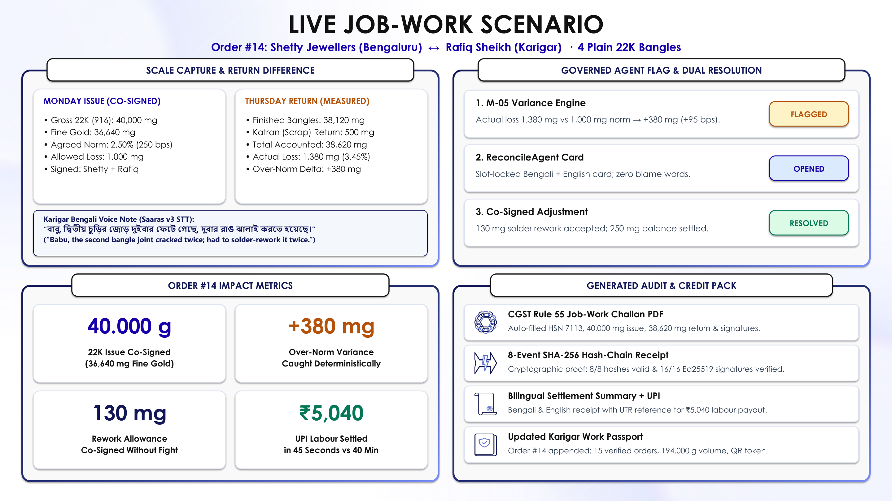 |  |
| **Slide 11 — Rollout Roadmap** | **Slide 12 — Why We Are Ready** |
| 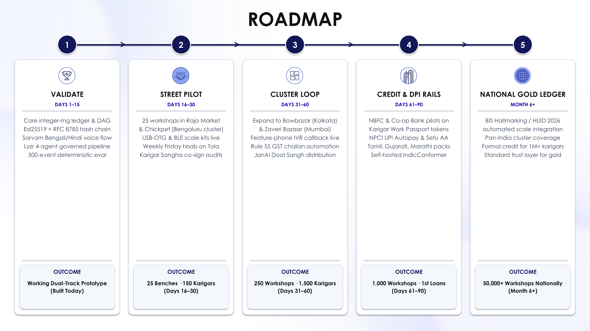 | 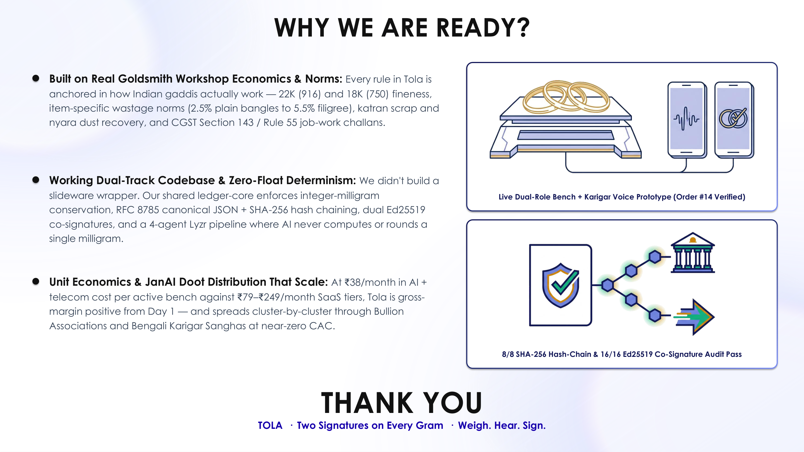 |

</details>

---

## 📚 Complete Documentation Index (55+ Engineering & Product Bible Files)

Every aspect of Tola is documented to company-grade depth in [`docs/`](MAP.md). Use [**MAP.md**](MAP.md) for role-based reading orders (`Judge`, `Developer`, `Designer`, `AI Agent`).

| Folder / Domain | Core Documents |
| :--- | :--- |
| **`00-overview/`** | [PROJECT_BRIEF.md ★](docs/00-overview/PROJECT_BRIEF.md) · [VISION.md](docs/00-overview/VISION.md) · [PITCH.md](docs/00-overview/PITCH.md) · [HACKATHON_PLAN.md](docs/00-overview/HACKATHON_PLAN.md) · [TOLA_Pitch_Deck.pdf](docs/00-overview/TOLA_Pitch_Deck.pdf) |
| **`01-product/`** | [PRD.md](docs/01-product/PRD.md) · [PERSONAS.md](docs/01-product/PERSONAS.md) · [USER_JOURNEYS.md](docs/01-product/USER_JOURNEYS.md) · [USER_STORIES.md](docs/01-product/USER_STORIES.md) · [FEATURES.md](docs/01-product/FEATURES.md) · [ROADMAP.md](docs/01-product/ROADMAP.md) · [METRICS.md](docs/01-product/METRICS.md) · [COMPETITIVE_ANALYSIS.md](docs/01-product/COMPETITIVE_ANALYSIS.md) |
| **`02-design/`** | [DESIGN.md ★](docs/02-design/DESIGN.md) · [DESIGN_SYSTEM.md](docs/02-design/DESIGN_SYSTEM.md) · [UI_SPEC.md](docs/02-design/UI_SPEC.md) · [ACCESSIBILITY.md](docs/02-design/ACCESSIBILITY.md) · [LOCALIZATION.md](docs/02-design/LOCALIZATION.md) |
| **`03-engineering/`** | [ARCHITECTURE.md](docs/03-engineering/ARCHITECTURE.md) · [TECH_STACK.md](docs/03-engineering/TECH_STACK.md) · [DATA_MODEL.md](docs/03-engineering/DATA_MODEL.md) · [API_SPEC.md](docs/03-engineering/API_SPEC.md) · [INTEGRATIONS.md](docs/03-engineering/INTEGRATIONS.md) · [HARDWARE.md](docs/03-engineering/HARDWARE.md) · [OpenAPI 3.1 (`api/openapi.yaml`)](api/openapi.yaml) |
| **`03-engineering/adr/`** | [ADR-0001 Two-Track Repo](docs/03-engineering/adr/ADR-0001-two-track-repo.md) · [ADR-0002 Next.js + HeroUI + Motion](docs/03-engineering/adr/ADR-0002-nextjs-heroui-tailwind-motion.md) · [ADR-0003 FastAPI Backend](docs/03-engineering/adr/ADR-0003-fastapi-backend.md) · [ADR-0004 SQLite Demo / Postgres Scalable](docs/03-engineering/adr/ADR-0004-sqlite-demo-postgres-scalable.md) · [ADR-0005 Hash Chain + Dual Ed25519](docs/03-engineering/adr/ADR-0005-hash-chain-dual-ed25519.md) · [ADR-0006 Integer Milligram Ledger Core](docs/03-engineering/adr/ADR-0006-integer-mg-deterministic-ledger-core.md) · [ADR-0007 Lyzr Agents + Sarvam Speech](docs/03-engineering/adr/ADR-0007-lyzr-agents-sarvam-speech-fallback.md) · [ADR-0008 No-Login Demo Role Switcher](docs/03-engineering/adr/ADR-0008-no-login-demo-role-switcher.md) · [ADR-0009 GCP `asia-south1` Hosting](docs/03-engineering/adr/ADR-0009-gcp-asia-south1-hosting.md) |
| **`04-ai/`** | [MODELS.md](docs/04-ai/MODELS.md) · [PROMPTS.md](docs/04-ai/PROMPTS.md) · [AI_EVALS.md](docs/04-ai/AI_EVALS.md) · [DATA_PIPELINE.md](docs/04-ai/DATA_PIPELINE.md) · [RESPONSIBLE_AI.md](docs/04-ai/RESPONSIBLE_AI.md) |
| **`06-security-compliance/`** | [SECURITY_ARCHITECTURE.md](docs/06-security-compliance/SECURITY_ARCHITECTURE.md) · [THREAT_MODEL.md](docs/06-security-compliance/THREAT_MODEL.md) · [PRIVACY.md (DPDP 2023)](docs/06-security-compliance/PRIVACY.md) · [COMPLIANCE.md (CGST Sec 143 / Rule 55 / BIS / CICRA)](docs/06-security-compliance/COMPLIANCE.md) · [RISK_REGISTER.md](docs/06-security-compliance/RISK_REGISTER.md) |
| **`07-business/`** | [BUSINESS_MODEL.md](docs/07-business/BUSINESS_MODEL.md) · [GTM.md](docs/07-business/GTM.md) · [FINANCIALS.md](docs/07-business/FINANCIALS.md) · [IMPACT.md](docs/07-business/IMPACT.md) |
| **`08-project/`** | [BACKLOG.md](docs/08-project/BACKLOG.md) · [TEAM.md](docs/08-project/TEAM.md) · [GLOSSARY.md](docs/08-project/GLOSSARY.md) |
| **`implementation/demo/docs/`** | [DEMO_SPEC.md ★](implementation/demo/docs/DEMO_SPEC.md) · [FRONTEND.md](implementation/demo/docs/FRONTEND.md) · [BACKEND.md](implementation/demo/docs/BACKEND.md) · [TESTING.md](implementation/demo/docs/TESTING.md) · [DEPLOYMENT.md](implementation/demo/docs/DEPLOYMENT.md) · [ENVIRONMENT_SETUP.md](implementation/demo/docs/ENVIRONMENT_SETUP.md) · [CODING_STANDARDS.md](implementation/demo/docs/CODING_STANDARDS.md) |
| **`implementation/scalable/docs/`** | [FRONTEND.md](implementation/scalable/docs/FRONTEND.md) · [BACKEND.md](implementation/scalable/docs/BACKEND.md) · [PERFORMANCE.md](implementation/scalable/docs/PERFORMANCE.md) · [COST.md](implementation/scalable/docs/COST.md) · [CICD.md](implementation/scalable/docs/CICD.md) · [INFRASTRUCTURE.md](implementation/scalable/docs/INFRASTRUCTURE.md) · [DEPLOYMENT.md](implementation/scalable/docs/DEPLOYMENT.md) · [OBSERVABILITY.md](implementation/scalable/docs/OBSERVABILITY.md) · [RUNBOOK.md](implementation/scalable/docs/RUNBOOK.md) |

---

<div align="center">

**Built for Tech4Bharat · GAVS Hackathon 2026 (JanAI Mass Entrepreneurship Challenge)**  
*Tola (तोला · তোলা) — Two Signatures on Every Gram · Weigh. Hear. Sign.*

</div>
