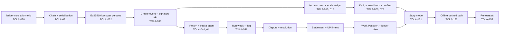

# Hackathon Plan
> Project: Tola · Owner: Field + pitch lead (FP) · Status: Draft v0.1 · Last updated: 2026-10-20
> Related: [Project Brief](PROJECT_BRIEF.md) · [Pitch](PITCH.md) · [Backlog](../08-project/BACKLOG.md) · [Team](../08-project/TEAM.md) · [Demo spec](../../implementation/demo/docs/DEMO_SPEC.md) · [Risk register](../06-security-compliance/RISK_REGISTER.md) · [AI evals](../04-ai/AI_EVALS.md)

**Goal:** win Theme 2 (Jeweltech, PS 2.2) at the **27 Dec 2026** offline final with a working demo, and leave with one pilot jeweller and a co-op bank conversation.

**Ground rules:**
- Dates are IST.
- Ticket IDs (TOLA-xxx) and sprint names come from [BACKLOG.md](../08-project/BACKLOG.md). If this file and the backlog disagree on a ticket, the backlog wins.
- Canonical demo numbers are in [PROJECT_BRIEF §2](PROJECT_BRIEF.md).

---

## 1. Timeline at a glance

```mermaid
gantt
  title Tola: 20 Oct to 27 Dec 2026
  dateFormat  YYYY-MM-DD
  axisFormat  %d %b
  section Idea round
  Rules email + accounts           :a1, 2026-10-20, 3d
  Field interviews (3 J + 5 K)     :a2, 2026-10-25, 15d
  Ledger core + chain spike        :a3, 2026-10-23, 21d
  Idea submission (15 Nov 23:59)   :milestone, m1, 2026-11-15, 0d
  Buffer + backlog grooming        :a4, 2026-11-16, 7d
  Shortlist (23 Nov)               :milestone, m2, 2026-11-23, 0d
  section Prototype (3 weeks)
  W1 ledger, signing, scale issue  :b1, 2026-11-23, 7d
  W2 voice, return, reconcile      :b2, 2026-11-30, 7d
  W3 settle, UPI, passport, story  :b3, 2026-12-07, 9d
  Prototype submission (15 Dec)    :milestone, m3, 2026-12-15, 0d
  section Pilot + polish
  Pilot week (1 J + 3 K)           :c1, 2026-12-16, 7d
  Polish + motion + a11y           :c2, 2026-12-16, 7d
  Demo freeze (22 Dec)             :milestone, m4, 2026-12-22, 0d
  Rehearsals                       :c3, 2026-12-23, 4d
  AMA (24 Dec 17:00)               :milestone, m5, 2026-12-24, 0d
  Final (27 Dec)                   :milestone, m6, 2026-12-27, 0d
```

| Phase | Dates | Exit gate |
|---|---|---|
| **Idea round** | 20 Oct – 22 Nov | Submission sent by **15 Nov 23:59**; at least **3 jeweller + 5 karigar** interviews logged (stretch: 15, per TEAM.md); `pnpm dev` and `uvicorn` both start; ledger core and chain pass unit tests |
| **Prototype W1** | 23 – 29 Nov | An ISSUE event from a simulated scale reading is signed by both personas |
| **Prototype W2** | 30 Nov – 6 Dec | "Run week" produces the +380 mg flag on Order #14; the karigar hears the read-back in Bengali |
| **Prototype W3** | 7 – 15 Dec | Full 3-minute story runs end to end in `live` and `cached` modes; **prototype submitted 15 Dec** |
| **Pilot + polish** | 16 – 22 Dec | Pilot shop logs ≥ 30 dual-signed events; **demo freeze 22 Dec** |
| **Rehearsal** | 23 – 26 Dec | 10 consecutive clean runs under 3:00 (TOLA-153); backup video done (TOLA-154) |
| **Final** | 27 Dec, 09:00–18:00, Bangalore Palace | Demo delivered; Q&A survived |

---

## 2. Team roles (4)
Role codes match [TEAM.md](../08-project/TEAM.md). Names are to be filled by **1 Nov 2026** (owner: FP).

| Code | Role | Owns | On stage (27 Dec) |
|---|---|---|---|
| **FE** | Front end + design | Design system, Next.js 16 app, role switcher, story mode, motion, a11y, i18n frame | Drives the laptop |
| **BE** | Back end + crypto | `api/openapi.yaml`, FastAPI, `ledger-core`, Ed25519 + SHA-256 chain, reconciliation, settlement, UPI intent, GST draft, CI, hosting | Backup laptop with `docker compose`; backup presenter |
| **AI** | AI + voice | Lyzr agent graph (M-03), Sarvam STT/TTS (M-01, M-02), read-back templates, cached fallback, evals, karigar confirm and dispute-voice screens | Watches the AI-mode chip; flips to `cached` |
| **FP** | Field + pitch | Field interviews, wastage-norm validation, seed story, copy review, CA review, compliance notes, submissions, deck, rehearsals, Q&A, logistics | Presents |

---

## 3. Idea round (20 Oct – 22 Nov): day by day

| Date | FE | BE | AI | FP |
|---|---|---|---|---|
| Tue 20 Oct | Read DESIGN.md; scaffold web shell (TOLA-002) | Repo scaffold (TOLA-001), API skeleton (TOLA-003) | Sarvam + Lyzr accounts; API keys into the secret store | **Send the rules email (§9)**; register the team on HackCulture |
| Wed 21 – Fri 23 Oct | Tokens, fonts, i18n frame | `ledger-core` integer-mg arithmetic (TOLA-030) | Bengali numeral spike: Saaras on 20 spoken weights | Interview guide (§3.1); book 3 jewellers on Avenue Road / Chickpet via KAVMS or walk-ins |
| Sat 24 – Sun 25 Oct | Issue-screen wireframe in code | Canonical serialisation + SHA-256 chain (TOLA-031) | Bulbul read-back test in bn/hi/kn | **Interviews: jewellers 1–2** |
| 26 Oct – 1 Nov | Karigar phone screen mock (Haan / Na) | Unit tests on the Order #14 arithmetic (1,000 / 1,380 / +380 mg) | Lyzr Intake agent prototype on 10 sample transcripts | **Interviews: karigars 1–3, jeweller 3**; collect consented 15-second clips |
| 2 – 8 Nov | Landing page (S-01) for the submission screenshots | Ed25519 sign/verify spike (`@noble/ed25519` ↔ PyNaCl) | Agent graph diagram for the submission | **Interviews: karigars 4–5**; validate wastage norms (TOLA-162); price ladder |
| 9 – 12 Nov | Screens for the deck | Architecture diagram | Eval plan summary | Write the brief + detailed explanation (TOLA-161); deck draft |
| 13 Nov | Team review of the submission | ← | ← | ← |
| **Sat 14 Nov** | Final proofread | Repo public / README | — | Submit **a day early**: brief, detailed explanation, deck, GitHub link |
| **Sun 15 Nov 23:59** | — | — | — | **Hard deadline** (only fixes) |
| 16 – 22 Nov | Story-mode skeleton | Freeze OpenAPI draft (TOLA-004 prep) | Cached-audio list | Groom the backlog; line up the pilot shop for 16–22 Dec |

### 3.1 Field interviews: 3 jewellers + 5 karigars (minimum), by 10 Nov
- **Consent:** spoken consent in the interviewee's language, recorded. No names or faces published without separate written consent. Clips are used only for the pitch.
- **Questions for jewellers:**
  1. How do you record issue and return today?
  2. When did you last disagree with a karigar about grams? How much, and how was it settled?
  3. What wastage norms do you agree per order type?
  4. How often do you settle?
  5. **Price ladder:** would you pay ₹49 / ₹79 / ₹99 / ₹149 per active karigar per month for a signed weekly ledger?
  6. Would you let the karigar see his own account?
  7. Does your balance have a serial or Bluetooth output? Which model?
- **Questions for karigars:**
  1. How many jewellers do you work for, and how much gold do you hold?
  2. How do you know the weight you were given is right?
  3. Last dispute: what happened, and who paid?
  4. How long do you wait for pay?
  5. Would you trust a record the jeweller pays for, if you had your own copy?
  6. WhatsApp, a call, or an app?
  7. Has a bank ever refused you? Do you know PM Vishwakarma?
- **Output:** a 1-page summary per interview, plus baselines for IMPACT IM-02/03/04/07 ([IMPACT.md §5](../07-business/IMPACT.md)). These feed backup slide B9 and Q&A answers.

---

## 4. Prototype round (23 Nov – 15 Dec): three weeks

### 4.1 Critical path



**Anything on this path that slips by more than 1 day triggers the cut list (§6).**

### 4.2 Week by week
| Week | FE | BE | AI | FP | Exit gate (demo) |
|---|---|---|---|---|---|
| **W1** 23–29 Nov | Role switcher (TOLA-150), scale widget (TOLA-010), issue form (TOLA-013) | Freeze OpenAPI (TOLA-004), demo CI (TOLA-005), keys (TOLA-032), event + signature API (TOLA-033), scale ingest (TOLA-011) | Fallback-mode plumbing (TOLA-008), read-back templates per language (TOLA-021) | Seed data and demo endpoints (TOLA-006) with the canonical numbers | Issue 40.000 g → both signatures → chain grows |
| **W2** 30 Nov – 6 Dec | Dashboard (S-03), reconciliation view (S-07), story-mode skeleton (TOLA-151) | Ledger stream + chain status (TOLA-034), run-week endpoint (TOLA-051), disputes API | TTS endpoint (TOLA-020), karigar confirm screen (TOLA-023), voice intake (TOLA-041); deploy (TOLA-007) | Copy review in bn/hi/kn by native speakers; pilot-shop prep | +380 mg flag on Order #14; Bengali read-back plays |
| **W3** 7–15 Dec | Settlement card + UPI QR (S-09), Passport (S-10), lender view (S-11), chain badge + tamper beat (TOLA-035) | Settlement + dual approve, payment intent, GST draft, passport share/revoke | Pre-generated cached audio (TOLA-022), offline path (TOLA-152), MVP eval gate run | Prototype submission write-up; deck v2 with the eval numbers | Full story ≤ 3:00 in `live` and `cached`; **submitted 15 Dec** |

**Capacity warning.** The backlog estimates W1–W3 demo work at about 356 hours (92 + 128 + 136), i.e. roughly 35–48 focused hours per builder per week in W2–W3. That is too much for students in term time ([BACKLOG §2](../08-project/BACKLOG.md)). The plan therefore assumes the cut list in §6 is used.

---

## 5. Pilot week and rehearsal (16–27 Dec)

| Date | What | Who |
|---|---|---|
| 16–22 Dec | **Pilot week:** 1 jeweller + 3 karigars run real issues and returns on the demo build (the shop's own balance is the weight source; Tola records it, R-04). Target ≥ 30 dual-signed events. Daily check-in at 19:00 | FP leads; BE on call for bugs |
| 16–22 Dec | Polish: motion, a11y, visual QA; stability fixes | FE, BE, AI |
| **22 Dec 18:00** | **Demo freeze.** After this only P0 bug fixes, each with a rehearsal after it | All |
| 23 Dec | Rehearsals 1–4 (§7); record the backup video (TOLA-154) | All |
| 24 Dec 17:00 | **AMA.** Ask the questions in §9; adjust the pitch to the announced jury | FP |
| 25 Dec | Rehearsals 5–8, including a forced Wi-Fi failure | All |
| 26 Dec | Rehearsals 9–10 + Q&A drill; pack the kit (§8.3) | All |
| **27 Dec** | **Final** (§7.2) | All |

---

## 6. What's real vs mocked

| Area | Real in the demo | Mocked or simulated (labelled on screen) |
|---|---|---|
| Weight capture | Web Serial reading if a serial balance is connected | Simulated scale widget (default) |
| Read-back | Sarvam Bulbul TTS (live) | Cached audio in `AI_FALLBACK_MODE=cached` |
| Voice intake | Sarvam Saaras STT + Lyzr IntakeAgent | Stored transcripts and drafts in cached mode |
| Signatures + hash chain | **Real** Ed25519 + SHA-256, always (also in cached mode) | — |
| Reconciliation arithmetic | **Real** `ledger-core`, integer mg | — |
| Flag explanation | Lyzr ReconcileAgent | Deterministic template in cached mode |
| Disputes, settlement | Real API and signatures | — |
| UPI | Real `upi://pay` intent string + QR | **No money moves** ("Simulated") |
| Work Passport | Real share, expiry and revoke | **Lender view mocked** ("Mocked lender view") |
| GST | Real Rule 55 challan / labour-invoice PDF | **Draft only**, never filed |
| WhatsApp / IVR | — | On-screen phone frame |
| Login | — | None (role switcher, `NEXT_PUBLIC_DEMO_MODE=true`) |

## 6.1 Cut list (in this order; aligned with [BACKLOG §2](../08-project/BACKLOG.md))
Cut only when the critical path slips more than 1 day. **Never cut:** signatures + chain, the Order #14 arithmetic, the Bengali read-back, dual approval, the cached/offline path.

| Order | Cut | Saves | Story impact |
|---|---|---|---|
| 1 | **TOLA-012** Web Serial reader for a real balance | ~8 h | Use the simulated scale and say so |
| 2 | **TOLA-053** variance anomaly score (M-05 robust z-score) | ~8 h | The rule-based variance flag remains |
| 3 | **TOLA-120** phone-frame WhatsApp simulation | ~8 h | The karigar view stays a web screen |
| 4 | **TOLA-100** light order list with late-risk flags (F-10) | ~4 h | Not in the 3-minute story |
| (backlog total for 1–4) | | **~28 h** | None to the 3-minute story |
| 5 | GST draft PDF (F-09) → show the JSON draft in a sheet | ~4 h | Q&A only |
| 6 | Tamper beat (TOLA-035) → explain with the chain badge | ~4 h | Q&A only |
| 7 | Live Lyzr in the story → cached-only on stage, live shown in a pre-recorded trace | ~8 h | Weakens the Lyzr angle; last resort |

---

## 7. Rehearsal schedule

### 7.1 Rehearsal log (TOLA-153)
| # | Date | Mode | Condition | Pass criteria |
|---|---|---|---|---|
| 1–2 | 23 Dec AM | `live` | Clean | ≤ 3:00; every beat lands |
| 3 | 23 Dec PM | `cached` | Wi-Fi off from the start | ≤ 3:00 |
| 4 | 23 Dec PM | `live` | BE presents (backup presenter) | ≤ 3:00 |
| 5–6 | 25 Dec AM | `live` | Wi-Fi killed at beat 3 → L1/L2 switch | Switch ≤ 15 s; ≤ 3:15 |
| 7 | 25 Dec PM | `live` | Projector at 1024×768; venue-style speaker | Bengali audio audible at the back |
| 8 | 25 Dec PM | Video | L4: narrate over the backup video | ≤ 3:00 |
| 9–10 | 26 Dec | `live` | Full dress rehearsal + 10-minute Q&A drill from [PITCH §6](PITCH.md), with a different archetype each time | 10 consecutive clean runs logged |

### 7.2 Final day: 27 Dec, hour by hour
| Time | Action | Who |
|---|---|---|
| 07:30 | Leave with the kit; tethered hotspot charged | All |
| 08:30 | Check in at Bangalore Palace | FP |
| 08:45 | Set up both laptops; `docker compose up`; `GET /v1/health`; `POST /v1/demo/reset`; audio check | BE, AI |
| 09:00 | Opening; find our slot and room; test the venue projector and HDMI | FP, FE |
| 09:30 – slot | Two silent run-throughs on the stage laptop, `cached` mode | FE, AI |
| T−30 min | Pre-flight checklist ([PITCH §5](PITCH.md)) | BE |
| T−10 min | Decide live vs cached based on venue Wi-Fi (test 3 Sarvam calls; any > 3 s → cached) | AI |
| T | **3-minute pitch + demo** | FP presents, FE drives |
| T+3 | Q&A: FP answers; hands technical questions to BE/AI by name | All |
| After | Note every question asked; update the Q&A bank | FP |
| Afternoon | Talk to KAVMS jewellers and co-op bankers at the summit; collect contacts for the pilot | FP, BE |
| 18:00 | Results | All |

---

## 8. Submission checklists

### 8.1 Mapped to every evaluation criterion
Criteria come from the official FAQ (thegavshackathon.com/faq), summarised in [PROJECT_BRIEF §13](PROJECT_BRIEF.md); the research file `~/hackathons/tech4bharat-gavs-hackathon/biblehackathon.md` sits outside the repo. Weightages are **unknown**.

| Criterion | What we show | Evidence artefact | Idea round (15 Nov) | Prototype (15 Dec) | Final (27 Dec) |
|---|---|---|---|---|---|
| **Technical: architecture** | C4 diagrams; integer-mg ledger; hash chain + two Ed25519 signatures; agent graph with HITL gate | [ARCHITECTURE.md](../03-engineering/ARCHITECTURE.md), slide 5 | Diagram | Repo + diagram | Slide 5 + B7 |
| **Technical: AI quality** | Numeral WER, flag recall and precision, explanation faithfulness, red-team results against the MVP gate | [AI_EVALS.md](../04-ai/AI_EVALS.md) report | Eval plan | First eval report | One number on slide 5; table on B6 |
| **Technical: working prototype** | The story S-01 → S-11 live, and offline | Demo URL + repo + backup video | Screens | Working demo URL | Live demo |
| **Technical: innovation** | First job-work ledger the karigar signs and owns; voice read-back; Work Passport | [COMPETITIVE_ANALYSIS.md](../01-product/COMPETITIVE_ANALYSIS.md) | Gap table | — | "Doesn't exist" line in the pitch |
| **Entrepreneurial: problem relevance** | Field clip; ₹4–5 lakh per karigar; PS 2.2 boundary met | Interview summaries (B9) | ✓ 3 J + 5 K | Pilot shop | Clip at 0:00 |
| **Entrepreneurial: market** | 5 lakh jewellers; 6.1 M workers; SAM ≈ ₹1,070 cr | [FINANCIALS §3.4](../07-business/FINANCIALS.md) | ✓ | ✓ | Q&A |
| **Entrepreneurial: business model** | ₹79–99 per active karigar; lender flat fee per pull; refiner v2; Doot share; karigar free | [BUSINESS_MODEL.md](../07-business/BUSINESS_MODEL.md) | ✓ | ✓ | Slide 6 |
| **Entrepreneurial: scalability** | Karigar-network loop; clusters; cost per karigar ₹147 → ₹46 → ₹42.50 at 100 / 10k / 1M | [GTM.md](../07-business/GTM.md), [COST.md](../../implementation/scalable/docs/COST.md) | ✓ | ✓ | Slide 7 |
| **Entrepreneurial: job creation** | Doot livelihoods; protected karigar income; IM-08 | [IMPACT.md](../07-business/IMPACT.md) | ✓ | ✓ | Close |
| **Constraint: low literacy** | Voice read-back, Haan/Na, numbers spoken | Demo beat 2 | ✓ | ✓ | ✓ |
| **Constraint: limited connectivity** | Offline demo path; offline-first PWA in v1 | TOLA-152 | Plan | ✓ | L2 fallback ready |
| **Constraint: low-cost phones** | 48 px targets; one-screen confirm; ₹6–8k Android target | DESIGN.md | ✓ | ✓ | Q&A |
| **Sponsor: Lyzr visible** | Manager + 3 agents; traces | Slide 5, B7 | Diagram | Live calls | Live + trace |

### 8.2 Idea-round package (15 Nov), per the HackCulture fields
- [ ] **Brief about the idea** (required): the one-liner, the problem in ₹, the two-signature mechanism, the karigar's Passport.
- [ ] **Detailed explanation** (required): problem with sources, solution, architecture, AI design with the "AI never does arithmetic" rule, business model, field evidence, team.
- [ ] **Deck** (optional, do it): 10 slides.
- [ ] **GitHub / research links** (optional, do it): public repo with README and docs.
- [ ] Field evidence: interview count, 2–3 quotes, consent noted.
- [ ] Team names and roles.

### 8.3 Prototype (15 Dec) and final (27 Dec) kit
- [ ] Demo URL live (Vercel + Render) and the local `docker compose` stack on both laptops.
- [ ] Repo: CI green (`demo-ci.yml`), README quick start, eval report.
- [ ] Backup video on 2 USB sticks + both laptops.
- [ ] Deck (PDF + PPTX) on USB.
- [ ] HDMI + USB-C adapters ×2; external speaker; phone hotspot; chargers.
- [ ] Optional: 0.01 g serial balance, tested on 26 Dec; otherwise leave it at home (R-03).
- [ ] Printed one-page arithmetic sheet for Order #14 (for the CA).
- [ ] Letters of interest (pilot shop; co-op bank if obtained) (TOLA-164).

---

## 9. Open questions for the organisers
Email **tech4bharath@rvce.edu.in** on **20 Oct 2026** (owner: FP; TOLA-165). Re-ask at the **24 Dec AMA** whatever is still open.

| # | Question | Why it matters | Due |
|---|---|---|---|
| 1 | **Team size:** the official rules say teams "must have 4 students", HackCulture allows 1–4. Which applies? | Eligibility | Reply by 31 Oct |
| 2 | **IP terms:** who owns the code and idea after submission? Any licence granted to organisers or partners? | We intend to continue as a startup and apply for SISFS | Reply by 31 Oct |
| 3 | **Lyzr credits:** how many per team, when issued, and does the free Build tier cover the final? | AI budget; the cost model assumes free building | Reply by 15 Nov |
| 4 | Evaluation weightages for technical vs entrepreneurial criteria | Time allocation in the pitch | By 23 Nov |
| 5 | Jury composition for the idea round and the final | Tuning the pitch (§1.1 of PITCH.md) | AMA 24 Dec |
| 6 | Is a JanAI Platform / Bazaar sandbox available? | Doot channel story | AMA 24 Dec |
| 7 | Pitch slot length and Q&A length; is a projector + audio provided? | Rehearsal format; Bengali audio | AMA 24 Dec |
| 8 | Can we bring a small electronic balance on stage? | Optional real-scale beat | AMA 24 Dec |
| 9 | Is a Lyzr-specific prize or track offered? | Sponsor angle | AMA 24 Dec |

**Draft email (send today):**
> Subject: Tech4Bharat – team-size rule, IP terms and Lyzr credits (Team Tola, PS 2.2)
>
> Dear organisers, we are registering for Theme 2 (PS 2.2). Could you please confirm: (1) whether teams must have exactly 4 students (the rules page) or 1–4 (HackCulture); (2) the IP terms that apply to submitted ideas and code; and (3) the Lyzr credit allocation per team and when it is issued? Thank you. — [FP name], Team Tola

---

## 10. MVP (hackathon) vs v1 (production)
- **This plan covers the MVP only** → [`implementation/demo`](../../implementation/demo/README.md).
- **v1 (production) starts 28 Dec** → [`implementation/scalable`](../../implementation/scalable/README.md): OTP auth, Postgres, offline PWA, WhatsApp/IVR, PSP, GCP Mumbai. Milestones are in [ROADMAP.md](../01-product/ROADMAP.md) and [GTM §7](../07-business/GTM.md).
