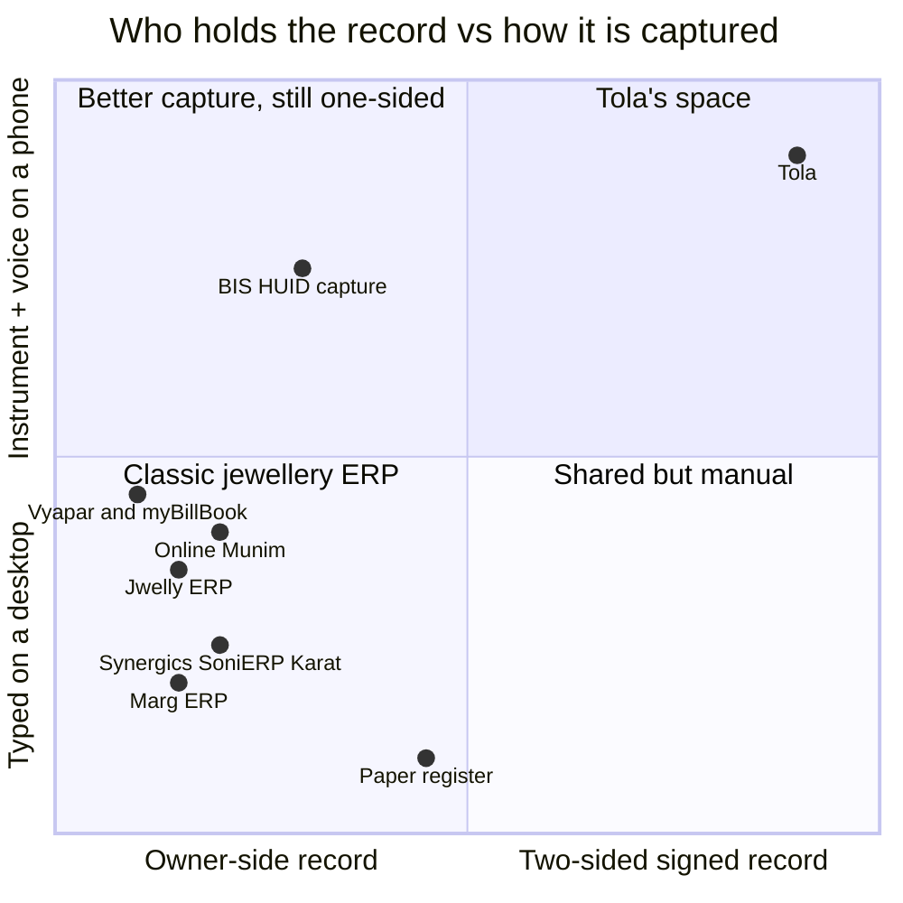

# Competitive Analysis
> Project: Tola · Owner: Product lead · Status: Draft v0.1 · Last updated: 2026-10-20
> Related: [PRD](./PRD.md) · [Personas](./PERSONAS.md) · [Business Model](../07-business/BUSINESS_MODEL.md) · [GTM](../07-business/GTM.md) · [Pitch](../00-overview/PITCH.md) · [Project Brief](../00-overview/PROJECT_BRIEF.md)

**Method.**
- Competitors come from the domain research (`research/domains/jeweltech.md` §3, sources [S25]–[S30]) and the war-room log.
- The web-search budget ran out during research, so funding figures and some prices could not be checked. They are marked **not verified 2026-10-20**.
- Feature claims come from vendor pages or a vendor-authored comparison [S25]. Treat them as vendor claims.
- The "no karigar login" finding comes from published feature lists, not from trials (HUNCH, domain research §1d).
- **Action:** Field/Pitch asks every interviewed jeweller which software they use (by 15 Nov 2026), and requests a trial of Marg and Jwelly to confirm whether a karigar-facing view exists (by 30 Nov 2026).

## 1. The real competitor: the paper register
For most karigar workshops, the incumbent is a register plus slips. The field study describes "a register … of gold inventory received, the weight of jewellery prepared … gold dust collected and gold dust lost", with payment "every week or twice a month" [S17]. It costs nothing and everyone knows how to use it.

What it cannot do:
- give the karigar his own copy;
- prove who wrote a number;
- catch variance before month end ("averaged monthly, so losses can't be traced to a specific karigar or item" [S28]);
- travel with the karigar.

Tola must beat the register on **speed at the counter**: a ≤ 20 s issue including the karigar's confirm.

## 2. Competitor table

### 2.1 India: jewellery ERPs with karigar / job-work modules
| Product | What it does (karigar side) | Price | Funding / company | Mobile / offline | Karigar-facing account? | Weaknesses for PS 2.2 | Source |
|---|---|---|---|---|---|---|---|
| **Marg ERP (Jewellery)** | "Karigar management with issue + receive + wastage + labour bill auto-calc" | ₹12k–50k/yr | Not verified 2026-10-20 | Weak mobile | Not found | Owner-side books; desktop-first | [S25] |
| **Jwelly ERP** | Karigar issue/receive, wastage tracking | ₹15k–75k/yr/shop | Not verified | "Strong offline behaviour with sync"; "mobile app is weaker" | Not found | Owner-side; no dual sign-off | [S25] |
| **Online Munim / OMGold** | Assigns orders to goldsmiths; girvi (gold-loan) module with photos/KYC; HUID field; "bhav cut" exchange | Price on request | Not verified | Cloud-first; site in EN/HI/MR/TA/TE/GU | Not found | Karigar has no account of his own | [S26][S27] |
| **Synergics** | Karigar job-work software; wastage standards; GST job-work invoices; "kundi and bharna" tracking | On quote | Not verified | Not verified | Not found | Aimed at mid/large manufacturers; vendor-defined wastage | [S28] |
| **SoniERP** | Jewellery ERP with karigar/job-work | On quote | Not verified | Not verified | Not found | Same as above | [S29] |
| **Karat ERP** | Jewellery ERP with job-work | From ₹40,000 | Not verified | Not verified | Not found | Same as above | [S29] |
| **Auric Suite** | Jewellery ERP with karigar/job-work | On quote | Not verified | Not verified | Not found | Same as above | [S28][S29] (domain research §3a) |
| **Akrut, Wingold Next, Busy, GoFrugal** | Billing / ERP; some with karigar accounting | ₹9k one-time to ₹2L | Not verified | Desktop / Windows | Not found | Desktop-bound; owner-side | [S25] |
| **SwarnApp** | Jewellery billing / ERP | In the ₹9k–₹2L band | Not verified | "Cloud-only (no reliable offline mode" | Not found | No offline | [S25] |

### 2.2 India: generic and adjacent
| Product | Relevance | Price | Gap for PS 2.2 | Source |
|---|---|---|---|---|
| **Vyapar, myBillBook** | Generic GST billing used by small shops | ₹999–4,999/yr | "no karigar workflows" | [S25] |
| **Rupeek** | Gold loans; "appraisal is done right in front of your eyes"; "5,00,000+ customers across 25+ cities" | Loan product | Lender-side; no karigar work record; a possible **P-04-type reader** of a Work Passport, not a competitor | [S30] |
| **PM Vishwakarma** (Govt) | Goldsmith is one of 18 trades; credit and toolkits; CSC + Aadhaar enrolment | Free (scheme) | Identity and credit hook, but no job-work record. **Complement:** Tola stores the ID (E-03) | [S41] |
| **BIS Care / HUID** (Govt) | Hallmark verification; since Jun 2026 includes photo and auto-captured weight | Free | Different problem (PS 2.1); validates our "weight from the instrument" rule | [S2][S5] |
| **Khata / ledger apps** (e.g. generic udhaar apps) | Two-party money ledgers are familiar to small traders | Free | Not gold-aware (no mg, fineness, wastage norm). Specific products **not researched** (UNKNOWN) | — |

### 2.3 Open source and prior hackathon work
| Repo / project | ★ / status | What it does | Gap | Source |
|---|---|---|---|---|
| rahulmaity0/Inventory-Management | 1 ★ | "Jewellery ledger & inventory backend … transactional issue/receipt ledger" | One-sided; no karigar UX | [S46] |
| santhoshhcodes/Jewellery-erp-suite | 3 ★ | Jewellery ERP (manufacturing, orders) | Owner-side | [S46] |
| omsoni21/jewelsync_ERP | 2 ★ | PHP/MySQL inventory, billing, barcode | No job-work | [S46] |
| EDSTeam/jewellery-erpnext | 2 ★ | ERPNext jewellery app | Owner-side | [S46] |
| KarigarAI-App, karthikj30/Karigar | 3 / 2 ★ | Generic artisan marketplaces | Not goldsmith job-work | [S46] |
| ManakMitra (SIH 2026, SIH26107) | 1 ★ | BIS-services assistant | Different problem (hallmark) | [S44] |

**Read-out.** No open-source project with real traction covers goldsmith job-work ledgers. "Jewellery job work" returns 1 GitHub repo and Kaggle "karigar" returns 0 (ideas file, competition research [E]). PS 2.2 is the least crowded problem statement in the event (about 2% of teams, war-room Round 0).

### 2.4 Global
No global product for two-party goldsmith job-work ledgers turned up in our research. This is **UNKNOWN**: the search budget was exhausted, so absence is not proven. Adjacent patterns we borrow:
- **Regulator-style capture.** BIS's own move to integrated weighing with "disabling manual keyboard entry" [S2].
- **Open BLE scale protocols.** openScale (2,595 ★) [S45].
- **Consent-based data sharing.** The AA/ULI rails in India [S42].

## 3. Positioning map
Placement is our judgement from the feature lists above (HUNCH), not measured.

**Positioning statement.** For jewellers who give gold to karigars on trust, and for the karigars who carry that risk, Tola is the gold job-work ledger that **both sides sign**. Every jewellery ERP keeps the owner's books. Tola gives the karigar his own uneditable copy, catches variance the same week, and turns his history into a record a lender can read.

## 4. Our moat (Thiel)
1. **The secret.** The karigar's record is worth more to him than to the jeweller, because it is his only collateral. New karigars start at 100–250 g until trust is built [S17]. Incumbents sell to the owner and are built for the owner's view. Tola is designed around the party they ignore.
2. **Two-sided network effect.**
   - Karigars work for several jewellers at once [S1].
   - Each karigar onboarded wants his other jewellers on Tola, so that his passport covers all his work.
   - Each jeweller brings 5–20 karigars (war-room, Gary Vee).
   - An ERP's karigar module never leaves one shop.
3. **Signed history accumulates.**
   - A karigar's 26 weeks of counter-signed events cannot be recreated by a competitor.
   - Switching means losing the history, unless it is exported. We commit to export (karigar-owned data), so the moat is the network, not lock-in.
4. **Trust by construction.** Append-only, dual Ed25519 signatures, a hash chain and a karigar-held copy. An ERP that adds a karigar login later still has an owner-editable database underneath. Retrofitting append-only, two-party signing into an existing ERP data model is a rebuild.
5. **Voice-first in the karigar's language.** Bengali-first read-back and confirm, with a numeral eval set for code-mixed speech (Khapra, war-room). This is built for the user ERPs never designed for.
6. **Distribution through the organiser's rails.** JanAI Bazaar and Cafe Doots, paid per verified outcome [B], and the KAVMS jeweller network.

## 5. Why incumbents can't copy fast
| Incumbent move | Why it is hard or slow for them |
|---|---|
| "Add a karigar app" | Their buyer is the owner. A karigar who can dispute and hold an uneditable copy reduces the owner's control, which can annoy their paying customer. It is a positioning conflict, not a feature gap |
| "Add signatures" | Their data model is mutable owner books (edit and delete invoices). Append-only dual signing touches every module |
| "Add Bengali voice" | Their UIs are English/desktop-first and "mobile app is weaker" [S25]. Voice-first for low literacy is a new product surface |
| "Add a credit record" | A record is only credible if the other party co-signed it. One-sided ERP data is the jeweller's claim, not proof |
| "Price lower" | Tola's karigar side is free forever and the jeweller pays per active karigar (HUNCH ₹49–99/month), within the ₹12k–₹2L/yr spend band [S25] |

**Where they could beat us:**
- They already sit on the jeweller's desktop with billing, GST and stock.
- **Mitigation:** Tola is not an ERP (non-goal). It integrates beside one: CA/Tally export (v2) and an ERP import of karigar lists.
- We stay narrow: the two-signature gram.

## 6. Competitive risks to watch
| Risk | Signal | Response | Owner · date |
|---|---|---|---|
| An ERP ships a karigar portal | Release notes from Marg / Jwelly / Online Munim | Lead with dual signatures, voice and the cross-jeweller passport | Product lead · quarterly from Jan 2027 |
| A fintech offers karigar loans with its own data capture | Lender pilots in karigar clusters | Partner as the record provider (P-04); never compete as lender | Field/Pitch · Mar 2027 |
| JanAI Bazaar lists a rival provider | Bazaar catalogue | Win on outcome metrics (days to pay, dispute rate) | Product lead · Mar 2027 |

## Sources
- [S1] PS 2.2.
- [S2] BIS Hallmarking brief.
- [S5] Angel One on BIS Care.
- [S17] IIMA/XLRI report.
- [S25] Codingclave, *Best Jewelry Shop Software India 2026* (vendor-authored): https://codingclave.com/guides/best-jewelry-shop-software-india-2026
- [S26] Online Munim: https://omunim.com/
- [S27] G2 OMGold: https://www.g2.com/products/omgold/discuss
- [S28] Synergics: https://www.synergicssolutions.com/the-jewellery-karigar-software-revolution-mastering-the-art-of-job-work-management-for-the-modern-era
- [S29] TechJockey Karat ERP: https://www.techjockey.com/detail/karat-erp ; GoodFirms SoniERP: https://www.goodfirms.co/software/sonierp
- [S30] Rupeek: https://rupeek.com/
- [S41] PM Vishwakarma.
- [S42] ULI.
- [S44] ManakMitra.
- [S45] openScale.
- [S46] GitHub repos (stars and last push from the GitHub REST API, 2026-10-20).
- [E] `research/E-competition.md` (via ideas file).
- [B] `research/B-sponsors.md`.
