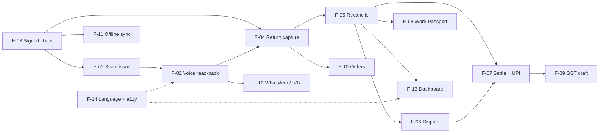

# Features
> Project: Tola · Owner: Product lead · Status: Draft v0.1 · Last updated: 2026-10-20
> Related: [PRD](./PRD.md) · [User Stories](./USER_STORIES.md) · [Project Brief](../00-overview/PROJECT_BRIEF.md) · [Architecture](../03-engineering/ARCHITECTURE.md) · [Hackathon Plan](../00-overview/HACKATHON_PLAN.md) · [Demo build](../../implementation/demo/README.md) · [Scalable build](../../implementation/scalable/README.md)

Feature IDs F-01 to F-14 are frozen in the [Project Brief §5](../00-overview/PROJECT_BRIEF.md). MoSCoW is for the MVP (hackathon).

**Owners** are the four team roles from the brief §13:
- **FE/Design**: front end and design;
- **BE/Crypto**: back end and crypto;
- **AI/Voice**: AI and voice;
- **Field/Pitch**: field work and pitch.

---

## 1. Feature matrix

| ID | Feature | Personas | MoSCoW | MVP? | **Demo implementation** (`implementation/demo`) | **Scalable implementation** (`implementation/scalable`) | Depends on | Owner |
|---|---|---|---|---|---|---|---|---|
| F-01 | Scale-captured issue: weight from the balance, never typed; photo, order type, signed wastage norm | P-01, P-03 | Must | Yes | Simulated scale widget (labelled) + optional **Web Serial** (Chrome) to a real serial balance; bench HX711 rig labelled "not for trade". SQLite. API-05, API-06 | Web Serial + **BLE** + **display OCR (M-04)**; two-person manual fallback; shop's own verified balance (Legal Metrology [S52], R-04) | F-03 (signing), E-05 norms | BE/Crypto (capture), FE/Design (UI) |
| F-02 | Voice read-back and confirm in the karigar's language | P-02 | Must | Yes | Sarvam **Bulbul v3** live (bn/hi/kn), pre-generated audio when `AI_FALLBACK_MODE=cached`; "haan" via Saaras or tap. API-09 | Same + mr/ta; IVR read-back (F-12); per-language numeral evals in `evals.yml` | M-01, M-02, F-14 | AI/Voice |
| F-03 | Dual-signed, SHA-256 hash-chained, append-only event log | P-01, P-02 | Must | Yes | **Real**: `@noble/ed25519` 3.2 in the browser with seeded demo keys; PyNaCl 1.6 verify; live tamper demo. API-06/07/08 | Same on Postgres 16; per-device keys with PIN; key rotation events; nightly full-chain verify job with alerting | — (foundation) | BE/Crypto |
| F-04 | Return capture (piece, scrap, dust); voice note → structured draft (IntakeAgent) | P-02, P-03 | Must | Yes | Lyzr IntakeAgent live via `lyzr-adk` 0.1.12 (gpt-4o-mini); pre-recorded transcripts in cached mode; weight always from the scale. API-10 | Same + duplicate detection over history; WhatsApp voice notes as input (F-12) | F-01, F-03, M-01, M-03 | AI/Voice |
| F-05 | Weekly reconciliation: fine-gold balance, variance vs norm, explained flags | P-01, P-02, P-05 | Must | Yes | **One-click "Run week"** (inline); deterministic `ledger-core` + M-05 rules; ReconcileAgent explanation with number guard. API-11 | **Scheduled** weekly job (Cloud Tasks / RQ + Redis 7); per-helper sub-ledger for P-05; notifications | F-03, F-04, E-05 | BE/Crypto (arithmetic), AI/Voice (explanations) |
| F-06 | Dispute thread: never overwritten; voice replies; two-signature resolution | P-01, P-02 | Must | Yes | Full flow on the Order #14 flag; voice reply via Saaras; Kannada/Bengali text. API-12 | Same + WhatsApp/IVR replies; SLA reminders at 7 and 14 days | F-03, F-05, M-01 | FE/Design + BE/Crypto |
| F-07 | Two-party settlement statement; UPI intent on dual approval | P-01, P-02 | Must | Yes | SettleAgent draft; dual approval; **`upi://pay` link + QR, status `simulated`, labelled "no money moves"**. API-13, API-14 | **PSP** intent/collect (Razorpay/Cashfree/PhonePe PG; choice by 15 Jan 2027) + webhook API-20; payment reconciliation | F-03, F-05, F-06 | BE/Crypto |
| F-08 | Work Passport: consented, time-boxed, revocable summary; no score | P-02, P-04 | Should | Yes | Share link + revoke; **lender view mocked and labelled**. API-15 | Real lender access with audit log; consent artefact; **AA/ULI FIU path in v2** [S42] | F-03, F-05, E-14 | BE/Crypto + Field/Pitch (lender letter) |
| F-09 | GST job-work drafts: Rule 55 challan + 5% labour invoice [S24] | P-01, P-03 | Should | Yes | PDF drafts with "DRAFT, not filed" on every page. API-16 | Same + CA/Tally export (v2) | F-07 | BE/Crypto |
| F-10 | Order and deadline tracker with late-risk flags | P-01 | Could | Light | Static seeded list sorted by occasion date | Live tracker: due ≤ 7 days and no RETURN → "At risk"; v2 lateness forecast from ledger history | E-04, F-04 | FE/Design |
| F-11 | Offline-first PWA and sync | P-05, P-02 | Should | No | Not built (online demo); cached AI path covers stage outages | Service worker + **Dexie 4.4** queue; locally signed events; API-18; fork handling | F-03 | FE/Design + BE/Crypto |
| F-12 | Karigar channel by WhatsApp / IVR | P-02, P-05 | Should | Simulated | **On-screen simulated phone frame**, labelled | **Meta WhatsApp Cloud API** + IVR (Exotel or Sarvam Voice Agents); API-19; PIN-gated delegated signing (Q-6) | F-02, F-03, F-06 | AI/Voice + BE/Crypto |
| F-13 | Jeweller dashboard: balances, open orders, flags, needs-action | P-01, P-03 | Must | Yes | HeroUI v3.2 + Motion 14.4 dashboard on seed data | Same, paginated across shops; first paint ≤ 2.5 s on mid Android/4G | F-03, F-05 | FE/Design |
| F-14 | Language and accessibility: en/hi/kn/bn UI, numbers spoken, 44 px targets | All | Must | Yes | `next-intl` 4.14 with en/hi/kn/bn; speaker button on karigar screens; reduced motion | + mr, ta; IVR for non-readers; usability tests with ≥ 5 low-literacy karigars per release | M-02 | FE/Design + AI/Voice |
| — | Demo harness: role switcher, story mode, seed reset | Presenter, judges | Must (MVP) | Yes | API-02; `NEXT_PUBLIC_DEMO_MODE=true` | **Not shipped** (replaced by OTP auth API-17) | All MVP features | FE/Design |

**MVP build order** (critical path): F-03 → F-01 → F-02 → F-04 → F-05 → F-06 → F-07 → F-13 → F-14 → F-08 → F-09 → harness polish. The cut list is in [HACKATHON_PLAN.md](../00-overview/HACKATHON_PLAN.md) (R-10).

## 2. Dependency graph

## 3. What is real vs simulated in the MVP
| Element | Status in demo | Label shown on screen |
|---|---|---|
| Hash chain, Ed25519 signatures, tamper detection | Real | "Verified" / "Broken at entry N" |
| Reconciliation arithmetic | Real (`ledger-core`, integer mg) | — |
| Lyzr agents, Sarvam STT/TTS | Real when live; cached when `AI_FALLBACK_MODE=cached` | "Live AI" / "Cached AI" chip |
| Scale | Simulated widget, or real balance via Web Serial | "Simulated scale" when simulated |
| UPI | Intent link + QR; no money moves | "Simulated, no money moves" |
| WhatsApp / IVR | Phone frame | "Simulated channel" |
| Lender view | Mocked | "Mocked lender view" |
| GST documents | Drafts | "DRAFT, not filed" |
| People and shops | Seeded, fictional | "Demo data" in the footer |

## 4. Feature flags
Flags are read from one typed config module per app (web: `src/config/flags.ts`; api: `app/config.py`). Where a flag follows an env var already fixed in the brief §10, it is derived from that var; no new env names are introduced. Default values are listed per build.

| Flag key | Controls | Derived from | Demo default | Scalable default |
|---|---|---|---|---|
| `demo.enabled` | Role switcher, story mode, API-02, no auth | `NEXT_PUBLIC_DEMO_MODE` | `true` | `false` |
| `ai.mode` | Live AI / cached fixtures / AI off (deterministic templates) | `AI_FALLBACK_MODE` (`live`\|`cached`\|`off`) | `live` (stage switch to `cached`) | `live` |
| `scale.webSerial` | Web Serial capture | config | `true` (Chrome only) | `true` |
| `scale.ble` | Web Bluetooth capture | config | `false` | `true` |
| `scale.displayOcr` | M-04 capture fallback | config | `false` | `true` |
| `scale.simulated` | Simulated widget | `demo.enabled` | `true` | `false` |
| `payments.mode` | `simulated` intent vs PSP | config | `simulated` | `psp` |
| `channel.whatsapp` / `channel.ivr` | F-12 live channels | config | `false` (phone frame) | `true` |
| `passport.lenderView` | `mocked` vs `live` lender page | config | `mocked` | `live` |
| `sync.offline` | F-11 service worker + Dexie queue | config | `false` | `true` |
| `reconcile.schedule` | Scheduled weekly job | config | `off` (button) | `cron` |
| `i18n.locales` | Enabled UI locales | config | `en,hi,kn,bn` | `en,hi,kn,bn,mr,ta` |

**Rule:** any flag that makes something simulated must also switch on its on-screen label (section 3). A Playwright test per label guards this (owner: FE/Design).

## Sources
- [S24] GJC GST FAQs.
- [S42] Wikipedia, ULI.
- [S52] Wikipedia, Legal Metrology Act 2009 (war-room log).

URLs are in [PRD.md § Sources](./PRD.md#sources).
