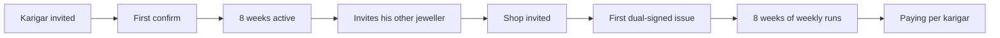

# Metrics
> Project: Tola · Owner: Product lead · Status: Draft v0.1 · Last updated: 2026-10-20
> Related: [PRD](./PRD.md) · [Roadmap](./ROADMAP.md) · [Features](./FEATURES.md) · [Impact](../07-business/IMPACT.md) · [Observability](../../implementation/scalable/docs/OBSERVABILITY.md) · [AI Evals](../04-ai/AI_EVALS.md) · [Privacy](../06-security-compliance/PRIVACY.md)

## 1. North star
**Dual-signed fine-gold grams per week (DSG/week)** is the total fine gold (mg ÷ 1000) carried in `LedgerEvent`s (E-06) of type `ISSUE`, `RETURN`, `SCRAP_RETURN` or `DUST_CREDIT` that **both parties signed** during the ISO week.

**Why this one:**
- It only grows if jewellers issue through Tola (adoption), karigars confirm (two-sided trust), and the scale captures the weight (integrity).
- It is the exact quantity PS 2.2 says is "tracked on trust" [S1].
- Gold is the unit both sides care about. A rupee metric would swing with the gold price (+81% y/y in Q1 2026 [S6]).

| Phase | Target |
|---|---|
| MVP (hackathon) | Seed + live stage events all dual-signed (100%). The P0 field pilot (16–22 Dec 2026) logs ≥ 30 dual-signed events |
| v1, 90 days (27 Mar 2027) | ≥ 2 kg DSG/week across pilot shops (HUNCH: 3 shops × 20 karigars × ~35 g/week) |
| 6 months (Jun 2027) | ≥ 15 kg DSG/week (HUNCH) |

## 2. Input metrics
| Metric | Definition | MVP target | v1 target | Feature |
|---|---|---|---|---|
| Active pairs | Shop–karigar pairs with ≥ 1 dual-signed event in the last 14 days | 1 (stage) | 60 by Mar 2027 (HUNCH) | all |
| Instrument capture rate | % of weight events whose `ScaleReading.source` ∈ {serial, ble, display_ocr} | n/a (simulated allowed) | ≥ 90% | F-01 |
| Time to karigar confirm | Median minutes from ISSUE draft to karigar signature | ≤ 20 s on stage | ≤ 10 min | F-02 |
| Dual-sign rate | % of events dual-signed within 24 h | 100% | ≥ 98% | F-03 |
| Flag rate | Variance flags per 100 events | Seeded: 1 | Monitored; investigate if > 10 (scale-noise suspicion, Q-2) | F-05 |
| Flag precision | % of flags that either side marks "real issue" vs "noise" | n/a | ≥ 70% | F-05 |
| Dispute resolution time | Median days from DISPUTE_OPEN to DISPUTE_RESOLVE | < 1 min on stage | ≤ 7 days; ≥ 80% in 14 days | F-06 |
| Days to pay | Median days from settlement dual approval to PSP `paid` | Simulated in ≤ 5 s | ≤ 2 days | F-07 |
| Passport shares | % of karigars with ≥ 8 weeks history who created ≥ 1 share | 1 share on stage | ≥ 20% | F-08 |
| Voice confirm share | % of karigar confirmations by voice or IVR (vs tap) | — | Watch only (tells us about literacy) | F-02, F-12 |

## 3. AARRR funnel
| Stage | Jeweller (payer, P-01) | Karigar (user, P-02) | Event(s) | v1 target (HUNCH) |
|---|---|---|---|---|
| **Acquisition** | Demo given by a Doot / association intro | Invited by a jeweller, or by another karigar | `shop_created`, `karigar_invited` | 10 shops/month from Apr 2027 |
| **Activation** | First dual-signed ISSUE within 7 days of sign-up | First confirmation within 24 h of invite | `issue_dual_signed` (first) | 70% of shops, 85% of karigars |
| **Retention** | ≥ 1 reconciliation run per week for 8 weeks | ≥ 1 confirmation per week for 8 weeks | `reconciliation_run_completed`, `event_signed` | 80% of shops at week 8 |
| **Revenue** | Paying per active karigar (₹49–99/month, HUNCH) | Free forever | `subscription_started` (v1) | 60% of activated shops convert after a 30-day trial |
| **Referral** | Shop refers another shop | **Karigar brings his other jewellers** (network effect, brief §4) | `karigar_invited_shop` | ≥ 0.3 new shops per active karigar per quarter |

## 4. Impact metrics
These are measured in pilots with consent: a baseline in the first 2 weeks, then compared at week 8. The measurement plan is in [IMPACT.md](../07-business/IMPACT.md).

| Impact | Measure | Baseline source | Target |
|---|---|---|---|
| Faster pay for karigars | Median days from delivery to labour payment | Interview answer to PS question 4 ("How long does a karigar wait to be paid?") [S1] | −50% by week 8 |
| Fewer unexplained losses | Unexplained grams per kg issued (variance beyond norm and not resolved) | Jeweller's own estimate, then Tola week 1–2 | −50% by week 8 |
| Disputes settled, not absorbed | % of disputes ending in a signed resolution (vs abandoned) | Interviews (PS question 5) | ≥ 80% |
| Credit access | Karigars who used a Work Passport in a loan application; outcomes self-reported | 0 | ≥ 5 in the 6-month pilot (HUNCH) |
| Trust size | Grams issued to a karigar in his first month vs the 100–250 g "first trust" norm [S17] | [S17] | Watch only |
| Jobs (judging criterion) | Doots / onboarding agents earning per verified active pair | 0 | ≥ 5 Doots by Jun 2027 (HUNCH) |

## 5. Analytics event taxonomy
**Principles:**
- No personal data in analytics: IDs are hashed and there are no names, phones or audio.
- Weights go in as integer mg only.
- Events are emitted server-side where possible.
- MVP logs to a local `analytics_events` table in SQLite for the demo dashboard only.
- v1 sends to OpenTelemetry (`OTEL_EXPORTER_OTLP_ENDPOINT`) and BigQuery (choice owned by BE/Crypto, decision by 31 Jan 2027).

Common properties on every event:
- `ts`;
- `build` (`demo` | `scalable`);
- `shop_id_h`;
- `actor_role` (`jeweller` | `staff` | `karigar` | `lender` | `system`);
- `locale`;
- `ai_mode` (`live` | `cached` | `off`).

| Event name | Trigger | Properties | Feature |
|---|---|---|---|
| `scale_reading_captured` | API-05 accepts a reading | `source`, `grams_mg`, `stable_ms`, `device_id_h` | F-01 |
| `norm_signed` | WastageNorm version gets both signatures | `order_type`, `norm_pct`, `version` | F-01 |
| `event_drafted` | API-06 returns a draft | `event_type`, `grams_mg`, `order_id_h`, `has_photo` | F-01, F-04 |
| `readback_played` | API-09 audio starts | `lang`, `latency_ms`, `cached` | F-02 |
| `event_signed` | API-07 accepts a signature | `event_type`, `party`, `method` (`tap`\|`voice`\|`whatsapp`\|`ivr`), `ms_since_draft` | F-02, F-03 |
| `event_rejected` | Karigar says "na" or the 30-s timeout passes | `reason` (`said_no`\|`timeout`) | F-02 |
| `issue_dual_signed` | Second signature on an ISSUE | `grams_mg`, `fine_mg`, `first_for_pair` | F-03 |
| `chain_verified` | API-08 verification | `status`, `events_n`, `verify_ms`, `first_broken_index` | F-03 |
| `voice_intake_completed` | API-10 returns | `lang`, `stt_ms`, `llm_ms`, `min_confidence`, `fields_flagged_n` | F-04 |
| `duplicate_warned` | US-13 warning | `action` (`keep`\|`discard`) | F-04 |
| `reconciliation_run_completed` | API-11 finishes | `trigger` (`button`\|`schedule`), `pairs_n`, `flags_n`, `run_ms` | F-05 |
| `variance_flag_raised` | Flag created | `order_type`, `variance_mg`, `rupee_value`, `zscore` | F-05 |
| `flag_feedback` | A party marks a flag as real or noise | `verdict` | F-05 |
| `dispute_opened` | API-12 create | `by_role`, `linked_events_n` | F-06 |
| `dispute_message_added` | API-12 message | `by_role`, `modality` (`text`\|`voice`), `duration_s` | F-06 |
| `dispute_resolved` | Dual-signed DISPUTE_RESOLVE | `days_open`, `adjustment_mg` | F-06 |
| `settlement_drafted` | API-13 create | `lines_n`, `labour_inr`, `gold_balance_fine_mg` | F-07 |
| `settlement_approved` | Each approval | `party`, `both_approved` | F-07 |
| `payment_intent_created` | API-14 | `mode` (`simulated`\|`psp`), `amount_inr` | F-07 |
| `payment_completed` | API-20 webhook success (v1) | `days_from_approval` | F-07 |
| `passport_shared` | API-15 POST | `scope`, `expiry_days`, `recipient_type` | F-08 |
| `passport_viewed` | API-15 GET | `share_age_h` | F-08 |
| `passport_revoked` | API-15 DELETE | `share_age_h` | F-08 |
| `gst_draft_downloaded` | API-16 | `doc` (`challan`\|`invoice`) | F-09 |
| `sync_batch_applied` | API-18 (v1) | `events_n`, `offline_h`, `conflicts_n` | F-11 |
| `channel_message_received` | API-19 (v1) | `channel` (`whatsapp`\|`ivr`), `intent` | F-12 |
| `locale_changed` | UI locale switch | `from`, `to` | F-14 |
| `demo_role_switched` | Role switcher (MVP) | `to_role` | harness |
| `demo_story_step` | Story-mode step | `step` (1–10), `ms_on_step` | harness |
| `demo_reset` | API-02 reset | `reset_ms` | harness |

## 6. Dashboards
| Dashboard | Audience | Panels | Build |
|---|---|---|---|
| **Stage dashboard** | Judges (inside the demo) | DSG for the seeded week; chain status; flags; days-to-pay (simulated) | MVP: a page in `implementation/demo` reading `analytics_events` |
| **Rehearsal dashboard** | Team | `demo_story_step` timings vs 3-min budget; `readback_played.latency_ms`; live vs cached runs | MVP |
| **Pilot health** | Product lead | North star; active pairs; dual-sign rate; time to confirm; flag precision; dispute time; days to pay | v1: Grafana or Looker Studio over BigQuery (owner BE/Crypto, by 31 Jan 2027) |
| **AI quality** | AI/Voice | STT numeral accuracy, intake field confidence, number-guard trips, fallback rate | v1; tied to [AI_EVALS.md](../04-ai/AI_EVALS.md) and `evals.yml` |
| **Impact** | Funders, JanAI, judges | Days to pay, unexplained grams per kg, passports used | v1, monthly |

## Sources
- [S1] PS 2.2 text (field questions).
- [S6] WGC Q1 2026.
- [S17] IIMA/XLRI report.

URLs are in [PRD.md § Sources](./PRD.md#sources).
