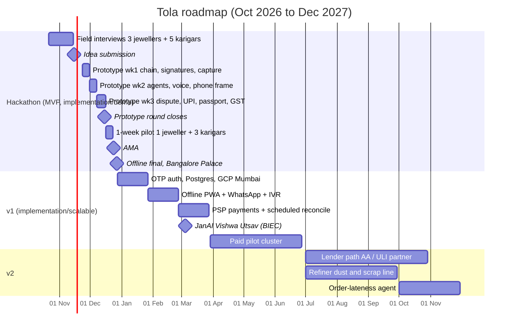

# Roadmap
> Project: Tola · Owner: Product lead · Status: Draft v0.1 · Last updated: 2026-10-20
> Related: [PRD](./PRD.md) · [Features](./FEATURES.md) · [Metrics](./METRICS.md) · [Hackathon Plan](../00-overview/HACKATHON_PLAN.md) · [GTM](../07-business/GTM.md) · [Business Model](../07-business/BUSINESS_MODEL.md) · [Risk Register](../06-security-compliance/RISK_REGISTER.md)

**Phase mapping:**
- **Hackathon** = MVP in `implementation/demo`.
- **30 days onward** = v1 in `implementation/scalable`.
- **6 months onward** includes v2.

Dates after 27 Dec 2026 are plans, not commitments. Targets marked **HUNCH** are our guesses, to be revised after the first pilot.

## 1. Timeline

## 2. Phases

### 2.1 Hackathon: now to 27 Dec 2026 (MVP · `implementation/demo`)
| Date | Milestone | Exit criteria | Owner |
|---|---|---|---|
| 21 Oct – 14 Nov | Field interviews: PS 2.2's six field questions [S1] | 8 interview notes and ≥ 3 consented 20-s clips; [PERSONAS.md](./PERSONAS.md) updated to v0.2 | Field/Pitch |
| 1 Nov | Team size confirmed with tech4bharath@rvce.edu.in (Q-4) | Written reply | Field/Pitch |
| **15 Nov** | **Idea submission** | Brief, detailed explanation, deck, repo with docs | Product lead |
| 23–29 Nov | Prototype week 1 | F-03 chain + signatures, F-01 issue with simulated scale and Web Serial, seed data | BE/Crypto, FE/Design |
| 30 Nov – 6 Dec | Prototype week 2 | F-02 Bengali read-back, F-04 IntakeAgent, F-05 run week, simulated phone frame (F-12) | AI/Voice |
| 7–15 Dec | Prototype week 3 | F-06 dispute, F-07 settlement + simulated UPI, F-08 passport, F-09 GST draft, story mode; `demo-ci.yml` green | All |
| **15 Dec** | **Prototype round closes** | All [PRD §11](./PRD.md#11-release-criteria) MVP criteria pass except the pilot | Product lead |
| 16–22 Dec | 1-week real pilot: 1 jeweller, 3 karigars | ≥ 30 real dual-signed events; one real weekly run; quotes for the pitch | Field/Pitch |
| 24 Dec | AMA | Questions sent in advance | Field/Pitch |
| **27 Dec** | **Offline final**, Bangalore Palace | 3-minute live demo; live and cached runs rehearsed ≥ 10 times | All |

### 2.2 30 days: by 27 Jan 2027 (v1 foundation)
- **Build:**
  - OTP auth (API-17);
  - per-device keys with PIN;
  - Postgres 16 on Cloud SQL in asia-south1;
  - Cloud Run for web, api and worker;
  - Terraform;
  - `scalable-ci.yml` and `scalable-deploy.yml` green.
- **Product:** DPDP notice and consent in bn/hi/kn/en [S53].
- **Pilot:** extend the December pilot shop to all 8 karigars (HUNCH: if the owner agrees).
- **Decision:** PSP choice (Razorpay / Cashfree / PhonePe PG) by 15 Jan 2027. Owner: BE/Crypto.

### 2.3 60 days: by 26 Feb 2027
- **Build:**
  - F-11 offline PWA with Dexie 4.4 and API-18 sync;
  - F-12 WhatsApp Cloud API + IVR in bn and hi (API-19);
  - M-04 display OCR.
- **Pilot:** 3 jewellers and ≥ 20 karigars in one cluster (HUNCH target: Bengaluru Avenue Road through the KAVMS network).

### 2.4 90 days: by 27 Mar 2027
- **Build:**
  - PSP intent/collect with webhook (API-20);
  - scheduled weekly reconciliation (Cloud Tasks / RQ + Redis 7);
  - head-karigar sub-ledger design (Q-3) built for P-05;
  - mr and ta locales.
- **Partnerships:**
  - JanAI Vishwa Utsav (1–7 Mar 2027, BIEC Bengaluru) [B]: pitch Tola as a JanAI Bazaar provider paid per verified active pair;
  - one co-op bank letter of interest for Work Passport reads (A-6).
- **Start of the paid pilot** at ₹49–99 per active karigar per month (HUNCH, brief §14).

### 2.5 6 months: by Jun 2027
- **Scale targets (HUNCH):** 25 jewellers, 200 active karigars, 2 clusters. Candidates: Bengaluru plus one Bengali-karigar cluster (Mumbai Zaveri Bazaar or Kolkata Bowbazar [S17][S20]).
- **Product:**
  - Work Passport real lender view with audit;
  - consent artefact aligned to the DPDP Rules phases (dates to be verified; owner Field/Pitch with legal mentor, by 31 Mar 2027).
- **Evidence:** before/after study on days-to-pay and unexplained loss in pilot shops (see [METRICS.md §4](./METRICS.md#4-impact-metrics)).

### 2.6 1 year: by Dec 2027 (v2)
- **Lender rail.** An AA/ULI path through a partner FIU [S42]. Sandbox access is not verified (2026-10-20). Tola never scores and never lends (R-06).
- **Refiner line.** Dust and scrap recovery credited back to the bench and karigar. Field study: floor-mat dust is collected yearly by "a specialized agency" for Rs 500–700 [S17].
- **Order-lateness agent.** Forecasts lateness from each karigar's own ledger history (the war-room "Muhurat" idea, folded into Tola).
- **Same capture layer, second PS.** Khara Hisaab exchange receipt (PS 2.1) is the next product. This is a decision gate in Oct 2027, not a commitment.
- **Targets (HUNCH):** 150 jewellers, 1,500 active karigars, 4 clusters; break-even per cluster (see [FINANCIALS.md](../07-business/FINANCIALS.md)).

## 3. Pilots
| Pilot | When | Who | Success = | Owner |
|---|---|---|---|---|
| P0 field pilot | 16–22 Dec 2026 | 1 jeweller, 3 karigars | ≥ 30 dual-signed events; both sides say they would continue | Field/Pitch |
| P1 shop pilot | Jan–Feb 2027 | Same shop, all karigars | ≥ 95% of events dual-signed; ≥ 1 dispute resolved in-app | Product lead |
| P2 cluster pilot (paid) | Mar–Jun 2027 | 3 → 25 jewellers | Retention ≥ 80% at 8 weeks; median days-to-pay ≤ 2 | Product lead |

## 4. Partnerships
| Partner | Why | Ask | When |
|---|---|---|---|
| **Lyzr** (AI partner) [B] | Agent runtime, traces, HITL | Credits beyond the free build tier; a case study | Dec 2026 |
| **Sarvam AI** [B] | Indic STT/TTS | Startup credits | Jan 2027 |
| **JanAI** (organiser) [B] | Bazaar distribution; Cafe "Doot" onboarding | Provider listing; per-outcome revenue share | Mar 2027 (Vishwa Utsav) |
| **KAVMS jeweller network** (organiser community) | First jewellers; credibility | Introductions to 10 shops | Jan 2027 |
| **Co-op bank / NBFC** | Work Passport reader (P-04) | Letter of interest, then a 20-karigar trial | Mar 2027 |
| **PM Vishwakarma partner banks** [S41] | Credit for goldsmiths | Accept the passport as a supporting document (not verified) | 2027 |
| **Balance makers / dealers** | Serial/BLE balances in pilot shops | Bundle price ≤ ₹3,000 (A-3, unverified) | Feb 2027 |

## 5. What we will not do in year 1
- Purity or karat claims.
- A credit score.
- Lending.
- Holding money or gold.
- A blockchain.
- A full ERP.

See the non-goals in [PRD §2.2](./PRD.md#22-non-goals-from-the-brief-12).

## Sources
- [S1] PS 2.2.
- [S17] IIMA/XLRI report.
- [S20] NewsClick.
- [S41] PM Vishwakarma.
- [S42] ULI.
- [S53] DPDP Act.
- [B] `research/B-sponsors.md`: JanAI Vishwa Utsav 1–7 Mar 2027; Bazaar per-outcome model; Lyzr; Sarvam.
