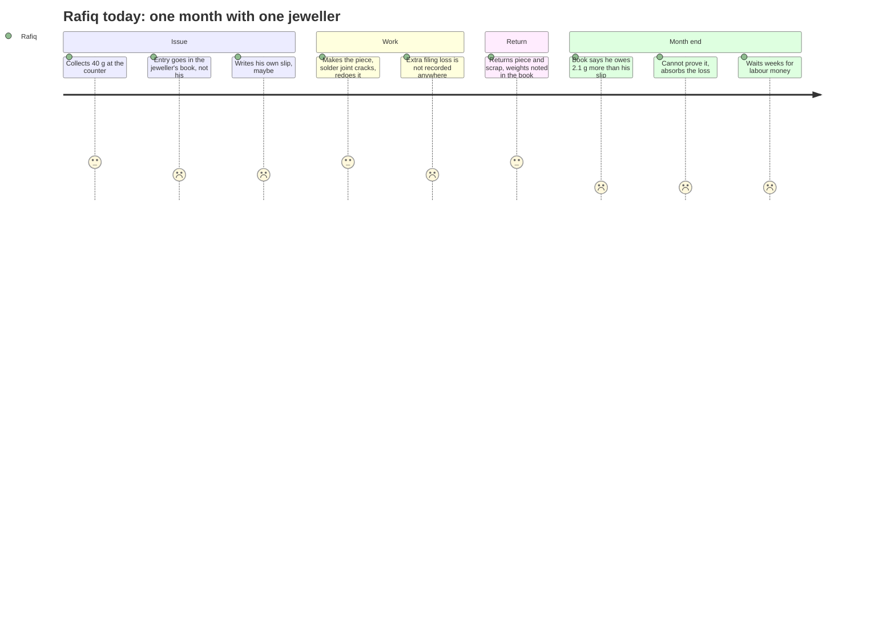
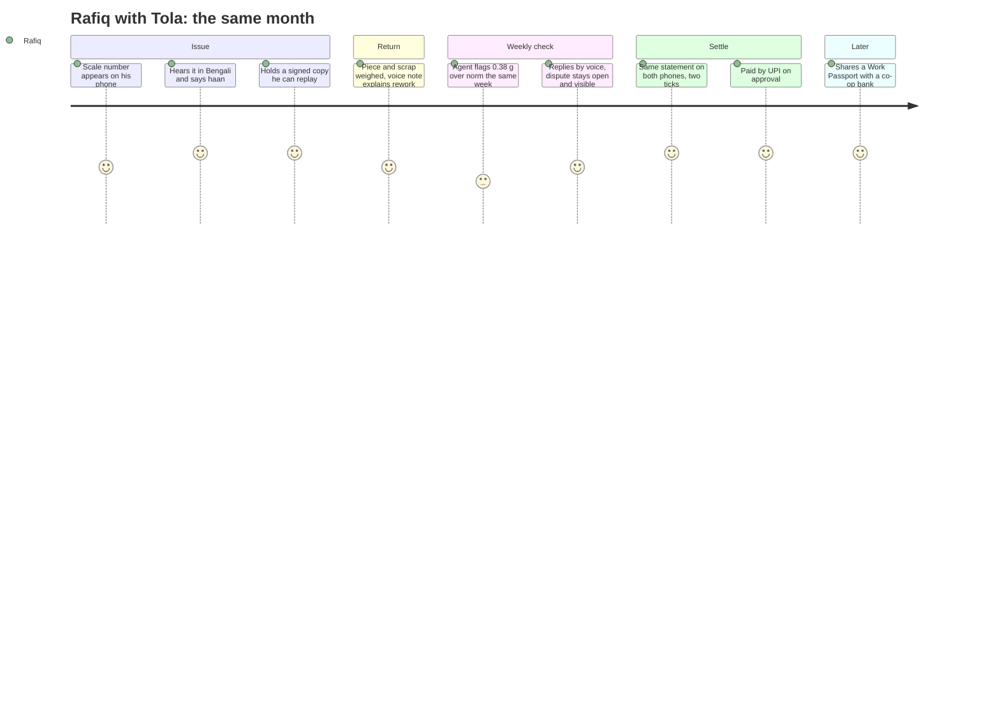
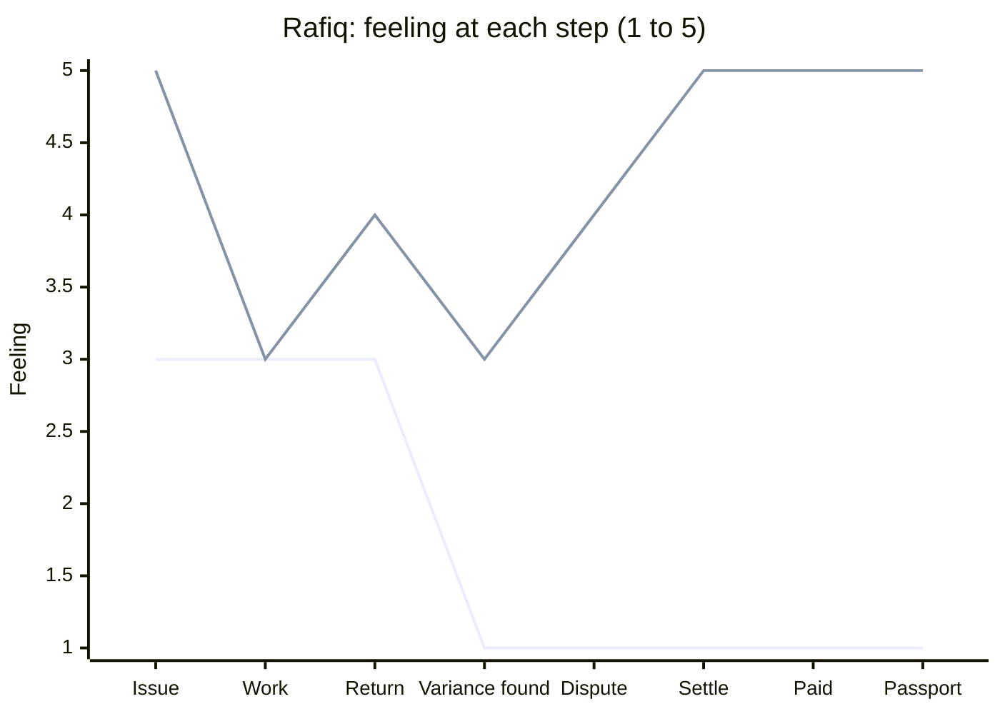
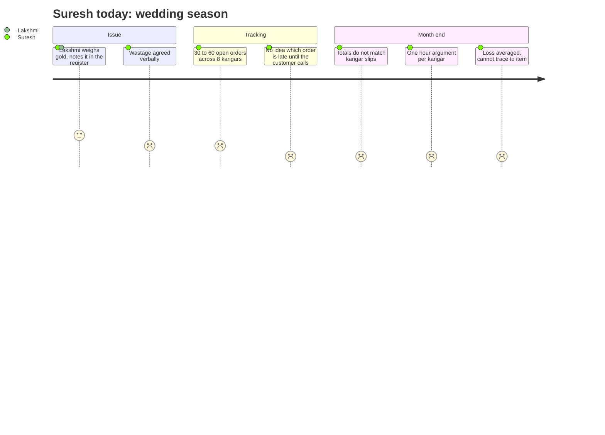
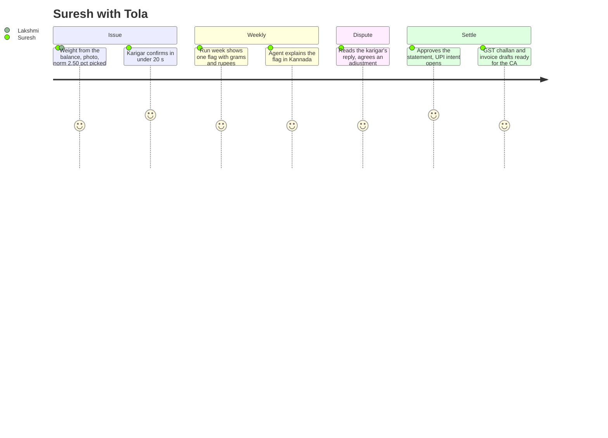
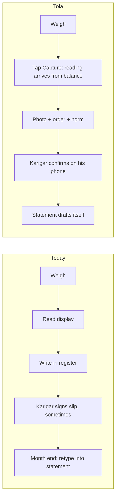
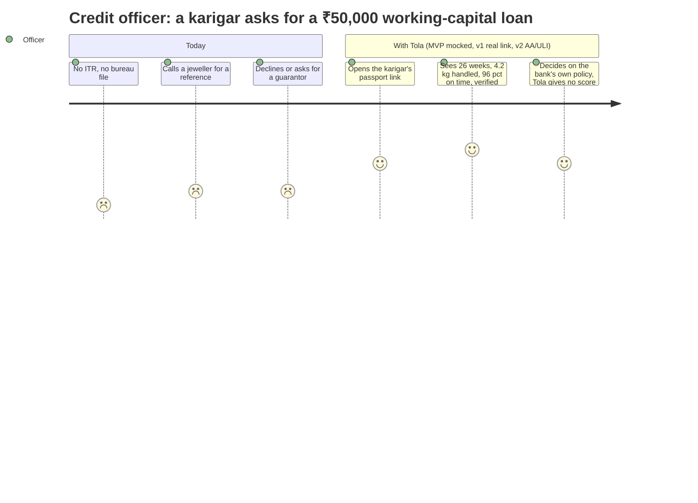
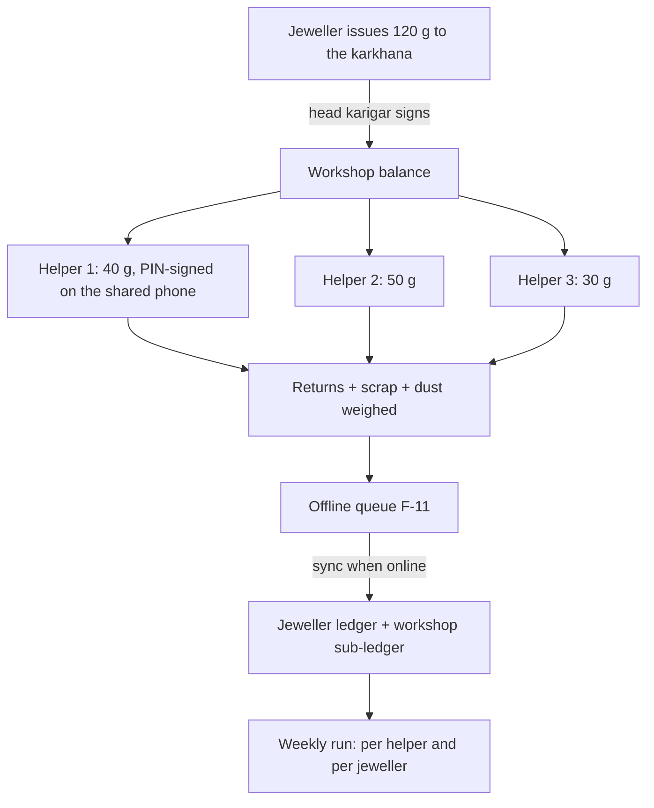

# User Journeys
> Project: Tola · Owner: Product lead · Status: Draft v0.1 · Last updated: 2026-10-20
> Related: [PRD](./PRD.md) · [Personas](./PERSONAS.md) · [User Stories](./USER_STORIES.md) · [Features](./FEATURES.md) · [UI Spec](../02-design/UI_SPEC.md) · [Demo build](../../implementation/demo/README.md) · [Scalable build](../../implementation/scalable/README.md)

Each persona gets a current-state journey (today, on paper and trust) and a future-state journey (with Tola). Mermaid `journey` scores run from 1 (very bad) to 5 (very good). They are our reading of the cited research and are to be validated in field interviews by 15 Nov 2026 (owner: Field/Pitch).

Where it matters, steps are tagged **MVP** (`implementation/demo`) or **v1** (`implementation/scalable`).

---

## 1. P-02 Rafiq (karigar)

### 1.1 Current state

Sources: wastage-based pay and registers [S17]; "artisans waiting weeks to be paid" [S1]; the 2.1 g composite is from the ideas file.

### 1.2 Future state (Tola)

### 1.3 Emotional curve

### 1.4 Moments of truth
1. **The first read-back.** If the number he hears is not the number he saw on the scale, trust is gone. The scale is the source of truth, and the number is always spoken in full (F-01, F-02; R-02).
2. **The first flag against him.** He must be able to reply, and the line must stay open, not be silently corrected (F-06).
3. **The first payment.** If dual approval does not lead to faster pay, the app is just more work for him (F-07).

---

## 2. P-01 Suresh (jeweller)

### 2.1 Current state

Sources: "agreed verbally", missed wedding dates [S1]; "averaged monthly … can't be traced" [S28].

### 2.2 Future state (Tola)

### 2.3 Moments of truth
1. **The first issue at rush hour.** It must be as fast as the notebook (target: ≤ 20 s including the karigar's confirm).
2. **The first flag is right.** If a flag comes from scale noise, he stops trusting the agent. Tolerance is open question Q-2 in the [PRD](./PRD.md#10-open-questions).
3. **The first month end that takes 5 minutes, not 5 hours.**

---

## 3. P-03 Lakshmi (counter staff)

### 3.1 Current vs future (flow)

### 3.2 Moments of truth
- **The scale does not connect at 11 a.m. on a Saturday.**
  - Fallback 1 (v1): M-04 display OCR.
  - Fallback 2: two-person manual confirm, where both type the same number. The event is marked `source=manual_dual`; this source value needs adding to E-08 in [DATA_MODEL.md](../03-engineering/DATA_MODEL.md).
  - MVP: the simulated widget.
- **The first time the owner asks "who entered this?"** The answer is in the signatures, not in her memory.

---

## 4. P-04 Credit officer (lender)

### 4.1 Current vs future

The numbers in the passport (26 weeks, 4.2 kg, 96%) are demo seed values, not research data.

### 4.2 Moments of truth
- **"Can I verify this?"** The page shows `chain_status: verified`, the number of counter-signing jewellers and the share expiry.
- **"Is this a score?"** No. The page says "Tola does not score or lend" (R-06).

---

## 5. P-05 Head karigar (v1)

The helper sub-ledger and delegation are v1+ design (R-09; Q-3 in the [PRD](./PRD.md#10-open-questions)). Not in MVP.

**Moment of truth:** a helper leaves with gold. The head karigar can show exactly which signed issues were outstanding, and from which jeweller.

---

## 6. The scripted demo week (MVP)
This is the story mode in `implementation/demo`. It uses seeded people (P-01 Suresh, P-02 Rafiq, P-04 lender) and real arithmetic. All weights are integer milligrams. The rate is ₹14,904/g 24K (₹1,49,041/10 g, 20 Oct 2026 [S47]) and fineness is 916.

| Step | Day | Role on screen | What happens | Feature · API | Numbers |
|---|---|---|---|---|---|
| 1 | Mon | Jeweller | Issue to Rafiq for **Order #14** (plain 22K bangle pair); norm **2.50%** | F-01 · API-05, API-06 | 40.000 g gross (36.640 g fine) |
| 2 | Mon | Karigar (phone frame) | Bengali read-back; Rafiq taps "haan"; both signatures appear; chain grows | F-02, F-03 · API-09, API-07 | — |
| 3 | Thu | Jeweller + Karigar | Return: piece **38.120 g**, scrap **0.500 g**. Rafiq's voice note: "the solder joint cracked, I redid it" | F-04 · API-10 | Returned 38.620 g |
| 4 | Sat | Jeweller | "Run week". Flag: Order #14 is **0.380 g above** the agreed wastage | F-05 · API-11 | Loss 1.380 g, allowed 1.000 g, variance +0.380 g ≈ ₹5,188 at 22K |
| 5 | Sat | Karigar | Rafiq opens a dispute and replies by voice | F-06 · API-12 | — |
| 6 | Sat | Jeweller + Karigar | Both agree to accept 0.130 g as rework wastage. An `ADJUSTMENT` is signed by both; **0.250 g** stays on Rafiq's balance | F-06, F-03 | 0.250 g gross = 0.229 g fine |
| 7 | Sun | Both | Settlement draft: gold carried forward 0.229 g fine; labour ₹4,800 (seed value, HUNCH); GST 5% ₹240 on the labour-invoice draft | F-07, F-09 · API-13, API-16 | Payable ₹5,040 |
| 8 | Sun | Both | Two ticks, then a UPI intent and QR labelled "Simulated, no money moves" | F-07 · API-14 | ₹5,040 |
| 9 | — | Karigar → Lender | Rafiq shares a 7-day Work Passport; lender view labelled "Mocked lender view" | F-08 · API-15 | Seeded history |
| 10 | — | Jeweller | Tamper demo: one stored byte is edited and chain status shows "broken at event N" | F-03 · API-08 | — |

**Arithmetic check (for the CA judge):**
- allowed = 40,000 mg × 2.50% = **1,000 mg**;
- loss = 40,000 − (38,120 + 500) = **1,380 mg**;
- variance = **+380 mg**;
- ₹ at 22K = 0.380 × 0.916 × ₹14,904 = **₹5,188** (rounded).
- After the 130 mg adjustment, the balance owed is 250 mg gross = 229 mg fine.

The seed values here (Order #14, 40.000 g, 38.120 g, 0.500 g, 2.50%, ₹4,800 labour) are the reference for `implementation/demo` seeds and the pitch script. If they change, update this table first.

---

## 7. Edge cases (all journeys)
| # | Edge case | Expected behaviour | Feature | MVP / v1 |
|---|---|---|---|---|
| EC-1 | Karigar says "na" or does not respond within 30 s on a read-back | Event stays with one signature, marked "awaiting karigar"; not settlement-eligible | F-02, F-03 | Both |
| EC-2 | Scale reading unstable (changes > 10 mg within 1.5 s) | Capture button disabled until stable | F-01 | Both |
| EC-3 | Scale disconnected mid-issue | Fallback order: display OCR (M-04), then two-person manual confirm | F-01 | Simulated in MVP; real in v1 |
| EC-4 | STT mishears "12.45" as "12.54" | No effect on the weight; only the scale reading is stored. Transcript shown for the note text only | F-04 | Both |
| EC-5 | Duplicate slip / same return entered twice | IntakeAgent warns on same order + weight within 10 min; human chooses | F-04 | Both |
| EC-6 | Lyzr or Sarvam unreachable on stage | `AI_FALLBACK_MODE=cached` serves deterministic text and pre-generated audio; banner shows "cached" | F-02, F-05, F-07 | MVP |
| EC-7 | Dispute open at settlement time | Disputed lines are excluded and carried over; undisputed lines can settle | F-06, F-07 | Both |
| EC-8 | Karigar revokes a passport while a lender has it open | Next request returns 410 Gone; page shows "revoked by the karigar" | F-08 | Both |
| EC-9 | Karigar changes phone / loses key | v1: re-enrol by OTP; old key revoked by a signed key-rotation event; history kept | F-03 | v1 |
| EC-10 | Offline for 3 days in a karkhana | Events signed and queued locally; on sync a chain fork is shown to both parties | F-11 | v1 |
| EC-11 | Wastage norm changed mid-order | Norms are versioned (E-05); the order keeps the version signed at issue | F-01, F-05 | Both |
| EC-12 | Gold price moves between flag and settlement | ₹ figures are informational at the day's rate; gold balances are settled in grams | F-05, F-07 | Both |
| EC-13 | Karigar cannot read at all | Every screen has a speaker button; confirm by voice; IVR in v1 | F-14, F-12 | Both |

## Sources
- [S1] PS 2.2 text.
- [S17] IIMA/XLRI IGPC report, 2023.
- [S28] Synergics blog.
- [S47] Zee Business gold rate, 20 Oct 2026.

URLs are in [PRD.md § Sources](./PRD.md#sources).
