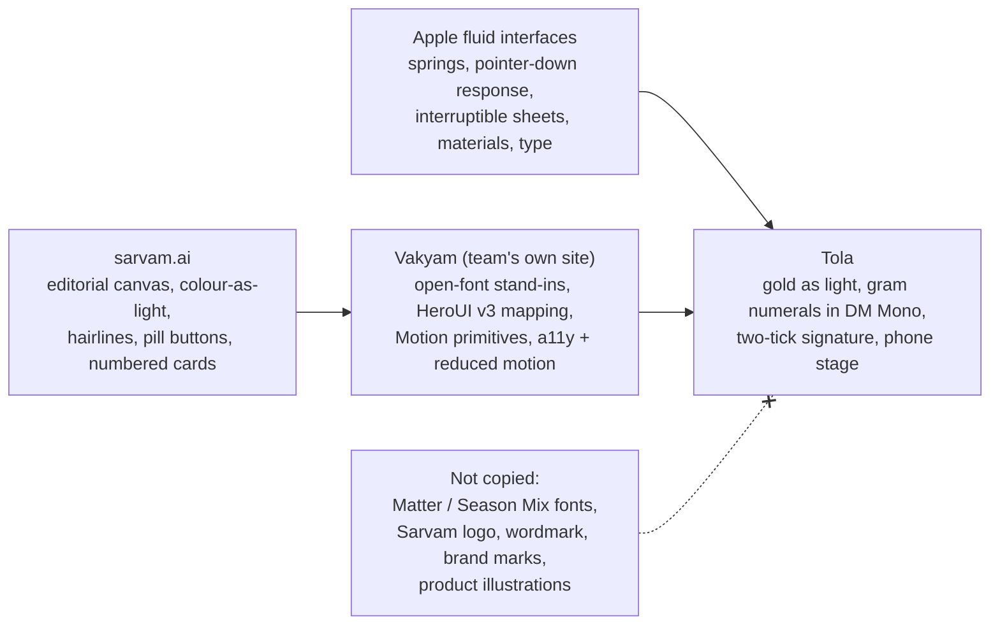

# Design: Tola
> Project: Tola · Owner: Design lead (front end + design) · Status: Draft v0.1 · Last updated: 2026-10-20
> Related: [Project brief](../00-overview/PROJECT_BRIEF.md) · [PRD](../01-product/PRD.md) · [Design system](./DESIGN_SYSTEM.md) · [UI spec](./UI_SPEC.md) · [Accessibility](./ACCESSIBILITY.md) · [Localization](./LOCALIZATION.md) · [Architecture](../03-engineering/ARCHITECTURE.md) · [Demo build](../../implementation/demo/README.md) · [Scalable build](../../implementation/scalable/README.md)

This is the headline design document. It explains where Tola's look and feel come from and records every decision a front-end developer needs to build it. [DESIGN_SYSTEM.md](./DESIGN_SYSTEM.md) is the lookup reference for tokens and components. [UI_SPEC.md](./UI_SPEC.md) describes each screen.

**In one sentence:** Tola looks like **sarvam.ai**, is built the way the team built **Vakyam** (`https://vakyam.duckdns.org`), and moves the way **Apple's fluid interfaces** move. Its own idea is **gold as light**: grams are precise, calm and signed twice.

---

## 0. Contents
1. [Lineage: Sarvam → Vakyam → Tola, plus Apple](#1-lineage)
2. [The Tola brand concept](#2-the-tola-brand-concept)
3. [Design principles](#3-design-principles)
4. [Colour](#4-colour)
5. [Complete token set (ready to paste)](#5-complete-token-set-ready-to-paste)
6. [Typography](#6-typography)
7. [Numerals and grams](#7-numerals-and-grams)
8. [Layout, spacing and radius](#8-layout-spacing-and-radius)
9. [Materials and depth](#9-materials-and-depth)
10. [Motion](#10-motion)
11. [Iconography and ornament](#11-iconography-and-ornament)
12. [Voice and tone](#12-voice-and-tone)
13. [Component inventory (HeroUI v3)](#13-component-inventory-heroui-v3)
14. [Page and section anatomy](#14-page-and-section-anatomy)
15. [Do / don't gallery](#15-do--dont-gallery)
16. [MVP (hackathon) vs v1 (production)](#16-mvp-hackathon-vs-v1-production)
17. [Open items](#17-open-items)

---

## 1. Lineage



### 1.1 What we take from Sarvam (studied at https://www.sarvam.ai on 2026-10-20 and in `reference/sarvam-tokens-extracted.txt`)
| Pattern | Sarvam source | How Tola uses it |
|---|---|---|
| Warm neutral canvas | `--color-sr-grey-50 #f9f9f9`, `-100 #f5f5f5`, `-200 #f0f0f0`, `--color-sr-black #141414` | Canvas `#fcfcfc` and a grey ramp taken directly from these values |
| Colour as light, not as fill | Gradient hero backdrop behind a left-aligned two-line headline | A blurred **ember → amber → gold → periwinkle** arc, used only as light |
| Indigo working accent | `--color-sr-indigo-600 #556adc`, `-800 #33c`, `-900 #212191` | Links, focus rings, selected segments and the "signed" state |
| Slate pill buttons | `--color-sr-slate #2a2c33`; button classes `rounded-full`, `active:scale-[0.96]`, `min-h-[40px] px-5`, `ease-[cubic-bezier(0.2,0,0,1)]` | Primary pill buttons; Tola raises the minimum height to 44 px (48 px on the karigar phone) |
| Ambient shadows, used sparingly | `--shadow-card 0 0 40px #0000000f`, `--shadow-focus-indigo 0 0 0 3px #a5bbfc26` | Hairlines first; ambient shadow only on hover and on floating layers |
| Type scale | hero 56 · section 40 · metric 48 · card 20 · body-lg 18 · body 16 · caption 14 · label 12 | Same eight steps, with tracking and leading per size (§6) |
| Tracking tokens | `-.05em`…`.1em` | Tracking is set per size, not per token |
| Section rhythm | Eyebrow → two-line headline → three clipped sentences → two CTAs; numbered panels **01–05** with product mock-ups; big stat callouts; closing CTA band | The same rhythm on the Story landing (§14) |
| Copy tone | Confident and India-first, short fragments ("Built on sovereign compute. Powered by frontier-class models.") | Calm and confident, short fragments, bilingual (§12) |
| Radius | `--radius-card 1rem`, `--radius-card-lg 32px` | `--r-md 16px` cards, `--r-xl 32px` hero surfaces |

### 1.2 What we take from Vakyam (`reference/vakyam-*`, live at https://vakyam.duckdns.org)
Vakyam already turned the Sarvam language into open-licence, buildable code. Tola forks it rather than starting from scratch.
- **Font stand-ins.** Fraunces Variable replaces Season Mix (display), Figtree Variable replaces Matter (text), and DM Mono is used for labels. Fonts are self-hosted through Fontsource, subset by `unicode-range`, and the hero fonts are preloaded.
- **Token architecture.** Primitives sit at the top, then a semantic layer that maps onto HeroUI v3 variables (`--background`, `--surface`, `--accent`, `--segment`, `--focus` …). The light theme selectors are `:root, .light, [data-theme="light"]` and the dark ones `.dark, [data-theme="dark"]`. Tola keeps this structure exactly (§5).
- **Concentric radius rule.** A nested radius is the outer radius minus the padding.
- **Motion primitives.** `Reveal`, `RevealGroup`/`RevealItem` and `MaskHeadline` use the `EASE_OUT [0.22, 1, 0.36, 1]` curve with `whileInView once`, inside `LazyMotion` and `MotionConfig reducedMotion="user"`. Tola copies these files almost verbatim into `src/motion/`.
- **Performance discipline.** The nav uses an IntersectionObserver sentinel instead of a scroll listener. Looping effects are compositor-only. Scroll-linked transforms track 1:1 without springs.
- **Hero device composition.** A fanned pair of phone mockups (Vakyam's `PhoneMockup` and the ARC card fan) sits in front of the light arc. In Tola the two phones are the **jeweller's** and the **karigar's**.
- **Accessibility.** Visible indigo focus rings, 44 px targets, landmarks and a skip link. Contrast and transparency preferences are handled in `a11y.css`. The marquee has a pause control and a reduced-motion fallback that wraps instead of scrolling.
- **Section anatomy.** Numbered "How it works" cards (01–03), an "at a glance" fact sheet in the hero, stat callouts, and an honest prototype disclaimer in the footer.

### 1.3 What we take from Apple (`~/.claude/skills/apple-design/SKILL.md`)
| Apple rule | Tola rule |
|---|---|
| Respond on pointer-down | Every pressable gives `scale(0.97)` feedback within 100 ms on `:active` / `onPointerDown`. A commit happens on release. |
| Springs, not durations | The default spring is critically damped (`bounce: 0`, response 0.3–0.4 s). Bounce of about 0.2 (damping ≈ 0.8) is used **only** after a flick or throw. |
| Interruptibility | Sheets, the role switcher and the phone stage can be grabbed mid-flight. Animations always start from the presentation value. Input is never locked during a transition. |
| Velocity handoff and projection | Sheet release uses `project(v, 0.998)` to choose a detent, then hands the release velocity to the spring. |
| Spatial consistency | A sheet leaves the way it came. Popovers grow from their trigger. The gram chip flies **from** the scale **to** the phones and never appears from nowhere. |
| Rubber-banding | Sheets past their top detent, and the story rail past step 1 or step 7, resist instead of stopping hard. |
| Materials | Translucent nav and toolbar (`backdrop-filter: blur(20px) saturate(180%)`). Scroll-edge fades replace 1 px header borders. Light material is never stacked on light material. |
| Type | Tracking and leading depend on size. Layout is in `rem` so it scales with user text size. |
| Reduced motion / transparency / contrast | All three media queries are honoured (§5.6, [ACCESSIBILITY.md](./ACCESSIBILITY.md)). |
| Multimodal feedback | Signing fires the visual tick, a 12 ms vibration (where supported) and a soft click **on the same frame**, and only for commit, error and settle. |
| The eight principles | Mapped to Tola in §3. |

### 1.4 What we deliberately do NOT copy
- **Sarvam's proprietary typefaces Matter, Matter Mono, Matter Semi Mono and Season Mix.** They are licensed to Sarvam. We use only the open stand-ins listed above (all SIL OFL via Fontsource).
- **Sarvam's logo, wordmark, product names, illustrations, product UI mock-ups, customer logo bands, imagery or any trade dress** that could suggest we are Sarvam or endorsed by Sarvam.
- **Sarvam's exact gradient asset.** Our arc is drawn from our own CSS radial gradients and includes **gold**, which theirs does not.
- **Sarvam's green ramp** as a brand colour. Green appears only as the semantic `success`.
- **Vakyam's kolam and mandala ornaments.** They belong to Vakyam's clinical-dignity story. Tola uses its own motifs: the balance beam, the tola weight and the two ticks (§11).
- **Attribution rule.** Sarvam is a sponsor and our voice provider. We credit it in **plain text only** ("Voice by Sarvam AI"), and only in the "Built with" strip and the footer. We use no Sarvam logo unless we receive written permission from the organisers or Sarvam. Lyzr is credited the same way.

---

## 2. The Tola brand concept

### 2.1 The idea
> **Gold is not a colour here. Gold is light.**

The shop is an old, trust-heavy place: brass scales, account books, a tube light over the counter. Tola's job is to make each gram **visible to both people at the same moment**, the way light falls on both sides of a counter. The brand therefore has no gold *fills*, no yellow buttons and no metallic gradients. Gold appears only as:
1. **A blurred arc of light** behind the hero and behind the phone stage: ember → amber → gold → periwinkle → mist. It moves from warm (the furnace, the bench) to cool (the record, the bank).
2. **A halo** that blooms for about 600 ms when **both** signatures land on an event.
3. **A hairline** (`--gold-line`) on the one card that matters most on any screen, such as an unsettled balance or a variance flag.
4. **Gold-ink text** (`--gold-ink #7a5208`, 6.91:1 on white) for the fine-gold balance label. It is never used for body text.

### 2.2 The light arc
```
          mist        periwinkle      gold          amber         ember
 (record, bank)  ◀───────────────────────────────────────────────▶ (furnace, bench)
   #f4f7ff         #a5bbfc         #f2c14e        #ffb053        #f9730c
```
The arc is drawn as **four stacked radial gradients** with `filter: blur(60px)` at 55–70% opacity, positioned behind content (`z-index: -1`, `pointer-events: none`). It never sits behind body text at full strength: a `--canvas` scrim of at least 70% opacity is laid over it wherever text sits on top. In dark mode the arc becomes the light source on a near-black canvas, with gold at `#f5c66b`.

### 2.3 Name and wordmark
- **Wordmark:** "Tola" set in Fraunces Variable at 600 weight, `opsz` 72, tracking −0.03em. The Devanagari / Bengali companion line is **तोला · তোলা**, set in Mukta 600 / Noto Sans Bengali 600 at 0.5× size with ink-3 colour.
- **Mark:** a **balance beam whose two pans are two ticks**: a horizontal 1.5 px line with two small check marks hanging from it. It reads as "weighed" and "signed twice". It is drawn as a 24×24 SVG with stroke `currentColor`. The halo variant adds a 12 px gold-light blur behind it.
- **Never:** a gold coin, a crown, a diamond, a padlock or a blockchain cube.

### 2.4 Emotional target (Apple principle 8, Delight)
**Calm, fair, certain.** The jeweller should feel *covered*. The karigar should feel *seen and paid*. The judge should feel "this is obviously how it should always have worked."

---

## 3. Design principles
The eight Apple principles, applied to Tola and ordered by how often they decide an argument:

| # | Principle | What it means in Tola | Test |
|---|---|---|---|
| 1 | **Responsibility** | AI never computes grams. Every AI sentence is labelled as a draft or explanation and is signed by a human. Simulated things (UPI, lender, scale) carry a visible "Simulated" chip. | Can a judge find anything that pretends to be real and is not? It must be "no". |
| 2 | **Simplicity, not minimalism** | One primary action per screen. On the karigar phone the entire screen is the number, the voice and **Haan / Na**. | Can Rafiq complete a confirm without reading? |
| 3 | **Agency** | Disputes are always available. Nothing is overwritten. Undo is available until signature. Confirmation dialogs appear only for the 3 irreversible acts: sign settlement, approve UPI, revoke passport. | Count AlertDialogs: at most 3. |
| 4 | **Familiarity** | The vocabulary is the trade's own register (*issue, return, ghat/wastage, fine, labour*), shown in the karigar's language. Two ticks behave like the WhatsApp ticks everyone knows. | Does the karigar recognise "two ticks = both agreed" without being taught? |
| 5 | **Flexibility** | The same event is usable on a projector at 1920 px, a ₹6–8k Android at 360 px, WhatsApp and a feature-phone IVR (v1). | Every flow works at 360 px and at 200% text size. |
| 6 | **Craft** | Grams in DM Mono with tabular figures, decimals aligned, `10.00 g` always to two places, concentric radii, size-specific tracking. | Zoom to 400% on a gram figure. Is it pixel-clean and aligned? |
| 7 | **Purpose** | We deliberately do **not** build: retail POS, purity claims, credit scores, gold prices ticking in the UI, or charts for charts' sake. | Does every element serve PS 2.2? |
| 8 | **Delight** | The single signature moment: the gram jumps onto two phones and two ticks light up gold. One moment only, not confetti. | Does the room react at the tick? |

---

## 4. Colour

### 4.1 Palette (light)
| Role | Token | Hex | Contrast (on `#ffffff` unless noted) | Use |
|---|---|---|---|---|
| Canvas | `--bg` | `#fcfcfc` | n/a | Page background |
| Card | `--card` | `#ffffff` | n/a | Cards, sheets |
| Ink 1 | `--ink` | `#1f1f1f` | 16.07:1 on `#fcfcfc` | Headings, grams |
| Ink 2 | `--ink-2` | `#3d3d3d` | 10.59:1 on `#fcfcfc` | Body |
| Ink 3 | `--ink-3` | `#666666` | 5.60:1 on `#fcfcfc`; 5.27:1 on `#f5f5f5` | Captions, meta |
| Hairline | `--hairline` | `#f0f0f0` | 1.1:1 (decorative only) | Card borders |
| Hairline strong | `--hairline-strong` | `#e6e6e6` | 1.25:1 (decorative only) | Dividers |
| Control edge | `--control-edge` | `#8a8a8a` | 3.45:1; 3.17:1 on `#f5f5f5` | Field and checkbox borders (WCAG 1.4.11) |
| Slate | `--slate` | `#2a2c33` | white on slate 13.94:1 | Primary pill buttons |
| Indigo 700 | `--indigo-700` | `#4250d5` | 6.29:1 | Signed tick, selected |
| Indigo 800 | `--indigo-800` | `#3333cc` | 8.45:1 | Links |
| Ember (light) | `--ember` | `#f9730c` | 2.81:1, **never text** | Arc, warning glow |
| Amber (light) | `--amber` | `#ffb053` | ink on amber 9.09:1 | Arc, pending chip fill |
| Gold (light) | `--gold` | `#f2c14e` | ink on gold 9.82:1 | Arc, halo; **never a button fill** |
| Gold line | `--gold-line` | `#a87810` | 3.92:1 | One hairline per screen; non-text only |
| Gold ink | `--gold-ink` | `#7a5208` | 6.91:1 | "Fine gold" label text |
| Periwinkle | `--peri` | `#a5bbfc` | n/a | Arc, focus glow |
| Mist | `--mist` | `#f4f7ff` | n/a | Arc tail, info surface |
| Success | `--success` | `#2f7d32` | 5.12:1 | Settled, chain verified |
| Danger | `--danger` | `#b81514` | 6.66:1; white on danger 6.66:1 | Variance over norm, broken chain |
| Warning ink | `--warning-ink` | `#a5460f` | 6.03:1 | "Pending signature" text |

Contrast ratios were computed with the WCAG 2.x relative-luminance formula on 2026-10-20 (script in [ACCESSIBILITY.md §4](./ACCESSIBILITY.md#4-contrast)).

### 4.2 Semantic colour meaning (fixed: never reuse a colour for another meaning)
| Meaning | Colour | Shape (colour is never the only cue) |
|---|---|---|
| Signed by one party | indigo-700, one tick | ✓ |
| Signed by both | indigo-700, two ticks + gold halo (one bloom) | ✓✓ |
| Pending the other party | warning-ink text on an amber-50 chip | ◷ clock |
| Variance over agreed norm | danger | ▲ triangle + the delta "+0.38 g" |
| Within norm | success | ● filled dot |
| Disputed (open) | danger outline, not fill | ⚑ flag |
| Simulated / mocked | ink-3 on bg-3 chip with dashed border | ◌ dashed ring |
| Chain verified | success | 🔗 link icon (Lucide `link-2`) |

---

## 5. Complete token set (ready to paste)

**File:** `src/styles/tokens.css`. Import order in `src/styles/index.css` (same as Vakyam): `@import "tailwindcss"; @import "@heroui/styles"; @import "./tokens.css"; @import "./base.css"; @import "./materials.css"; @import "./a11y.css"; @import "./animations.css";`

### 5.1 Light theme
```css
/*
 * Tola design tokens: Sarvam language via Vakyam, gold as light.
 * Light: warm off-white canvas, hairlines over shadows, indigo working accent, slate pills.
 */
:root,
.light,
[data-theme="light"] {
  color-scheme: light;

  /* ── Light-as-colour primitives (arc + halo only, never fills) ── */
  --ember: #f9730c;
  --amber: #ffb053;
  --gold: #f2c14e;
  --peri: #a5bbfc;
  --mist: #f4f7ff;
  --gold-line: #a87810;   /* ≥3:1 non-text; one hairline per screen */
  --gold-ink: #7a5208;    /* 6.91:1 text on white; "fine gold" label */
  --halo: rgba(242, 193, 78, 0.55);

  /* ── Indigo ramp (working accent; Sarvam values) ── */
  --indigo-50: #fafcff;
  --indigo-100: #e8effc;
  --indigo-200: #d2dff9;
  --indigo-300: #a7c0f1;
  --indigo-400: #81a0e9;
  --indigo-500: #6a88e2;
  --indigo-600: #556adc;
  --indigo-700: #4250d5;
  --indigo-800: #3333cc;
  --indigo-900: #212191;

  /* ── Supporting hues (chips, status) ── */
  --green-50: #f2f8eb;
  --green-200: #c8e4b0;
  --green-700: #2f7d32;
  --red-50: #fde7e2;
  --red-200: #eba18f;
  --red-600: #b81514;
  --red-800: #781a11;
  --amber-50: #fff8e6;
  --amber-100: #fff0cf;
  --amber-200: #ffe8b7;
  --orange-50: #fffbfa;
  --orange-200: #fddcce;
  --orange-700: #a5460f;

  /* ── Neutrals ── */
  --bg: #fcfcfc;
  --bg-2: #f5f5f5;
  --bg-3: #f0f0f0;
  --bg-4: #e6e6e6;
  --card: #ffffff;
  --ink: #1f1f1f;
  --ink-2: #3d3d3d;
  --ink-3: #666666;
  --hairline: #f0f0f0;
  --hairline-strong: #e6e6e6;
  --control-edge: #8a8a8a;
  --slate: #2a2c33;
  --nav: rgba(252, 252, 252, 0.72);

  /* ── Shadows (ambient, indigo-tinted; Vakyam) ── */
  --shadow-card-hover: 0 1px 2px rgba(33, 33, 90, 0.05), 0 14px 36px -12px rgba(33, 33, 145, 0.16);
  --shadow-surface: 0 1px 2px rgba(33, 33, 90, 0.04), 0 28px 64px -28px rgba(33, 33, 145, 0.16);
  --shadow-device: 0 2px 4px rgba(0, 0, 0, 0.05), 0 50px 90px -30px rgba(33, 33, 145, 0.35);
  --shadow-sheet: 0 -1px 0 rgba(255, 255, 255, 0.6) inset, 0 -24px 60px -20px rgba(33, 33, 145, 0.22);
  --shadow-focus: 0 0 0 3px rgba(165, 187, 252, 0.55);
  --shadow-button-filled: inset 0 1px 0 rgba(255, 255, 255, 0.12), 0 0 2px rgba(0, 0, 0, 0.1);

  /* ── Radius: nested = outer − padding (concentric) ── */
  --r-xs: 8px;
  --r-sm: 12px;
  --r-md: 16px;
  --r-lg: 24px;
  --r-xl: 32px;
  --r-phone: 44px;   /* phone-frame outer corner */
  --r-pill: 9999px;

  /* ── Spacing (4-pt; HeroUI uses --spacing: 0.25rem) ── */
  --space-section: clamp(4rem, 9vw, 8rem);
  --space-gutter: clamp(1rem, 4vw, 2.5rem);
  --content-max: 72rem;   /* 1152px */
  --prose-max: 38rem;

  /* ── HeroUI v3 semantic mapping ── */
  --background: var(--bg);
  --foreground: var(--ink);
  --surface: var(--card);
  --surface-foreground: var(--ink);
  --surface-secondary: var(--bg-2);
  --surface-secondary-foreground: var(--ink);
  --surface-tertiary: var(--bg-3);
  --surface-tertiary-foreground: var(--ink);
  --overlay: #ffffff;
  --overlay-foreground: var(--ink);
  --muted: var(--ink-3);
  --default: var(--bg-2);
  --default-foreground: var(--ink);
  --accent: var(--slate);
  --accent-foreground: #ffffff;
  --success: var(--green-700);
  --success-foreground: #ffffff;
  --warning: var(--amber);
  --warning-foreground: var(--ink);
  --danger: var(--red-600);
  --danger-foreground: #ffffff;
  --segment: #ffffff;
  --segment-foreground: var(--indigo-800);
  --field-background: var(--bg-2);
  --field-foreground: var(--ink);
  --field-placeholder: var(--ink-3);
  --field-border: var(--control-edge);
  --field-border-width: 1px;
  --border: var(--hairline-strong);
  --separator: var(--hairline);
  --focus: var(--indigo-600);
  --link: var(--indigo-800);
  --backdrop: rgba(20, 20, 30, 0.32);
  --radius: 1rem;
  --surface-shadow: none;
  --overlay-shadow: 0 0 40px rgba(0, 0, 0, 0.06), 0 0 0 1px var(--hairline);
  --disabled-opacity: 0.4;

  /* ── Fonts (Fontsource family names) ── */
  --font-display: "Fraunces Variable", "Mukta", Georgia, serif;
  --font-sans: "Figtree Variable", "Mukta", "Noto Sans Bengali Variable", "Noto Sans Kannada Variable", system-ui, sans-serif;
  --font-mono: "DM Mono", ui-monospace, "SFMono-Regular", monospace;

  /* ── Type scale (rem so it follows user text size) ── */
  --text-hero: clamp(2.5rem, 1.6rem + 3.6vw, 3.5rem);   /* 40→56px */
  --text-section: clamp(2rem, 1.5rem + 2vw, 2.5rem);     /* 32→40px */
  --text-metric: clamp(2.25rem, 1.8rem + 1.8vw, 3rem);   /* 36→48px, grams */
  --text-gram-phone: 3.5rem;                              /* 56px on karigar phone */
  --text-card: 1.25rem;     /* 20px */
  --text-body-lg: 1.125rem; /* 18px */
  --text-body: 1rem;        /* 16px */
  --text-caption: 0.875rem; /* 14px */
  --text-label: 0.75rem;    /* 12px */

  /* ── Motion tokens (CSS side; springs live in src/motion/springs.ts) ── */
  --ease-cw: cubic-bezier(0.2, 0, 0, 1);         /* Sarvam button curve */
  --ease-reveal: cubic-bezier(0.25, 1, 0.5, 1);
  --ease-nav: cubic-bezier(0.22, 1, 0.36, 1);    /* = EASE_OUT */
  --ease-in-mirror: cubic-bezier(0.64, 0, 0.78, 0); /* mirrored exit of ease-nav */
  --dur-press: 100ms;
  --dur-fade: 200ms;
  --dur-hover: 350ms;
  --dur-halo: 600ms;
}
```

### 5.2 Dark theme
```css
.dark,
[data-theme="dark"] {
  color-scheme: dark;

  --ember: #ff7f24;
  --amber: #ffb86b;
  --gold: #f5c66b;        /* gold literally becomes the light source */
  --peri: #a5bbfc;
  --mist: #0e1020;
  --gold-line: #c8961e;   /* 6.86:1 on #141418 */
  --gold-ink: #ffd27a;    /* 12.91:1 on #141418 */
  --halo: rgba(245, 198, 107, 0.45);

  --indigo-50: #12142a;
  --indigo-100: #181b38;
  --indigo-200: #2a3070;
  --indigo-300: #4a57b8;
  --indigo-600: #8fa3f2;  /* 8.08:1 on #0c0c0f */
  --indigo-700: #a5b4fa;
  --indigo-800: #b4c3ff;  /* 10.67:1 on #141418 */
  --indigo-900: #c9d5ff;

  --green-50: #142012;
  --green-200: #2c4a1e;
  --green-700: #7fd18b;   /* 9.97:1 on #141418 */
  --red-50: #2a1412;
  --red-200: #5a2620;
  --red-600: #ff8a7a;     /* 8.02:1 on #141418 */
  --red-800: #ffb3a8;
  --amber-50: #261f0e;
  --amber-100: #33280f;
  --amber-200: #4d3d14;
  --orange-50: #26150c;
  --orange-200: #55301a;
  --orange-700: #ffb07a;  /* 10.27:1 on #141418 */

  --bg: #0c0c0f;
  --bg-2: #141418;
  --bg-3: #1b1b20;
  --bg-4: #26262c;
  --card: #141418;
  --ink: #f2f2f4;
  --ink-2: #c9c9cf;
  --ink-3: #9a9aa3;       /* 6.58:1 on #141418 */
  --hairline: #222228;
  --hairline-strong: #2c2c33;
  --control-edge: #6b6b75;
  --slate: #f2f2f4;
  --nav: rgba(12, 12, 15, 0.66);

  --shadow-card-hover: 0 1px 2px rgba(0, 0, 0, 0.5), 0 14px 36px -12px rgba(0, 0, 0, 0.7);
  --shadow-surface: 0 0 0 1px rgba(255, 255, 255, 0.02), 0 28px 64px -28px rgba(0, 0, 0, 0.75);
  --shadow-device: 0 0 0 1px rgba(255, 255, 255, 0.06), 0 50px 100px -30px rgba(245, 198, 107, 0.18);
  --shadow-sheet: 0 -1px 0 rgba(255, 255, 255, 0.06) inset, 0 -24px 60px -20px rgba(0, 0, 0, 0.8);
  --shadow-focus: 0 0 0 3px rgba(143, 163, 242, 0.6);

  --background: var(--bg);
  --foreground: var(--ink);
  --surface: var(--card);
  --surface-foreground: var(--ink);
  --surface-secondary: var(--bg-3);
  --surface-secondary-foreground: var(--ink);
  --surface-tertiary: var(--bg-4);
  --surface-tertiary-foreground: var(--ink);
  --overlay: #18181c;
  --overlay-foreground: var(--ink);
  --muted: var(--ink-3);
  --default: var(--bg-3);
  --default-foreground: var(--ink);
  --accent: #f2f2f4;
  --accent-foreground: #0c0c0f;
  --success: var(--green-700);
  --success-foreground: #0c0c0f;
  --warning: var(--amber);
  --warning-foreground: #000000;
  --danger: var(--red-600);
  --danger-foreground: #0c0c0f;
  --segment: #2a2a31;
  --segment-foreground: var(--ink);
  --field-background: var(--bg-3);
  --field-border: var(--control-edge);
  --border: var(--hairline-strong);
  --separator: var(--hairline);
  --focus: var(--indigo-600);
  --link: var(--indigo-800);
  --backdrop: rgba(0, 0, 0, 0.6);
  --overlay-shadow: 0 0 1px 0 rgba(255, 255, 255, 0.3) inset;
}
```

### 5.3 Script (language) overrides
```css
/* Indic scripts: never track, give tall matras/conjuncts room, Indic face first for display */
:lang(hi), :lang(mr), :lang(bn), :lang(kn), :lang(ta) { letter-spacing: 0 !important; }

html[lang="hi"], html[lang="mr"] {
  --font-display: "Mukta", "Fraunces Variable", serif;
  --font-sans: "Figtree Variable", "Mukta", system-ui, sans-serif;
  --leading-boost: 0.12;
}
html[lang="bn"] {
  --font-display: "Noto Sans Bengali Variable", "Fraunces Variable", serif;
  --font-sans: "Figtree Variable", "Noto Sans Bengali Variable", system-ui, sans-serif;
  --leading-boost: 0.18;
}
html[lang="kn"] {
  --font-display: "Noto Sans Kannada Variable", "Fraunces Variable", serif;
  --font-sans: "Figtree Variable", "Noto Sans Kannada Variable", system-ui, sans-serif;
  --leading-boost: 0.2;
}
html[lang="ta"] {  /* v1 */
  --font-display: "Noto Sans Tamil Variable", "Fraunces Variable", serif;
  --font-sans: "Figtree Variable", "Noto Sans Tamil Variable", system-ui, sans-serif;
  --leading-boost: 0.18;
}
```
Figtree comes first in `--font-sans` on purpose. Latin words and numbers inside an Indic sentence stay in Figtree, and Indic codepoints fall through to the script font through `unicode-range`. For display text, the script face comes first because Fraunces has no Indic glyphs.

### 5.4 Tailwind 4 theme bridge
```css
@theme inline {
  --color-canvas: var(--bg);
  --color-card: var(--card);
  --color-ink: var(--ink);
  --color-ink-2: var(--ink-2);
  --color-ink-3: var(--ink-3);
  --color-hairline: var(--hairline);
  --color-slate: var(--slate);
  --color-gold-ink: var(--gold-ink);
  --color-gold-line: var(--gold-line);
  --color-indigo-700: var(--indigo-700);
  --color-indigo-800: var(--indigo-800);
  --font-display: var(--font-display);
  --font-sans: var(--font-sans);
  --font-mono: var(--font-mono);
  --radius-card: var(--r-md);
  --radius-card-lg: var(--r-xl);
  --ease-cw: var(--ease-cw);
}
```

### 5.5 Materials (see §9)
```css
.material-nav {
  background: var(--nav);
  -webkit-backdrop-filter: blur(20px) saturate(180%);
  backdrop-filter: blur(20px) saturate(180%);
}
.material-sheet {
  background: color-mix(in oklab, var(--card) 86%, transparent);
  -webkit-backdrop-filter: blur(28px) saturate(170%);
  backdrop-filter: blur(28px) saturate(170%);
  box-shadow: var(--shadow-sheet);
  border-top: 1px solid rgba(255, 255, 255, 0.5); /* light catching the edge */
}
/* Scroll-edge fade replaces a 1px border under sticky chrome */
.scroll-edge-top {
  mask-image: linear-gradient(to bottom, transparent 0, #000 24px);
  -webkit-mask-image: linear-gradient(to bottom, transparent 0, #000 24px);
}
.light-arc {
  position: absolute; inset: -20% -10% auto -10%; height: 70vh; z-index: -1; pointer-events: none;
  background:
    radial-gradient(40% 55% at 85% 30%, var(--ember) 0%, transparent 70%),
    radial-gradient(45% 60% at 65% 25%, var(--amber) 0%, transparent 72%),
    radial-gradient(40% 50% at 45% 20%, var(--gold) 0%, transparent 70%),
    radial-gradient(55% 60% at 20% 15%, var(--peri) 0%, transparent 75%),
    radial-gradient(70% 70% at 0% 0%, var(--mist) 0%, transparent 80%);
  filter: blur(60px); opacity: 0.6;
}
.dark .light-arc { opacity: 0.42; }
.halo { box-shadow: 0 0 0 0 var(--halo); }
```

### 5.6 Preference media queries
```css
@media (prefers-reduced-motion: reduce) {
  html { scroll-behavior: auto; }
  *, *::before, *::after {
    animation-duration: 0.01ms !important;
    animation-iteration-count: 1 !important;
    transition-duration: 0.01ms !important;
  }
  .light-arc { filter: blur(60px); } /* static, stays */
}
@media (prefers-reduced-transparency: reduce) {
  .material-nav, .material-sheet { backdrop-filter: none; -webkit-backdrop-filter: none; background: var(--card); }
  .light-arc { opacity: 0.25; }
}
@media (prefers-contrast: more) {
  :root { --hairline: #b3b3b3; --hairline-strong: #8a8a8a; --ink-3: #3d3d3d; --control-edge: #3d3d3d; }
  .dark { --hairline: #5a5a63; --hairline-strong: #7a7a85; --ink-3: #d0d0d6; }
  .material-nav, .material-sheet { backdrop-filter: none; background: var(--card); border: 1px solid var(--hairline-strong); }
  .light-arc { display: none; }
}
@media (forced-colors: active) {
  .light-arc, .halo { display: none; }
  .tick path { stroke: CanvasText; }
}
```
Motion springs read the same preference through `MotionConfig reducedMotion="user"` (§10.6).

---

## 6. Typography

### 6.1 Families (all SIL OFL, self-hosted through Fontsource; versions from `npm view` on 2026-10-20)
| Role | Family | Package | Stands in for |
|---|---|---|---|
| Display | Fraunces Variable (opsz, wght, SOFT, WONK) | `@fontsource-variable/fraunces` 5.3.0 | Season Mix (Sarvam) |
| Text / UI | Figtree Variable | `@fontsource-variable/figtree` 5.3.0 | Matter (Sarvam) |
| Numerals, labels, hashes | DM Mono 400/500 | `@fontsource/dm-mono` 5.3.0 | Matter Mono (Sarvam) |
| Devanagari (hi, mr) | Mukta 400/500/600/700 | `@fontsource/mukta` 5.3.0 | n/a |
| Bengali (bn) | Noto Sans Bengali Variable | `@fontsource-variable/noto-sans-bengali` 5.3.0 | n/a |
| Kannada (kn) | Noto Sans Kannada Variable | `@fontsource-variable/noto-sans-kannada` 5.3.0 | n/a |
| Tamil (ta, v1) | Noto Sans Tamil Variable | `@fontsource-variable/noto-sans-tamil` 5.3.0 | n/a |

**Loading budget.** Preload only Fraunces (latin, wght 600) and Figtree (latin). Load Indic subsets on language switch (`import()` of the Fontsource CSS) with `font-display: swap`. Target: ≤ 160 KB of font bytes on first paint for the `en` landing (owner: front-end lead, measure by 30 Nov 2026).

### 6.2 Scale with size-specific tracking and leading
Large text gets negative tracking and tight leading. Small text gets neutral or slightly positive tracking and loose leading. Indic scripts never get tracking (§5.3), and their leading is multiplied by `1 + var(--leading-boost)`.

| Token | Size (px, desktop) | Family / weight | Tracking (Latin) | Leading (Latin) | Leading (bn/kn) | Use |
|---|---|---|---|---|---|---|
| `hero` | 40→56 (clamp) | Fraunces 560, opsz auto | −0.035em | 1.04 | 1.25 | Landing H1 |
| `section` | 32→40 | Fraunces 540 | −0.025em | 1.10 | 1.30 | Section H2 |
| `metric` | 36→48 | **DM Mono 500** | −0.02em | 1.00 | 1.00 (digits are Latin) | Gram figures, ₹ totals |
| `gram-phone` | 56 | DM Mono 500 | −0.025em | 1.00 | 1.00 | Karigar phone number |
| `card` | 20 | Figtree 600 | −0.01em | 1.30 | 1.50 | Card titles |
| `body-lg` | 18 | Figtree 400 | −0.005em | 1.55 | 1.75 | Lead paragraphs |
| `body` | 16 | Figtree 400 | 0 | 1.55 | 1.75 | Body, table cells |
| `caption` | 14 | Figtree 450 | +0.005em | 1.45 | 1.65 | Meta, helper |
| `label` | 12 | **DM Mono 500, UPPERCASE** | +0.06em | 1.30 | n/a (labels stay Latin mono for codes; translated labels use script font at 13px, sentence case) | Eyebrows, chip codes |

**Hierarchy rule (Apple §15):** emphasise with weight before size. A card title is 600 weight at 20 px, not 24 px. The minimum body size on the karigar phone is **18 px**.

### 6.3 CSS utilities
```css
.t-hero    { --lh: 1.04; font: 560 var(--text-hero)/var(--lh) var(--font-display); letter-spacing: -0.035em; font-optical-sizing: auto; text-wrap: balance; }
.t-section { --lh: 1.10; font: 540 var(--text-section)/var(--lh) var(--font-display); letter-spacing: -0.025em; text-wrap: balance; }
.t-metric  { font: 500 var(--text-metric)/1 var(--font-mono); letter-spacing: -0.02em; font-variant-numeric: tabular-nums; }
.t-card    { --lh: 1.30; font: 600 var(--text-card)/var(--lh) var(--font-sans); letter-spacing: -0.01em; }
.t-body    { --lh: 1.55; font: 400 var(--text-body)/var(--lh) var(--font-sans); text-wrap: pretty; }
.t-caption { --lh: 1.45; font: 450 var(--text-caption)/var(--lh) var(--font-sans); letter-spacing: 0.005em; color: var(--ink-3); }
.t-label   { font: 500 var(--text-label)/1.3 var(--font-mono); letter-spacing: 0.06em; text-transform: uppercase; color: var(--ink-3); }
/* Indic: multiply each style's own leading by the script boost (metric stays at 1: digits are Latin) */
:is(:lang(bn), :lang(kn), :lang(hi), :lang(mr), :lang(ta)) :is(.t-hero, .t-section, .t-card, .t-body, .t-caption) {
  line-height: calc(var(--lh) * (1 + var(--leading-boost, 0.15)));
}
```

---

## 7. Numerals and grams

Grams are the product. They follow fixed rules in every surface.

| Rule | Detail |
|---|---|
| **Storage** | Integer milligrams (brief §6). The UI never does float arithmetic: `formatGrams(mg) = (mg/1000).toFixed(2)` is applied only at render, and **ledger-core** computes all differences. |
| **Display precision** | Always two decimals with a thin space and a lowercase "g": **`10.00 g`**. Never `10 g`, `10.0g` or `10,00 g`. Fine gold uses three decimals because fineness × weight produces them: **`36.640 g fine`** (40.00 g × 916/1000). |
| **Typeface** | DM Mono 500 with `font-variant-numeric: tabular-nums` (DM Mono is monospaced; the feature is set anyway for fallbacks). Columns of grams are right-aligned, so decimals line up. |
| **Digits** | **Latin digits everywhere, in every UI language.** The UI language is `bn` but numbers are formatted with `en-IN` and `numberingSystem: 'latn'` (§7.1). The spoken read-back carries the native-language number. Reason: scales, slips and UPI all show Latin digits, and mixing scripts in one ledger column invites misreading. Optional (v1, settings): a native-digit echo in caption size under the gram figure. |
| **Sign and delta** | Variance is written `+0.38 g` / `−0.12 g` with a true minus (U+2212), coloured, with a ▲/▼ glyph. |
| **Rupees** | `₹1,49,000` (Indian grouping, `en-IN`). Use paise only on settlement totals and UPI amounts (`₹5,040.00`). |
| **Purity** | Fineness in parts per thousand plus karat in brackets: `916 (22K)`. We make **no purity claim**; the label reads "declared fineness". |
| **Live scale reading** | While unstable: ink-3 at 60% opacity, with a ◌ "settling" indicator. When stable (the same reading for 800 ms, or the device's stable flag): full ink, plus a 1 px gold-line underline. **Grams never count up or tween through intermediate values.** A number that rolls from 39.87 to 40.00 looks like the system is guessing. A figure moves as a solid object (§10.4). |
| **Spoken read-back** | Code expands the numbers to words *before* TTS (`spellGrams(lang, mg)`), so Bulbul never guesses. Example (bn, 40.00 g): "চল্লিশ দশমিক শূন্য শূন্য গ্রাম". Details are in [LOCALIZATION.md §6](./LOCALIZATION.md#6-numbers-dates-currency-and-spoken-numbers). |

### 7.1 Formatter (paste into `src/lib/format.ts`)
```ts
const IN = 'en-IN';
export const formatGrams = (mg: number) =>
  new Intl.NumberFormat(IN, { minimumFractionDigits: 2, maximumFractionDigits: 2, numberingSystem: 'latn' })
    .format(mg / 1000) + ' g';
export const formatFine = (mgFine: number) =>
  new Intl.NumberFormat(IN, { minimumFractionDigits: 3, maximumFractionDigits: 3, numberingSystem: 'latn' })
    .format(mgFine / 1000) + ' g fine';
export const formatINR = (paise: number, withPaise = false) =>
  new Intl.NumberFormat(IN, { style: 'currency', currency: 'INR', numberingSystem: 'latn',
    minimumFractionDigits: withPaise ? 2 : 0, maximumFractionDigits: withPaise ? 2 : 0 }).format(paise / 100);
export const formatDelta = (mg: number) => (mg > 0 ? '+' : mg < 0 ? '−' : '±') + formatGrams(Math.abs(mg));
```
Verified on Node 22.19 (ICU 77.1) on 2026-10-20: `en-IN` gives `₹1,49,000.00`. **`kn-IN` and `mr-IN` gave `149,000` (no lakh grouping), and `bn-IN` / `mr-IN` default to native digits**, which is why the formatter is pinned to `en-IN` + `latn` whatever the UI locale.

---

## 8. Layout, spacing and radius
- **Grid.** 12 columns up to `--content-max` 72 rem, with a gutter of `clamp(1rem, 4vw, 2.5rem)`. Below 640 px: one column with 16 px side gutters and no horizontal scroll.
- **Section rhythm.** `--space-section` (64→128 px) between landing sections. In-app, cards are 24 px apart and use 20–24 px inner padding.
- **Spacing scale.** 4-pt grid: 4, 8, 12, 16, 20, 24, 32, 40, 56, 80, 128.
- **Radius.** Chips are pills. Inputs use 12 px, cards 16 px, sheets and hero surfaces 24–32 px, and the phone frame 44 px. **Concentric rule:** inner radius = outer radius − padding (a card of 24 px with 8 px padding holds an inner tile of 16 px).
- **Projector stage (demo).** The demo is designed at **1920×1080** as the primary breakpoint (Bangalore Palace projector) and verified at 1366×768 and 390×844. App shell: content column 60%, phone stage 40% (§14.2).
- **Touch targets.** At least 44×44 px everywhere and **48×48 px** on the karigar phone. Haan / Na are 64 px tall and full width.

---

## 9. Materials and depth
Hairlines come first, shadows second and blur third. There are four layers:

| Layer | Material | Examples | Rule |
|---|---|---|---|
| 0 Canvas | Solid `--bg` + light arc | Page | The arc stays behind a ≥70% canvas scrim wherever text sits on it |
| 1 Surface | Solid `--card`, 1 px `--hairline`, **no shadow** | Cards, table, ledger rows | Hover adds `--shadow-card-hover` (desktop pointer only) |
| 2 Floating chrome | **Translucent** `.material-nav` | Top nav, role switcher, story rail | Content scrolls underneath. Scroll-edge fade instead of a bottom border. Text gets +25 weight on the material (vibrancy rule). |
| 3 Modal / sheet | `.material-sheet` + `--backdrop` scrim | Sign sheet, dispute composer, settlement approve | Modal tasks dim and push the parent back (`scale 0.96`, `y 8px`). A non-blocking panel (phone stage) has **no** scrim. |
| Device | `--shadow-device` | Phone mockups | Only on hero and stage phones |

Rules:
- **Never stack translucent on translucent.** A sheet opened over the nav makes the nav solid while the sheet is open.
- **Bigger reads thicker.** The nav uses a 20 px blur, sheets 28 px, chips 0 (solid).
- **Materialize.** Sheets enter with blur 0→28 px **and** scale 0.98→1 together, not with an opacity fade alone.
- **Colour on solids.** Status colour is never placed on the translucent layer itself; it sits on a solid chip on top of it.

---

## 10. Motion

Library: **Motion 14.4** (`motion/react`) through `LazyMotion features={domAnimation}` (async-loaded `domMax` only on routes that use drag), wrapped in `<MotionConfig reducedMotion="user">`.

### 10.1 Spring presets (`src/motion/springs.ts`)
Motion's `visualDuration` is used as the web equivalent of Apple's *response*, and `bounce: 0` as damping 1.0. Apple's damping 0.8 is approximated as `bounce: 0.2`. The mapping is an approximation chosen by eye and has not been measured against iOS.

| Preset | Motion config | Apple equivalent | Use | Never use for |
|---|---|---|---|---|
| `spring.ui` (default) | `{ type: 'spring', bounce: 0, visualDuration: 0.35 }` | damping 1.0, response 0.35 | Toggles, tabs, chips, role switch | n/a |
| `spring.move` | `{ type: 'spring', bounce: 0, visualDuration: 0.4 }` | damping 1.0, response 0.4 | Reposition, layout, shared-element gram flight (x) | n/a |
| `spring.arc` | `{ type: 'spring', bounce: 0, visualDuration: 0.48 }` | damping 1.0, response 0.48 | Gram flight (y axis, slower than x, which makes the arc) | n/a |
| `spring.sheet` | `{ type: 'spring', bounce: 0, visualDuration: 0.3 }` | damping 1.0, response 0.3 | Sheet open/close by button | n/a |
| `spring.throw` | `{ type: 'spring', bounce: 0.2, visualDuration: 0.3, velocity }` | damping ≈0.8, response 0.3 | Sheet / card **released after a flick** (|v| > 300 px/s) | Anything not preceded by a gesture |
| `spring.tick` | `{ type: 'spring', bounce: 0, visualDuration: 0.3 }` on `pathLength` | damping 1.0 | Signature tick draw | n/a |
| `tween.reveal` | `{ duration: 0.7, ease: [0.22, 1, 0.36, 1] }` | n/a (scroll reveal, non-interactive) | `Reveal`, `RevealItem` (Vakyam) | Anything touchable |
| `tween.mask` | `{ duration: 0.85, ease: [0.22, 1, 0.36, 1] }`, stagger 0.055 | n/a | `MaskHeadline` | n/a |
| `tween.fade` | `{ duration: 0.2, ease: 'linear' }` | n/a | Reduced-motion replacement for all of the above | n/a |

```ts
// src/motion/springs.ts
export const spring = {
  ui:    { type: 'spring', bounce: 0,   visualDuration: 0.35 },
  move:  { type: 'spring', bounce: 0,   visualDuration: 0.4 },
  arc:   { type: 'spring', bounce: 0,   visualDuration: 0.48 },
  sheet: { type: 'spring', bounce: 0,   visualDuration: 0.3 },
  throw: (velocity: number) => ({ type: 'spring', bounce: 0.2, visualDuration: 0.3, velocity }),
  tick:  { type: 'spring', bounce: 0,   visualDuration: 0.3 },
} as const;
export const EASE_OUT = [0.22, 1, 0.36, 1] as const;
export const project = (v: number, d = 0.998) => (v / 1000) * d / (1 - d);
export const rubberband = (o: number, dim: number, c = 0.55) => (o * dim * c) / (dim + c * Math.abs(o));
```

### 10.2 Press feedback (pointer-down)
```css
.pressable { transition: transform var(--dur-press) ease-out, background-color var(--dur-hover) var(--ease-cw); touch-action: manipulation; }
.pressable:active, .pressable[data-pressed="true"] { transform: scale(0.97); }
```
HeroUI v3 is built on React Aria, so `data-pressed` is set on press start. We style that attribute and add nothing else. The commit happens on release. Dragging off the target cancels (React Aria's default).

### 10.3 Reveal and MaskHeadline (from Vakyam)
- Copy `vakyam-motion-primitives.tsx` into `src/motion/reveal.tsx` unchanged. Only the landing and the passport public view use them. **App screens do not reveal on scroll**: data must be visible immediately.
- `MaskHeadline` is used for the hero H1 "Two signatures on every gram." and for each landing H2. It keeps `aria-label={text}` and `aria-hidden` on the word spans (already in the Vakyam source).
- **Indic headlines** are split by **grapheme clusters / words using `Intl.Segmenter(lang, { granularity: 'word' })`** and never by character, so conjuncts are never cut.

### 10.4 The signature moment: "the gram number jumps onto two phones"
This is the 45-second demo moment from ideas.md and the one place Tola spends its delight budget.

```mermaid
sequenceDiagram
  participant S as Scale widget (jeweller screen)
  participant J as Jeweller phone frame
  participant K as Karigar phone frame
  Note over S: reading settles: 40.00 g (stable 800 ms) → gold-line underline
  S->>S: pointer-down on "Issue 40.00 g" → scale(0.97)
  S->>J: chip A flies (x: spring.move, y: spring.arc) ~420 ms
  S->>K: chip B flies, 60 ms later (reads as "both, at once" without colliding)
  Note over J: lands → tick ① draws (jeweller signed at issue)
  Note over K: lands → single amber ring pulse (once) → read-back audio plays
  K->>K: "Haan" pointer-down → scale(0.97); release → tick ② draws (spring.tick)
  K-->>J: tick ② mirrors on jeweller phone (same frame)
  Note over J,K: both ticks → gold halo blooms 600 ms, then the hash chip "#a3f9…c21" fades in
```

Implementation notes:
1. **Two flying chips, not one `layoutId`.** One element cannot land in two places. Render two portal chips that start from the scale figure's `getBoundingClientRect()` and target each phone's gram slot. **Animate X and Y as independent springs** (Apple §3). Y is slower (`spring.arc`), so the path curves upward with no keyframes. Chips are 85% opaque while travelling (large moving objects go semi-transparent) and become solid on landing.
2. **Hint the direction.** On press, the scale figure first lifts 4 px and scales 1.02 toward the phones before the chips leave.
3. **The landing figure is the real value.** The chip *becomes* the phone's gram text (crossfade at 90% of travel). There are no counting digits.
4. **Tick draw.** An SVG with two paths `M4 12l4 4 8-9`. Each is animated with `pathLength 0→1` on `spring.tick` and `opacity 0→1`. Tick ① is drawn in indigo-700. Tick ② is drawn in indigo-700 and, **only when both exist**, the pair receives the halo (`box-shadow 0 0 0 0 → 0 0 24px 6px var(--halo) → 0 0 12px 2px var(--halo)` over 600 ms, then it stays faint).
5. **Multimodal, same frame.** On tick ② the code calls `navigator.vibrate?.(12)` (a no-op on desktop) and plays a 40 ms soft click (`/sounds/tick.mp3`, −18 LUFS, muted when stage mode is off). Haptics and sound go only on the commit, never on hover.
6. **Interruptible.** If the presenter presses "Back" mid-flight, the chips re-target to the scale from their current position (springs start from the presentation value). Input is never blocked.
7. **Reduced motion.** No flight: both phone gram slots crossfade in place (`tween.fade`) at the same time, ticks appear without drawing, and the halo is a static faint ring.

### 10.5 Sheets (sign, dispute composer, approve settlement)
- **Detents.** `medium` (55% of viewport height) and `large` (92%), plus `closed`.
- **Drag.** Tracks 1:1 with pointer capture and respects the grab offset. There is a 10 px hysteresis before the gesture commits to vertical.
- **Release.** `target = nearestDetent(y + project(vy))`, then `spring.throw(vy)` if |vy| > 300 px/s, otherwise `spring.sheet`.
- **Above the top detent** the sheet rubber-bands (`rubberband(overshoot, vh)`).
- **Interruptible.** A closing sheet that is grabbed again follows the finger.
- **Path symmetry.** It enters from the bottom edge and leaves through the bottom edge. On desktop ≥ 1024 px the sheet becomes a centred modal that grows from its trigger (`transform-origin` set to the trigger's rect).
- **Keyboard and a11y.** Esc closes. Focus is trapped. There is a visible drag handle *and* a close button (WCAG 2.5.7 needs a non-drag alternative).
- **Build choice.** HeroUI v3 `Drawer` gives structure and focus management. Whether it can accept an external drag-velocity handoff is **not verified (2026-10-20)**. If it cannot, `TolaSheet` wraps React Aria `Modal`/`Dialog` with a Motion `drag="y"` body. Owner: front-end lead, decide by 25 Nov 2026.

### 10.6 Other motion
| Element | Motion |
|---|---|
| Role switcher (segmented) | The selected pill slides with a `layoutId="role-pill"` on `spring.ui`. The content area cross-slides 24 px along the direction of the chosen role (shared-axis). |
| Story rail step change | Content shared-axis x ±32 px with `spring.move`. The rail dot fills on `spring.ui`. |
| Nav on scroll | An IntersectionObserver sentinel toggles `data-scrolled`. The material fades in over 200 ms. **No scroll listener.** |
| Variance flag appear | A ▲ glyph scales 0.8→1 with `spring.ui`, and the row background fades to `--red-50`. No shake. |
| Toast | Enters from the top edge and leaves to the top. Auto-dismiss after 4 s, paused on hover or focus. |
| Ledger "live" ticker (landing) | CSS marquee (Vakyam `.ticker`) with a pause button. Under reduced motion it wraps into a static list. |
| Reduced motion (global) | `MotionConfig reducedMotion="user"` turns transforms off and keeps opacity. `MaskHeadline` becomes a plain fade. Flights become in-place crossfades. Sheet drag still tracks the finger (that is direct manipulation, not decoration), but the release uses `tween.fade`. |

**Forbidden:** looping animation slower than 1 cycle per 5 s (vestibular); parallax on app screens; confetti; shake-to-error; ticking prices.

---

## 11. Iconography and ornament
- **Library.** `@gravity-ui/icons` 2.22.0 (MIT), the icon set HeroUI v3's own docs and examples use, so icons and components share one drawing language. Size 16 (inline, inside `Button`/`Chip`) / 20 (UI) / 24 (phone). Icons always sit next to a text label; icon-only buttons carry an `aria-label`. *(Changed from `lucide-react` on 2026-10-21 during the demo build review.)*
- **Core glyph map.**

| Concept | Gravity icon | Notes |
|---|---|---|
| Scale / weigh | `ScalesBalanced` | Issue, return |
| Voice / listen | `VolumeFill` | Replay read-back |
| Speak / record | `Microphone` | Voice note, dispute reply |
| Signed | custom `Ticks` | Two-path SVG, see §10.4 |
| Pending | `Clock` | n/a |
| Variance | `TriangleExclamationFill` | Always with the delta |
| Dispute | `Flag` | n/a |
| Chain verified / broken | `Link` / `LinkSlash` | n/a |
| Passport | `Medal` | n/a |
| Share | `ArrowUpFromSquare` | n/a |
| UPI / pay | `QrCode` | Never a third-party UPI logo |
| Agent draft | `Sparkles` | Only inside `AgentNote` |
| Simulated | `CircleDashed` | With the dashed `SimChip` |
| Verify | `ShieldCheck` | n/a |

- **Custom glyphs** (`src/components/tola/`): the Tola mark (beam + two ticks), the tola weight (a small cylinder with a knob, used as a bullet in "How it works"), and the karigar bench lamp (empty state). Each is 24×24 with a 1.5 px stroke, drawn from scratch by the team.
- **Illustration.** None, apart from phone mockups that show the **real app screens**. The landing does not use fake product UIs; the phones are live components in an iframe-free `PhoneFrame`.
- **Ornament.** One original motif: a **filigree hairline** (a 1 px gold-line wave with 3 dots) used as a section divider at most twice on the landing.

---

## 12. Voice and tone

**Character:** a fair, unhurried head munim (accountant) who speaks your language. Short sentences. Numbers first. No blame.

| Do | Don't |
|---|---|
| "40.00 g issued to Rafiq. Waiting for his yes." | "Transaction initiated successfully!" |
| "0.38 g above the agreed 2.50%. Ask Rafiq?" | "Rafiq has a discrepancy." (blame) |
| "Both signed. This line can't be changed now." | "Immutable blockchain record created." |
| "Simulated: no money moves in this demo." | (hiding that it's simulated) |
| "Draft by Tola's agent. Check before you sign." | "AI has calculated…" (AI never calculates grams) |

**Bilingual microcopy examples.** Indic strings are a **draft and need native-speaker review** before 15 Nov 2026 (owner: field + pitch lead); see [LOCALIZATION.md §5](./LOCALIZATION.md#5-translation-workflow).

| Key | en | hi | bn | kn |
|---|---|---|---|---|
| `readback.issue` (spoken) | "Suresh Jewellers gave you forty point zero zero grams, twenty-two carat, for order fourteen. Say haan to agree." | "सुरेश ज्वेलर्स ने आपको ऑर्डर चौदह के लिए चालीस दशमलव शून्य शून्य ग्राम, बाईस कैरेट सोना दिया। सहमत हों तो 'हाँ' बोलिए।" | "সুরেশ জুয়েলার্স আপনাকে চোদ্দ নম্বর অর্ডারের জন্য চল্লিশ দশমিক শূন্য শূন্য গ্রাম, বাইশ ক্যারেট সোনা দিয়েছে। রাজি থাকলে 'হ্যাঁ' বলুন।" | "ಸುರೇಶ್ ಜ್ಯುವೆಲರ್ಸ್ ನಿಮಗೆ ಆರ್ಡರ್ ಹದಿನಾಲ್ಕಕ್ಕೆ ನಲವತ್ತು ದಶಮಾಂಶ ಸೊನ್ನೆ ಸೊನ್ನೆ ಗ್ರಾಂ, ಇಪ್ಪತ್ತೆರಡು ಕ್ಯಾರೆಟ್ ಚಿನ್ನ ಕೊಟ್ಟಿದ್ದಾರೆ. ಒಪ್ಪಿದರೆ 'ಹೌದು' ಎನ್ನಿ." |
| `confirm.yes` | Haan, correct | हाँ, सही है | হ্যাঁ, ঠিক আছে | ಹೌದು, ಸರಿ |
| `confirm.no` | No, something's wrong | नहीं, गड़बड़ है | না, ভুল আছে | ಇಲ್ಲ, ತಪ್ಪಿದೆ |
| `status.bothSigned` | Both signed | दोनों ने साइन किया | দুজনেই সই করেছেন | ಇಬ್ಬರೂ ಸಹಿ ಮಾಡಿದ್ದಾರೆ |
| `status.waiting` | Waiting for {name} | {name} का इंतज़ार | {name}-এর অপেক্ষায় | {name} ಅವರಿಗಾಗಿ ಕಾಯುತ್ತಿದೆ |
| `variance.flag` | {delta} above agreed {norm} | तय {norm} से {delta} ज़्यादा | ঠিক করা {norm}-এর চেয়ে {delta} বেশি | ಒಪ್ಪಿದ {norm} ಗಿಂತ {delta} ಹೆಚ್ಚು |
| `sim.upi` | Simulated: no money moves | नमूना: कोई पैसा नहीं जाएगा | নমুনা: কোনো টাকা যাবে না | ಮಾದರಿ: ಹಣ ವರ್ಗಾವಣೆ ಆಗುವುದಿಲ್ಲ |

Spoken read-backs **always state the number twice in effect**: once in words (TTS) and once on screen in Latin digits.

---

## 13. Component inventory (HeroUI v3)
HeroUI **v3.2.6** (72 components, listed through the HeroUI MCP on 2026-10-20; the brief pins 3.2.x). The patterns are compound (`Card.Header`, `Card.Content`). There is no Provider.

| Tola component | HeroUI v3 base | Where | Notes |
|---|---|---|---|
| `PillButton` (primary / secondary / ghost) | `Button` | Everywhere | `rounded-full`, min-h 44 (48 phone), slate primary, `bg-2` secondary |
| `RoleSwitcher` | `ToggleButtonGroup` + `ToggleButton` | Shell top bar | Jeweller · Karigar · Lender; `layoutId` pill |
| `StoryRail` | `Toolbar` + `ProgressBar` + `Kbd` | Shell bottom | 7 beats; ← → keys |
| `LanguageMenu` | `Dropdown` (or `Select`) | Nav | en / हिं / বাং / ಕನ್ನ |
| `ThemeToggle` | `Switch` | Nav | light / dark / system |
| `StatCard` | `Card` | Dashboard, landing | DM Mono metric |
| `KarigarRow` | `Table` rows + `Avatar` | Dashboard | Fine-gold balance right-aligned |
| `ScaleWidget` | custom + `Slider` (simulate) + `Button` | Issue, Return | Never a `NumberField` for weight |
| `GramFigure` | custom (`Typography`) | Everywhere | Enforces §7 rules |
| `OrderTypePicker` | `RadioGroup` | Issue | plain / studded / antique, shows norm % |
| `NormField` | `NumberField` | Onboarding, norms | **The only numeric input**: wastage %, signed by both |
| `PhoneFrame` | custom + `Surface` | Stage, hero | 390×844 logical, `--r-phone` |
| `ReadbackPlayer` | custom + `Button` + `ProgressBar` | Karigar phone | Waveform bars, replay |
| `ConfirmPair` | 2 × `Button` | Karigar phone | Haan (slate) / Na (outline danger) |
| `SignatureTicks` | custom SVG | Ledger rows, settlement | 0/1/2 ticks + halo |
| `HashChip` | `Chip` + `Tooltip` | Ledger rows | `#a3f9…c21` DM Mono; tooltip shows the full hash |
| `ChainBadge` | `Chip` | Ledger header | "Chain verified · 42 events" |
| `LedgerTable` | `Table` + `ScrollShadow` | Ledger, reconcile | Sticky header with scroll-edge fade |
| `VarianceBar` | `Meter` | Reconcile | Actual vs norm, with a norm tick mark |
| `WeekStrip` | `Tabs` | Reconcile | Mon–Sat, shared-axis |
| `FlagCard` | `Card` + `Alert` | Reconcile | ▲ delta, agent explanation, "Ask Rafiq" |
| `AgentNote` | `Alert` (variant default) | Reconcile, settle | Labelled "Draft by Tola agent (Lyzr)" |
| `DisputeThread` | `Card` + `ListBox` | Dispute | Voice and text bubbles |
| `VoiceRecorder` | `Button` + `ProgressCircle` | Dispute, return | Press-and-hold or tap-toggle |
| `SettlementCard` | `Card` + `Avatar` × 2 | Settle | Two avatars, two ticks |
| `ApproveDialog` | `AlertDialog` | Settle | One of only 3 confirmation dialogs |
| `UpiQr` | custom (`qrcode.react` 4.2.0) + `Chip` "Simulated" | Settle | `upi://pay?...` |
| `PassportCard` | `Card` + `Meter` | Passport | grams handled, on-time %, variance |
| `ShareSheet` | `Drawer` / `TolaSheet` + `Select` + `RadioGroup` | Passport | Recipient, scope, expiry (24 h / 7 d) |
| `RevokeDialog` | `AlertDialog` | Passport | Confirmation dialog #3 |
| `GstDraftPreview` | `Card` + `Table` + `Chip` "Draft" | GST | PDF download `Link` |
| `Toast` | `Toast` | Global | Status, completion, warning, error |
| `EmptyState` | `Card` + custom glyph | Lists | Bench-lamp glyph |
| `Skeleton` | `Skeleton` | Loading | Shimmer off under reduced motion |
| `SimChip` | `Chip` (dashed) | UPI, lender, scale | "Simulated" |
| `OtpInput` (v1) | `InputOTP` | Login | `autocomplete="one-time-code"` |
| `SyncCenter` (v1) | `ListBox` + `ProgressCircle` + `Alert` | Offline queue | n/a |
| `DueDate` | `DatePicker` | Order | n/a |

Theming is done by CSS variables only (§5). HeroUI internals are not forked. Per-component overrides go in `src/styles/components/heroui.css` (Vakyam pattern).

---

## 14. Page and section anatomy

### 14.1 Demo landing (`/`, Story mode landing, S-01)
Section rhythm follows Sarvam: eyebrow → two-line headline → three clipped sentences → two CTAs → numbered panels → stat callouts → closing band.

```
┌──────────────────────────────────────────────────────────────────────────────┐
│ ▸ Tech4Bharat · GAVS 2026 · Theme 2 Jeweltech · PS 2.2          (announce)  │
├──────────────────────────────────────────────────────────────────────────────┤
│ ⚖✓✓ Tola तोला   How it works  Ledger  Passport   [EN ▾] [◐]  (Start story) │ ← translucent nav
├──────────────────────────────────────────────────────────────────────────────┤
│  GOLD JOB-WORK LEDGER                         ░░▒▒▓▓ light arc ▓▓▒▒░░        │
│  Two signatures                                ┌──────┐ ┌──────┐             │
│  on every gram.                                │Jewel-│ │Kari- │  ← fanned   │
│  Weighed by the scale. Heard in his language.  │ ler  │ │ gar  │    PhoneFrames│
│  Signed by both.                               │40.00g│ │40.00g│    (live)    │
│  (Start the story ▸)  (Open as Jeweller)       │ ✓    │ │ ✓✓   │             │
│  [Scale-captured] [বাংলা · हिंदी · ಕನ್ನಡ] [Signed twice] [Weekly AI check] │
│  At a glance: Built for PS 2.2 · Voice: Sarvam AI · Agents: Lyzr ·          │
│  Status: prototype, UPI simulated, not a verified weighing instrument        │
├──────────────────────────────────────────────────────────────────────────────┤
│ THE PROBLEM   A gram of argument costs ₹14,900.                              │
│  [₹4–5 lakh]           [1 g ≈ ₹14,900]          [Month-end]                 │
│  gold a karigar holds   at ₹1.49 lakh/10 g      when accounts are squared    │
├──────────────────────────────────────────────────────────────────────────────┤
│ HOW IT WORKS  Three steps. Two people. One record.                           │
│  01 Weigh             02 Hear & sign          03 Settle together             │
│  Scale reads it.      Read back in Bengali;   Weekly check, two ticks,       │
│  Never typed.         "haan" signs it.        UPI opens.                     │
├──────────────────────────────────────────────────────────────────────────────┤
│ LIVE LEDGER   Every line, signed twice, chained.     🔗 Chain verified · 42  │
│  ▸ ticker: ISSUE 40.00 g ✓✓ #a3f9… · RETURN 38.12 g ✓✓ #77c0… · …  [⏸]     │
│  (Verify the chain yourself)                                                 │
├──────────────────────────────────────────────────────────────────────────────┤
│ TWO SIDES     For the jeweller: dispute insurance. For the karigar: a credit │
│               file he owns.   [card]                   [card]                │
├──────────────────────────────────────────────────────────────────────────────┤
│ BUILT WITH    Lyzr agents (Manager → Intake · Reconcile · Settle) ·          │
│               Voice by Sarvam AI · Ed25519 + SHA-256 · (text only, no logos) │
├──────────────────────────────────────────────────────────────────────────────┤
│  ░▒▓ arc ▓▒░   Start the story. One week in 3 minutes.  (Start the story ▸)  │
├──────────────────────────────────────────────────────────────────────────────┤
│ footer: Prototype. UPI simulated. Lender view mocked. Not a verified         │
│ weighing instrument. Team · Tech4Bharat 2026                                 │
└──────────────────────────────────────────────────────────────────────────────┘
```
**Hero phones.** These are `PhoneFrame` components (Vakyam's `PhoneMockup` pattern, portrait instead of landscape) rendering the **real** karigar and jeweller screens with seeded data, fanned ±6° with `--shadow-device`. A scroll-linked tilt tracks 1:1 with no spring (Vakyam rule). Under reduced motion the phones are static.

### 14.2 App shell (all demo screens)
```
┌──────────────────────────────────────────────────────────────────────────────┐
│ ⚖✓✓ Tola  [ Jeweller | Karigar | Lender ]   Suresh Jewellers ▾  [EN▾] [◐]   │ material-nav
├───────────────────────────────────────────────┬──────────────────────────────┤
│                                               │        PHONE STAGE           │
│   ROLE CONTENT (60%)                          │   ┌──────────────────┐       │
│   e.g. Jeweller dashboard / Issue / Reconcile │   │ Rafiq · বাংলা     │       │
│                                               │   │   40.00 g        │       │
│                                               │   │  (🔊 Replay)      │       │
│                                               │   │ [  হ্যাঁ, ঠিক  ]  │       │
│                                               │   │ [  না, ভুল    ]  │       │
│                                               │   └──────────────────┘       │
├───────────────────────────────────────────────┴──────────────────────────────┤
│ STORY  ●──●──○──○──○──○──○  2/7 Issue 40.00 g to Rafiq   (◂ Back) (Next ▸)  ⌨←→│ material story rail
└──────────────────────────────────────────────────────────────────────────────┘
```
- **≥1280 px:** a split stage. The phone stage is a **non-modal** panel (no scrim) and mirrors whichever counterpart is relevant.
- **<1280 px:** the phone stage collapses into a floating "Rafiq's phone" button that opens a `TolaSheet` (medium detent).
- **<640 px:** single role view; the role switcher moves into the menu; the story rail is a bottom bar of 56 px.
- **Wayfinding** (Apple): the title row always says *who you are* (role + person), *where you are* (screen title) and *how to get out* (Back / role switcher).

---

## 15. Do / don't gallery
| # | Do | Don't | Why |
|---|---|---|---|
| 1 | Show `10.00 g` in DM Mono, right-aligned, two decimals | `10 g`, `10.0g`, Bengali digits in the ledger column | One reading of every number (§7) |
| 2 | Let gold be a blurred light behind the hero and a 600 ms halo on double-sign | Gold buttons, gold gradients on text, metallic bevels | Gold as light, not paint |
| 3 | Use indigo for "signed" and amber chips for "pending" | Green/red ticks | Ticks must read as WhatsApp-familiar, and red/green alone fails colour-blind users |
| 4 | Fly the gram from the scale to both phones | A number that just appears or counts up | Spatial consistency; counting looks like guessing |
| 5 | Critically damped springs for UI | Bouncy menus or toasts | Bounce only after momentum |
| 6 | Press feedback on pointer-down | Feedback only after the API returns | Latency kills directness |
| 7 | Hairline cards on `#fcfcfc` | Drop shadows on every card | Sarvam/Vakyam restraint |
| 8 | Translucent nav with a scroll-edge fade | A solid nav with a 1 px grey border | Apple materials |
| 9 | Label simulations with a dashed "Simulated" chip | A realistic bank or UPI app look | Responsibility: never fake the real thing |
| 10 | Credit Sarvam and Lyzr in plain text | Their logos without permission; Matter / Season Mix fonts | Brand law and good faith |
| 11 | Speak every number back | Rely on the karigar reading the screen | Low literacy (R-08) |
| 12 | Keep a disputed line visible with a ⚑ flag | Hide, strike through or edit the line | PS 2.2: never overwritten |
| 13 | One primary action per screen | Two slate buttons side by side | Simplicity |
| 14 | Agent text inside `AgentNote` labelled "Draft" | AI text styled like a fact or a ledger line | AI never does gram arithmetic |
| 15 | Indic text with `letter-spacing: 0` and boosted leading | Negative tracking on Bengali or Kannada | It breaks conjunct shaping and clips matras |
| 16 | Show the live gold rate only on the settlement card, with source and time | A ticking price anywhere | Purpose; anxiety-free |

---

## 16. MVP (hackathon) vs v1 (production)
| Area | MVP (hackathon) → `implementation/demo` | v1 (production) → `implementation/scalable` |
|---|---|---|
| Themes | Light (stage default) + dark | Same + "sunlight" high-contrast preset for the shop counter |
| Languages (UI) | en, hi, kn, bn | + mr, ta |
| Shell | Role switcher + story rail + phone stage | Real per-role apps; karigar PWA; no role switcher |
| Motion | Full signature moment, sound on stage | Same; sound off by default; haptics on Android |
| Sheets | `TolaSheet` for sign/dispute/approve | Same + offline queue sheet |
| Channels | Simulated WhatsApp and IVR inside `PhoneFrame` | Real WhatsApp Cloud API + IVR (designs in [UI_SPEC.md](./UI_SPEC.md)) |
| Packages | `implementation/demo/web/src/styles`, `src/motion` | Extracted to `packages/ui` (brief §10) |

## 17. Open items
| Item | Owner | Due |
|---|---|---|
| Native-speaker review of all hi / bn / kn strings and read-back scripts | Field + pitch lead | 15 Nov 2026 |
| Decide HeroUI `Drawer` vs custom `TolaSheet` (velocity handoff) | Front-end lead | 25 Nov 2026 |
| Measure font payload ≤ 160 KB and LCP ≤ 2.0 s on the landing (Moto G-class, 4G) | Front-end lead | 30 Nov 2026 |
| Projector test at Bangalore Palace resolution (assumed 1920×1080, not verified) | Field + pitch lead | AMA 24 Dec 2026 |
| Record `tick.mp3` (original, CC0) | Front-end lead | 10 Dec 2026 |
