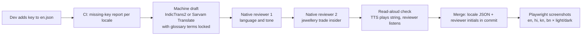

# Localization: Tola
> Project: Tola · Owner: Design lead (front end + design), with AI/voice lead for spoken output · Status: Draft v0.1 · Last updated: 2026-10-20
> Related: [DESIGN.md](./DESIGN.md) · [Design system](./DESIGN_SYSTEM.md) · [UI spec](./UI_SPEC.md) · [Accessibility](./ACCESSIBILITY.md) · [Models](../04-ai/MODELS.md) · [Prompts](../04-ai/PROMPTS.md) · [Frontend](../../implementation/demo/docs/FRONTEND.md)

Tola has two kinds of localization:
1. **Screen text.** The UI shows text in the user's language.
2. **Spoken read-back.** The karigar hears every entry in *his* language.

The second one is load-bearing (F-02, F-14, R-02, R-08). A wrong number on screen is a bug. A wrong number spoken aloud is a dispute.

---

## 1. Languages and priority

| Priority | Locale | UI | Voice (TTS read-back / STT confirm) | Track | Why |
|---|---|---|---|---|---|
| 1 | `en-IN` English | ✓ | n/a (en read-back available, not default) | Demo + v1 | Judges and jeweller desktop; source language for strings |
| 2 | `bn-IN` Bengali | ✓ | ✓ / ✓ | Demo + v1 | Mumbai's estimated 2.2 lakh karigars are mostly Bengali-speaking [S20]; persona P-02 Rafiq |
| 3 | `kn-IN` Kannada | ✓ | ✓ / ✓ | Demo + v1 | Bengaluru jewellers (P-01, P-03); the final is at Bangalore Palace; the KAVMS jury community |
| 4 | `hi-IN` Hindi | ✓ | ✓ / ✓ | Demo + v1 | Lingua franca of migrant karigars and multi-state workshops |
| 5 | `mr-IN` Marathi | v1 | v1 | Scalable | Mumbai workshop owners (P-05) and Maharashtra jewellers |
| 6 | `ta-IN` Tamil | v1 | v1 | Scalable | Coimbatore goldsmith cluster [S18] |
| later | `te-IN`, `ml-IN`, `gu-IN` | v2 | v2 | n/a | Thrissur, Hyderabad, Rajkot clusters (HUNCH from [S17][S18]) |

**The UI language and the voice language are separate settings.** Suresh's shop runs in Kannada and English, and Rafiq hears Bengali. In the demo, the phone stage renders in the **karigar's** locale whatever the app locale is (`PhoneFrame` nests its own provider; see §3).

**Voice provider:** Sarvam Saaras (`saaras:v3`, M-01) and Bulbul v3 (M-02) via `sarvamai` 0.1.37. Fallbacks:
- AI4Bharat IndicConformer for STT.
- AI4Bharat IndicF5 for TTS.
- Pre-generated clips for the demo (`AI_FALLBACK_MODE=cached`).

Sarvam's per-language voice availability for Bulbul v3 in bn/kn/hi/mr/ta is **not verified 2026-10-20**. Owner: AI/voice lead, confirm by 15 Nov 2026 in [MODELS.md](../04-ai/MODELS.md).

---

## 2. Framework: next-intl 4.14
- **Package:** `next-intl` 4.14 (brief §10; npm shows 4.14.9 on 2026-10-20) with the Next.js 16 App Router.
- **Mode:** **without i18n routing.** The locale lives in a cookie (`NEXT_LOCALE`), not in the URL. Language must change instantly mid-story without a route jump, and the story beat lives in the query string. v1 keeps the same mode; the public passport link `/p/[token]` takes `?lang=` for the recipient.
- **Message files:** `messages/{en,hi,kn,bn}.json` in the demo, plus `mr.json` and `ta.json` in v1. `en.json` is the source of truth for keys (Vakyam convention).
- **Type safety:** declare `AppConfig` so that a missing key fails `tsc`.

```ts
// src/i18n/request.ts
import { cookies } from 'next/headers';
import { getRequestConfig } from 'next-intl/server';

export const LOCALES = ['en', 'hi', 'kn', 'bn'] as const;       // v1: + 'mr', 'ta'
export type Locale = (typeof LOCALES)[number];

export default getRequestConfig(async () => {
  const c = (await cookies()).get('NEXT_LOCALE')?.value as Locale | undefined;
  const locale: Locale = c && LOCALES.includes(c) ? c : 'en';
  return {
    locale,
    messages: (await import(`../../messages/${locale}.json`)).default,
    timeZone: 'Asia/Kolkata',
  };
});
```

```ts
// src/i18n/global.d.ts
import en from '../../messages/en.json';
declare module 'next-intl' {
  interface AppConfig { Messages: typeof en; Locale: 'en' | 'hi' | 'kn' | 'bn' | 'mr' | 'ta'; }
}
```

```tsx
// PhoneFrame renders the karigar's locale regardless of the app locale
<NextIntlClientProvider locale={karigar.voiceLang} messages={karigarMessages}>
  <div lang={karigar.voiceLang}>{children}</div>
</NextIntlClientProvider>
```

**Key naming:** `area.screen.element[.state]`. Examples: `issue.button.submit`, `karigar.confirm.yes`, `reconcile.flag.title`, `sim.upi`. Keys are never reused across meanings.

**ICU usage:**
```json
{
  "issue": { "button": { "submit": "Issue {grams} to {name}" } },
  "reconcile": {
    "flag": { "title": "{delta} above agreed {norm} · {fine} ≈ {inr}" },
    "summary": "{count, plural, =0 {No karigars checked} one {# karigar within agreed wastage} other {# karigars within agreed wastage}}"
  }
}
```
Grams, ₹ and percentages are **pre-formatted strings** passed in as arguments (from `src/lib/format.ts`). They are never ICU `{x, number}`, because ICU would use the locale's digits and grouping (§6).

---

## 3. Script and font issues
| Issue | Rule |
|---|---|
| Fonts | Devanagari (hi, mr): **Mukta**. Bengali: **Noto Sans Bengali**. Kannada: **Noto Sans Kannada**. Tamil (v1): **Noto Sans Tamil**. All are self-hosted through Fontsource 5.3.0 and loaded on language switch. Fraunces/Figtree have no Indic glyphs (DESIGN §6). |
| Font order | Text: Figtree first, script font second (Latin words and digits inside Indic sentences stay in Figtree). Display: script font first. |
| Letter-spacing | `0` for every Indic `:lang()`. Tracking breaks conjunct and matra positioning. |
| Line height | +12% (Devanagari), +18% (Bengali, Tamil), +20% (Kannada) over Latin. |
| Uppercase | Indic scripts have no case. Mono uppercase labels become sentence-case 13 px labels in the script face. |
| Italic | Never synthesised: `font-synthesis: none`. Emphasis is by weight. |
| Headline animation | `MaskHeadline` splits with `Intl.Segmenter(lang, { granularity: 'word' })`, never by character or code unit. |
| Truncation | Never truncate gram figures or names of parties. Other text gets `line-clamp` with the full text in an accessible name. |
| Line breaking | `overflow-wrap: anywhere` on long compound words (Kannada). No `hyphens: auto` (not supported for these scripts in browsers). |
| Text expansion | Design for **+40%** over English. Buttons wrap to 2 lines rather than shrink. Pseudo-locale `en-XA` (accented, +40%) is used in Playwright screenshots. |
| Mixed direction | All target scripts are LTR; no RTL work needed. |
| Rendering check | Verify conjuncts and reph (e.g. "র্ম", "ಕ್ಷ", "क्ष") at 14 px on a low-end Android WebView. |

---

## 4. Tone in each language
- **Register.** Polite, plain, shop-floor. Hindi uses *aap*, Bengali *apni*, Kannada the plural-respectful *neevu* forms.
- **Trade words.** Use the word the bench uses, even when it is an English loanword ("order", "wastage", "labour" are common in workshops; HUNCH from [S17]; to be confirmed in field interviews). Avoid Sanskritised or bureaucratic vocabulary.
- **Numbers.** Always Latin digits on screen (§6), always spoken in the language.
- **Microcopy examples:** see [DESIGN.md §12](./DESIGN.md#12-voice-and-tone).

### 4.1 Glossary (draft: every Indic cell needs native trade-speaker review)
| Concept | en | hi | bn | kn | Notes |
|---|---|---|---|---|---|
| Karigar (artisan goldsmith) | karigar | कारीगर | কারিগর | ಕಾರಿಗರ್ / ಅಕ್ಕಸಾಲಿಗ | Kannada trade term to be confirmed |
| Tola (weight) | tola | तोला | তোলা | ತೊಲ | Brand only; UI weights are in grams |
| Gram | g / gram | ग्राम | গ্রাম | ಗ್ರಾಂ | Unit always "g" on screen |
| Issue (give gold) | issue | दिया / इश्यू | দেওয়া / ইস্যু | ಕೊಟ್ಟದ್ದು / ಇಶ್ಯೂ | Prefer the verb form in read-backs |
| Return | return | वापसी | ফেরত | ವಾಪಸ್ | n/a |
| Wastage (agreed loss) | wastage | घट / वेस्टेज | ঘাট / ওয়েস্টেজ | ವೇಸ್ಟೇಜ್ / ಘಟ | Field-check which is used locally |
| Fine gold | fine gold | शुद्ध सोना (फाइन) | খাঁটি সোনা (ফাইন) | ಶುದ್ಧ ಚಿನ್ನ (ಫೈನ್) | Show "fine" in brackets |
| Fineness | fineness | शुद्धता | বিশুদ্ধতা | ಶುದ್ಧತೆ | Always "declared" |
| Labour (making charge to karigar) | labour | मज़दूरी | মজুরি | ಕೂಲಿ / ಮಜೂರಿ | n/a |
| Settlement | settlement | हिसाब | হিসাব | ಲೆಕ್ಕ | "Hisaab" is widely understood |
| Signature / sign | sign | साइन / हस्ताक्षर | সই | ಸಹಿ | Prefer साइन in hi (spoken) |
| Dispute | dispute | आपत्ति | আপত্তি | ಆಕ್ಷೇಪ | Avoid "विवाद" (sounds legal/hostile) |
| Work Passport | Work Passport | काम का पासपोर्ट | কাজের পাসপোর্ট | ಕೆಲಸದ ಪಾಸ್‌ಪೋರ್ಟ್ | n/a |
| Simulated | simulated | नमूना | নমুনা | ಮಾದರಿ | Demo chip |

The glossary lives as `messages/_glossary.json`. The CI linter flags any translation that uses a non-glossary variant of a term.

---

## 5. Translation workflow

| Step | Tool | Notes |
|---|---|---|
| Machine draft | **IndicTrans2** (AI4Bharat, open source; self-host or the HF model) or the **Sarvam translate API** (model name and pricing not verified 2026-10-20). **Bhashini** (ULCA) translation APIs are the v1 government-aligned alternative (onboarding steps not verified 2026-10-20) | Drafts are never shipped unreviewed |
| Review | 2 native reviewers per language (one from the trade) | Demo: team members and field contacts. v1: paid reviewers at ₹1.5–3 per word (HUNCH) |
| Read-aloud | Bulbul TTS (or cached clips) | Catches strings that read well but sound wrong |
| Gate | CI fails if any `en` key is missing in a demo locale; warns for v1 locales | Script: `pnpm i18n:check` |
| Freeze | String freeze **10 Dec 2026** for the final demo (17 days before 27 Dec) | Owner: design lead |
| Agent output | Lyzr agent explanations (M-03) are generated in the target language with the glossary in the system prompt ([PROMPTS.md](../04-ai/PROMPTS.md)); numbers inside them are **inserted by code from ledger-core**, never written by the LLM | Prevents hallucinated digits |

**Demo deadline:** all demo strings in hi/kn/bn reviewed by **15 Nov 2026** (idea submission) for the screenshots, and final by **10 Dec 2026**.

---

## 6. Numbers, dates, currency and spoken numbers

### 6.1 On screen
| Value | Format | Example | Implementation |
|---|---|---|---|
| Grams | 2 decimals, thin space, "g", Latin digits, Indian grouping | `40.00 g`, `1,240.00 g` | `formatGrams(mg)` |
| Fine gold | 3 decimals + "fine" (translated word) | `36.640 g fine`, `0.229 g fine` | `formatFine(mg)` |
| Delta | Sign with true minus | `+0.38 g`, `−0.12 g` | `formatDelta(mg)` |
| Rupees | Indian lakh/crore grouping, ₹ prefix | `₹1,49,000`, `₹5,040.00` | `formatINR(paise)` |
| Percent | No space; wastage norms always 2 decimals | `2.50%`, `5%` (GST) | norms: `Intl.NumberFormat('en-IN', {style:'percent', minimumFractionDigits:2, maximumFractionDigits:2, numberingSystem:'latn'})` |
| Fineness | ppt + karat | `916 (22K)` | constant table |
| Dates | UI language words, **Latin digits** | `27 Dec 2026` / `27 दिस॰ 2026` | `Intl.DateTimeFormat(locale, {dateStyle:'medium', numberingSystem:'latn', timeZone:'Asia/Kolkata'})` |
| Time | 12-hour with the localized am/pm marker | `11:09 am` | same, `timeStyle:'short'` |
| Phone | `+91 98765 43210` | n/a | v1 only |

**Why grams and ₹ always use `en-IN` + Latin digits.** This was verified on Node 22.19 (ICU 77.1) on 2026-10-20:

| Locale | `currency INR` 149000 | `10` with 2 decimals |
|---|---|---|
| `en-IN` | `₹1,49,000.00` | `10.00` |
| `hi-IN` | `₹1,49,000.00` | `10.00` |
| `kn-IN` | `₹149,000.00` (**no lakh grouping**) | `10.00` |
| `bn-IN` | `₹১,৪৯,০০০.০০` (**Bengali digits**) | `১০.০০` |
| `mr-IN` | `₹१४९,०००.००` (**Devanagari digits, no lakh grouping**) | `१०.००` |
| `ta-IN` | `₹1,49,000.00` | `10.00` |

Locale-default formatting would therefore show the same gram in three different ways across the four demo languages. Tola pins `en-IN` + `numberingSystem: 'latn'` for every quantity, because scales, slips and UPI apps all show Latin digits. A native-digit echo under the gram figure is a v1 setting, off by default.

### 6.2 Spoken numbers (read-back, IVR, passport "hear it")
The TTS engine **never** receives raw digits. Code expands every number into words first, so that "10.00" can never be read as "ten" or "one thousand".

```ts
// src/voice/spell.ts (shape; per-language word tables reviewed by native speakers)
export function spellGrams(lang: Lang, mg: number): string {
  const whole = Math.floor(mg / 1000);
  const frac = String(Math.round((mg % 1000) / 10)).padStart(2, '0'); // 2 decimals, matches screen
  const W = WORDS[lang];   // 0–999 cardinal table + lakh/crore + decimal word + digit names
  return `${cardinal(W, whole)} ${W.point} ${W.digit[+frac[0]]} ${W.digit[+frac[1]]} ${W.gram}`;
}
```

| Lang | Decimal word | Zero | Gram | `40.00 g` spoken | `0.38 g` spoken |
|---|---|---|---|---|---|
| en | point | zero | grams | "forty point zero zero grams" | "zero point three eight grams" |
| hi | दशमलव | शून्य | ग्राम | "चालीस दशमलव शून्य शून्य ग्राम" | "शून्य दशमलव तीन आठ ग्राम" |
| bn | দশমিক | শূন্য | গ্রাম | "চল্লিশ দশমিক শূন্য শূন্য গ্রাম" | "শূন্য দশমিক তিন আট গ্রাম" |
| kn | ದಶಮಾಂಶ | ಸೊನ್ನೆ | ಗ್ರಾಂ | "ನಲವತ್ತು ದಶಮಾಂಶ ಸೊನ್ನೆ ಸೊನ್ನೆ ಗ್ರಾಂ" | "ಸೊನ್ನೆ ದಶಮಾಂಶ ಮೂರು ಎಂಟು ಗ್ರಾಂ" |
| mr (v1) | दशांश | शून्य | ग्रॅम | "चाळीस दशांश शून्य शून्य ग्रॅम" | "शून्य दशांश तीन आठ ग्रॅम" |
| ta (v1) | புள்ளி | பூஜ்ஜியம் | கிராம் | "நாற்பது புள்ளி பூஜ்ஜியம் பூஜ்ஜியம் கிராம்" | "பூஜ்ஜியம் புள்ளி மூன்று எட்டு கிராம்" |

Rules:
- Decimals are spoken **digit by digit** ("three eight", not "thirty-eight"), because that is how a slip is read aloud and it cannot be confused with a whole number. Field check: confirm with 5 karigars that this matches how they say weights. Some may say "das gram, adtis milli" (HUNCH). Owner: field + pitch lead, by 15 Nov 2026.
- Rupees are spoken with lakh/crore words ("पाँच हज़ार चालीस रुपये" for ₹5,040; "এক লাখ উনপঞ্চাশ হাজার টাকা").
- Hindi and Bengali cardinals 1–99 are irregular, so `WORDS[lang]` holds a full reviewed table and is not generated by rule. It is unit-tested against a golden file of 200 numbers per language (Vitest 5).
- **Code-mixed option (v1).** Many karigars say numbers in Hindi or English whatever their mother tongue. Settings → Voice → "Numbers in: my language / Hindi / English".
- **STT for "haan".** The accepted confirm tokens per language are "haan / हाँ / হ্যাঁ / ಹೌದು / होय / ஆமாம்" plus "yes" and "ok". The exact list and confidence threshold are owned by [MODELS.md](../04-ai/MODELS.md) (M-01). The numeral WER evaluation (code-mixed set) is owned by [AI_EVALS.md](../04-ai/AI_EVALS.md).

---

## 7. Locale-aware content beyond strings
| Item | Rule |
|---|---|
| Names | Shown as given; no first/last-name split (many karigars use one name) |
| Shop names | Not translated ("Suresh Jewellers" stays) but transliterated in read-backs by TTS |
| Audio clips (demo cache) | `public/audio/{lang}/{eventKey}.mp3`, generated from the reviewed string, checksum in the manifest |
| GST drafts | English (legal documents for the CA); a summary line in the user's language on screen |
| Consent notice (DPDP) | In the user's language, read aloud, with a version number; the English text is the reference version (see [privacy docs](../06-security-compliance/)) |
| WhatsApp templates (v1) | One template per language per message type; Meta template approval required per language |

---

## 8. Testing
| Test | Tool | Threshold |
|---|---|---|
| Missing keys | `pnpm i18n:check` (compares JSON key trees) | 0 missing in demo locales |
| Format rules | Vitest 5 on `format.ts` across all 6 locales | Grams/₹ identical across locales |
| Spoken numbers | Vitest golden files, 200 numbers × language | 100% match reviewed table |
| Layout overflow | Playwright 1.64 screenshots in `en-XA` (+40%), bn, kn | No clipped text, no horizontal scroll at 360 px |
| Font rendering | Manual on an Android Go device (Chrome WebView) | Conjuncts correct at 14 px |
| Read-aloud review | Reviewer listens to every demo clip | Sign-off per language by 10 Dec 2026 |

## 9. MVP (hackathon) vs v1 (production)
| Area | MVP (hackathon) → `implementation/demo` | v1 (production) → `implementation/scalable` |
|---|---|---|
| UI locales | en, hi, kn, bn | + mr, ta |
| Voice | bn, hi, kn read-back + "haan" STT; cached clips for every scripted line | All six + code-mixed numeral option |
| Translation | Team + field reviewers; IndicTrans2 / Sarvam drafts | Paid reviewers + Bhashini option; translation memory |
| Channels | On-screen mocks | WhatsApp templates and IVR prompts per language |
| Digits | Latin only | Optional native-digit echo |
