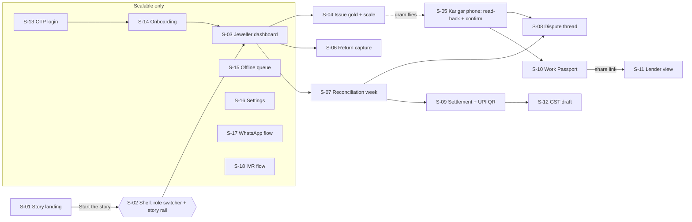

# UI Spec: Tola
> Project: Tola · Owner: Design lead (front end + design) · Status: Draft v0.1 · Last updated: 2026-10-20
> Related: [DESIGN.md](./DESIGN.md) · [Design system](./DESIGN_SYSTEM.md) · [Accessibility](./ACCESSIBILITY.md) · [Localization](./LOCALIZATION.md) · [PRD](../01-product/PRD.md) · [User journeys](../01-product/USER_JOURNEYS.md) · [Metrics](../01-product/METRICS.md) · [API spec](../03-engineering/API_SPEC.md) · [Demo build](../../implementation/demo/README.md) · [Scalable build](../../implementation/scalable/README.md)

This document covers every screen of both tracks. **S-01 to S-12** are demo screens (MVP (hackathon) → `implementation/demo`). **S-13 to S-18** are scalable-only screens (v1 (production) → `implementation/scalable`). Demo screens also ship in v1 without the role switcher and story rail.

> **New IDs introduced here:** `S-xx` screen IDs and the analytics event names in §4. They do not conflict with any brief ID. [METRICS.md](../01-product/METRICS.md) must mirror the event names in §4.

---

## 1. Screen map



### 1.1 Routes (proposed; [FRONTEND.md](../../implementation/demo/docs/FRONTEND.md) owns the final routing)
| ID | Screen | Route (demo) | Role | Features | APIs |
|---|---|---|---|---|---|
| S-01 | Story mode landing | `/` | Public | F-14 | API-01, API-08 (ticker) |
| S-02 | Shell: role switcher + story rail | layout `app/(app)/layout.tsx` | All | F-14 | API-02 |
| S-03 | Jeweller dashboard | `/jeweller` | P-01, P-03 | F-13, F-10 | API-03, API-04, API-08 |
| S-04 | Issue gold with scale widget | `/jeweller/issue` | P-01, P-03 | F-01, F-03 | API-05, API-06, API-07 |
| S-05 | Karigar phone: read-back + confirm | `/karigar` (and the phone stage) | P-02 | F-02, F-03, F-12 | API-09, API-07 |
| S-06 | Return capture | `/jeweller/return` | P-03 | F-04 | API-05, API-10, API-06 |
| S-07 | Reconciliation week view | `/jeweller/reconcile` | P-01 | F-05 | API-11 |
| S-08 | Dispute thread | `/disputes/[id]` | P-01, P-02 | F-06 | API-12, API-10 |
| S-09 | Settlement: two-tick card + UPI QR | `/settle/[id]` | P-01, P-02 | F-07 | API-13, API-14 |
| S-10 | Work Passport (karigar) | `/karigar/passport` | P-02 | F-08 | API-15 |
| S-11 | Lender mock view | `/p/[token]` | P-04 | F-08 | API-15 |
| S-12 | GST draft | `/settle/[id]/gst` | P-01 | F-09 | API-16 |
| S-13 | OTP login | `/login` | All | n/a | API-17 |
| S-14 | Onboarding | `/onboarding/*` | P-01, P-02, P-05 | F-14 | API-03, API-17 |
| S-15 | Offline queue / sync centre | `/sync` | All | F-11 | API-18 |
| S-16 | Settings | `/settings` | All | F-14 | n/a |
| S-17 | WhatsApp flow | (WhatsApp, not web) | P-02 | F-12 | API-19 |
| S-18 | IVR flow | (phone call) | P-02 | F-12 | API-19 |

### 1.2 The scripted week (seed data used on every demo screen)
These are the **canonical demo numbers** from [PROJECT_BRIEF §2](../00-overview/PROJECT_BRIEF.md) and [USER_JOURNEYS §6](../01-product/USER_JOURNEYS.md). If they change, those docs change first. ₹ labour is a HUNCH. The rate is ₹14,904/g 24K (₹1,49,041 / 10 g, 20 Oct 2026 [S47]); fineness is 916. The brief writes weights to 3 decimals (mg). The UI shows gross weights to 2 decimals (scale resolution 0.01 g, E-08) and fine gold to 3. Every canonical gross value is a multiple of 10 mg, so nothing is rounded.

| Item | Value |
|---|---|
| Shop | Suresh Jewellers, Avenue Road, Bengaluru (P-01 Suresh Shetty; staff P-03 Lakshmi) |
| Karigar | Rafiq Sheikh (P-02), voice language **bn**, 3 linked shops |
| Order | **#14**: plain 22K bangle pair, declared fineness 916, agreed wastage norm **2.50% of gross issued**, due Sat 19 Dec 2026 (customer wedding 24 Dec) |
| Mon 14 Dec | ISSUE **40.00 g** gross = 36.640 g fine (scale, stable) → both sign |
| Thu 17 Dec | RETURN piece **38.12 g** + SCRAP_RETURN **0.50 g** → returned 38.62 g |
| Reconcile (Sat 19 Dec) | allowed 2.50% × 40,000 mg = **1,000 mg**; loss 40,000 − 38,620 = **1,380 mg**; OVER_NORM flag **+380 mg** (0.380 × 0.916 × ₹14,904 ≈ **₹5,188**) |
| Rafiq's reply | Opens a dispute and replies by voice (bn); transcript: "the solder joint cracked, I redid it" |
| Resolution | Both agree to accept **130 mg** as rework wastage (ADJUSTMENT, signed by both) → **250 mg gross (229 mg fine)** stays on Rafiq's balance → DISPUTE_RESOLVE |
| Settlement ST-0007 (Sun 20 Dec) | Gold carried forward **0.229 g fine**; labour **₹4,800.00** (HUNCH) + 5% GST **₹240.00** (labour-invoice draft) → payable **₹5,040.00** → both approve → UPI intent ₹5,040.00 (simulated) |

### 1.3 Story beats (S-02 story rail, 7 beats, target ≤ 3 min on stage)
| Beat | Title (en) | Screens | Target time |
|---|---|---|---|
| 1 | Meet Suresh and Rafiq | S-01 → S-03 | 15 s |
| 2 | Issue 40.00 g | S-04 + S-05 (the gram flies) | 45 s |
| 3 | Thursday: the piece comes back | S-06 | 20 s |
| 4 | Saturday: Tola checks the week | S-07 | 25 s |
| 5 | Rafiq answers in Bengali | S-08 | 25 s |
| 6 | Settle: two ticks, then UPI | S-09 (+ S-12 peek) | 30 s |
| 7 | Rafiq's Work Passport | S-10 → S-11 | 20 s |

---

## 2. Global states and conventions
- **Loading.** A skeleton on the first load only. Re-fetches keep the stale data visible and show a 2 px top progress hairline.
- **Error.** An inline `Alert` with what happened, what is safe and one action. Example: "Couldn't reach the server. Nothing was signed. (Try again)". There are no error toasts for actionable errors.
- **AI unavailable.** If `AI_FALLBACK_MODE=cached`, a caption chip "Cached" appears next to the agent and voice output. If `off`, deterministic text is shown with "Agent offline · showing rule-based summary".
- **Offline (demo).** The demo assumes online. If `navigator.onLine === false`, a banner reads "You're offline. The story runs on cached data." In stage mode the API answers from a local fallback (R-07).
- **Offline (v1).** Banner: "Offline · 3 signed events waiting to sync" → S-15.
- **Empty.** Bench-lamp glyph, one sentence, one action.
- **Success.** Inline, next to the thing that changed (ticks, chips). A toast only when the change happened off-screen.
- **Simulated.** The `SimChip` is mandatory on UPI, lender, the simulated scale and the WhatsApp/IVR mocks.

---

## 3. Screens

### S-01 · Story mode landing (`/`)
**Purpose:** In 15 seconds a judge should understand the problem, the promise ("Two signatures on every gram") and how to start the story. The anatomy is in [DESIGN.md §14.1](./DESIGN.md#141-demo-landing--story-mode-landing-s-01).

```
┌ announce: Tech4Bharat · GAVS 2026 · Theme 2 Jeweltech · PS 2.2 ───────────────┐
│ ⚖✓✓ Tola तोला    How it works  Ledger  Passport    [EN▾] [◐]  (Start story ▸) │
│ GOLD JOB-WORK LEDGER                                   ┌─────┐┌─────┐ arc      │
│ Two signatures                                         │ J   ││ K   │          │
│ on every gram.                                         │40.00││40.00│          │
│ Weighed by the scale. Heard in his language.           │ ✓   ││ ✓✓  │          │
│ Signed by both.                                        └─────┘└─────┘          │
│ (Start the story ▸) (Open as Jeweller)                                         │
│ ── problem stats ── 01 02 03 how it works ── live ledger ticker [⏸] ──         │
│ ── two sides ── built with (text) ── closing CTA ── footer disclaimer ──       │
└────────────────────────────────────────────────────────────────────────────────┘
```
**Components:** `Nav` (material), `MaskHeadline`, `PillButton`, `Chip` ×4, `PhoneFrame` ×2 (inert), `StatCard` ×3, numbered `Card` ×3, ledger `.ticker` + pause `Button`, `ChainBadge`, `Reveal`.

**States:**
| State | Behaviour |
|---|---|
| Loading | Static HTML hero is visible immediately. Phones render a skeleton until seed data arrives (≤ 300 ms local). |
| Empty | n/a (always seeded) |
| Error | Ticker hides; ChainBadge reads "Ledger unavailable"; CTAs still work (S-02 falls back to cached seed) |
| Offline | Same as error, plus banner |
| Success | n/a |

**Copy (en):**
- Eyebrow: "Gold job-work ledger".
- H1: "Two signatures on every gram."
- Sub: "Weighed by the scale. Heard in his language. Signed by both."
- CTAs: "Start the story" / "Open as Jeweller".
- Problem H2: "A gram of argument costs ₹14,900." Stats: "₹4–5 lakh · of someone else's gold, held by one karigar"; "≈ ₹14,900 · one gram of 24K at ₹1.49 lakh / 10 g"; "Month end · when accounts are squared today".
- How H2: "Three steps. Two people. One record."
- Footer: "Prototype for Tech4Bharat 2026. UPI is simulated, the lender view is mocked, and Tola is not a verified weighing instrument."

**Analytics:** `landing_viewed`, `story_started {entry: 'hero'|'closing'}`, `role_opened_direct {role}`, `ledger_ticker_paused`, `chain_verify_clicked {result}`, `language_changed {from,to,screen}`.

---

### S-02 · Shell: role switcher + story rail (all app screens)
**Purpose:** Switch between personas without logging in, and walk a guided week in 7 beats. The layout is in [DESIGN.md §14.2](./DESIGN.md#142-app-shell-all-demo-screens).

```
┌ ⚖✓✓ Tola  [ Jeweller | Karigar | Lender ]  Suresh Jewellers ▾  ⟲ Reset  [EN▾] [◐] ┐
│  role content (60%)                                   │  phone stage (40%)        │
├──────────────────────────────────────────────────────────────────────────────────┤
│ ●──●──○──○──○──○──○  2/7  Issue 40.00 g     (◂ Back) (Next ▸)   ← → · R reset   │
└──────────────────────────────────────────────────────────────────────────────────┘
```
**Components:** `RoleSwitcher` (`ToggleButtonGroup`), `Dropdown` (persona within role), `Button` Reset (calls API-02 `POST /v1/demo/reset`), `StoryRail` (`Toolbar` + `ProgressBar` + `Kbd`), `PhoneFrame` (stage), `LanguageMenu`, `ThemeToggle`.

**Behaviour:**
- Role change slides the content along a shared axis; the pill uses `layoutId`.
- The URL updates (`?role=karigar&beat=2`) so that a refresh resumes the same beat.
- "Next" performs the beat's scripted action if it has not been done yet. For example, on beat 4 "Next" runs the reconciliation. Each scripted action is also clickable in the UI, so the presenter can do it by hand.
- Keys: `←`/`→` move between beats, `R` resets without a confirmation dialog, because a reset can be undone by replaying the beats; it fires a toast "Story reset · Undo". `?` shows a shortcut sheet.
- Rubber-band past beats 1 and 7.

**States:**
| State | Behaviour |
|---|---|
| Loading | Rail is shown; content skeleton |
| Error | Reset fails → inline Alert "Reset failed. The previous story is still loaded." |
| Offline | Rail continues on cached seed (fallback JSON in `public/seed/`) |
| Success | Each beat-complete dot fills on `spring.ui` |

**Copy:** Role labels: "Jeweller", "Karigar", "Lender (mock)". Beat titles are in §1.3. Reset toast: "Story reset to Monday."

**Analytics:** `role_switched {from,to,beat}`, `story_beat_entered {beat, ms_since_start}`, `story_beat_completed {beat, ms_in_beat}`, `story_reset`, `story_finished {total_ms}`, `shortcut_used {key}`.

---

### S-03 · Jeweller dashboard (`/jeweller`)
**Purpose:** Answer three questions immediately: *How much of my gold is out? With whom? What needs me today?*

```
┌──────────────────────────────────────────────────────────────────────────────┐
│ Good morning, Suresh                                 Mon 14 Dec 2026          │
│ ┌ Gold out (fine) ──┐ ┌ Open orders ─┐ ┌ Needs you ─────────────────────────┐ │
│ │  412.380 g fine   │ │  23  · 4 due │ │ ▲ 1 variance flag   ◷ 2 to sign     │ │
│ └───────────────────┘ └──────────────┘ └─────────────────────────────────────┘ │
│ Karigars                                         🔗 Chain verified · 42 events │
│ ┌──────────────────────────────────────────────────────────────────────────┐ │
│ │ Karigar        Lang  Gold held (fine)  Orders  Last signed   Status      │ │
│ │ Rafiq Sheikh   বাং    36.640 g          1      Mon ✓✓        ● in norm   │ │
│ │ Manju K.       ಕನ್ನ    81.640 g          5      Sat ✓✓        ● in norm   │ │
│ │ …                                                                        │ │
│ └──────────────────────────────────────────────────────────────────────────┘ │
│                     (Issue gold ▸)   (Record a return)   (Check this week)    │
└──────────────────────────────────────────────────────────────────────────────┘
```
**Components:** `StatCard` ×3 (`t-metric`), `LedgerTable`-style `Table` with `ScrollShadow`, `Avatar`, `Chip` (language, status), `ChainBadge`, `PillButton` primary "Issue gold", plus secondaries.

**States:**
| State | Behaviour |
|---|---|
| Loading | Three stat skeletons + 5 row skeletons |
| Empty | Bench lamp: "No karigars yet. Add your first karigar." (v1 → S-14; demo is always seeded) |
| Error | "Couldn't load balances. Nothing has changed in your ledger. (Retry)" |
| Offline (v1) | Balances show "as of 10:42" + banner |
| Success | Rows show ticks; flagged rows get a ▲ chip |

**Copy:** "Gold out (fine)" carries a tooltip: "Fine gold = weight × declared fineness ÷ 1000, computed by Tola's ledger, not AI." "Needs you" items are links.

**Analytics:** `dashboard_viewed {karigar_count, flags}`, `karigar_row_opened {karigar_id}`, `cta_issue_clicked`, `chain_verify_clicked {result}`.

---

### S-04 · Issue gold with scale widget (`/jeweller/issue`)
**Purpose:** Issue gold by weight to a karigar for an order. The weight comes from the scale, and both parties sign. This screen holds **the signature moment** ([DESIGN.md §10.4](./DESIGN.md#104-the-signature-moment-the-gram-number-jumps-onto-two-phones)).

```
┌ Issue gold ─────────────────────────────────────┬─ phone stage ───────────┐
│ To      [ Rafiq Sheikh ▾ ]  বাংলা voice         │  ┌────────────────────┐ │
│ Order   [ #14 Plain 22K bangle pair ▾ ]         │  │ Rafiq · বাংলা       │ │
│ Type    (● Plain 2.50%) (○ Studded 25.00%) (○ Antique 4.00%) ← signed  │ │
│ Fineness 916 (22K) · declared                   │  │  waiting…          │ │
│ ┌ SCALE ── Simulated ◌ ─────────────── (Connect scale) ┐│                    │ │
│ │                                               ││                    │ │
│ │            40.00 g   ← DM Mono 48, gold-line underline when stable     │ │
│ │            ● stable                          ││                    │ │
│ │  [10.00] [25.00] [40.00] ───●──── simulate    (Tare)│                    │ │
│ └───────────────────────────────────────────────┘│  └────────────────────┘ │
│ Photo  [📷 Add photo]  (optional)                │                         │
│                      ( Issue 40.00 g to Rafiq ▸ ) │                         │
└─────────────────────────────────────────────────┴─────────────────────────┘
```
**Components:** `Select`/`ComboBox` (karigar, order), `RadioGroup` (`OrderTypePicker`, shows the signed norm %), `ScaleWidget`, `GramFigure`, `Button` (photo, via `<input type=file capture>`), `PillButton` primary (the label includes the live weight), `PhoneFrame`, `SignatureTicks`, `HashChip`.

**Flow:**
1. Select karigar and order (pre-selected in the story).
2. The scale reading settles (stable after 800 ms).
3. The primary button enables, labelled "Issue 40.00 g to Rafiq".
4. On press, `POST /v1/scale/readings` (API-05) → `POST /v1/events` (API-06) returns the unsigned payload → the jeweller key signs → `POST /v1/events/{id}/signatures` (API-07). Tick ① is drawn.
5. The gram flies to both phones. The karigar phone (S-05) takes over.
6. On karigar "Haan", tick ② is drawn and the halo blooms on both screens. The HashChip appears. The button changes to "Issue another".

**States:**
| State | Behaviour |
|---|---|
| Scale disconnected | The widget shows "Connect scale" plus "Use simulated scale" (the demo default is simulated) |
| Settling | Button disabled with the tooltip "Waiting for a stable reading" |
| Stable | Button enabled |
| Zero / negative | "Place the gold on the scale"; button disabled |
| Web Serial unsupported | The Connect button is hidden; caption "Real scale needs Chrome on desktop" |
| Signing | Button label "Signing…" with a spinner; input is **not** locked (the user can still change the photo) |
| Waiting for karigar | Inline chip "◷ Waiting for Rafiq" + tick ① |
| Karigar said "Na" | Amber `Alert`: "Rafiq said something is wrong. The issue is not signed. (Re-weigh) (Open dispute)" |
| Error | "Not signed. Nothing was recorded. (Try again)" |
| Success | ✓✓ + halo + HashChip + toast if the user navigated away |

**Copy:** Button: "Issue {grams} to {name}". Norm caption: "Agreed with Rafiq on 2 Dec 2026 · both signed". Simulated chip: "Simulated scale · demo only".

**Analytics:** `issue_viewed`, `scale_connected {source}`, `scale_reading_stable {mg, source, ms_to_stable}`, `issue_submitted {mg, order_type}`, `event_signed {event_type, party:'jeweller'}`, `gram_flight_played {reduced_motion}`, `issue_both_signed {ms_issue_to_both}`, `issue_rejected_by_karigar`.

---

### S-05 · Karigar phone: voice read-back + confirm (`/karigar`, phone stage)
**Purpose:** Rafiq hears what was issued in Bengali and agrees with one tap or one word. **No reading is required.**

```
┌──────────────────────────┐
│ 9:41      Rafiq · বাংলা   │
│                          │
│ সুরেশ জুয়েলার্স থেকে      │  (from Suresh Jewellers)
│                          │
│        40.00 g           │  ← DM Mono 56, Latin digits
│   ২২ ক্যারেট · অর্ডার ১৪    │  caption, script font
│                          │
│   ▂▅▇▅▂▃▆▇▅▂  (🔊 আবার)  │  waveform + replay 48px
│   ◌ live · Sarvam        │
│                          │
│ ┌──────────────────────┐ │
│ │   হ্যাঁ, ঠিক আছে  ✓    │ │  64px, slate
│ └──────────────────────┘ │
│ ┌──────────────────────┐ │
│ │   না, ভুল আছে         │ │  64px, outline
│ └──────────────────────┘ │
│ 🎙 অথবা বলুন "হ্যাঁ"       │  (or say "haan")
└──────────────────────────┘
```
**Components:** `PhoneFrame`, `GramFigure size="phone"`, `ReadbackPlayer`, `ConfirmPair`, `SignatureTicks`, `Chip` (live/cached).

**Flow:**
1. The event arrives (the gram lands).
2. The read-back plays automatically on stage (API-09 `POST /v1/voice/readback`, lang `bn`).
3. A microphone ring opens for "haan" (M-01). The tap is always available.
4. "Haan" signs with the karigar key (API-07).
5. The phone shows ✓✓ and "দুজনেই সই করেছেন" (Both signed).

If he says "Na", a sheet opens: "What's wrong? (Weight) (Order) (Other)" plus "🎙 Say it". This opens a dispute (S-08) before the event is signed.

**States:**
| State | Behaviour |
|---|---|
| Idle | "No new entries. You'll hear the next one here." |
| Arriving | The gram lands; the ring pulses once |
| Playing | Waveform animates (static under reduced motion); the Haan button is enabled **during** playback (no forced wait) |
| Listening | Mic ring + "Listening…"; times out after 6 s back to tap only |
| Heard unclear | "Didn't catch that. Tap Haan or Na." (never auto-signs on a low-confidence STT result; threshold set in [MODELS.md](../04-ai/MODELS.md)) |
| TTS failed | The cached clip plays; if there is no clip, the on-screen text is shown at 22 px with a caption "Voice unavailable" |
| Signed | ✓✓ + halo + "Both signed. This line can't be changed now." |
| Error | "Not signed. Nothing changed. (Try again)" |

**Copy:** See [DESIGN.md §12](./DESIGN.md#12-voice-and-tone) for the en/hi/bn/kn read-back and buttons.

**Analytics:** `readback_played {lang, source:'live'|'cached', ms_latency}`, `readback_replayed`, `confirm_voice_heard {lang, confidence}`, `confirm_tapped {choice:'haan'|'na', via:'tap'|'voice'}`, `event_signed {party:'karigar'}`, `confirm_timeout`.

---

### S-06 · Return capture (`/jeweller/return`)
**Purpose:** Weigh back the finished piece, scrap and dust. A voice note plus scale readings become a structured RETURN event (intake agent, M-01 + M-03).

```
┌ Return from Rafiq · Order #14 ─────────────────────────────────────────────┐
│ Issued  40.00 g (Mon 14 Dec ✓✓)                                            │
│ ┌ Finished piece ───┐ ┌ Scrap ───────────┐ ┌ Dust ────────────┐            │
│ │ 38.12 g  ● stable │ │  0.50 g ● stable │ │  —  (add later)  │  ← each from│
│ │  (Weigh)          │ │  (Weigh)         │ │  (Weigh)         │    ScaleWidget│
│ └───────────────────┘ └──────────────────┘ └──────────────────┘            │
│ 🎙 Voice note from Rafiq (bn)  ▂▅▇▅▂  "solder joint cracked, I redid it"   │
│ ┌ Draft by Tola agent · Lyzr · check before signing ───────────────────┐  │
│ │ Order #14 · RETURN 38.12 g · SCRAP_RETURN 0.50 g · note: rework      │  │
│ │ Returned 38.62 g of 40.00 g (computed by ledger, not AI)             │  │
│ └───────────────────────────────────────────────────────────────────────┘  │
│                                      ( Record return · both sign ▸ )       │
└─────────────────────────────────────────────────────────────────────────────┘
```
**Components:** `ScaleWidget` ×3 (compact), `GramFigure`, `VoiceRecorder`, `AgentNote` (intake draft, editable fields with a diff highlight), `PillButton`, `SignatureTicks`.

**States:**
| State | Behaviour |
|---|---|
| Nothing weighed | Primary disabled, "Weigh the finished piece first" |
| Agent drafting | `Skeleton` inside AgentNote (≤ 3 s target; the cached fallback appears after 4 s) |
| Agent field mismatch | If the voice says a weight that differs from the scale: amber Alert "Voice said 38.2 g; scale says 38.12 g. Scale wins." (R-02) |
| Agent offline | Fields filled from the scale only, with "Agent offline" |
| Signing / Waiting / Success | As in S-04 |

**Copy:** "Scale wins" is the rule and is shown wherever voice and scale disagree.

**Analytics:** `return_viewed`, `return_weighed {part:'piece'|'scrap'|'dust', mg}`, `voice_note_recorded {lang, seconds}`, `intake_draft_shown {source, ms_latency}`, `intake_field_edited {field}`, `voice_scale_mismatch {delta_mg}`, `return_submitted`, `return_both_signed`.

---

### S-07 · Reconciliation week view (`/jeweller/reconcile`)
**Purpose:** Run the weekly check, see each karigar's and each order's fine-gold balance, and catch variance against the agreed norm **this week**.

```
┌ This week · 14–19 Dec 2026        [Mon][Tue][Wed][Thu][Fri][●Sat]  ( Run week ▸ ) ┐
│ ┌ Rafiq Sheikh ─────────────────────────────────────────────────────────────────┐ │
│ │ Order   Type     Issued   Returned  Used    Allowed       Variance             │ │
│ │ #14     Plain    40.00 g  38.62 g   1.38 g  1.00 g (2.50%) ▲ +0.38 g           │ │
│ │         ████████████████████|██████▌░░░░░░░░  138% of allowed                  │ │
│ │ #11     Plain    20.00 g  19.62 g   0.38 g  0.50 g (2.50%) ● within            │ │
│ └───────────────────────────────────────────────────────────────────────────────┘ │
│ ┌ ▲ Order #14 · 0.38 g above agreed 2.50% · 0.348 g fine ≈ ₹5,188 ────────────┐ │
│ │ Draft by Tola agent · Lyzr: "Thursday's voice note says a solder joint      │ │
│ │ cracked and was redone. Rework can add loss. Ask Rafiq before settling."   │ │
│ │ (Why? numbers)   (Ask Rafiq ▸)   (Accept as exception)                       │ │
│ └──────────────────────────────────────────────────────────────────────────────┘ │
└──────────────────────────────────────────────────────────────────────────────────┘
```
**Components:** `Tabs` (`WeekStrip`), `PillButton` "Run week" (API-11), `Table` per karigar, `VarianceBar` (`Meter`), `FlagCard` (`Card` + `Alert` + `AgentNote`), `Disclosure` ("Why? numbers" shows the ledger-core arithmetic line by line).

**States:**
| State | Behaviour |
|---|---|
| Not yet run | "Run this week's check. It takes a few seconds." |
| Running | Per-karigar rows fill in as results stream (or all at once ≤ 2 s); the button shows a spinner but stays interruptible (Cancel) |
| All within norm | Green summary: "All 8 karigars within agreed wastage this week." |
| Flags | Flags sorted by ₹ impact; ▲ appear on `spring.ui` |
| Agent offline | FlagCard shows the deterministic text: "Used 1.38 g, allowed 1.00 g (2.50% of 40.00 g). Excess 0.38 g." |
| Error | "Check didn't finish. No balances changed. (Run again)" |

**Copy:** Flag title template: "{delta} above agreed {norm} · {fine} fine ≈ {inr}". The rupee estimate carries a caption "at ₹14,904/g 24K (₹1,49,041 / 10 g, 20 Oct 2026) × 916 fineness". The "Why?" disclosure says "Arithmetic by Tola ledger. The agent only explains it."

**Analytics:** `reconcile_viewed`, `reconcile_run_started`, `reconcile_run_finished {karigars, flags, ms}`, `flag_viewed {order_id, delta_mg}`, `flag_why_opened`, `flag_ask_karigar {order_id}`, `flag_accepted_exception {order_id}`.

---

### S-08 · Dispute thread (`/disputes/[id]`)
**Purpose:** A disputed line stays visible and is never overwritten. Both parties talk (the karigar by voice), and resolution needs both signatures.

```
┌ ⚑ Dispute · Order #14 · +0.38 g above norm         Open · opened Sat 19 Dec ┐
│ Linked lines:  ISSUE 40.00 g ✓✓ #a3f9…  RETURN 38.12 g ✓✓ #77c0…  (visible)  │
│ ─────────────────────────────────────────────────────────────────────────── │
│  Suresh  "Order #14 used 0.38 g more than 2.50%. What happened?"  Sat 11:02 │
│                                                                              │
│                 Rafiq 🔊 ▂▅▇▅▂ 0:06  (bn)                          Sat 11:09 │
│                 "সোল্ডারের জোড়া ফেটে গেছিল, আবার করেছি"                     │
│                 Transcript (auto): "the solder joint cracked, I redid it"    │
│ ─────────────────────────────────────────────────────────────────────────── │
│ Resolve:  (● Accept 0.13 g as rework; 0.25 g (0.229 g fine) stays on Rafiq)  │
│           (○ Rafiq owes all 0.38 g)   (○ Other)                              │
│ [🎙 Hold to reply]  [ Type… ]                      ( Propose resolution ▸ )   │
│ Resolution needs both:  Suresh ◷   Rafiq ◷                                   │
└──────────────────────────────────────────────────────────────────────────────┘
```
**Components:** `Card` header with `Chip` (Open/Resolved), linked-line `HashChip`s, a `ListBox` of messages (voice bubbles with a player and transcript), `VoiceRecorder`, `TextArea`, `RadioGroup` (resolution type), `PillButton`, `SignatureTicks` ×2, `TolaSheet` for the composer on phones.

**States:**
| State | Behaviour |
|---|---|
| Open | Red outline chip ⚑ |
| Proposed | "Suresh proposed: accept as exception. Waiting for Rafiq." The karigar phone gets a read-back of the proposal |
| Resolved | Green chip; DISPUTE_RESOLVE + ADJUSTMENT events shown with ✓✓; the thread stays readable forever |
| Transcription failed | The voice bubble stays; "Transcript unavailable"; audio is still playable |
| Error | "Message not sent. (Retry)" with the audio kept locally |

**Copy:** Top caption (always visible): "Disputed lines stay in the ledger. Nothing is overwritten."

**Analytics:** `dispute_opened {source:'reconcile'|'karigar_na'}`, `dispute_message_sent {type:'voice'|'text', lang}`, `dispute_transcript_shown {lang, confidence}`, `dispute_resolution_proposed {kind}`, `dispute_resolved {kind, hours_open}`.

---

### S-09 · Settlement: two-tick card + UPI QR (`/settle/[id]`)
**Purpose:** Present the week's statement to both parties. On dual approval, a UPI payment intent opens (simulated, no money moves).

```
┌ Settlement ST-0007 · 14–20 Dec 2026 ───────────────────────────────────────┐
│   (S) Suresh Jewellers  ✓              (R) Rafiq Sheikh  ◷                 │
│ ─────────────────────────────────────────────────────────────────────────  │
│ Gold carried forward (Order #14)            0.229 g fine    ✓✓ agreed      │
│ Rework accepted (adjustment)                0.13 g          ✓✓ resolved    │
│ Labour                                      ₹4,800.00                       │
│ GST 5% on labour (invoice draft)            ₹240.00                         │
│ ───────────────────────────────────────────────────────────────            │
│ Net payable to Rafiq                        ₹5,040.00                       │
│ Draft by Tola agent: "Labour for Order #14; dispute resolved."  (Why?)     │
│                                  ( Approve as Suresh ▸ )                   │
│ ── after both ✓✓ (halo) ─────────────────────────────────────────────────  │
│   ┌──────────┐  Pay ₹5,040.00 to Rafiq Sheikh                               │
│   │ ▓▓ QR ▓▓ │  upi://pay?pa=…&am=5040.00&cu=INR&tn=Tola ST-0007            │
│   └──────────┘  ◌ Simulated: no money moves    (Open UPI app)  (View GST draft)│
└────────────────────────────────────────────────────────────────────────────┘
```
**Components:** `SettlementCard` (two `Avatar`, `SignatureTicks`), `Table` rows, `AgentNote`, `PillButton` → `ApproveDialog` (`AlertDialog`), `UpiQr` (`qrcode.react`), `SimChip`, `Link` to S-12.

**Rules:**
- An open dispute blocks approval of any line it touches: "Order #14 has an open dispute. Settle it first, or settle without this order." It is never hidden.
- The UPI link is built as `upi://pay?pa={TOLA_UPI_VPA}&pn={TOLA_UPI_PAYEE_NAME}&am={amount}&cu=INR&tn=Tola%20{settlementId}` (API-14).
- On desktop, "Open UPI app" shows the QR only. On Android it opens the intent.

**States:**
| State | Behaviour |
|---|---|
| Draft | Both ◷ |
| Awaiting the other party | ✓ + ◷ |
| Blocked by dispute | Danger Alert + link to S-08 |
| Approved | ✓✓ + halo + QR materializes (scale .98→1, blur 12→0) |
| Payment simulated | Chip "Simulated · marked paid" after the presenter taps "Mark paid (demo)" |
| Error | "Approval not recorded. Nothing was paid. (Retry)" |

**Copy:** ApproveDialog: title "Approve ST-0007?", body "You agree to these lines. Rafiq sees exactly the same statement. This can't be undone.", actions "Approve" / "Not yet".

**Analytics:** `settlement_viewed {id, role}`, `settlement_why_opened`, `settlement_approve_clicked {party}`, `settlement_approved {party}`, `settlement_both_approved {ms_between}`, `upi_intent_opened {surface:'qr'|'intent'}`, `payment_marked_simulated`.

---

### S-10 · Work Passport (karigar) (`/karigar/passport`)
**Purpose:** Rafiq owns a summary of his signed record and shares it with consent, for a set time, with someone he chooses.

```
┌──────────────────────────┐
│ আমার কাজের পাসপোর্ট        │  My Work Passport
│ Rafiq Sheikh · since Jun │
│ ┌──────────────────────┐ │
│ │ Gold 1,240.00 g       │ │
│ │ On time       94%     │ │  Meter
│ │ Within norm   38 / 40 │ │
│ │ Shops         3 ✓✓    │ │
│ └──────────────────────┘ │
│ (🔊 শুনুন)                 │  hear it
│ ( শেয়ার করুন ▸ )           │  Share → ShareSheet
│ Shared links              │
│  Co-op Bank · 7 days · ⓧ  │  revoke
└──────────────────────────┘
```
**ShareSheet (TolaSheet):**
- Recipient ("Co-op bank / NBFC", "New jeweller", "Other").
- Scope (`RadioGroup`: Summary only · Summary + monthly totals).
- Expiry (24 h · 7 days).
- A consent notice in bn, read aloud.
- "Share" creates a link (API-15 `POST /v1/passport/shares`) and offers WhatsApp share / copy / QR.

**States:**
| State | Behaviour |
|---|---|
| Too little history | "Your passport fills up as you sign work. 4 more weeks to show on-time %." |
| Shared | Lists active links with expiry |
| Revoked | `RevokeDialog`: "Stop sharing with Co-op Bank? The link stops working now." → link-off chip |
| Error | "Link not created. Nothing was shared." |

**Copy:** "Only you can share this. You can stop sharing at any time. Tola does not give you a score."

**Analytics:** `passport_viewed`, `passport_readback_played {lang}`, `passport_share_started`, `passport_shared {recipient_type, scope, expiry_h}`, `passport_revoked {age_h}`.

---

### S-11 · Lender mock view (`/p/[token]`)
**Purpose:** Show what a branch credit officer (P-04) sees. Clearly **mocked**, with no score.

```
┌ ◌ MOCK LENDER VIEW · not a real lender integration ─────────────────────────┐
│ Work Passport · shared by Rafiq Sheikh · expires 26 Dec 2026, 10:00          │
│ Consent: Summary + monthly totals · revocable by the karigar                 │
│ ┌ Gold handled ┐ ┌ On-time ┐ ┌ Within agreed wastage ┐ ┌ Shops ┐             │
│ │ 1,240.00 g   │ │ 94%     │ │ 38 of 40 orders       │ │ 3     │             │
│ └──────────────┘ └─────────┘ └───────────────────────┘ └───────┘             │
│ Monthly totals table …                  Every figure is from lines signed    │
│                                          by both parties. 🔗 Chain verified  │
│ Tola does not compute or sell credit scores. The lender decides.             │
└──────────────────────────────────────────────────────────────────────────────┘
```
**Components:** `Alert` (mock banner), `StatCard` ×4, `Table`, `ChainBadge`, `SimChip`.

**States:**
| State | Behaviour |
|---|---|
| Valid | As above |
| Expired | "This link expired on {date}. Ask the karigar to share again." |
| Revoked | "The karigar stopped sharing this record." (no data shown) |
| Invalid | 404 copy "Link not found" |

**Analytics:** `passport_link_opened {status}`, `passport_monthly_expanded`.

---

### S-12 · GST draft (`/settle/[id]/gst`)
**Purpose:** Produce a Rule 55 delivery-challan draft and a 5% labour-invoice draft [S24] for the CA. Tola **does not file** anything.

```
┌ GST drafts · ST-0007 ──────────────── ◌ DRAFT · for your CA, not filed ──────┐
│ [ Delivery challan (Rule 55) | Labour invoice (5%) ]   ← Tabs                 │
│ ┌──────────────────────────────────────────────────────────────────────────┐ │
│ │ Consignor: Suresh Jewellers · GSTIN (optional) …                         │ │
│ │ Job worker: Rafiq Sheikh · …                                             │ │
│ │ Goods: gold, 916, 40.00 g · purpose: job work · …                        │ │
│ └──────────────────────────────────────────────────────────────────────────┘ │
│ (Download PDF)   (Share with CA)        Draft by Tola agent · check before use │
└──────────────────────────────────────────────────────────────────────────────┘
```
**Components:** `Tabs`, `Card`, `Table`, `Chip` "Draft", `Link` (PDF, API-16), `AgentNote`.

**States:**
- Missing GSTIN: "Add your GSTIN to complete the draft (optional for the demo)".
- Generating: skeleton.
- Error: "Draft not generated. (Retry)".

**Analytics:** `gst_draft_viewed {tab}`, `gst_draft_downloaded {doc}`.

---

### S-13 · OTP login (v1 only, `/login`)
```
┌──────────────────────────┐
│ ⚖✓✓ Tola                  │
│ Your phone number         │
│ [ +91 │ 98765 43210     ] │
│ ( Send code ▸ )           │
│ ── after send ──          │
│ Enter the 6-digit code    │
│ [ _ ][ _ ][ _ ][ _ ][ _ ][ _ ] │  InputOTP, autocomplete=one-time-code
│ Resend in 0:28 · (Call me instead) │
└──────────────────────────┘
```
**Components:** `TextField` (tel, `inputmode="numeric"`), `InputOTP`, `PillButton`, `Link`.

**States:** invalid number (inline), sending, code sent, wrong code (3 tries, then 10-min cooldown copy), expired, rate-limited, **voice OTP** fallback (low literacy), offline ("You need a connection to sign in the first time").

**Copy:** Language picker before the phone field (icons + native names). "We'll send a code by SMS. No password."

**Analytics:** `login_viewed`, `otp_requested {channel:'sms'|'voice'}`, `otp_verified {attempts}`, `otp_failed {reason}`.

### S-14 · Onboarding (v1 only, `/onboarding/*`)
Steps:
1. **Language** (big tiles with spoken names).
2. **Role** (Jeweller / Karigar / Head karigar).
3. **Notice and consent** (DPDP; read aloud in the chosen language; "I agree" plus "Hear again").
4. **Device key**: "Create your signing key". A 4–6 digit PIN, explained as "Your PIN is your signature. Nobody at Tola can sign for you." (R-09)
5. **Jeweller:** shop details (GSTIN optional), invite karigars by phone (WhatsApp invite).
6. **Karigar:** accept the shop invite → **agree wastage norms** (plain / studded / antique %; each norm read back and signed by both; `NormField`).
7. **Scale setup** (connect or skip → display OCR in v1).

```
┌──────────────────────────┐
│ Step 3 of 6  ●●●○○○       │
│ আপনার তথ্য, আপনার অধিকার   │
│ (🔊 শুনুন)                 │
│ • What we keep …          │
│ • Who sees it …           │
│ • How to delete …         │
│ ( রাজি আছি ▸ )  (Not now) │
└──────────────────────────┘
```
**States:** resume after drop-off, invite expired, norm disagreement ("Rafiq proposed 5% for antique. Accept or counter?"), PIN mismatch.

**Analytics:** `onboarding_step_viewed {step}`, `consent_given {lang, played_audio}`, `key_created`, `karigar_invited {count}`, `invite_accepted`, `norm_proposed {type, pct}`, `norm_signed {type}`, `onboarding_completed {ms}`.

### S-15 · Offline queue / sync centre (v1 only, `/sync`)
```
┌ Sync ─────────────────────────────── ☁̸ Offline since 10:42 ┐
│ Waiting to sync (signed on this phone)                       │
│  ISSUE 40.00 g · Rafiq · signed ✓ (you) · ◷ server           │
│  RETURN 38.12 g · Manju · ✓✓ · ◷ server                      │
│ Conflicts (need you)                                         │
│  ▲ Event chain moved on the server. (Review)                 │
│ Last synced 10:41 · (Sync now)                               │
└──────────────────────────────────────────────────────────────┘
```
**Rules:**
- Events are signed locally and queued in Dexie 4.4.
- API-18 `POST /v1/sync` batch.
- A conflict never auto-merges a gram figure. The user re-confirms.

**States:** online-idle ("All synced"), offline-queued, syncing (`ProgressCircle`), partial failure, conflict, storage nearly full.

**Analytics:** `sync_started {queued}`, `sync_finished {ok, failed, ms}`, `sync_conflict {kind}`, `offline_banner_shown`.

### S-16 · Settings (v1 only, `/settings`)
Sections:
- **Language** (UI and voice can be set separately).
- **Voice** (speed 0.8× / 1× / 1.2×, auto-play on/off).
- **Text size** (follows the system, with an override of +2 steps).
- **Theme** (light / dark / system / sunlight high-contrast).
- **Signing key and devices** (list, revoke a lost phone).
- **Head-karigar delegation** (v1.1, R-09).
- **My data** (download everything as PDF/CSV; delete account, with the explanation that signed ledger lines are retained per law; see the [privacy docs](../06-security-compliance/)).
- **Shared passport links.**
- **About** (versions, licences, "Voice by Sarvam AI", "Agents by Lyzr").

**Analytics:** `settings_changed {key, value}`, `device_revoked`, `data_export_requested`, `account_delete_requested`.

### S-17 · WhatsApp flow (v1 only, karigar channel F-12; simulated in the demo inside `PhoneFrame` as `WhatsAppMock`)
```mermaid
sequenceDiagram
  participant T as Tola (WhatsApp Cloud API)
  participant K as Karigar (WhatsApp)
  T->>K: Template message (bn): "Suresh Jewellers issued 40.00 g · Order 14" + audio clip (read-back)
  T->>K: Interactive reply buttons: [হ্যাঁ, ঠিক] [না, ভুল] [আবার শুনুন]
  K->>T: Button reply "হ্যাঁ, ঠিক" (or a voice note)
  T->>T: Webhook API-19 → Signature with assurance_tier = channel_whatsapp_ivr (not a device key; see note)
  T->>K: "✓✓ দুজনেই সই করেছেন · #a3f9…" + link to his ledger
```
**Signature note:** a WhatsApp button or IVR keypress cannot carry the karigar's device key. These confirmations are recorded as an E-07 `Signature` with **`assurance_tier = channel_whatsapp_ivr`** (brief §6; the other tiers are `device_key` and `witnessed_in_person`). The evidence is the WhatsApp message ID or call ID, the phone number and a timestamp, countersigned by the server. The UI shows it in the **channel tick style**: a tick with a small chat badge (✓ⓦ) or phone badge (✓☎), labelled "Confirmed on WhatsApp" or "Confirmed by phone call". It is never drawn identical to a `device_key` tick. The tier is listed in the HashChip tooltip and in the lender view.

**Message copy rules:**
- ≤ 2 lines.
- The number is always in Latin digits plus an audio clip.
- No links except his own ledger.
- Template names: `tola_issue_confirm_v1`, `tola_return_confirm_v1`, `tola_settlement_ready_v1`, `tola_dispute_update_v1` (new names; Meta approval is needed per template).

**States:** delivered / read / no reply in 2 h (one reminder, then the jeweller sees "Not confirmed yet"), "Na" → a dispute is opened, voice note → API-10 intake.

**Analytics:** `wa_template_sent {template, lang}`, `wa_reply {choice, ms_to_reply}`, `wa_voice_note {seconds}`, `wa_no_reply`.

### S-18 · IVR flow (v1 only, feature phones; demo simulated as `IvrMock`)
```
Call from Tola (Exotel or Sarvam voice agent):
 "Namaskar Rafiq. Suresh Jewellers issued forty point zero zero grams, twenty-two carat, for order fourteen."
 ├─ Press 1 or say "haan" → "Thank you. Recorded as confirmed by phone." (Signature assurance_tier = channel_whatsapp_ivr, ✓☎)
 ├─ Press 2 or say "na"   → "Tell us what's wrong after the beep." → voice note → dispute
 ├─ Press 9               → repeat
 └─ No input × 2          → "We'll call again in 1 hour." (max 3 attempts/day)
```
**Rules:** language from the profile; numbers expanded to words by code ([LOCALIZATION.md §6](./LOCALIZATION.md#6-numbers-dates-currency-and-spoken-numbers)); calls only between 09:00 and 20:00 local time.

**Analytics:** `ivr_call_placed`, `ivr_input {digit_or_voice, choice}`, `ivr_repeat`, `ivr_no_answer`.

---

## 4. Analytics event conventions
- **Names:** `snake_case`, `object_action`, past tense for completions. Every event carries `{session_id, role, beat?, lang, theme, reduced_motion, track:'demo'|'scalable', ts}`.
- **Demo:** events go to an in-memory ring buffer shown in a hidden "Stage stats" panel (`Shift+S`), used to prove timings in rehearsal (story total ≤ 180 s). **No third-party analytics in the demo.**
- **Scalable:** the sink, retention and dashboards are defined in [METRICS.md](../01-product/METRICS.md) and [OBSERVABILITY.md](../../implementation/scalable/docs/OBSERVABILITY.md).
- **No PII in properties:** IDs only, never names, phone numbers, audio or transcripts.

## 5. Acceptance targets (UI)
| Target | Value | How measured |
|---|---|---|
| Story runs end to end | ≤ 180 s, 0 errors, 10 rehearsals in a row | `story_finished.total_ms`, Playwright e2e |
| Issue → both signed (stage) | ≤ 6 s including read-back | `issue_both_signed.ms_issue_to_both` |
| Press feedback | First visual change ≤ 100 ms after pointer-down | Chrome DevTools performance trace |
| Gram flight | 60 fps on a 2020-class laptop at 1920×1080, no long tasks > 50 ms | Performance panel |
| Karigar confirm without reading | 5/5 field testers with low literacy succeed (pilot, Dec 2026) | Moderated test, owner: field + pitch lead |
