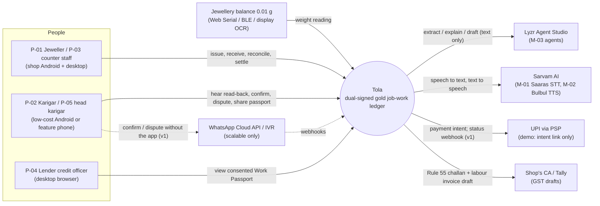
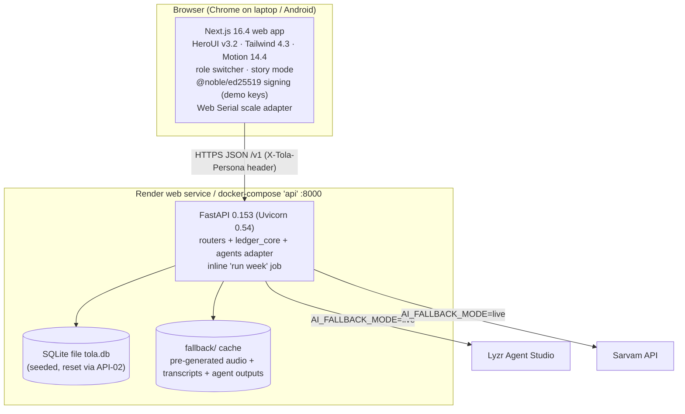
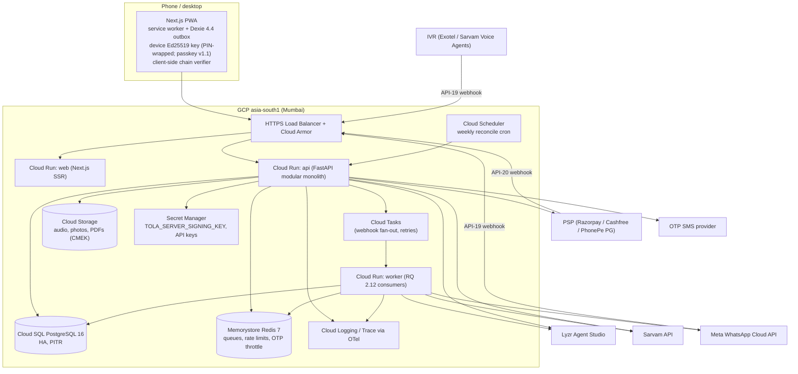
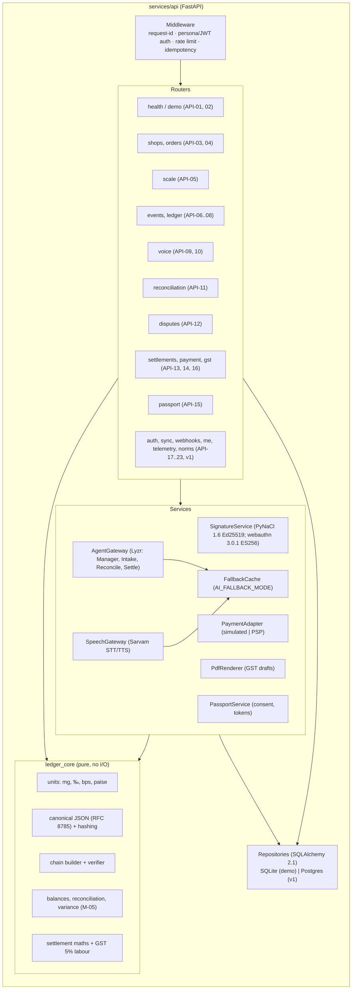
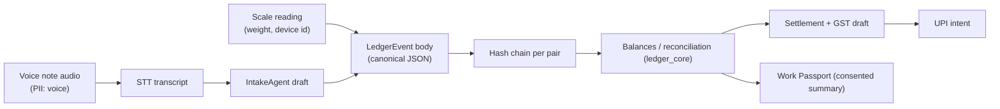
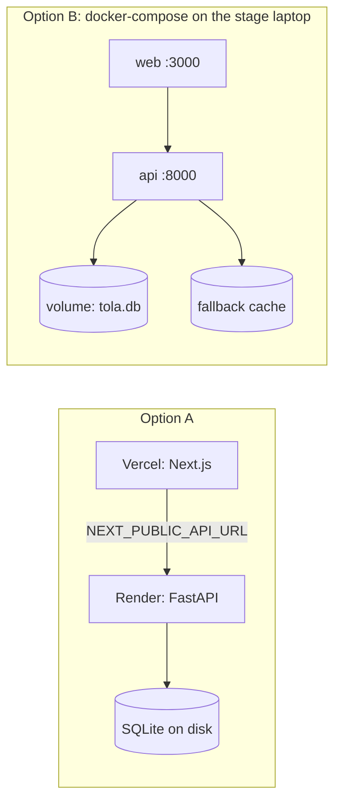
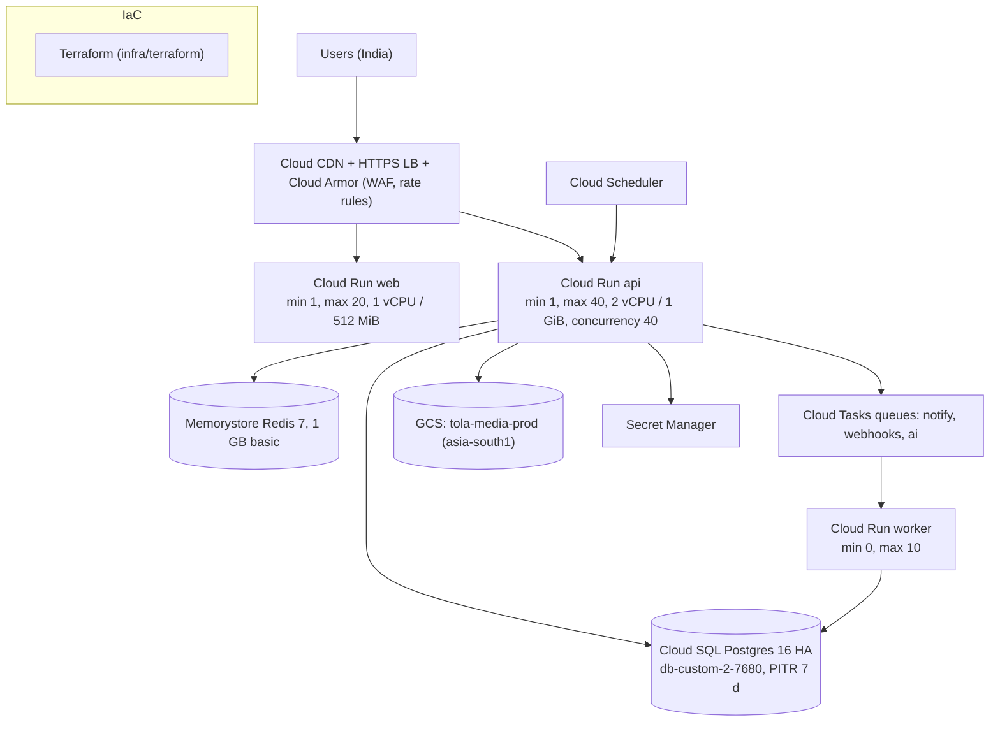

# Architecture
> Project: Tola · Owner: Back end + crypto lead · Status: Draft v0.1 · Last updated: 2026-10-20
> Related: [Project brief](../00-overview/PROJECT_BRIEF.md) · [PRD](../01-product/PRD.md) · [Tech stack](TECH_STACK.md) · [Data model](DATA_MODEL.md) · [API spec](API_SPEC.md) · [Integrations](INTEGRATIONS.md) · [Hardware](HARDWARE.md) · [AI models](../04-ai/MODELS.md) · [Security architecture](../06-security-compliance/SECURITY_ARCHITECTURE.md) · [OpenAPI](../../api/openapi.yaml)

Tola is a **two-party, append-only gold ledger**. The scale supplies the weight, the karigar confirms it by voice, both parties sign, and deterministic code (`ledger-core`) does all the arithmetic. AI agents (Lyzr, M-03) listen, extract, explain and draft. They never compute grams and never sign anything.

This document is **common** to both builds:

| Track | Folder | Scope |
|---|---|---|
| **MVP (hackathon)** | [`implementation/demo`](../../implementation/demo/README.md) | No login, role switcher, seeded story week, SQLite, inline jobs, Vercel + Render or one Docker Compose |
| **v1 (production)** | [`implementation/scalable`](../../implementation/scalable/README.md) | OTP auth, Postgres, offline-first PWA, WhatsApp/IVR, workers, GCP asia-south1 |

Both builds implement the same contract ([`api/openapi.yaml`](../../api/openapi.yaml)) and the same chain format, so a ledger exported from the demo verifies with the scalable verifier ([ADR-0001](adr/ADR-0001-two-track-repo.md)).

---

## 1. Architectural principles
1. **Weights are measured, never typed** (F-01). A `ScaleReading` (E-08) is the only source of a gram figure. The only fallback is a manual entry that both people type, and it is flagged `source=manual_dual`; see [HARDWARE.md](HARDWARE.md).
2. **Integer milligrams, deterministic code.** All gold arithmetic lives in `ledger-core` and uses integers: mg, fineness in parts per thousand (‰), wastage norms in basis points, money in paise ([ADR-0006](adr/ADR-0006-integer-mg-deterministic-ledger-core.md)).
3. **Two signatures on every gram.** Every ledger event (E-06) counts toward a balance only when both the jeweller side and the karigar have signed it with Ed25519 (E-07) ([ADR-0005](adr/ADR-0005-hash-chain-dual-ed25519.md)).
4. **Append-only and tamper-evident.** Events are SHA-256 hash-chained per shop–karigar pair. Corrections are new `ADJUSTMENT` events, and disputes are `DISPUTE_OPEN` / `DISPUTE_RESOLVE` events. Nothing is updated or deleted.
5. **The karigar holds his own copy.** His device can verify the chain (§9), and every settlement checkpoints the chain head hash under both signatures.
6. **AI behind a human gate.** Each agent output is a *draft*, and a human reads it (or hears it) and signs. When an AI service fails, the system degrades to cached or template output and keeps working ([ADR-0007](adr/ADR-0007-lyzr-agents-sarvam-speech-fallback.md)).
7. **One contract, two tracks.** Demo-only endpoints (API-02) and scalable-only endpoints (API-17..API-23) are tagged `x-tola-track` in OpenAPI.

---

## 2. C4 level 1: system context



---

## 3. C4 level 2: containers

### 3.1 MVP (hackathon): `implementation/demo`



### 3.2 v1 (production): `implementation/scalable`



---

## 4. C4 level 3: API components (shared by both tracks)



**Rules enforced in code review:**
- `ledger_core` imports nothing from FastAPI, SQLAlchemy or any AI SDK. It is a pure function library with 100% branch coverage.
- No router computes a weight. Routers call `ledger_core`.
- `AgentGateway` returns typed drafts (Pydantic). Before any draft is persisted, its numeric fields are **overwritten by `ledger_core` values** or checked against them, so an LLM-invented number cannot reach the ledger (see [MODELS](../04-ai/MODELS.md)).

### 4.1 Web components (both tracks)

| Component | Responsibility |
|---|---|
| `RoleSwitcher` (demo only) | Sets the `X-Tola-Persona` header and the persona's demo key |
| `StoryMode` (demo only) | Scripted week: Mon issue → Wed return → Fri run week → flag → dispute → settlement → UPI → passport |
| `ScaleCapture` | Adapters: `SimulatedScale`, `WebSerialScale`, `BleScale` (v1), `DisplayOcr` (M-04); emits a stable reading after 1.5 s within ±0.01 g |
| `ReadBackSheet` | Plays the M-02 audio, shows the gram figure in DM Mono, 44 px confirm targets, "haan" voice confirm |
| `Signer` | Builds the signing message, signs with `@noble/ed25519`, posts to API-07 |
| `ChainBadge` | Runs the §9 verifier in the browser (WebCrypto SHA-256 + noble verify) and shows "Verified on this device" |
| `Outbox` (v1) | Dexie queue of signed drafts and the API-18 sync loop |

---

## 5. Key flows (sequence diagrams)

### 5.1 Issue → read-back → dual-sign (F-01, F-02, F-03)

```mermaid
sequenceDiagram
  autonumber
  actor J as Jeweller staff (P-03)
  participant W as Web app
  participant S as Balance (serial / sim)
  participant A as API
  participant LC as ledger_core
  participant SV as Sarvam TTS (M-02)
  actor K as Karigar (P-02)
  J->>W: New issue, Order #14 (ORD-0014), plain 22K bangles
  W->>S: read stable weight
  S-->>W: 40.000 g (stable)
  W->>A: POST /v1/scale/readings {weight_mg: 40000, source: serial}  (API-05)
  A-->>W: 201 reading_id
  W->>A: POST /v1/events {type: ISSUE, reading_id, fineness_ppt: 916}  (API-06)
  A->>LC: fine_mg = floor(40000×916/1000) = 36640; body_hash; seq; chain hash
  A-->>W: 201 event {status: pending_signatures, body_hash, signing_message}
  W->>A: POST /v1/voice/readback {event_id, lang: bn-IN}  (API-09)
  A->>SV: text-to-speech (bulbul:v3)
  SV-->>A: wav (base64)
  Note over A: on error/timeout 2.5 s → cached clip<br/>or on-device number template
  A-->>W: audio_url + text
  W-->>K: plays "চল্লিশ গ্রাম…" (40 grams, in Bengali)
  K->>W: taps ✔ or says "haan"
  W->>A: POST /v1/events/{id}/signatures {role: karigar, signature}  (API-07)
  J->>W: confirm
  W->>A: POST /v1/events/{id}/signatures {role: jeweller, signature}
  A->>A: verify both Ed25519 sigs; server witness sig
  A-->>W: event {status: committed}
  W-->>J: balance +36.640 g fine (40.000 g gross) for Rafiq
```

If the karigar says "na" or taps ✖, the client calls API-12 to open a dispute that references the pending event. The event stays `pending_signatures` and is never counted in a balance.

### 5.2 Return → intake agent (F-04)

```mermaid
sequenceDiagram
  autonumber
  actor K as Karigar
  participant W as Web app
  participant A as API
  participant STT as Sarvam STT (M-01)
  participant IA as Lyzr IntakeAgent (M-03)
  participant LC as ledger_core
  K->>W: places finished piece + scrap on the balance
  W->>A: POST /v1/scale/readings ×2 (piece 38.120 g, scrap 0.500 g)
  K->>W: voice note "Order 14 bangles ready, half gram scrap"
  W->>A: POST /v1/voice/intake {audio, lang: bn-IN, reading_ids}  (API-10)
  A->>STT: speech-to-text (demo saaras:v3 / v1 saaras:v4; clips ≤ 30 s, longer → batch)
  STT-->>A: transcript
  A->>IA: transcript + open orders + reading ids (text only)
  IA-->>A: draft {order_id, events:[RETURN, SCRAP_RETURN], confidence}
  A->>LC: weights come ONLY from reading_ids; drop any number not matching a reading
  A-->>W: draft events + field confidence + mismatches
  W-->>K: read-back (5.1) for each draft
  Note over W,A: then the same dual-sign path as 5.1 (API-06 → API-07)
```

### 5.3 Weekly reconcile → flag → dispute (F-05, F-06)

```mermaid
sequenceDiagram
  autonumber
  participant T as Trigger (demo: "Run week" button / v1: Cloud Scheduler Sun 20:00 IST)
  participant A as API / worker
  participant LC as ledger_core
  participant RA as Lyzr ReconcileAgent
  actor J as Jeweller
  actor K as Karigar
  T->>A: POST /v1/reconciliation/runs {shop_id, period}  (API-11)
  A->>A: verify every pair chain (§9) — abort run if broken
  A->>LC: per order: consumed = issued − returned − scrap − dust
  LC-->>A: variance_mg vs norm (WastageNorm E-05), robust z (M-05)
  A->>RA: flags (numbers fixed) → plain-language explanation in en + karigar language
  RA-->>A: explanation text (no numbers changed; validator checks)
  A-->>J: run summary, 1 critical flag (ORD-0014: loss 1,380 mg vs allowed 1,000 mg → +380 mg)
  A-->>K: same flag, his language, audio
  K->>A: POST /v1/disputes {flag_id, voice message}  (API-12)
  A->>A: append DISPUTE_OPEN event (dual-signable)
  J->>A: POST /v1/disputes/{id}/messages
  J->>A: POST /v1/disputes/{id}/resolve {kind: ADJUSTMENT, weight_mg: −130} (agreed: 130 mg written off)
  A-->>J: DISPUTE_RESOLVE + ADJUSTMENT events pending signatures (250 mg gross / 229 mg fine stays on Rafiq's balance)
  J->>A: sign; K->>A: sign  (API-07)
  A-->>J: dispute closed (both signed)
```

### 5.4 Settlement → UPI (F-07, F-09)

```mermaid
sequenceDiagram
  autonumber
  actor J as Jeweller
  participant A as API
  participant LC as ledger_core
  participant SA as Lyzr SettleAgent
  actor K as Karigar
  participant U as UPI app (PSP in v1)
  J->>A: POST /v1/settlements {pair_id, period_from, period_to}  (API-13)
  A->>LC: gold balance (fine mg), labour ₹ (paise), dust credit, GST 5% on labour, chain head hash
  A->>SA: numbers (fixed) → narrative in both languages
  A-->>J: draft settlement + narrative
  J->>A: POST /v1/settlements/{id}/approve {signature}
  K->>A: POST /v1/settlements/{id}/approve {signature}  (after audio read-back)
  A->>A: both signatures valid → status approved; SETTLEMENT event appended
  J->>A: POST /v1/settlements/{id}/payment-intent  (API-14)
  A-->>J: upi://pay?pa=…&am=…&tr=STL-… + QR (demo: status simulated)
  J->>U: opens intent / scans QR
  U-->>A: v1 only: POST /v1/webhooks/psp (API-20) → status paid
  J->>A: GET /v1/settlements/{id}/gst-draft (API-16) → PDF "DRAFT"
```

### 5.5 Work Passport share (F-08)

```mermaid
sequenceDiagram
  autonumber
  actor K as Karigar
  participant A as API
  participant LC as ledger_core
  actor L as Lender officer (P-04)
  K->>A: POST /v1/passport/shares {scope, recipient_label, expires_in_days: 7}  (API-15)
  A-->>K: consent notice (his language) → K confirms → share {token, url, expires_at}
  K-->>L: sends link (WhatsApp / QR)
  L->>A: GET /v1/passport/{token}
  A->>A: check not expired / revoked; log access
  A->>LC: grams handled, on-time %, variance vs norm (committed events only)
  A-->>L: passport summary + chain head hash + server signature (no score, no raw events unless scope=detailed)
  K->>A: DELETE /v1/passport/shares/{id}
  A-->>K: revoked; later GETs → 410 Gone
```

---

## 6. Data flow and classification



- **Sent to Lyzr:** transcripts, order ids, and numbers fixed by `ledger_core`. Names are replaced by pseudonymous ids (`K-7f3a`) before any call.
- **Sent to Sarvam:** audio from voice notes (STT) and read-back text (TTS). No phone numbers, GSTIN or bank details.
- **Never leaves Tola:** private keys (they stay on the device), phone numbers, UPI VPAs (except inside the intent that the payer opens).
- Field-level PII classes are in [DATA_MODEL.md](DATA_MODEL.md). DPDP handling is in [PRIVACY.md](../06-security-compliance/PRIVACY.md).

---

## 7. Deployment views

### 7.1 MVP (hackathon)

| Option | Web | API | DB | When |
|---|---|---|---|---|
| **A. Cloud (default)** | Vercel (Hobby) `tola-demo.vercel.app` | Render web service (Starter, Singapore region; always on, so no cold start on stage) | SQLite on a Render persistent disk `/data/tola.db` | Prototype-round submission, judges' async review |
| **B. Stage laptop (fallback)** | `docker compose up` → web :3000 | api :8000 | SQLite volume | The finale at Bangalore Palace: works with **no internet** when `AI_FALLBACK_MODE=cached` |



Render free instances spin down when idle (not verified 2026-10-20 for the current plan terms). For the finale, use Starter or Option B.

### 7.2 v1 (production): GCP asia-south1



Container images are built from `implementation/scalable/infra/docker/web.Dockerfile`, `api.Dockerfile` and `worker.Dockerfile`, pushed to Artifact Registry (asia-south1) by `scalable-deploy.yml`, and deployed with Terraform from `implementation/scalable/infra/terraform`.

All data stays in asia-south1. Backups go cross-region to asia-south2 (Delhi) for DR ([ADR-0009](adr/ADR-0009-gcp-asia-south1-hosting.md)).

---

## 8. Scalability approach (v1)
| Dimension | Target (v1 pilot → year 1) | Approach |
|---|---|---|
| Shops / karigars | 50 shops / 400 karigars → 2,000 / 15,000 | Stateless Cloud Run; Postgres partitioning of `ledger_events` by `shop_id` hash once rows exceed 50 M |
| Events | ~20 events per karigar per week → ~300k/week at year 1 | Insert-only table; covering index `(pair_id, seq)` |
| Write latency | p95 < 300 ms for API-06/07 (excluding AI) | No AI on the signing path; signatures verified in-process (PyNaCl ≈ tens of µs) |
| Read-back latency | p95 < 2.5 s end-to-end | TTS cache keyed by `(text_hash, lang, speaker)` in GCS |
| Weekly reconcile | 15k pairs in < 10 min | Fan-out one Cloud Task per shop; pure-integer maths |
| Availability | 99.5% monthly (pilot) | Cloud Run multi-zone, Cloud SQL HA |

Chain contention: each pair's chain takes a row lock on `shop_karigar_links.head_seq` (`SELECT … FOR UPDATE`). Pairs are independent, so throughput scales with the number of pairs.

---

## 9. Hash-chain and signature specification
Decision record: [ADR-0005](adr/ADR-0005-hash-chain-dual-ed25519.md). This spec is normative for both tracks and for `packages/ledger-core`.

### 9.1 Event body
`body` is the canonical JSON ([RFC 8785 JCS](https://www.rfc-editor.org/rfc/rfc8785)) of:

```json
{
  "v": 1,
  "event_id": "0192f6a8-7c1e-7b3a-9d2e-5c1f0a2b3c4d",
  "pair_id": "PAIR-01",
  "type": "ISSUE",
  "order_id": "0192f6a8-0000-7000-8000-000000000014",
  "weight_mg": 40000,
  "fineness_ppt": 916,
  "fine_mg": 36640,
  "reading_ids": ["RD-8812"],
  "norm_id": "WN-07@3",
  "refs": [],
  "note": null,
  "created_by": "PER-03",
  "created_at": "2026-12-27T10:42:13.120Z"
}
```

Rules:
- Integers only for quantities. Timestamps are UTC ISO-8601 with milliseconds.
- `fine_mg = floor(weight_mg × fineness_ppt / 1000)` (integer division, **floor**), computed by `ledger_core` and checked by the server. This answers PRD open question Q-1; see [ADR-0006](adr/ADR-0006-integer-mg-deterministic-ledger-core.md).
- `refs` holds the event ids that an `ADJUSTMENT`, `DISPUTE_*` or `SETTLEMENT` event points at.

### 9.2 Hashes and signatures
```
body_hash  = SHA-256( JCS(body) )
sign_msg   = UTF8("tola:v1:body:") || pair_id_utf8 || 0x00 || body_hash || readback_sha256   # what each party signs
             #   readback_sha256 = SHA-256 of the read-back audio that signer heard (32 zero bytes if none)
hash_n     = SHA-256( UTF8("tola:v1:chain:") || hash_{n-1} || u64be(seq_n) || body_hash_n )
hash_0     = 32 zero bytes (genesis), seq starts at 1
witness    = Ed25519_server( UTF8("tola:v1:witness:") || hash_n || u64be(server_received_ms) )
checkpoint = Ed25519_server( UTF8("tola:v1:checkpoint:") || pair_id_utf8 || 0x00 || u64be(seq) || head_hash || day_utf8 )   # daily, E-17

alg = ed25519 : verify(public_key, sign_msg, sig)
alg = es256   : WebAuthn passkey (v1.1). client_data_json.challenge = base64url(SHA-256(sign_msg));
                verify P-256 ECDSA(public_key, authenticator_data || SHA-256(client_data_json), sig)
                and check client_data_json.type == "webauthn.get" and origin == app origin
```

- **Parties sign the body, not the chain position.** A device that is offline can therefore sign a draft before the server orders it (§10). The chain hash fixes order and completeness, and the party signatures fix content and consent.
- **Required signatures for `committed`:** one `jeweller`-role signature (P-01 or authorised staff P-03 of the shop) **and** one `karigar`-role signature (or, in v1, his delegated head karigar P-05, see R-09). The `server` witness is a third, separate signature.
- **Assurance tiers** (E-07 `assurance_tier`): `device_key` (the party's own device key), `channel_whatsapp_ivr` (v1: a custodial key in Cloud KMS signs after a verified WhatsApp button reply or an IVR PIN + DTMF confirmation; see [INTEGRATIONS §5](INTEGRATIONS.md)), `witnessed_in_person` (signed with a PIN on the counter-party's device, flagged `SIGNED_ON_ONE_DEVICE`). The tier is shown next to every line in the UI and in the Work Passport.
- **Ledger rules:** disputes open up to 14 days after commit; a new device key waits 72 h before it can sign a settlement; voice audio is kept 90 days ([DATA_MODEL](DATA_MODEL.md)).
- Public keys are stored on E-02 `Person` (`person_keys`). Each E-07 `Signature` row also stores the `public_key` used, so key rotation never breaks old verifications.
- **Daily checkpoints (E-17):** each night (IST) the server signs the head of every pair that moved and pushes it to the karigar's app (v1: and a short hash by WhatsApp). The device keeps them.
- **Settlement checkpoints:** every `SETTLEMENT` body includes `chain_head_hash` and `chain_head_seq`, and both parties sign it. A server that later rewrites history cannot reproduce a head that the karigar has already signed.

### 9.3 Verification algorithm (runs in the API, the worker and the browser)

```text
verify_pair_chain(events sorted by seq, persons):
  prev = 0x00 * 32 ; expected_seq = 1 ; problems = []
  for e in events:
    if e.seq != expected_seq:                       problems += (e.seq, "GAP_OR_REORDER"); break
    bh = SHA256(JCS(e.body))
    if bh != e.body_hash:                           problems += (e.seq, "BODY_TAMPERED")
    h  = SHA256("tola:v1:chain:" || prev || u64be(e.seq) || bh)
    if e.prev_hash != prev or h != e.hash:          problems += (e.seq, "CHAIN_BROKEN"); break
    for s in e.signatures:
       if not verify_alg(s.alg, s.public_key, sign_msg(e.pair_id, bh, s.readback_sha256), s, ):   # ed25519 | es256
                                                    problems += (e.seq, "BAD_SIGNATURE:"+s.role)
       if s.public_key not in persons[s.signer_id].key_history: problems += (e.seq, "UNKNOWN_KEY")
    if witness invalid:                             problems += (e.seq, "BAD_WITNESS")
    status_e = committed if valid(jeweller) and valid(karigar) else pending
    prev = h ; expected_seq += 1
  for each SETTLEMENT checkpoint and each stored daily Checkpoint (E-17) c:
      verify c.server_sig (daily) ; assert hash at c.seq == c.head_hash else "CHECKPOINT_MISMATCH"
  return {ok: problems == [], length: expected_seq-1, head_hash: prev, problems}
```

- Complexity is O(n) hashes plus O(2n) signature verifications. 10k events verify in under 1 s in a mid-range Android browser (target; measure in `tests/perf`).
- `GET /v1/ledger` (API-08) returns `chain.ok`, `head_hash` and `problems`, and the web `ChainBadge` re-runs the check client-side.
- Golden test vectors live in `implementation/*/tests/vectors/chain_v1.json`, and both the Python and TS implementations must pass them.

---

## 10. Offline and sync strategy (v1 only, F-11)
The demo is online-only. In v1:

```mermaid
sequenceDiagram
  autonumber
  participant D as PWA (Dexie outbox)
  participant SW as Service worker
  participant A as API /v1/sync (API-18)
  Note over D: offline in karkhana
  D->>D: create draft body (client event_id = UUIDv7), weight from local scale
  D->>D: karigar signs body_hash on shared phone (PIN-unlocked key)
  D->>D: queue {body, signatures[]} in outbox
  SW->>A: on reconnect (Background Sync / app foreground): POST /v1/sync {items[], last_known_heads}
  A->>A: per item: idempotent on event_id; validate body (ledger_core recompute)
  A->>A: assign seq under pair lock; chain hash; witness
  A-->>SW: results [{event_id, seq, hash, status}] + server events since last_known_heads
  SW->>D: mark synced; pull counter-party signatures; re-verify chain locally
```

- **Conflict model:** chain order is the server's arrival order, and that is safe because content is signed. Two offline drafts for the same order are both accepted. `ledger_core` then flags a possible double count (same `reading_ids`, or the same weight ±10 mg within 10 min) for human review.
- **Stale norms:** if the draft's `norm_id` version is older than the current signed norm, the server accepts the draft and adds a `NORM_STALE` warning.
- **Outbox limits:** 500 items or 50 MB of audio. Audio uploads are resumable to GCS by signed URL.
- **Clock skew:** the client time is kept in the body (`created_at`), and the server time goes into the witness. A difference of more than 24 h raises a flag.

---

## 11. Failure modes

| # | Failure | Detection | Behaviour | Risk |
|---|---|---|---|---|
| FM-01 | Sarvam TTS down or slow (> 2.5 s) | timeout, 5xx/429 | Serve the cached clip for seeded events, otherwise an on-device number template (pre-recorded digits per language) | R-07 |
| FM-02 | Sarvam STT fails | timeout/5xx | Demo: pre-recorded transcript; v1: queue for retry, user taps fields manually | R-02, R-07 |
| FM-03 | Lyzr unreachable | timeout 8 s / 5xx | Deterministic template explanations and drafts (`AI_FALLBACK_MODE=cached`) | R-07 |
| FM-04 | LLM hallucinates a number | Validator: every number in the agent output must equal a ledger_core value | Draft rejected, template used, eval logged | R-02 |
| FM-05 | Scale disconnected / unstable | No stable reading in 10 s | Retry → display OCR (M-04) → dual manual entry, flagged `manual_dual` | R-03 |
| FM-06 | Karigar refuses ("na") | Explicit reject | Event stays pending; DISPUTE_OPEN created; not counted | — |
| FM-07 | Chain verification fails | API-08 / nightly job | Ledger becomes read-only for that pair; alert P1; investigate from the WAL / PITR | — |
| FM-08 | Private key lost (phone lost) | User report | v1: revoke the key on E-02, re-enrol via OTP plus the counter-party's attestation; old signatures stay valid | R-09 |
| FM-09 | PSP webhook missing | Intent older than 30 min without status | Poll the PSP status API; the jeweller can mark "paid outside Tola" (signed by both) | — |
| FM-10 | Duplicate submit (double tap, retries) | `Idempotency-Key` header / `event_id` | Same response is returned | — |
| FM-11 | Render API cold or down on stage | Health check (API-01) fails | Switch to Option B (laptop compose) in < 60 s; runbook | R-07 |
| FM-12 | DB corruption (demo SQLite) | Startup integrity check | `POST /v1/demo/reset` re-seeds in < 3 s | R-10 |

---

## 12. Trade-offs
| Choice | We gain | We give up | ADR |
|---|---|---|---|
| Two tracks in one repo | A stage-perfect demo without blocking production design | Some duplication | [ADR-0001](adr/ADR-0001-two-track-repo.md) |
| Hash chain + Ed25519, no blockchain | Zero fees, offline, explainable to a CA | No third-party consensus. Mitigated by signed checkpoints held by the karigar | [ADR-0005](adr/ADR-0005-hash-chain-dual-ed25519.md) |
| Integer mg, deterministic core | Numbers always reconcile (the CA judge lens) | AI cannot "fix" data; humans must | [ADR-0006](adr/ADR-0006-integer-mg-deterministic-ledger-core.md) |
| Lyzr agents for language, not maths | Sponsor alignment, governed agents | An extra network hop; fallback needed | [ADR-0007](adr/ADR-0007-lyzr-agents-sarvam-speech-fallback.md) |
| No-login demo | 3-minute story without OTP friction | Not a security demo; keys are public demo keys | [ADR-0008](adr/ADR-0008-no-login-demo-role-switcher.md) |
| SQLite → Postgres | Zero-ops demo | Two dialects to test | [ADR-0004](adr/ADR-0004-sqlite-demo-postgres-scalable.md) |
| Modular monolith (FastAPI) | Fast to build, one deploy | Must split later if teams grow | [ADR-0003](adr/ADR-0003-fastapi-backend.md) |
| GCP Mumbai | Data residency, low latency | Vendor lock-in for Cloud Run/Tasks | [ADR-0009](adr/ADR-0009-gcp-asia-south1-hosting.md) |

## 13. ADR index
- [ADR-0000 template](adr/ADR-0000-template.md)
- [ADR-0001 Two-track repo](adr/ADR-0001-two-track-repo.md)
- [ADR-0002 Next.js + HeroUI + Tailwind + Motion](adr/ADR-0002-nextjs-heroui-tailwind-motion.md)
- [ADR-0003 FastAPI back end](adr/ADR-0003-fastapi-backend.md)
- [ADR-0004 SQLite demo / Postgres scalable](adr/ADR-0004-sqlite-demo-postgres-scalable.md)
- [ADR-0005 Hash chain + dual Ed25519](adr/ADR-0005-hash-chain-dual-ed25519.md)
- [ADR-0006 Integer mg + deterministic ledger-core](adr/ADR-0006-integer-mg-deterministic-ledger-core.md)
- [ADR-0007 Lyzr agents + Sarvam speech, cached fallback](adr/ADR-0007-lyzr-agents-sarvam-speech-fallback.md)
- [ADR-0008 No-login demo with role switcher](adr/ADR-0008-no-login-demo-role-switcher.md)
- [ADR-0009 GCP asia-south1 hosting](adr/ADR-0009-gcp-asia-south1-hosting.md)
