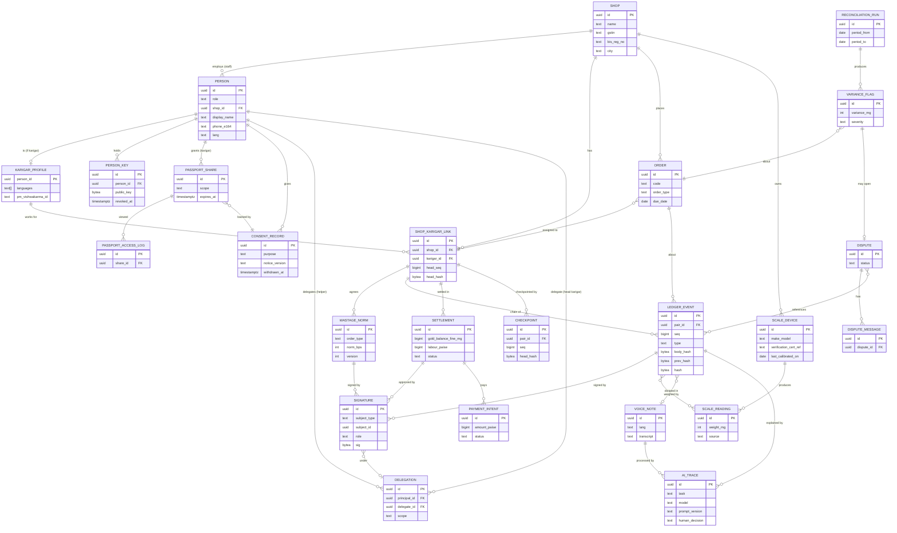

# Data Model
> Project: Tola · Owner: Back end + crypto lead · Status: Draft v0.1 · Last updated: 2026-10-20
> Related: [Project brief §6](../00-overview/PROJECT_BRIEF.md) · [Architecture §9 hash chain](ARCHITECTURE.md#9-hash-chain-and-signature-specification) · [API spec](API_SPEC.md) · [OpenAPI](../../api/openapi.yaml) · [Privacy](../06-security-compliance/PRIVACY.md) · [ADR-0004](adr/ADR-0004-sqlite-demo-postgres-scalable.md) · [ADR-0006](adr/ADR-0006-integer-mg-deterministic-ledger-core.md)

## 1. Conventions
| Rule | Detail |
|---|---|
| Weights | `INTEGER` **milligrams** (`*_mg`). 40.000 g = `40000`. Never float or decimal. |
| Purity | `fineness_ppt` `SMALLINT` (parts per thousand): 999, 995, 916 (22K), 875 (21K), 750 (18K), 585 (14K). |
| Fine gold | `fine_mg = floor(weight_mg × fineness_ppt / 1000)` (**floor**, answers PRD Q-1), computed only in `ledger_core`. Example: 40,000 mg × 916 → 36,640 mg; 250 mg × 916 → 229 mg. |
| Wastage | Norms apply to **gross issued** weight: `allowed_mg = floor(issued_mg × norm_bps / 10000)`. Canonical demo: 40,000 mg × 250 bps → 1,000 mg allowed; loss 40,000 − (38,120 + 500) = 1,380 mg; variance **+380 mg**. |
| Money rounding | Paise: round half up, `(x × bps + 5000) div 10000`. Only money is rounded this way; weights always floor. |
| Percentages | `*_bps` `INTEGER` basis points: 2.50% = `250`. |
| Money | `*_paise` `BIGINT`. ₹1,250.00 = `125000`. |
| IDs | Primary keys are UUIDv7 (`TEXT` in SQLite, `UUID` in Postgres). Human-facing codes (`ORD-0014`, `STL-0001`) are unique per shop. |
| Time | UTC. SQLite stores `TEXT` ISO-8601 with ms; Postgres uses `TIMESTAMPTZ`. |
| Append-only | `ledger_events`, `signatures`, `checkpoints`, `dispute_messages`, `passport_access_log` and `ai_traces`: no `UPDATE`/`DELETE` (Postgres: trigger + `REVOKE UPDATE, DELETE`; SQLite: `BEFORE UPDATE/DELETE` triggers that `RAISE(ABORT)`). |
| PII classes | **P0** public/non-personal · **P1** pseudonymous id · **P2** personal (name, phone, photo of a person) · **P3** sensitive in context (voice audio, bank/UPI VPA, location, lender-shared data). DPDP treats all personal data alike; these classes drive our own controls ([PRIVACY](../06-security-compliance/PRIVACY.md)). |
| Ledger rules (brief §6) | A dispute may be opened up to **14 days** after the disputed event was committed (`DISPUTE_WINDOW_CLOSED` after that). Voice audio is kept **90 days**. A newly registered device key waits **72 h** before it can sign settlements (`DEVICE_COOLING_OFF`). |
| No names in signed bodies | Event bodies hold only ids, so a DPDP erasure of a person's name and phone never breaks a hash. |

## 2. ER diagram



Child tables belong to an existing entity ID and add **no new E-xx**: `person_keys` → E-02, `shop_karigar_links` → E-03, `variance_flags` → E-10, `dispute_messages` → E-11, `passport_access_log` → E-14. Entities E-15..E-19 were added to the brief on 2026-10-20 (E-19 on the orchestrator's request, from [DATA_PIPELINE §7](../04-ai/DATA_PIPELINE.md)).

## 3. Entities

Column types are written in Postgres terms. SQLite mappings are in §5.

### E-01 `Shop` (`shops`)
| Field | Type | Constraints | PII |
|---|---|---|---|
| id | uuid | PK | P0 |
| name | text | not null, 1–120 chars | P0 (business) |
| gstin | text | null; `^[0-9]{2}[A-Z]{5}[0-9]{4}[A-Z][1-9A-Z]Z[0-9A-Z]$` | P0 (business; P2 if proprietorship, so treat as P2) |
| bis_reg_no | text | null | P0 |
| address_line, city, state_code | text | city not null; state_code 2-digit GST state code | P2 (proprietor's address) |
| default_lang | text | in (`en`,`hi`,`kn`,`bn`,`mr`,`ta`) | P0 |
| upi_vpa | text | null; payer VPA shown in intents | P3 |
| created_at | timestamptz | not null | P0 |

Indexes: `uq_shops_gstin` (partial, where not null). Retention: life of account + 8 years (books of account). See §6.

### E-02 `Person` (`persons`, child `person_keys`)
| Field | Type | Constraints | PII |
|---|---|---|---|
| id | uuid | PK | P1 |
| role | text | in (`jeweller_owner`,`shop_staff`,`karigar`,`head_karigar`,`lender_officer`) | P0 |
| shop_id | uuid | FK shops; required for owner/staff | P1 |
| display_name | text | not null | P2 |
| phone_e164 | text | unique where not null; `^\+91[6-9][0-9]{9}$` | P2 |
| lang | text | UI and voice language | P1 |
| pseudonym | text | unique, e.g. `K-7f3a`; the only name sent to AI services | P1 |
| status | text | `active`,`suspended`,`erased` | P0 |
| erased_at | timestamptz | null; set on DPDP erasure (name/phone nulled) | P0 |
| created_at | timestamptz | not null | P0 |

`person_keys` (one row per registered key/device):

| Field | Type | Constraints | PII |
|---|---|---|---|
| id | uuid | PK; exposed as `key_id` | P0 |
| person_id | uuid | FK persons | P1 |
| alg | text | `ed25519` (app/demo key) or `es256` (WebAuthn passkey, v1.1) | P0 |
| public_key | bytea | unique; 32 bytes (Ed25519) or a P-256 key (65 bytes uncompressed SEC1) | P0 |
| key_label | text | `demo`, `device`, `passkey`, `custodial` (v1 KMS-held key used only for `channel_whatsapp_ivr` confirmations, see [INTEGRATIONS §5](INTEGRATIONS.md)) | P0 |
| device_fingerprint | text | null; salted hash of the device id, used for the `SIGNED_ON_ONE_DEVICE` warning | P1 |
| registered_at | timestamptz | not null | P0 |
| settlement_sign_after | timestamptz | = registered_at + **72 h** (cooling-off); demo keys are seeded with a past value | P0 |
| revoked_at | timestamptz | null | P0 |

Indexes: `ix_person_keys_person (person_id) where revoked_at is null`. Keys are never deleted, because old signatures must stay verifiable.

### E-03 `KarigarProfile` (`karigar_profiles`, child `shop_karigar_links`)
| Field | Type | Constraints | PII |
|---|---|---|---|
| person_id | uuid | PK, FK persons (role karigar/head_karigar) | P1 |
| languages | text[] (SQLite: JSON) | ≥1 of bn/hi/kn/mr/ta/en | P1 |
| pm_vishwakarma_id | text | null (optional, F-03 brief) | P2 |
| specialities | text[] | e.g. `plain`,`studded`,`antique` | P1 |
| workshop_label | text | null (karkhana name) | P2 |
| delegate_of | uuid | null; head karigar who may co-sign for helpers (v1, R-09) | P1 |

`shop_karigar_links` (the **pair**; one hash chain per pair):
| Field | Type | Constraints |
|---|---|---|
| id | uuid | PK (`pair_id`) |
| shop_id | uuid | FK shops |
| karigar_id | uuid | FK persons |
| status | text | `invited`,`active`,`ended` |
| head_seq | bigint | not null default 0 |
| head_hash | bytea(32) | not null default 32×0x00 |
| labour_rate_paise_per_g | bigint | default labour rate for the pair |
| created_at | timestamptz | |

Indexes: `uq_pair (shop_id, karigar_id)`. `head_seq` / `head_hash` are updated only inside the event-append transaction, under `SELECT … FOR UPDATE` in Postgres or `BEGIN IMMEDIATE` in SQLite. PII: P1. Retention: same as the ledger.

### E-04 `Order` (`orders`)
| Field | Type | Constraints | PII |
|---|---|---|---|
| id | uuid | PK | P0 |
| shop_id | uuid | FK | P0 |
| pair_id | uuid | FK shop_karigar_links; null until assigned | P1 |
| code | text | unique per shop, `ORD-\d{4,}` | P0 |
| title | text | e.g. "Bridal haar, 22K" | P0 |
| order_type | text | `plain`,`studded`,`antique` | P0 |
| target_fineness_ppt | smallint | 375–999 | P0 |
| design_photo_ref | text | null; GCS / local path | P0 |
| due_date | date | not null | P0 |
| occasion_date | date | null (customer's wedding date) | P2 (in context) |
| customer_ref | text | null; shop's own reference, no name stored | P1 |
| labour_rate_paise_per_g | bigint | null → pair default | P0 |
| labour_flat_paise | bigint | default 0 | P0 |
| status | text | `open`,`in_work`,`returned`,`settled`,`cancelled` | P0 |
| created_at | timestamptz | | P0 |

Indexes: `uq_orders_shop_code (shop_id, code)`, `ix_orders_pair_status (pair_id, status)`, `ix_orders_due (shop_id, due_date) where status in ('open','in_work')`.

### E-05 `WastageNorm` (`wastage_norms`)
| Field | Type | Constraints | PII |
|---|---|---|---|
| id | uuid | PK | P0 |
| pair_id | uuid | FK | P1 |
| order_type | text | `plain`,`studded`,`antique` | P0 |
| norm_bps | integer | 0–5000 (0–50%) | P0 |
| tolerance_mg | integer | default 20; extra slack before a flag | P0 |
| version | integer | ≥1; `(pair_id, order_type, version)` unique | P0 |
| effective_from | date | not null | P0 |
| body_hash | bytea(32) | SHA-256 of the JCS norm body | P0 |
| status | text | `proposed`,`active` (both signed),`superseded` | P0 |

Signatures are E-07 rows with `subject_type='wastage_norm'`, added through API-23 (scalable; the demo seeds norms already signed). A norm is `active` only when both parties have signed it. Seed defaults are plain 250 bps, studded 2,500 bps and antique 400 bps, taken from the field-study ranges [S17]. Index: `ix_norm_active (pair_id, order_type) where status='active'`.

### E-06 `LedgerEvent` (`ledger_events`): append-only
| Field | Type | Constraints | PII |
|---|---|---|---|
| id | uuid | PK (= `body.event_id`, client-generatable UUIDv7) | P1 |
| pair_id | uuid | FK, not null | P1 |
| seq | bigint | ≥1; `uq_events_pair_seq (pair_id, seq)` | P0 |
| type | text | `ISSUE`,`RETURN`,`SCRAP_RETURN`,`DUST_CREDIT`,`ADJUSTMENT`,`SETTLEMENT`,`DISPUTE_OPEN`,`DISPUTE_RESOLVE` | P0 |
| order_id | uuid | FK null (required for ISSUE/RETURN/SCRAP_RETURN) | P0 |
| weight_mg | integer | null for DISPUTE_*; ≥0; ADJUSTMENT may be signed (±) | P0 |
| fineness_ppt | smallint | null or 1–999 | P0 |
| fine_mg | integer | = ledger_core(weight_mg, fineness_ppt); CHECK enforced in app + DB (`fine_mg = weight_mg*fineness_ppt/1000`, integer division; for negative ADJUSTMENT weights `ledger_core` floors toward −∞ and the DB CHECK is skipped) | P0 |
| norm_id | uuid | FK wastage_norms; required for ISSUE | P0 |
| body | jsonb (SQLite: TEXT JSON) | canonical JCS form, exactly as hashed | P1 |
| body_hash | bytea(32) | SHA-256(JCS(body)) | P0 |
| prev_hash | bytea(32) | = hash of seq−1 | P0 |
| hash | bytea(32) | unique | P0 |
| witness_sig | bytea(64) | server Ed25519 | P0 |
| server_received_at | timestamptz | | P0 |
| status_cache | text | `pending_signatures`,`committed`,`disputed`; derived from E-07 and E-11, may be recomputed | P0 |
| voice_note_id | uuid | FK null | P1 |

Join table `event_readings (event_id, reading_id)` (E-06↔E-08). Indexes: `uq_events_pair_seq`, `ix_events_order (order_id)`, `ix_events_pair_type_time (pair_id, type, server_received_at)`. Retention: **8 years** after the financial year of the event (see §6), then archive to cold storage. Never erased. Bodies hold no names (see §1).

### E-07 `Signature` (`signatures`): append-only
| Field | Type | Constraints | PII |
|---|---|---|---|
| id | uuid | PK | P0 |
| subject_type | text | `event`,`settlement`,`wastage_norm` | P0 |
| subject_id | uuid | not null | P0 |
| role | text | `jeweller`,`karigar` (`server` is stored on E-06 as `witness_sig`) | P0 |
| signer_id | uuid | FK persons (the person whose key signed) | P1 |
| on_behalf_of | uuid | null; FK persons. Set when a head karigar signs for a helper under E-16 | P1 |
| delegation_id | uuid | null; FK delegations; required when `on_behalf_of` is set | P0 |
| key_id | uuid | FK person_keys | P0 |
| alg | text | `ed25519` or `es256`; verification accepts both | P0 |
| public_key | bytea | copy of the key used (verification never depends on mutable rows) | P0 |
| sig | bytea | Ed25519: 64 bytes over `sign_msg`. ES256: DER ECDSA over `authenticator_data ‖ SHA-256(client_data_json)`, where `client_data_json.challenge = base64url(SHA-256(sign_msg))` | P0 |
| authenticator_data | bytea | null; WebAuthn only | P0 |
| client_data_json | text | null; WebAuthn only | P0 |
| readback_sha256 | bytea(32) | null; SHA-256 of the read-back audio this signer heard (M-02). It is part of `sign_msg`, so a signer can later prove what he heard ([DATA_PIPELINE §7](../04-ai/DATA_PIPELINE.md)) | P0 |
| assurance_tier | text | `device_key` (own device key), `channel_whatsapp_ivr` (custodial key after a verified WhatsApp/IVR confirmation), `witnessed_in_person` (signed on the counter-party's device with a PIN, witnessed by staff) | P0 |
| device_fingerprint | text | null; salted hash | P1 |
| decision | text | `approve` (default) or `reject` (a reject signature is evidence of refusal) | P0 |
| channel | text | `app`,`whatsapp`,`ivr`,`demo` | P0 |
| signed_at | timestamptz | client-claimed | P0 |
| received_at | timestamptz | server | P0 |

Constraint: `uq_sig (subject_type, subject_id, role, decision)`, so there is at most one approval per role. Rules checked on insert: a settlement signature needs `received_at ≥ person_keys.settlement_sign_after` (72 h cooling-off); if both approvals of one subject share a `device_fingerprint`, the subject gets the warning `SIGNED_ON_ONE_DEVICE` (allowed with tier `witnessed_in_person`, and always raised in the single-laptop demo). Index: `ix_sig_subject (subject_type, subject_id)`. Retention: same as the subject.

### E-08 `ScaleReading` (`scale_readings`)
| Field | Type | Constraints | PII |
|---|---|---|---|
| id | uuid | PK | P0 |
| shop_id | uuid | FK | P0 |
| weight_mg | integer | 0–5,000,000 (≤ 5 kg); resolution ≥ 10 mg | P0 |
| source | text | `serial`,`ble`,`display_ocr`,`simulated`,`manual_dual` | P0 |
| scale_device_id | uuid | FK scale_devices (E-18); null for `simulated` | P0 |
| device_id | text | e.g. `serial:VID_0403&PID_6001:SN123` or `sim-01` | P0 |
| device_label | text | e.g. "Shop balance #1 (verified 03/2026)" | P0 |
| stable | boolean | true when the reading held within ±10 mg for ≥1.5 s | P0 |
| raw_frame | text | null; raw serial line or OCR string | P0 |
| ocr_confidence | real | null; 0–1 (M-04) | P0 |
| photo_ref | text | null; photo of the piece on the pan | P0 (P2 if a person is visible: blur in v1) |
| captured_by | uuid | FK persons | P1 |
| captured_at | timestamptz | | P0 |

Indexes: `ix_readings_shop_time (shop_id, captured_at)`. Retention: as the ledger for readings referenced by events. Unreferenced readings are deleted after 30 days. Photos are kept 1 year.

### E-09 `VoiceNote` (`voice_notes`)
| Field | Type | Constraints | PII |
|---|---|---|---|
| id | uuid | PK | P1 |
| person_id | uuid | FK | P1 |
| audio_ref | text | GCS / local path; real-time clips ≤ 30 s (longer audio goes to the Sarvam batch path in v1) | **P3** |
| audio_sha256 | bytea(32) | | P0 |
| lang | text | BCP-47 (`bn-IN`, `hi-IN`, `kn-IN`, …) | P1 |
| transcript | text | STT output (M-01) | P2 |
| extracted | jsonb | IntakeAgent draft (M-03), numbers **not** trusted | P1 |
| confidence | real | 0–1 overall | P0 |
| model_ids | jsonb | e.g. `{"stt":"saaras:v3","llm":"lyzr:intake@v3"}` | P0 |
| source | text | `live`,`cached`,`template` | P0 |
| created_at | timestamptz | | P0 |

Retention: audio for **90 days** from capture (brief ledger rule), then deleted; the audio's SHA-256 stays in E-09/E-19. Transcripts are kept with the event. Audio is never sent to Lyzr.

### E-10 `ReconciliationRun` + `VarianceFlag` (`reconciliation_runs`, `variance_flags`)
`reconciliation_runs`: `id` uuid PK · `shop_id` FK · `period_from`, `period_to` date · `trigger` (`manual`,`schedule`) · `status` (`running`,`done`,`failed`,`chain_broken`) · `chains_verified` int · `pairs_count` int · `flags_count` int · `ledger_core_version` text · `started_at`, `finished_at`. Index: `uq_run (shop_id, period_from, period_to, trigger)`.

`variance_flags`:
| Field | Type | Constraints | PII |
|---|---|---|---|
| id | uuid | PK | P0 |
| run_id | uuid | FK | P0 |
| pair_id | uuid | FK | P1 |
| order_id | uuid | FK null (null = pair-level) | P0 |
| issued_mg | bigint | gross issued | P0 |
| returned_mg | bigint | gross piece + scrap + dust | P0 |
| loss_mg | bigint | issued − returned (demo: 1,380) | P0 |
| allowed_mg | bigint | `floor(issued_mg × norm_bps / 10000)` (demo: 1,000) | P0 |
| variance_mg | bigint | loss − allowed, gross (positive = over norm; demo: +380) | P0 |
| variance_fine_mg | bigint | `floor(variance_mg × fineness_ppt / 1000)` | P0 |
| variance_value_paise | bigint | null; indicative ₹ at the day's rate entered by the shop (demo: ≈ ₹5,188) | P0 |
| robust_z_x1000 | integer | M-05 z × 1000 (integer) | P0 |
| severity | text | `info`,`warn`,`critical` | P0 |
| code | text | `OVER_NORM` (loss above the norm), `OPEN_BALANCE` (gold held past the order due date), `DUPLICATE` (same reading, or same weight ±10 mg within 10 min), `UNSIGNED` (event still missing a signature at run time), `UNUSUAL_FOR_KARIGAR` (M-05 robust z ≥ 3.5 against his own history) | P0 |
| warnings | text[] | e.g. `SIGNED_ON_ONE_DEVICE` (both signatures from one device) | P0 |
| explanation | jsonb | `{en:…, bn:…}` from ReconcileAgent or template; numbers validated | P1 |
| status | text | `open`,`acknowledged`,`disputed`,`resolved` | P0 |

Index: `ix_flags_pair_status (pair_id, status)`. Severity rule (in `ledger_core`): for `OVER_NORM`, `critical` if `variance_mg > max(tolerance_mg, allowed_mg / 4)` (canonical demo: 380 > 250, so critical), or `|z| ≥ 3.5`; `warn` if `variance_mg > tolerance_mg`; otherwise `info`. Thresholds are HUNCH values to be tuned in the pilot. Owner: back-end lead, by 15 Jan 2027.

### E-11 `Dispute` (`disputes`, child `dispute_messages`)
`disputes`: `id` uuid PK · `pair_id` FK · `flag_id` FK null · `event_ids` uuid[] (SQLite: JSON) · `opened_by` FK persons · `open_event_id` FK ledger_events (`DISPUTE_OPEN`) · `resolve_event_id` FK null (`DISPUTE_RESOLVE`) · `status` (`open`,`proposed_resolution`,`resolved`,`withdrawn`) · `resolution` jsonb null (e.g. `{"kind":"ADJUSTMENT","weight_mg":-200,"note":"dust credit"}`) · `opened_at`, `resolved_at`. Index: `ix_disputes_pair_status`. A dispute may be opened only within **14 days** of the referenced event's commit time (API-12 returns `422 DISPUTE_WINDOW_CLOSED` after that); a flag from a reconciliation run opens its own 14-day window. A dispute is `resolved` only when its `DISPUTE_RESOLVE` event (E-06) is `committed`, i.e. both parties have signed it through API-07.

`dispute_messages` (append-only): `id` · `dispute_id` FK · `author_id` FK · `kind` (`text`,`voice`) · `text` (P2) · `voice_note_id` FK null (P3) · `created_at`. Retention: as the ledger, except audio, which follows the E-09 rule.

### E-12 `Settlement` (`settlements`)
| Field | Type | Constraints | PII |
|---|---|---|---|
| id | uuid | PK | P0 |
| code | text | `STL-\d{4,}`, unique per shop | P0 |
| pair_id | uuid | FK | P1 |
| period_from, period_to | date | from ≤ to | P0 |
| gold_issued_fine_mg | bigint | | P0 |
| gold_returned_fine_mg | bigint | | P0 |
| allowed_wastage_fine_mg | bigint | | P0 |
| dust_credit_fine_mg | bigint | | P0 |
| gold_balance_fine_mg | bigint | positive = karigar still holds this much of the shop's fine gold | P0 |
| labour_paise | bigint | ≥0 | P0 |
| gst_labour_bps | integer | 500 (5%) [S24] | P0 |
| gst_paise | bigint | `(labour_paise × 500 + 5000) div 10000` | P0 |
| deductions_paise | bigint | default 0; e.g. a gold shortfall valued at the agreed rate (both sign) | P0 |
| net_payable_paise | bigint | labour + gst − deductions (canonical demo: 480000 + 24000 − 0 = 504000, i.e. ₹5,040) | P0 |
| chain_head_seq | bigint | checkpoint | P0 |
| chain_head_hash | bytea(32) | checkpoint | P0 |
| body_hash | bytea(32) | SHA-256 of the JCS settlement body (both sign this) | P0 |
| narrative | jsonb | SettleAgent text `{en, bn}` | P1 |
| status | text | `draft`,`awaiting_karigar`,`awaiting_jeweller`,`approved`,`paid`,`paid_outside`,`void` | P0 |
| settlement_event_id | uuid | FK ledger_events (`SETTLEMENT`) once approved | P0 |
| created_at, approved_at | timestamptz | | P0 |

Indexes: `uq_settlement_code (shop_id, code)`, `ix_settlement_pair_period (pair_id, period_to)`. A CHECK that periods do not overlap for the same pair, unless one of them is `void`, is enforced in the app. In Postgres an exclusion constraint on `daterange` is also used.

### E-13 `PaymentIntent` (`payment_intents`)
| Field | Type | Constraints | PII |
|---|---|---|---|
| id | uuid | PK | P0 |
| settlement_id | uuid | FK | P0 |
| amount_paise | bigint | = settlement.net_payable_paise | P0 |
| payee_vpa | text | karigar's VPA (demo: `TOLA_UPI_VPA`) | P3 |
| payee_name | text | | P2 |
| tr_ref | text | unique, `STL-0001-01` | P0 |
| upi_uri | text | `upi://pay?pa=…&pn=…&am=…&cu=INR&tn=…&tr=…` | P3 |
| qr_svg_ref | text | | P3 |
| provider | text | `simulated`,`razorpay`,`cashfree`,`phonepe` | P0 |
| provider_ref | text | null | P0 |
| status | text | `simulated` (demo), `created`,`pending`,`paid`,`failed`,`expired` | P0 |
| created_at, updated_at | timestamptz | | P0 |

Index: `uq_intent_tr (tr_ref)`, `ix_intent_provider_ref`. Retention: 8 years (financial record).

### E-14 `PassportShare` (`passport_shares`, child `passport_access_log`)
| Field | Type | Constraints | PII |
|---|---|---|---|
| id | uuid | PK | P0 |
| karigar_id | uuid | FK persons | P1 |
| token_hash | bytea(32) | SHA-256 of a 128-bit random URL token; the token itself is never stored | P0 |
| scope | text | `summary` (default) or `summary_with_monthly` | P0 |
| recipient_label | text | e.g. "Canara Bank, Chickpet branch" | P2 |
| purpose | text | e.g. `working_capital_loan` | P0 |
| consent_record_id | uuid | FK consent_records (E-15) | P0 |
| consented_at | timestamptz | copy of E-15 `given_at` | P0 |
| expires_at | timestamptz | ≤ 30 days after consent; default 7 days | P0 |
| revoked_at | timestamptz | null | P0 |
| max_views | integer | default 20 | P0 |

`passport_access_log` (append-only): `id` · `share_id` · `viewed_at` · `ip_hash` (salted SHA-256, P1) · `user_agent_family` · `result` (`ok`,`expired`,`revoked`,`limit`). Retention: shares for 3 years after expiry (proof of consent), access logs for 3 years. The passport **content** is computed on read and never stored.

### E-15 `ConsentRecord` (`consent_records`)
DPDP notice-and-consent artefact [S53]. One row per purpose per person per notice version.

| Field | Type | Constraints | PII |
|---|---|---|---|
| id | uuid | PK | P0 |
| person_id | uuid | FK persons | P1 |
| purpose | text | `ledger_participation`, `voice_processing`, `passport_share`, `whatsapp_channel` | P0 |
| notice_version | text | e.g. `notice-bn-v1`; notice texts are versioned in the repo | P0 |
| lang | text | language the notice was shown or played in | P0 |
| channel | text | `app`, `whatsapp`, `ivr`, `in_person`, `demo` | P0 |
| evidence | jsonb | e.g. `{"tap":true,"audio_played":true}` or a signature id | P1 |
| given_at | timestamptz | not null | P0 |
| withdrawn_at | timestamptz | null; the only updatable column | P0 |

Index: `ix_consent_person_purpose (person_id, purpose) where withdrawn_at is null`. A withdrawal stops future processing for that purpose (for example, it revokes all active E-14 shares). Ledger events already signed are kept as books of account. Retention: life of account + 3 years.

### E-16 `Delegation` (`delegations`): v1
A head karigar or karkhana owner (P-05) signs on behalf of helpers who share one phone (R-09).

| Field | Type | Constraints | PII |
|---|---|---|---|
| id | uuid | PK | P0 |
| principal_id | uuid | FK persons (the helper) | P1 |
| delegate_id | uuid | FK persons (the head karigar) | P1 |
| pair_id | uuid | null = all pairs of the principal | P1 |
| scope | text | `events` or `events_and_settlements` | P0 |
| max_weight_mg | integer | null; per-event cap, e.g. 50,000 | P0 |
| valid_from, valid_to | timestamptz | valid_to ≤ valid_from + 180 days | P0 |
| body_hash | bytea(32) | SHA-256 of the JCS delegation body | P0 |
| principal_sig | bytea | the principal's own signature (or `witnessed_in_person`) | P0 |
| jeweller_ack_sig | bytea | null; the shop acknowledges the delegation | P0 |
| revoked_at | timestamptz | null | P0 |

Index: `ix_delegation_active (principal_id, delegate_id) where revoked_at is null`. A delegated E-07 row carries `on_behalf_of` and `delegation_id`. Not used in the demo.

### E-17 `Checkpoint` (`checkpoints`): append-only
A daily signed chain checkpoint. It stops server-side history rewrites between settlements.

| Field | Type | Constraints | PII |
|---|---|---|---|
| id | uuid | PK | P0 |
| pair_id | uuid | FK | P1 |
| day | date | IST day; `uq_checkpoint (pair_id, day)` | P0 |
| seq | bigint | chain head seq at 23:59 IST | P0 |
| head_hash | bytea(32) | | P0 |
| server_sig | bytea(64) | Ed25519 over `"tola:v1:checkpoint:" ‖ pair_id ‖ 0x00 ‖ u64be(seq) ‖ head_hash ‖ day (YYYY-MM-DD)` | P0 |
| delivered_to | jsonb | e.g. `{"karigar_app":"2026-12-21T18:31Z","whatsapp":"…"}` | P0 |
| karigar_ack_sig | bytea | null; optional counter-signature from the karigar's device | P0 |
| created_at | timestamptz | | P0 |

A checkpoint is created only when the head moved that day. The karigar's device stores every checkpoint it receives, and the verifier ([Architecture §9.3](ARCHITECTURE.md#93-verification-algorithm-runs-in-the-api-the-worker-and-the-browser)) checks them (`CHECKPOINT_MISMATCH`). Demo: the "Run week" step writes one checkpoint per pair. Retention: as the ledger.

### E-18 `ScaleDevice` (`scale_devices`)
A registered balance (see [HARDWARE.md](HARDWARE.md)).

| Field | Type | Constraints | PII |
|---|---|---|---|
| id | uuid | PK | P0 |
| shop_id | uuid | FK | P0 |
| label | text | e.g. "Counter balance #1" | P0 |
| make_model | text | e.g. "<make> <model>, 0.01 g, 300 g max" | P0 |
| serial_no | text | | P0 |
| interface | text | `serial`, `ble`, `display_ocr`, `simulated`, `bench_rig` | P0 |
| accuracy_class | text | e.g. `II` (as stated on the certificate) | P0 |
| resolution_mg | integer | e.g. 10 | P0 |
| max_capacity_mg | integer | | P0 |
| verification_cert_ref | text | null; Legal Metrology verification/stamping certificate ref [S52] | P0 |
| verified_until | date | null | P0 |
| last_calibrated_on | date | null | P0 |
| for_trade | boolean | false for `simulated` and for the `bench_rig` ("not for trade") | P0 |
| active | boolean | | P0 |

Rule: in v1, readings from a device with `for_trade=false`, or with `verified_until` in the past, carry a visible warning and cannot back a settlement unless both parties acknowledge it. Retention: as the ledger.

### E-19 `AiTrace` (`ai_traces`): append-only
Lineage for every AI artefact ([DATA_PIPELINE §7](../04-ai/DATA_PIPELINE.md)). It replaces the earlier `ai_calls` table.

| Field | Type | Constraints | PII |
|---|---|---|---|
| id | uuid | PK (`trace_id`) | P0 |
| task | text | `M-01`, `M-02`, `M-03:intake`, `M-03:reconcile`, `M-03:settle`, `M-04`, `M-05` | P0 |
| provider | text | `sarvam`, `lyzr`, `local`, `cache`, `template` | P0 |
| model | text | e.g. `saaras:v3` (demo), `saaras:v4` (scalable), `bulbul:v3`, `gpt-4o-mini` | P0 |
| prompt_id, prompt_version | text | null for STT/TTS; e.g. `intake`, `1.0.0` | P0 |
| prompt_sha256 | bytea(32) | null | P0 |
| input_hash | bytea(32) | SHA-256 of the input (audio bytes, or prompt + variables); the content is not stored here | P0 |
| output_json | jsonb | structured output (drafts, explanations); pseudonymous ids only; no audio | P1 |
| output_sha256 | bytea(32) | | P0 |
| fallback_mode | text | `live`, `cached`, `off` (value of `AI_FALLBACK_MODE` at call time) | P0 |
| validator_result | text | `pass`, `retry_pass`, `fallback_template`, `rejected_number` | P0 |
| latency_ms | integer | | P0 |
| cost_inr_milli | integer | estimated cost in thousandths of a rupee (₹0.125 = 125); an operational estimate, not ledger money | P0 |
| human_decision | text | `accepted`, `edited`, `rejected`, `none` | P0 |
| event_id | uuid | FK ledger_events, null | P0 |
| voice_note_id | uuid | FK voice_notes, null | P0 |
| run_id | uuid | FK reconciliation_runs, null | P0 |
| settlement_id | uuid | FK settlements, null | P0 |
| created_at | timestamptz | | P0 |

Indexes: `ix_trace_event (event_id)`, `ix_trace_task_time (task, created_at)`. Retention: 1 year (evals and incident review). Traces linked to a disputed event are kept as long as the dispute record.

## 4. Operational tables (no E-ID, infrastructure only)
| Table | Track | Purpose |
|---|---|---|
| `idempotency_keys` | both | `(key, route, response_hash, created_at)`, TTL 24 h |
| `otp_challenges` | scalable | phone hash, code hash, attempts, expiry 5 min |
| `outbox_jobs` | scalable | transactional outbox → Cloud Tasks |
| `alembic_version` | scalable | migrations |

## 5. Demo SQLite vs scalable Postgres
| Concern | Demo (SQLite, `implementation/demo`) | Scalable (Postgres 16, `implementation/scalable`) |
|---|---|---|
| Schema source | `SQLAlchemy 2.1` models + `Base.metadata.create_all()` on start; seed via `seed/story_week.json` | Same models; **Alembic 1.20** migrations, expand → migrate → contract |
| UUID | `TEXT(36)` | `UUID` |
| Hash/sig bytes | `BLOB` | `BYTEA` |
| JSON | `TEXT` with `CHECK(json_valid(body))` | `JSONB` |
| Arrays | JSON text | `TEXT[]` / `UUID[]` |
| Time | ISO `TEXT` | `TIMESTAMPTZ` |
| Append-only | `CREATE TRIGGER no_upd BEFORE UPDATE ON ledger_events BEGIN SELECT RAISE(ABORT,'append-only'); END;` (same for DELETE). `POST /v1/demo/reset` drops and recreates the file instead of deleting rows | Trigger plus `REVOKE UPDATE, DELETE ON ledger_events, signatures FROM tola_app` |
| Chain append lock | `BEGIN IMMEDIATE` (single writer) | `SELECT … FROM shop_karigar_links WHERE id=$1 FOR UPDATE` |
| Pragmas | `journal_mode=WAL`, `foreign_keys=ON`, `synchronous=NORMAL` | — |
| Exclusion constraints | App-level check | `EXCLUDE USING gist (pair_id WITH =, daterange(period_from, period_to,'[]') WITH &&) WHERE (status <> 'void')` (needs `btree_gist`) |
| Row-level security | n/a | RLS by `shop_id` for staff and `karigar_id` for karigars; enforced in addition to app checks |
| Encryption | Disk only | Cloud SQL encryption at rest + CMEK on GCS; `phone_e164` additionally stored as an HMAC for lookup |
| Backups | The seed file is the backup | PITR 7 days, daily export to an asia-south2 bucket (retained 35 days) |

Example demo DDL (excerpt):

```sql
CREATE TABLE ledger_events (
  id TEXT PRIMARY KEY,
  pair_id TEXT NOT NULL REFERENCES shop_karigar_links(id),
  seq INTEGER NOT NULL CHECK (seq >= 1),
  type TEXT NOT NULL CHECK (type IN ('ISSUE','RETURN','SCRAP_RETURN','DUST_CREDIT','ADJUSTMENT','SETTLEMENT','DISPUTE_OPEN','DISPUTE_RESOLVE')),
  order_id TEXT REFERENCES orders(id),
  weight_mg INTEGER,
  fineness_ppt INTEGER CHECK (fineness_ppt IS NULL OR fineness_ppt BETWEEN 1 AND 999),
  fine_mg INTEGER,
  norm_id TEXT REFERENCES wastage_norms(id),
  body TEXT NOT NULL CHECK (json_valid(body)),
  body_hash BLOB NOT NULL CHECK (length(body_hash) = 32),
  prev_hash BLOB NOT NULL CHECK (length(prev_hash) = 32),
  hash BLOB NOT NULL UNIQUE CHECK (length(hash) = 32),
  witness_sig BLOB NOT NULL CHECK (length(witness_sig) = 64),
  server_received_at TEXT NOT NULL,
  status_cache TEXT NOT NULL DEFAULT 'pending_signatures',
  voice_note_id TEXT REFERENCES voice_notes(id),
  UNIQUE (pair_id, seq),
  CHECK (fine_mg IS NULL OR weight_mg < 0 OR fine_mg = (weight_mg * fineness_ppt) / 1000)  -- SQLite integer division truncates; equals floor for non-negative values
);
```

The `status_cache` column is the only mutable column on `ledger_events`. The triggers therefore block any UPDATE that touches another column (`WHEN NEW.body IS NOT OLD.body OR …`). In Postgres the same effect comes from a column-level `GRANT UPDATE (status_cache)`.

## 6. Retention summary
| Data | Retention | Basis |
|---|---|---|
| Ledger events, signatures, settlements, payment intents, GST drafts | 8 years after the end of the financial year | GST record keeping (CGST Act s.36: 72 months from the annual-return due date, not verified 2026-10-20) plus a margin |
| Voice audio (E-09) | 90 days from capture | Brief ledger rule; DPDP purpose limitation [S53] |
| Scale photos | 1 year | Dispute window |
| Person name/phone | Until account closure plus 30 days, or erasure on request (the ledger keeps the pseudonymous id) | DPDP [S53] |
| Passport shares and access logs; consent records (E-15) | 3 years after expiry / withdrawal / account closure | Proof of consent |
| Checkpoints (E-17), scale devices (E-18), delegations (E-16) | As the ledger | Evidence |
| AI traces (E-19) | 1 year (longer if the event is disputed) | Evals and debugging |

## 7. Migrations strategy
- **Demo:** no migrations. The schema is created from the models, and `POST /v1/demo/reset` rebuilds the DB from `seed/story_week.json` in under 3 s.
- **Scalable:** Alembic, one migration per PR, reviewed. Destructive changes need two releases (expand/contract). Changing the format of `ledger_events.body` is forbidden: a new format means `"v": 2` bodies, and both verifiers must keep accepting v1.
- **Contract tests:** the same Pydantic models generate `api/openapi.yaml` components. CI diffs the generated spec against the committed one.
