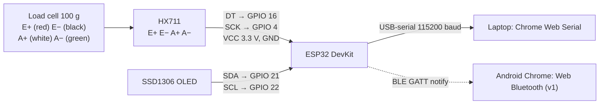

# Hardware: Weight Capture
> Project: Tola · Owner: Back end + crypto lead (scale adapters) · Status: Draft v0.1 · Last updated: 2026-10-20
> Related: [Project brief F-01, R-03, R-04](../00-overview/PROJECT_BRIEF.md) · [Architecture](ARCHITECTURE.md) · [Data model E-08, E-18](DATA_MODEL.md) · [Integrations](INTEGRATIONS.md) · [AI models M-04](../04-ai/MODELS.md) · [Compliance](../06-security-compliance/COMPLIANCE.md)

**Rule F-01: weights come from the balance, never from a keyboard.** Tola is a recorder. It does not make or certify a weighing instrument. All ₹ prices on this page are **HUNCH** (not verified 2026-10-20) unless a source is given.

## 1. Capture paths
| Path | How | Track | Browser support | Notes |
|---|---|---|---|---|
| **Simulated** (`simulated`) | On-screen balance with a pan animation; values come from the seed or a slider | Demo (default) | All | Labelled "Simulated balance". E-18 `for_trade=false` |
| **Web Serial** (`serial`) | `navigator.serial.requestPort()` → read the balance's continuous ASCII output (RS-232 via a USB-serial adapter, or native USB CDC) | Demo (optional) + v1 | Chromium desktop (Chrome/Edge). Android Chrome support: not verified 2026-10-20 | The shop's own verified balance can feed Tola directly |
| **Web Bluetooth** (`ble`) | GATT notify characteristic | v1 | Chrome on Android/desktop; not iOS Safari | Needs a BLE balance or a BLE-to-serial bridge |
| **Display OCR** (`display_ocr`) | Phone camera reads the seven-segment display (M-04: OpenCV template matching / small CNN) | v1 (demo: optional) | Any camera browser | Confidence ≥ 0.98 and two identical frames required; otherwise fall back |
| **Manual dual** (`manual_dual`) | Both parties type the same number independently (M-04 fallback) | Both | All | Flagged in the ledger; never the default |

## 2. Reading a serial balance
Many 0.01 g jewellery balances sold in India have an RS-232 or USB port with a continuous or print-on-demand output (true per model only after checking the manual; not verified 2026-10-20). Output formats differ by manufacturer, so the adapter is driven by a per-model profile:

```ts
// apps/web/lib/scale/profiles.ts (example profile; confirm against the balance manual)
export const genericAsciiProfile = {
  baudRate: 9600, dataBits: 8, stopBits: 1, parity: "none",
  // e.g. "ST,GS,+  40.000 g" or "+  40.00 g" ; ST = stable, US = unstable (format varies by make)
  line: /^(?<stab>ST|US)?[ ,]*(?:GS|NT)?[ ,]*(?<sign>[+-])?\s*(?<num>\d+\.\d{2,3})\s*g\s*$/,
};
```

Adapter rules:
1. Parse to integer mg with string arithmetic (`"40.000"` → `40000`), never `parseFloat`.
2. A reading is **stable** when the balance reports `ST`, or when values stay within ±10 mg for ≥ 1.5 s.
3. Reject negative or overload values and values above the device's `max_capacity_mg` (E-18).
4. Post the raw line as `raw_frame` with the reading (API-05) for audit.
5. Every device is registered as an E-18 `ScaleDevice` (make/model, serial no., resolution, verification certificate ref, `verified_until`, `for_trade`).

## 3. Bench rig: ESP32 + HX711 (**NOT FOR TRADE**)
**Purpose.** A cheap, demonstrable source of real serial and BLE readings for the hackathon (R-03). It is used when no shop balance with a data port is available. It is **not** a legal-for-trade instrument. The enclosure carries a printed label **"NOT FOR TRADE: demonstration only"**, and E-18 records `interface=bench_rig, for_trade=false`. The UI shows a grey "Bench rig: not for trade" chip on every reading it produces.

### 3.1 Bill of materials (HUNCH prices, Indian hobby retailers, Oct 2026)
| # | Part | Qty | ₹ (HUNCH) |
|---|---|---|---|
| 1 | ESP32 DevKit v1 (ESP32-WROOM-32, USB-serial) | 1 | 350–450 |
| 2 | HX711 24-bit load-cell ADC module | 1 | 60–120 |
| 3 | Bar load cell, 100 g capacity (for best resolution; 500 g as an alternative) | 1 | 250–450 |
| 4 | 0.96" SSD1306 OLED (I²C) for a local display | 1 | 180–250 |
| 5 | Acrylic/3D-printed base and pan, M3/M4 screws | 1 set | 200–400 |
| 6 | Calibration weights: 1 g, 2 g, 5 g, 10 g, 20 g, 50 g (class F2/M1 set) | 1 set | 800–2,500 |
| 7 | Draft shield (clear acrylic box) | 1 | 200–350 |
| 8 | USB cable, jumper wires, "NOT FOR TRADE" label | — | 100 |
| | **Total** | | **≈ ₹2,100–4,600** |

### 3.2 Wiring

Load-cell wire colours differ between vendors, so check the datasheet. Set the HX711 RATE pin for 10 SPS (lower noise).

### 3.3 Firmware (Arduino-ESP32)
- **Library:** `bogde/HX711` (Arduino Library Manager). The output format imitates a balance line, so the same Web Serial profile works:
  `ST,GS,+  40.00 g\r\n` when stable, `US,GS,+  39.97 g\r\n` otherwise.
- **Filtering:** median of 15 samples, then an exponential moving average. Stable = range ≤ 2 counts-equivalent of 10 mg over 1.5 s.
- **Commands over serial:** `T` tare, `C<grams>` calibrate with a known weight (stores the factor in NVS), `I` identity (prints `TOLA-BENCH-RIG v0.1 NOT-FOR-TRADE <chip id>`).
- **BLE (v1):** a custom service UUID with a characteristic that notifies `{ "mg": 40000, "stable": true }` and an identity characteristic that returns the same NOT-FOR-TRADE string.
- **Expected performance (HUNCH):** with a 100 g load cell and HX711 at 10 SPS, a readability of 0.01 g display with real repeatability of about ±0.02–0.05 g, after warm-up and inside a draft shield. That is enough to show the flow, but not the accuracy of a verified jewellery balance. Measure it with the calibration set and publish the result in `implementation/demo/docs/bench-rig-results.md` before the finale. Owner: back-end lead, by 10 Dec 2026.

### 3.4 Calibration procedure
1. Warm up for 15 minutes on a level, vibration-free table under the draft shield.
2. Tare with the empty pan (`T`).
3. Place 50 g (or 20 g) and send `C50.00`.
4. Check 1, 5, 10 and 20 g. Each must be within ±0.05 g, otherwise repeat step 3.
5. Record the date in E-18 `last_calibrated_on`. **Never** fill `verification_cert_ref` for the rig.

## 4. Legal Metrology note
- The **Legal Metrology Act, 2009** [S52] governs weights and measures used in trade and transactions. HUNCH (not verified 2026-10-20): instruments used for transactions must be of an approved model and verified/stamped by the Legal Metrology department, and precious-metal weighing typically needs a high-accuracy class balance (class II under the General Rules 2011). **Confirm with the Karnataka Legal Metrology department, or have a practising lawyer confirm, before the pilot.** Owner: field + pitch lead, by 31 Jan 2027.
- **Tola's position (R-04).** In every real transaction, the weight comes from **the shop's own verified balance**. Tola records the reading, the device identity and its verification reference (E-18). Tola itself is not a weighing instrument and makes no accuracy claim.
- **Display OCR and the bench rig** are capture conveniences and demonstration tools. Their readings carry `source` and `for_trade` flags, and v1 will not let a settlement rest on a `for_trade=false` device unless both parties explicitly acknowledge it.
- **No purity claims.** Fineness is the declared value (non-goal: purity testing belongs to PS 2.1).

## 5. MVP vs v1
| Item | MVP (hackathon) | v1 (production) |
|---|---|---|
| Default capture | Simulated balance (stage-safe) | Shop balance over Web Serial / BLE |
| Real hardware | Optional: bench rig or a borrowed serial balance on the stage laptop | Registered E-18 devices per shop; profiles for the 3–5 most common models in the pilot city |
| OCR | Optional demo | M-04 with confidence gates |
| Legal | Rig labelled NOT FOR TRADE | Verified balances only for transactions; certificate refs stored |
