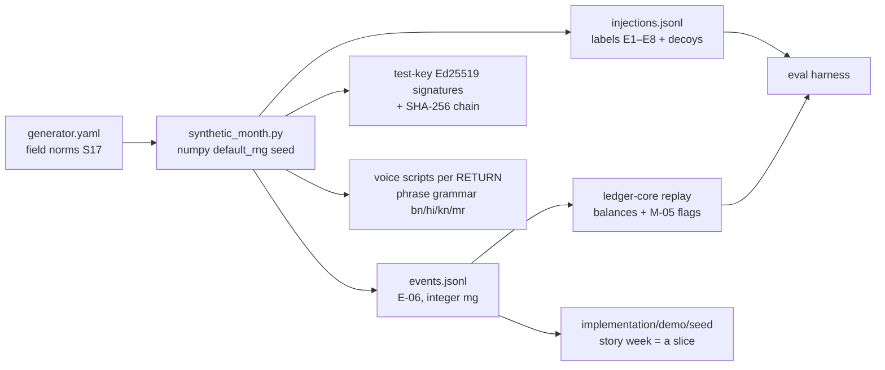
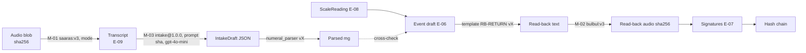

# AI Data Pipeline
> Project: Tola · Owner: AI/voice lead · Status: Draft v0.1 · Last updated: 2026-10-20
> Related: [Models](MODELS.md) · [Prompts](PROMPTS.md) · [AI Evals](AI_EVALS.md) · [Responsible AI](RESPONSIBLE_AI.md) · [Data Model](../03-engineering/DATA_MODEL.md) · [Privacy](../06-security-compliance/PRIVACY.md)

## 1. Scope and stance
Tola trains **no model** in MVP or v1. The AI data pipeline exists for three things:
1. **Evaluation data:** a synthetic ledger month and a consented voice set ([AI_EVALS](AI_EVALS.md)).
2. **A small reference knowledge base** in Lyzr: GST job-work rule snippets and published wastage norms.
3. **Lineage:** being able to say, for any line a karigar or jeweller signed, which model, prompt and input produced the draft.

**No RAG over ledger data.** Balances, events and norms are read from the database by deterministic code and passed to agents as facts. Retrieval would only add a way to be wrong.

## 2. Data sources
| Source | What we take | Link | Licence / terms | Used for |
|---|---|---|---|---|
| IIMA/XLRI karigar field study [S17] | Wastage norms (2–3% plain, 20–30% studded, ~4% antique); weekly/fortnightly payment; new karigars get 100–250 g; gold-dust register practice | via `research/domains/jeweltech.md` | Published report; we use facts and ranges and cite them; no text redistribution | Generator parameters; `wastage_norms` KB |
| GJC GST FAQs for Gem & Jewellery [S24] | Job-work labour at 5% GST; Rule 55 delivery challan; Rule 46 job-worker invoice; old gold from unregistered customer is not job work | https://www.gjc.org.in/pdf/gst/FAQs_GJI_updated_GJF.pdf | Industry FAQ; short quoted snippets with attribution | `gst_jobwork` KB |
| CGST Rules 2017 (Rule 45, 55) and CGST Act s.143 (job-work return periods) | Rule text snippets | CBIC (cbic-gst.gov.in) | Government text | `gst_jobwork` KB. **Rule 45 / s.143 return-period details not verified 2026-10-20**; owner: AI/voice lead to verify with a CA by 30 Nov 2026 before loading |
| DS-02 consented voice clips | Audio + transcripts of numeral phrases | Collected by the team (§4) | Speaker consent (evaluation-only by default) | STT/intake evals |
| Synthetic generator (§3) | Ledger months with injected errors | `implementation/scalable/ai/evals/tola_evals/generate/` | Ours (repo licence) | DS-01, demo seed |
| AI4Bharat IndicConformer-600M | Fallback STT weights | Hugging Face (AI4Bharat) | MIT (per `research/B-sponsors.md`) | M-01 fallback (v1) |

Gold price [S47] is not part of the AI pipeline. ₹ valuations shown in the UI come from the ledger and a configured rate.

## 3. Synthetic ledger generator (DS-01 and demo seed)


### 3.1 Parameters (`generator.yaml`)
```yaml
seed: 20261020
period: { start: "2026-10-05", weeks: 4 }
target_events: 500
shop: { id: shop_demo_01, name: "Suresh Jewellers", karigars: 8 }
karigar_languages: { bn: 4, hi: 2, kn: 2 }          # mirrors P-02 (Bengali karigars in South/West India)
order_type_mix: { plain: 0.60, studded: 0.25, antique: 0.15 }   # HUNCH; tune with field data
wastage_norm_bp:                                     # [S17] ranges, basis points
  plain:   { min: 200,  max: 300 }
  studded: { min: 2000, max: 3000 }
  antique: { min: 400,  max: 400 }
fineness_ppt: { "916": 0.85, "750": 0.15 }           # 22K / 18K declared fineness
issue_mg:                                            # per issue event; HUNCH
  plain:   { min: 5000,  max: 60000 }
  studded: { min: 3000,  max: 30000 }
  antique: { min: 10000, max: 80000 }
issues_per_order: { min: 1, max: 3 }                 # top-ups
new_karigar_hold_cap_mg: { min: 100000, max: 250000 }  # [S17] first-trust range
experienced_hold_cap_mg: 180000                      # P-02 holds ~180 g
actual_loss_fraction_of_norm: { dist: beta, a: 6, b: 2, scale: 1.0 }  # honest work mostly under norm
scrap_return_fraction_of_issue: { min: 0.01, max: 0.04 }
dust_credit_weekly_mg: { min: 50, max: 300 }
settlement_cadence: weekly                           # [S17] "every week or twice a month"
disputes_per_month: 3
injections: { E1: 12, E2: 6, E3: 10, E4: 5, E5: 5, E6: 4, E7: 4, E8: 4, decoys: 20 }
```
Rules:
- All quantities are **integer mg**. Fine gold = `weight_mg * fineness // 1000` is computed only in `ledger-core`, never in the generator's labels. Labels state the injection, not the expected balance.
- Same seed means byte-identical output. CI runs 10 seeds.
- The demo story week (`implementation/demo/seed/`) is a hand-curated slice of seed `20261020` with names from [PERSONAS](../01-product/PERSONAS.md).

### 3.2 Voice scripts
For each RETURN/SCRAP/DUST event, the generator also writes a script in the karigar's language from a phrase grammar (fractional words, code-mixed numerals, fillers). The scripts:
- become scripted rows in DS-03 (text only);
- **optionally** get synthesised with Bulbul to stress-test STT. Synthetic audio is tagged `synthetic=true` and **never counts** toward the headline nWER, which uses human speech only.

## 4. Field voice-note collection (DS-02)
```mermaid
sequenceDiagram
  participant F as Field lead / JanAI Doot
  participant S as Speaker (karigar or staff)
  participant A as Collection app (PWA, offline)
  participant B as GCS asia-south1
  F->>S: Explain purpose in speaker's language (script + audio)
  S->>A: Consent: tap + spoken "haan" recorded; tier choice
  A->>S: Show 30 phrase cards (text + icon + read-aloud)
  S->>A: Record each phrase (≤ 10 s) + 3 free-speech notes (≤ 30 s)
  A->>B: Upload when online (encrypted, pseudonymous speaker_id)
  F->>S: Pay ₹100 per 20-min session (HUNCH) by UPI
```
- **Who:** adults (18+) only, recruited via the field lead and JanAI Doot network. No recording without the speaker present and consenting. **No recordings from minors** working in karkhanas (P-05). If a minor is present, the session stops.
- **Consent (DPDP-aligned; legal text in [PRIVACY.md](../06-security-compliance/PRIVACY.md)):**
  - **Notice:** in the speaker's language, read aloud: purpose (testing how well Tola hears numbers), what is stored, retention, how to withdraw (call or WhatsApp the field lead; deletion within 30 days).
  - **Tier A (default):** evaluation by the Tola team only.
  - **Tier B (opt-in):** inclusion in a future open dataset (CC-BY-4.0). Off by default; separate tap.
  - The consent artefact (timestamp, notice version, language, tier, consent audio hash) is stored separately from the audio.
- **What speakers say:** fictional shop and order names only. No real customer names, addresses or amounts from their real work.
- **Metadata:** `speaker_id` (random), language, home state, self-described gender (optional), age band, device model, noise condition, sample rate. No phone number or name in the dataset; the phone number for payment lives only in the payment record.
- **Storage:** `gs://$GCS_BUCKET/evals/ds02/` in asia-south1:
  - uniform bucket-level access; a read-only service account for CI;
  - object versioning off (so deletion is real);
  - retention 3 years or until withdrawal.
- **Production voice notes (E-09)** are evidence attached to ledger events and follow ledger retention. They are **not** used for evals or tuning unless the speaker gives a separate Tier A opt-in in-app (v1).

## 5. Cleaning and labelling
| Step | Rule | Tool |
|---|---|---|
| Resample / trim | 16 kHz mono WAV; trim silence > 500 ms at ends; drop clips < 0.5 s | `ffmpeg` (pinned in harness Docker image) |
| PII scrub | Listen-through check for real names/amounts; bleep or drop | Reviewer |
| Transcribe | Verbatim, native script; numbers **as spoken words**; tags `[noise]`, `[overlap]`, `[unclear]` | MVP: shared sheet; v1: Label Studio (version pinned at setup) |
| Canonical value | Annotator writes the intended value in mg (e.g. *saade baara gram* → `12500`) | Same |
| Double-annotation | 2 annotators; mismatch on value → third adjudicates; κ on `intent` ≥ 0.8 | Harness script |
| Split | By **speaker** (no speaker in both dev and test); test set frozen per quarter | Harness |

## 6. Knowledge base in Lyzr (the only retrieval)
| Collection | Contents | Chunking | Size |
|---|---|---|---|
| `gst_jobwork` | Rule 55 challan fields; job-work labour 5% GST; Rule 46 invoice; "old gold from unregistered customer is not job work" [S24]; Rule 45 / s.143 return periods (after CA verification) | **One rule per chunk**, 150–400 tokens, metadata `{source_id, url, retrieved_on, jurisdiction: IN, not_legal_advice: true}` | ~20 chunks |
| `wastage_norms` | Published reference ranges [S17] by order type, with the caveat that **the pair's signed E-05 norm always wins** | One norm per chunk | ~10 chunks |

- **Retrieval:** Lyzr KB built-in vector search, top-k = 3. Embedding model and vector store are Lyzr defaults (**not verified 2026-10-20**). No re-ranker: the corpus is under 50 chunks.
- **Use:** MVP loads both collections so the Lyzr graph shows a KB (sponsor visibility); no agent depends on them for numbers. v1 exposes `kb_lookup` ([PROMPTS §4.5](PROMPTS.md)) so SettleAgent can cite **source IDs** in the CA cover note. Code renders citations; KB text is never used to compute.
- **Change control:** KB files live in `implementation/scalable/ai/kb/*.md`, reviewed in PRs, hashed, and synced to Lyzr only by CI (`sync_lyzr_kb.py`). Manual uploads are not allowed (defends against KB poisoning).
- **Refresh:** GST snippets quarterly and within 7 days of any CBIC notification on job work; norms yearly or when a new field study lands. Owner: AI/voice lead, with the shop's CA as reviewer.

## 7. Lineage
Every AI artefact carries a trace record so any signed line can be explained after the fact.



**Trace fields** (proposed table `ai_trace`, linked by `event_id` / `voice_note_id` / `reconciliation_run_id`; not yet an E-xx entity in the [Project Brief](../00-overview/PROJECT_BRIEF.md), so it is flagged to the brief owner for DATA_MODEL.md):

| Field | Example |
|---|---|
| `trace_id` | ULID |
| `task` | `M-01` / `M-02` / `M-03:intake` … |
| `provider`, `model`, `model_version` | `sarvam`, `saaras`, `v3` |
| `prompt_id`, `prompt_version`, `prompt_sha256` | `intake`, `1.0.0`, `9f…` |
| `input_sha256`, `output_sha256` | hashes only (content lives in E-09 / object store) |
| `fallback_mode` | `live` / `cached` / `off` |
| `latency_ms`, `cost_inr_milli` | 1840, 125 |
| `validator_result` | `pass` / `retry_pass` / `fallback_template` |
| `created_at` | ISO 8601 IST |

The read-back audio hash is part of the event payload that **both parties sign**. A karigar can therefore later prove exactly what he heard.

## 8. MVP vs v1
| | MVP (hackathon) → `implementation/demo` | v1 (production) → `implementation/scalable` |
|---|---|---|
| Synthetic data | Generator + seed slice for story mode | Same; 10-seed CI; tuned to pilot data |
| Voice data | 240 clips (team + 8 volunteers), Tier A consent | 2,000 clips from ≥ 120 field speakers; Tier B optional |
| Storage | Private GCS bucket (or local encrypted disk for the team) | GCS asia-south1, CMEK, access logs |
| KB | Two collections uploaded to Lyzr | CI-synced, versioned, `kb_lookup` tool |
| Lineage | `ai_trace` rows in SQLite | Postgres + OTel spans (`gen_ai.*` attributes) |
