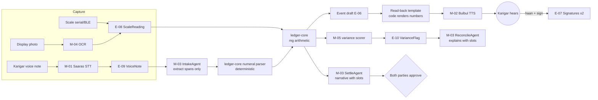

# AI Models
> Project: Tola · Owner: AI/voice lead · Status: Draft v0.1 · Last updated: 2026-10-20
> Related: [Project Brief](../00-overview/PROJECT_BRIEF.md) · [PRD](../01-product/PRD.md) · [Architecture](../03-engineering/ARCHITECTURE.md) · [Prompts](PROMPTS.md) · [AI Evals](AI_EVALS.md) · [Data Pipeline](DATA_PIPELINE.md) · [Responsible AI](RESPONSIBLE_AI.md) · [Cost](../../implementation/scalable/docs/COST.md)

## 0. The one rule
**AI never does gram arithmetic.** Every weight, balance, wastage allowance, variance, dust credit and rupee amount is computed by deterministic code in `ledger-core` from integer milligrams (see [Project Brief §6](../00-overview/PROJECT_BRIEF.md)). Models do four things only:

1. **listen**: speech to text (M-01);
2. **speak**: text to speech (M-02);
3. **extract and explain**: turn a transcript into a draft and explain numbers they were given (M-03);
4. **read a display**: seven-segment OCR (M-04).

M-05 is not ML; it is a rules-and-statistics scorer. No model output becomes a ledger event until **both humans sign** (F-03).

## 1. Summary table
| ID | Task | Primary (demo = MVP) | Fallback chain | Where it runs | Cost per call (₹) |
|---|---|---|---|---|---|
| M-01 | STT for voice notes and "haan/na" | Sarvam **Saaras** `saaras:v3`, REST, `mode=transcribe`, via `sarvamai` 0.1.37 | `saaras:v4` (v1, for keyterms) → AI4Bharat IndicConformer-600M (self-host) → demo: pre-recorded transcripts | Cloud (Sarvam, India) | ≈ ₹0.13 for a 15 s note |
| M-02 | TTS read-back | Sarvam **Bulbul** `bulbul:v3` | Pre-generated clips (demo) → AI4Bharat IndicF5 (v1 self-host) → on-screen text + digits | Cloud | ≈ ₹0.48 for 160 chars |
| M-03 | Agent LLM: Manager, IntakeAgent, ReconcileAgent, SettleAgent | **Lyzr Agent Studio** via `lyzr-adk` 0.1.12, provider `gpt-4o-mini` | Gemini Flash via Lyzr → deterministic template (no LLM) | Cloud (Lyzr SaaS) | ≈ ₹5.3 per single-agent run, ≈ ₹15.8 per Manager run (HUNCH FX) |
| M-04 | Scale display reader (seven-segment) | OpenCV template matching (`opencv-python-headless` 5.0 server; `@techstark/opencv-js` 5.0 in browser) + small CNN (ONNX, `onnxruntime-web` 1.30) | Manual two-person confirm (both type the same number) | On-device (browser) | ₹0 |
| M-05 | Variance anomaly scoring | Deterministic rules + modified z-score (median/MAD) over the karigar's own history, NumPy 2.5 | Rules only (cold start) | Server (`ledger-core`) | ₹0 |

**FX assumption:** USD→INR **₹88/$** (HUNCH, not verified 2026-10-20). All Lyzr ₹ figures scale with this rate.

## 2. Verified pricing and limits (fetched 2026-10-20)

### 2.1 Sarvam (docs.sarvam.ai/api/pricing.md, ratelimits.md, changelog.md, models pages)
| Item | Value | Source |
|---|---|---|
| Speech to Text | **₹30 per hour** (₹45/hr with diarization), billed per second | pricing.md (fetched) |
| Text to Speech (Bulbul) | **₹30 per 10K characters** | pricing.md (fetched) |
| Sarvam-105B (not used; noted for v1 option) | ₹15 in / ₹5 cached / ₹60 out per 1M tokens | pricing.md (fetched) |
| Free credits | **₹100 per new user**, usable across all APIs, never expire | pricing.md + ratelimits.md (fetched) |
| Starter rate limits | STT REST 60 req/min; WebSocket 20 concurrent; Batch 20 req/min. TTS REST 60 req/min, **30 req/min for `bulbul:v3`** | ratelimits.md (fetched) |
| STT REST max audio | **30 seconds**; Batch up to 2 hours | Saaras model page (fetched) |
| Saaras v3/v4 languages | 23 codes incl. `hi-IN`, `bn-IN`, `kn-IN`, `mr-IN`, `ta-IN`, `en-IN` (all 22 scheduled + en) | Saaras model page (fetched) |
| Saaras modes | `transcribe` (default, number normalisation), `translate`, `verbatim` (keeps spoken numbers), `translit`, `codemix` | Saaras model page (fetched) |
| Keyterm prompting | **`saaras:v4` only**, REST and Batch (and WebSocket since 22 Sep 2026), up to 50 terms | Saaras page + changelog (fetched) |
| `saaras:v4` | GA on Voice Agents 2 Sep 2026; on Realtime API 3 Sep 2026 (`saaras:v3-realtime` remains default) | changelog (fetched) |
| Bulbul v3 languages | `hi-IN`, `bn-IN`, `ta-IN`, `te-IN`, `gu-IN`, `kn-IN`, `ml-IN`, `mr-IN`, `pa-IN`, `od-IN`, `en-IN` (11) | Bulbul model page (fetched) |
| Bulbul v3 limits | 2,500 chars per REST request; REST sample rates 8k–48k Hz (default 22,050); 36+ named speakers, default `Shubh` | Bulbul model page (fetched) |
| Bulbul v3 lifecycle | EOL **on Voice Agents** 10 Nov 2026; **remains available on the TTS API** | changelog (fetched) |
| Bulbul number normalisation | Not documented ("pre-TTS text normalization model") | Bulbul page (fetched). We therefore **send numbers as words** (see [PROMPTS.md §6](PROMPTS.md)). |

The research note in `research/B-sponsors.md` matches the fetched pricing (₹30/hr STT, ₹30/10K chars, ₹100 credits).

**₹100 credit budget for the hackathon:** a 15 s note costs ₹0.125 and a 160-char read-back costs ₹0.48. So ₹100 buys about **800 STT notes** or **about 200 read-backs**. **Rule:** pre-generate every story-mode read-back once (about 40 clips ≈ ₹20), keep it in `seed/audio/`, and spend live credits only on the on-stage live moment.

### 2.2 Lyzr (docs.lyzr.ai/enterprise/get-started/pricing, fetched 2026-10-20)
| Item | SaaS | Customer VPC |
|---|---|---|
| Single Agent | **$0.06/run** (≈ ₹5.3) | $0.03/run |
| Manager Agent (1–4 executed sub-agents) | **$0.18/run** (≈ ₹15.8) | $0.09/run |
| Manager with 5–8 executed sub-agents | $0.36/run | $0.18/run |
| Voice Agent | $0.09/min | $0.06/min |
| LLM tokens | "Pass-through at cost, zero markup"; BYOM paid to provider directly | same |
| Credit unit | 1 credit = $1 | — |
| Build tier | "Build: $0, Free forever" (pricing page per `research/B-sponsors.md`) | — |
| Hackathon credit amount | **UNKNOWN**; ask at the AMA on 24 Dec 2026. Owner: AI/voice lead, by 24 Nov 2026 (prototype round start + 1 day). | — |

`gpt-4o-mini` token price: last known list price $0.15 / 1M input, $0.60 / 1M output (**not verified 2026-10-20**). At about 1,500 input and 300 output tokens per run, that is ≈ ₹0.04, which is negligible next to the $0.06 run fee.

**We do not use Lyzr Voice Agents.** Indic support is undocumented and the price is $0.09/min. Speech stays on Sarvam and Lyzr sees text only.

## 3. Model cards

### M-01 · Speech-to-text (Sarvam Saaras)
| Field | Value |
|---|---|
| Task | Transcribe karigar voice notes (return descriptions, disputes) and short confirmations ("haan", "na", "হ্যাঁ", "ಹೌದು") |
| Model / version | `saaras:v3` (MVP). v1 moves to `saaras:v4` for keyterm prompting (jewellery vocabulary, shop and karigar names) |
| Why chosen | Sponsor-visible Indic stack; covers bn/hi/kn/mr/ta; code-mixed `codemix` mode; ₹30/hr; ₹100 free credits |
| Alternatives considered | AI4Bharat IndicConformer-600M (MIT, self-host, no API cost, needs GPU/CPU box); Bhashini ASR (free, but "proof-of-concept use only" per its docs [B-sponsors 32]); Gemma 3n audio (on-device, Indic quality unverified) |
| Inputs | WAV/WebM ≤ 30 s, 16 kHz mono; `language_code` from the karigar profile (E-03) or `unknown` for auto-detect |
| Outputs | Transcript string, detected language. We call it **twice for numeral-bearing notes**: `mode=verbatim` (spoken numbers kept as words, for the numeral parser) and `mode=transcribe` (normalised, for display). Stored in E-09 with confidence where available. |
| Latency target | p95 ≤ 2.5 s for a 15 s clip (target, to be measured in [AI_EVALS](AI_EVALS.md)) |
| Context limits | 30 s per REST call; longer notes are chunked on silence (≤ 28 s) or sent to Batch (v1) |
| Cost | ₹30/hr → ₹0.0083/s → ₹0.125 per 15 s note (₹0.25 with the double call) |
| Indic performance | Vendor claims state of the art across 22 languages (changelog, v4). **Our own number:** numeral-WER per language from the code-mixed eval set ([AI_EVALS §3](AI_EVALS.md)). No independent benchmark verified. |
| On-device vs cloud | Cloud (Sarvam). v1 option: IndicConformer self-hosted in asia-south1 for cost or residency |
| Fallback | `AI_FALLBACK_MODE=cached` → seeded transcripts keyed by clip ID; `off` → karigar taps ✓/✗ (no voice) |
| Intended use | Capturing what the karigar **said**, as evidence and as a cross-check. |
| Limitations | Mishears spoken numbers, especially fractional words (*sava*, *saade*, *paune*, *dedh*, *dhai*; Bengali *সাড়ে*, *পৌনে*; Kannada *ಅರ್ಧ*, *ಮುಕ್ಕಾಲು*), workshop noise (blowtorch, polishing motor) and accents of migrant karigars. **A transcript is never the source of a weight. The scale is (R-02).** |

### M-02 · Text-to-speech read-back (Sarvam Bulbul)
| Field | Value |
|---|---|
| Task | Speak every event back to the karigar in his language before he signs (F-02); read settlements and flags |
| Model / version | `bulbul:v3` via the TTS REST API (still supported on the TTS API after its 10 Nov 2026 Voice Agents EOL) |
| Why chosen | Covers bn/hi/kn/mr/ta/en; ₹30/10K chars; one SDK with M-01 |
| Alternatives | AI4Bharat IndicF5 (11 languages, voice-prompted; heavy on CPU; licence not checked, **not verified 2026-10-20**); Bhashini TTS (PoC only) |
| Inputs | Text **rendered by code** from a template, with every number already spelled out in words in the target language plus digits on screen; `target_language_code`; speaker; 16 kHz for WhatsApp/IVR, 22,050 Hz for the app |
| Outputs | Audio (WAV) stored by hash; the hash goes into the event so the karigar can replay exactly what he heard |
| Latency target | p95 ≤ 1.5 s for ≤ 200 chars |
| Context limits | 2,500 chars per request; a read-back is ≤ 300 chars |
| Cost | ₹0.003/char → ₹0.48 for a 160-char read-back |
| Indic performance | Measured by the read-back intelligibility test: native listeners transcribe the numbers they hear; target ≥ 99% number recall ([AI_EVALS §4](AI_EVALS.md)) |
| Fallback | Pre-generated clips for every story-mode event (demo); on-screen large digits + words; IVR (v1) uses the same audio |
| Intended use | Making the entry understandable to a karigar who may not read |
| Limitations | Bulbul's own number normalisation is undocumented, so we never pass raw digits. Proper nouns (shop names) may be mispronounced, so we store a phonetic name per shop. |

### M-03 · Agent LLM (Lyzr Agent Studio)
| Field | Value |
|---|---|
| Task | Four agents ([PROMPTS.md](PROMPTS.md)): **Manager** routes; **IntakeAgent** extracts structured spans from a transcript; **ReconcileAgent** explains flags that `ledger-core` already computed; **SettleAgent** drafts the settlement narrative and GST draft cover note |
| Model / version | Lyzr Agent Studio agents (IDs in `LYZR_AGENT_ID_MANAGER/INTAKE/RECONCILE/SETTLE`), provider `gpt-4o-mini`, temperature 0 for Intake, 0.2 for explanations; prompts versioned `intake@1.0.0` etc. |
| Why chosen | Lyzr is the hackathon's AI Partner; the agent graph, traces and HITL gates are what a Lyzr judge will look for; single-agent runs are cheap |
| Alternatives | Direct OpenAI/Gemini call (cheaper, loses the sponsor story); Sarvam-105B (Indic-native, ₹15/₹60 per 1M tokens; inside Lyzr needs BYOM on Enterprise, HUNCH); self-hosted small model (v2) |
| Inputs | Facts JSON prepared by the backend (event drafts, flags with mg values, norms) + transcript inside `<transcript>` delimiters. **Never raw audio.** |
| Outputs | JSON validated against the schemas in [PROMPTS.md §4](PROMPTS.md). Explanations contain **slots** such as `{{flag.F1.actual_mg}}`, not digits. Code fills the slots. |
| Latency target | p95 ≤ 6 s per single-agent run; ≤ 12 s for a Manager run |
| Context limits | gpt-4o-mini 128K tokens (**not verified 2026-10-20**); our prompts stay under 4K tokens |
| Cost | $0.06/run single, $0.18/run Manager (fetched) + ≈ ₹0.04 tokens |
| Indic performance | Explanations are generated in the karigar's language. Quality is judged by native reviewers ([AI_EVALS §5](AI_EVALS.md)). Numbers are never at risk because they are slots. |
| Fallback | (1) Gemini Flash provider in Lyzr; (2) `AI_FALLBACK_MODE=cached` → recorded agent responses for story mode; (3) Lyzr unreachable → **deterministic template** per flag type and settlement (every number still correct, prose plainer) |
| Intended use | Drafting text a human reads and signs |
| Limitations | Can hallucinate reasons ("the karigar probably stole") → banned by prompt and by the output validator; can follow instructions injected through speech → defences in [PROMPTS.md §7](PROMPTS.md). |

### M-04 · Scale display reader (seven-segment OCR)
| Field | Value |
|---|---|
| Task | Read the weight from a photo of a balance display when no serial/BLE link exists (F-01, `source=display_ocr`) |
| Model / version | Step 1: OpenCV perspective fix + adaptive threshold + per-digit segmentation; step 2: 7-segment template matching; step 3 (if template confidence < 0.9): small CNN (≈ 50K params, ONNX) per digit. `ocr@0.1.0` |
| Why chosen | Runs offline on a ₹8k phone in the browser, costs ₹0, and needs no cloud |
| Alternatives | Cloud OCR (Google Vision): costs money, adds network, overkill for 7 digits; Sarvam document extraction (built for documents, not LCDs) |
| Inputs | JPEG of the display (≥ 640 px wide); the expected format `ddd.dd` is known per device |
| Outputs | Reading string (e.g. `048.62`), per-digit confidence, crop image hash → E-08 |
| Latency target | ≤ 400 ms on-device |
| Fallback | Confidence < 0.95 on any digit → **manual two-person confirm**: jeweller staff and karigar each type the number; it must match exactly |
| Intended use | Reading a number a human can also see; both parties see the crop and the reading before signing |
| Limitations | Glare, LCD ghosting, unusual fonts. It is not a weighing instrument: legal-metrology verification belongs to the shop's balance (R-04) |

### M-05 · Variance anomaly scoring
| Field | Value |
|---|---|
| Task | Decide which per-order / per-karigar variances become a VarianceFlag (E-10) |
| Method | **Rule 1 (norm):** `actual_loss_mg − allowed_loss_mg > max(50 mg, 10% of allowed_loss_mg)` → `OVER_NORM`. **Rule 2 (chain):** unreturned issue past due date → `OPEN_BALANCE`; duplicate slip (same scale reading ID, or same mg ± 0 within 10 min) → `DUPLICATE`; signature missing → `UNSIGNED`. **Rule 3 (history):** modified z-score `0.6745·(x − median)/MAD` of loss % over the karigar's last ≥ 8 closed orders of the same type; \|z\| > 3.5 → `UNUSUAL_FOR_KARIGAR` (Iglewicz–Hoaglin cut-off) |
| Why chosen | Explainable to a CA (Dr I S Prasad lens), no training data needed, compares the karigar only to **himself**, never to other karigars |
| Inputs / outputs | Integer mg from `ledger-core` → flags with `expected_mg`, `actual_mg`, `delta_mg`, `rule_id` |
| Cost / latency | ₹0; < 50 ms per shop-week |
| Fallback | Fewer than 8 orders → rules 1–2 only (cold start) |
| Limitations | The thresholds (50 mg, 10%, 3.5) are starting points. Tune them on pilot data. Owner: AI/voice lead, before the v1 pilot (target 31 Mar 2027) |

## 4. Fallback ladder (`AI_FALLBACK_MODE`)
| Mode | M-01 | M-02 | M-03 | Used when |
|---|---|---|---|---|
| `live` | Sarvam API | Sarvam API | Lyzr API | Normal |
| `cached` | Seeded transcript by clip ID | Pre-generated WAV by text hash | Recorded JSON by (agent, input hash) | Stage demo default; network flaky (R-07) |
| `off` | Tap ✓/✗ only | On-screen text + digits | Deterministic templates | Total outage; CI unit tests |

The system auto-degrades `live → cached` per call after a 4 s timeout or a 5xx. The UI shows a small "offline voice" chip so nobody thinks it is live when it is not.

## 5. Demo vs scalable usage
| Aspect | MVP (hackathon) → `implementation/demo` | v1 (production) → `implementation/scalable` |
|---|---|---|
| M-01 | `saaras:v3` REST on one live clip; the rest cached | `saaras:v4` + keyterms (50: *ghaat, wastage, touch, bharna, kundan, tola, milli*, shop names); Batch for > 30 s; IndicConformer fallback pod |
| M-02 | About 40 pre-generated clips + 1 live read-back | Live per event, cached by text hash (identical read-backs reuse audio); audio played on demand on WhatsApp (text + digits first) |
| M-03 | Manager → 3 agents visible in the Lyzr graph; story mode calls it once per step | Specialists called directly by workers (no Manager hop) except free-form karigar questions; ReconcileAgent runs **once per shop-week** covering all its karigars |
| M-04 | Optional; simulated scale is primary | On-device in the PWA |
| M-05 | Rules 1–2 on the seeded week; rule 3 on seeded history | All rules, nightly + weekly |
| Keys | `SARVAM_API_KEY`, `LYZR_API_KEY` in Render env | Secret Manager (asia-south1) |

### 5.1 Unit cost per active karigar per month (v1, HUNCH volumes)
Assumptions: 30 events/month; 12 voice notes; 30 read-backs of 160 chars, 50% played; ₹88/$.

| Line | Naïve design | Optimised design (target) |
|---|---|---|
| STT 12 × 20 s (×2 modes) | ₹4.0 | ₹2.0 (verbatim only; display text from the verbatim pass) |
| TTS read-backs | ₹14.4 | ₹7.2 (on-demand play) |
| IntakeAgent | 12 × ₹5.3 = ₹63.4 | 4 × ₹5.3 = ₹21.1 (deterministic numeral parser first; LLM on ≤ 30% of notes) |
| ReconcileAgent | 4 × ₹5.3 = ₹21.1 | ₹2.6 (one run per shop-week ÷ 8 karigars) |
| SettleAgent | 2 × ₹5.3 = ₹10.6 | ₹5.3 (monthly) |
| Manager hops | 18 × ₹15.8 ≈ ₹285 | ₹0 (no Manager on the hot path) |
| **Total** | **≈ ₹398** | **≈ ₹38** |

**Finding for [COST.md](../../implementation/scalable/docs/COST.md) and [BUSINESS_MODEL.md](../07-business/BUSINESS_MODEL.md):** against a HUNCH price of ₹49–99 per active karigar, the naïve agent design loses money. The optimised design keeps AI cost ≤ ₹40 (≤ 80% of the lowest price point) only if Manager runs stay off the hot path. Lyzr's customer-VPC rates ($0.03/run) would roughly halve the Lyzr lines. **Gate:** AI cost per active karigar ≤ ₹40/month, tracked in OBSERVABILITY dashboards.

## 6. Changes to models
Any model or prompt version change must pass `evals.yml` thresholds ([AI_EVALS §7](AI_EVALS.md)) and is recorded in the event lineage fields ([DATA_PIPELINE §7](DATA_PIPELINE.md)).
