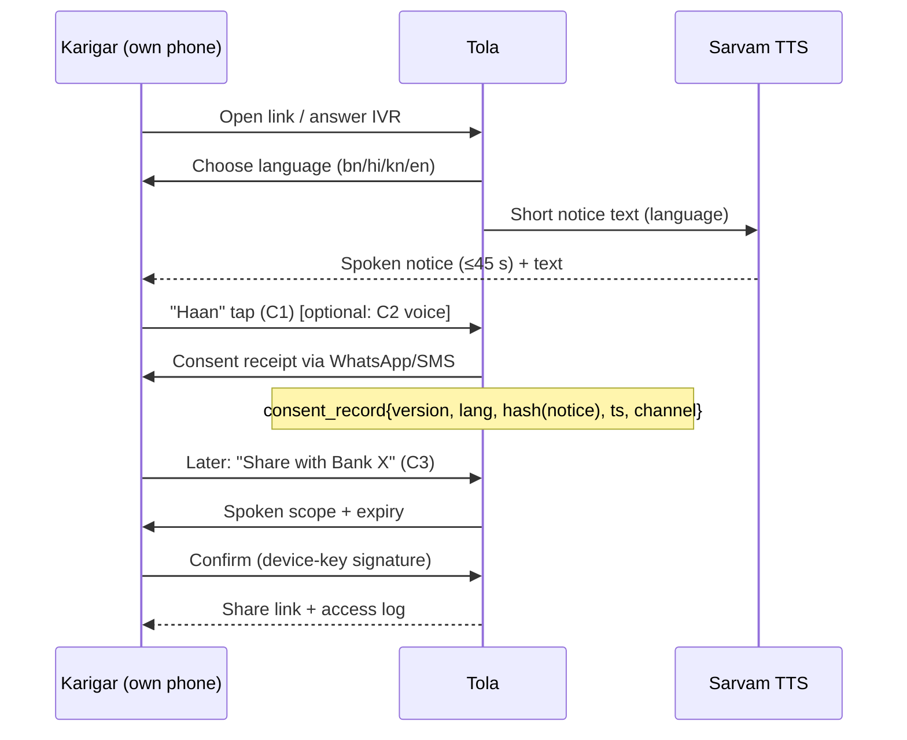

# Privacy
> Project: Tola · Owner: Product lead (acting Data Protection lead) · Status: Draft v0.1 · Last updated: 2026-10-20
> Related: [Security Architecture](SECURITY_ARCHITECTURE.md) · [Threat Model](THREAT_MODEL.md) · [Compliance](COMPLIANCE.md) · [Risk Register](RISK_REGISTER.md) · [Data Model](../03-engineering/DATA_MODEL.md) · [Responsible AI](../04-ai/RESPONSIBLE_AI.md) · [Localization](../02-design/LOCALIZATION.md) · [Project Brief](../00-overview/PROJECT_BRIEF.md)

**Privacy stance in one line:** the karigar's record belongs to the karigar. Tola holds it so that he can prove it, and he decides who else sees it.

| Track | Personal data processed | Legal posture |
|---|---|---|
| **MVP (hackathon)**, `implementation/demo` | **None real.** Synthetic personas P-01 to P-05 and team-recorded voice clips (with written consent) | DPDP obligations don't attach to synthetic data. We still build the notice and consent screens so judges see the v1 flow. |
| **v1 (production)**, `implementation/scalable` | Name, phone, language, signed ledger events, voice notes, scale photos, UPI VPA, passport shares | Tola is the **Data Fiduciary** for its own users' account data. Jewellers use Tola for their business records. Role allocation for shop-entered data is in §2.3. |

---

## 1. Legal status check (DPDP), as of 2026-10-20

| Instrument | Status | Source / verification |
|---|---|---|
| Digital Personal Data Protection Act, 2023 | Enacted Aug 2023. Commencement is phased: **13 Nov 2025** (Board provisions, ss.18–26 and others); **13 Nov 2026** (s.6(9) consent-manager provisions, s.27(1)(d)); **13 May 2027** (all remaining provisions, incl. the main fiduciary duties) | Wikipedia *DPDP Act, 2023* infobox, fetched 2026-10-20 [S53]; consistent with SCC Online below |
| Digital Personal Data Protection Rules, 2025 | Notified by MeitY on **13 Nov 2025**; the PIB release is dated 14 Nov 2025. **Immediately:** Rules 1, 2, 17–21 (Board). **After 1 year (13 Nov 2026):** Rule 4 (Consent Manager registration). **After 18 months (13 May 2027):** Rules 3, 5–16, 22–23 (notice, security safeguards, breach intimation, retention/erasure, children, SDF duties, rights) | SCC Online blog, 14 Nov 2025, fetched 2026-10-20. MeitY and PIB pages returned HTTP 403 to our fetcher, so the **primary text is not verified 2026-10-20**. Owner: Product lead, re-check against the Gazette PDF by **30 Nov 2026**. |
| Breach intimation | To the Board: an initial intimation, then a detailed report **within 72 hours**. Affected Data Principals: without delay | SCC Online summary of Rule 7 (fetched). Primary text not verified. |
| Security-safeguard logs | Logs and related personal data kept for **one year** (Rule 6 / Seventh Schedule) | SCC Online summary (fetched). Primary text not verified. |
| Erasure notice | **48 hours'** notice to the Data Principal before erasure for inactivity, where the Third Schedule applies | SCC Online summary (fetched). Whether Tola's class falls under the Third Schedule is not verified. |

**What this means for us.** The pilot (early 2027) runs *before* the main duties start on 13 May 2027. We will still comply with the full Act and Rules from day one of v1. That is cheaper than retrofitting, and it is the right thing for a product whose pitch is fairness to the weaker party.

---

## 2. Roles

### 2.1 Data Principals
- karigars (P-02, P-05, helpers);
- jeweller owners and staff (P-01, P-03);
- lender officers (P-04);
- jewellery **customers**, only incidentally (see §3, "occasion date").

### 2.2 Data Fiduciary
Tola (the company, once incorporated; until then the team members, for the demo only).

### 2.3 Who decides what for shop-entered data
A jeweller enters data about his karigars: name, orders, wastage norms.
- For the **shared ledger**, Tola decides the purpose and the means, because the two-signature design is Tola's. **Tola is therefore the Data Fiduciary** for ledger data about both parties.
- The jeweller is a **user**, not a processor.

This is our reading, not a legal opinion. Owner: Product lead, to get a written opinion from a pro bono tech lawyer (e.g. via the RVCE incubation network) by **31 Jan 2027**.

### 2.4 Data Processors
| Processor | Data |
|---|---|
| Google Cloud (hosting, `asia-south1`) | All stored data |
| Sarvam AI | Audio and text |
| Lyzr + its LLM provider | Pseudonymised transcripts and ledger summaries |
| Meta (WhatsApp Cloud API) | Phone number and message text |
| IVR provider | Phone number and call audio |
| SMS OTP provider | Phone number |
| UPI PSP | VPA and amount |

Each needs a **Data Processing Agreement** before v1 goes live. Owner: Product lead, before the first pilot shop.

### 2.5 Significant Data Fiduciary
Tola is **not** expected to be notified as one (small volume, no sensitive categories at scale). We still run a DPIA (§9) voluntarily.

---

## 3. Personal data inventory (v1)

Classification:
- **P0:** public / non-personal;
- **P1:** personal;
- **P2:** personal and financially sensitive;
- **P3:** high-risk (voice, images of people, location).

| Entity | Field | Class | Purpose | Legal basis (DPDP) | Retention | Who sees it |
|---|---|---|---|---|---|---|
| E-02 Person | `display_name` | P1 | Show on ledger and statements | Consent (s.6) | Life of account + ledger retention (§5) | Self; counterparties; lender only if the passport scope includes it |
| E-02 Person | `phone_e164` (encrypted + blind index) | P1 | Login (OTP), read-backs, statements | Consent | Account life + 30 days | Self; last 4 digits to counterparties; full number to no human by default |
| E-02 Person | `public_key`, `key_id`, device label | P1 | Verify signatures | Consent; needed for the service | **Same as the ledger** (needed to verify old signatures) | System; shown as a fingerprint |
| E-02 Person | `preferred_language` | P1 | Read-back and UI language | Consent | Account life | Self, system |
| E-02 Person | `age_attested_18_plus` (boolean, no DOB) | P1 | Exclude children (§8) | Consent | Account life | System |
| E-03 KarigarProfile | `languages[]` | P1 | Voice read-back | Consent | Account life | Self; linked shops |
| E-03 KarigarProfile | `pm_vishwakarma_id` (optional) | P2 | Karigar may show it on his passport | Consent (explicit, optional) | Until he removes it | Self; lender if in scope. **Never** shown to shops. |
| E-03 KarigarProfile | `linked_shop_ids[]` | P2 | Route events | Consent | Account life | Self; each shop sees only its own link |
| E-01 Shop | `name`, `gstin`, `bis_reg_no`, address | P0/P1 (P1 for a proprietorship) | Statements, GST drafts (F-09) | Consent; legal obligation for GST records | GST retention (§5) | Shop; its karigars |
| E-04 Order | design ref, type, due date | P0 | Job tracking | — | GST retention | Shop; assigned karigar |
| E-04 Order | `customer_occasion_date` | P1 (about an end customer, indirectly) | Late-risk flags (F-10) | Legitimate use is unclear, so we store **only the date**, no customer name or phone | Until the order closes + 30 days | Shop; assigned karigar |
| E-05 WastageNorm | % per type, signatures | P1 | Reconciliation | Consent (both sign) | Ledger retention | Both parties |
| E-06/E-07 LedgerEvent + Signature | weights (mg), fineness, hashes, signatures, assurance tier | P2 (financial) | **Core purpose:** the dual-signed record | Consent; the karigar's own record | Ledger retention (§5) | Both parties to the pair, **only** |
| E-08 ScaleReading | grams, source, device id, display photo | P1 (the photo can show hands or the counter) | Evidence of weight | Consent | Photo: **13 months**. Reading + photo hash: ledger retention | Both parties |
| E-09 VoiceNote | audio | **P3** | Return intake (F-04), disputes (F-06) | Consent (explicit, per recording, with a tap) | Audio: **90 days** after the event is signed or the dispute is closed. Transcript and fields: ledger retention | Both parties; Sarvam (processing only) |
| E-09 VoiceNote | transcript, extracted fields, confidence | P2 | Same | Consent | Ledger retention | Both parties; Lyzr (pseudonymised) |
| E-10 ReconciliationRun / VarianceFlag | expected vs actual, z-score | P2 | Weekly reconciliation (F-05) | Consent | Ledger retention | Both parties |
| E-11 Dispute | messages (text/voice), status, "signed under pressure" private flag | P2/P3 | Dispute resolution (F-06) | Consent | Ledger retention; voice 90 days after closure | Parties; the private flag goes only to the karigar and Tola trust & safety |
| E-12 Settlement | gold balance, labour ₹, dust credit, signatures | P2 | Settlement (F-07), GST drafts (F-09) | Consent; legal obligation (GST) | GST retention | Both parties; the CA if the shop exports |
| E-13 PaymentIntent | UPI VPA, amount, status, UTR | P2 | Payment (F-07) | Consent | GST retention | Both parties; PSP |
| E-14 PassportShare | scope, recipient org, expiry, views log | P2 | Karigar-controlled sharing (F-08) | **Explicit consent per share** | Share record: 1 year after expiry. View logs: 1 year | Karigar; the named recipient while the share is valid |
| — | Lender officer `email`, org | P1 | Recipient verification | Consent | 1 year after last access | Tola; the karigar sees the org name |
| — | Security logs (IP hash, user agent, actor, action) | P1 | Security, CERT-In, DPDP Rule 6 | Legitimate use: compliance with law (s.7) | **1 year** (covers CERT-In's 180 days) | Security team only |

**Never collected:**
- Aadhaar number or biometrics;
- bank account numbers;
- precise GPS;
- caste, religion or health;
- voiceprints or speaker embeddings;
- contacts or the phone's photo gallery;
- names or phone numbers of end customers.

---

## 4. Notice and consent (DPDP s.5, s.6; Rule 3, verify current text)

### 4.1 How consent is captured
1. **Language first.** The first screen and the first IVR prompt ask for the language: bn, hi, kn, en (v1 adds mr, ta). The **notice is spoken aloud** (Sarvam Bulbul, M-02) and also shown as text. The Act's rights list references availability in Eighth Schedule languages [S53].
2. **Short notice first, full notice one tap away.** The short notice takes under 45 seconds of audio. Consent is a separate, unticked "I agree / हाँ" button. It is never bundled with the terms of service.
3. **Separate, optional consents:**
   - **C1, core ledger:** required to use Tola.
   - **C2, voice recording:** optional; text or tap confirm works without it.
   - **C3, Work Passport sharing:** a separate consent each time, naming the recipient.
   - **C4, product-improvement use of de-identified transcripts:** off by default.
4. A **consent receipt** goes to his WhatsApp/SMS in his language, with the withdrawal instructions.
5. **Withdrawal** is as easy as giving consent: one menu item, or the reply "STOP TOLA", or IVR option 9. Withdrawing C1 ends new processing. Signed past events stay with the counterparty as their own business record (see §7).
6. **Consent Manager.** From 13 Nov 2026 registered Consent Managers can exist (Rule 4). v1 will accept consent through one if a karigar uses one. The AA/ULI path for F-08 would use an RBI-regulated Account Aggregator's consent artefact.

### 4.2 Short notice text, v0.1 (to be reviewed by native speakers)
Review owner: Field & pitch lead, with one karigar and one native-speaker reviewer per language, by **10 Dec 2026**. The Bengali and Kannada versions are machine-assisted drafts.

**English**
> Tola keeps a record of the gold you receive and return, signed by you and the jeweller. We store your name, phone number, language, and the entries you confirm. If you choose, we also keep your voice notes for 90 days. Only you and the jeweller in each entry can see it. No other jeweller can. Nobody else sees your record unless you share it, and you can stop any share. You can ask to see, correct or delete your data, or complain, by pressing 9 or messaging "HELP". Do you agree?

**हिन्दी (Hindi)**
> तोला आपके लिए और जौहरी के लिए सोने के लेन-देन का रिकॉर्ड रखता है, जिस पर आप दोनों के हस्ताक्षर होते हैं। हम आपका नाम, फ़ोन नंबर, भाषा और आपकी पुष्टि की हुई एंट्री रखते हैं। आप चाहें तो आपकी आवाज़ की रिकॉर्डिंग 90 दिन तक रखी जाती है। हर एंट्री सिर्फ़ आप और उस जौहरी को दिखती है, किसी दूसरे जौहरी को नहीं। आपकी मर्ज़ी के बिना कोई और आपका रिकॉर्ड नहीं देखता, और आप कभी भी शेयर बंद कर सकते हैं। अपना डेटा देखने, सुधारने, हटाने या शिकायत के लिए 9 दबाएँ या "HELP" लिखें। क्या आप सहमत हैं?

**বাংলা (Bengali), draft**
> তোলা আপনার আর জুয়েলারের সোনার লেনদেনের হিসাব রাখে, যাতে আপনারা দুজনেই সই করেন। আমরা আপনার নাম, ফোন নম্বর, ভাষা আর আপনার নিশ্চিত করা এন্ট্রি রাখি। আপনি চাইলে আপনার ভয়েস নোট ৯০ দিন রাখা হয়। প্রতিটি এন্ট্রি শুধু আপনি আর সেই জুয়েলার দেখতে পান, অন্য কোনো জুয়েলার নয়। আপনি শেয়ার না করলে আর কেউ আপনার হিসাব দেখে না, আর আপনি যেকোনো সময় শেয়ার বন্ধ করতে পারেন। আপনার তথ্য দেখতে, ঠিক করতে, মুছতে বা অভিযোগ করতে ৯ টিপুন বা "HELP" লিখুন। আপনি কি রাজি?

**ಕನ್ನಡ (Kannada), draft**
> ತೋಲಾ ನೀವು ಮತ್ತು ಆಭರಣ ವ್ಯಾಪಾರಿ ಇಬ್ಬರೂ ಸಹಿ ಮಾಡುವ ಚಿನ್ನದ ವ್ಯವಹಾರದ ದಾಖಲೆಯನ್ನು ಇಡುತ್ತದೆ. ನಿಮ್ಮ ಹೆಸರು, ಫೋನ್ ಸಂಖ್ಯೆ, ಭಾಷೆ ಮತ್ತು ನೀವು ದೃಢಪಡಿಸಿದ ನಮೂದುಗಳನ್ನು ನಾವು ಇಡುತ್ತೇವೆ. ನೀವು ಬಯಸಿದರೆ ನಿಮ್ಮ ಧ್ವನಿ ಸಂದೇಶಗಳನ್ನು 90 ದಿನ ಇಡಲಾಗುತ್ತದೆ. ಪ್ರತಿಯೊಂದು ನಮೂದನ್ನು ನೀವು ಮತ್ತು ಆ ವ್ಯಾಪಾರಿ ಮಾತ್ರ ನೋಡಬಹುದು, ಬೇರೆ ಯಾವ ವ್ಯಾಪಾರಿಯೂ ಅಲ್ಲ. ನೀವು ಹಂಚಿಕೊಳ್ಳದ ಹೊರತು ಬೇರೆ ಯಾರೂ ನಿಮ್ಮ ದಾಖಲೆಯನ್ನು ನೋಡುವುದಿಲ್ಲ, ಮತ್ತು ನೀವು ಯಾವಾಗ ಬೇಕಾದರೂ ಹಂಚಿಕೆಯನ್ನು ನಿಲ್ಲಿಸಬಹುದು. ನಿಮ್ಮ ಮಾಹಿತಿ ನೋಡಲು, ಸರಿಪಡಿಸಲು, ಅಳಿಸಲು ಅಥವಾ ದೂರು ನೀಡಲು 9 ಒತ್ತಿ ಅಥವಾ "HELP" ಎಂದು ಕಳುಹಿಸಿ. ನೀವು ಒಪ್ಪುತ್ತೀರಾ?

### 4.3 Passport-share consent (C3), spoken before every share
> "You are sharing your Tola work record with **{Bank X}** for **{7} days**. They will see: grams handled per month, on-time %, and difference from agreed wastage. They will **not** see your phone number or your jewellers' names. You can stop this share any time. Share now?"

### 4.4 Consent flow

Every consent is stored as `consent_record` (proposed entity, see the [RISK_REGISTER](RISK_REGISTER.md#7-notes-for-the-brief-owner) note) with the notice version, a hash of the notice text, the language, the channel and the timestamp.

---

## 5. Retention schedule
| Data | Retention | Basis | Deletion method |
|---|---|---|---|
| Ledger events, signatures, settlements, payment intents | Up to **72 months** from the due date of the relevant annual GST return (CGST Act s.36, our reading; **not verified 2026-10-20**, CA to confirm), otherwise 8 years | Legal obligation for the shop's records; dispute evidence for both parties | Crypto-shred the PII DEK (§7.3); the hash chain stays |
| Voice audio | 90 days after the event is signed or the dispute closes | Minimisation | Hard delete from GCS (lifecycle rule) |
| Scale display photos | 13 months | Covers one full season of disputes | GCS lifecycle rule |
| Passport shares and view logs | 1 year after expiry | Accountability to the karigar | Hard delete |
| Security / access logs | 1 year in India | CERT-In (180 days) + DPDP Rules (1 year, per the summary) | Log bucket retention policy |
| OTP hashes | 24 hours | Security | TTL |
| Inactive accounts | After 3 years without login, we send a notice (48 hours ahead at least, if the Third Schedule applies), then erase PII | Rule 8 (verify) | Crypto-shred |
| Demo data | Deleted 31 Jan 2027 | — | Drop the DB; revoke keys |

---

## 6. Residency and cross-border transfer
- **Primary storage is in India:** GCP `asia-south1` (Mumbai) for Cloud SQL, GCS and Secret Manager. Backups stay in `asia-south1` (DR copy in `asia-south2` Delhi, if adopted in INFRASTRUCTURE).
- **CERT-In logs** are kept within Indian jurisdiction (180 days minimum).
- **The LLM path is the exception.** Lyzr with `gpt-4o-mini` may process data outside India. The provider region is not verified 2026-10-20. The DPDP Act allows transfers except to countries the government restricts (s.16). Mitigations:
  1. send only **pseudonymised** transcripts (`K1`, `S1`), never names or phone numbers;
  2. send integers already computed by `ledger-core`, never raw audio;
  3. turn off provider retention or training where Lyzr allows it (setting availability not verified);
  4. **v1 roadmap:** move M-03 to an India-hosted model. Options are Lyzr's sovereign/on-prem deployment [S43] or an Indian LLM. Owner: AI lead, decision by **31 Mar 2027**.
- **Sarvam** is an Indian company. Its hosting region is not verified 2026-10-20 (AI lead to confirm in the DPA).

---

## 7. Data principal rights (DPDP ss.11–14)

| Right | How the karigar (or any user) exercises it | Target time |
|---|---|---|
| **Access** (s.11) | "My record" screen shows every event, signature and share. **Export**: a signed JSON + PDF in his language, sent to his WhatsApp. IVR option: "your balance is …" read aloud | Instant in the app; export ≤ 24 h |
| **Correction** (s.12) | Profile fields: edit directly. **Ledger entries cannot be edited.** A wrong entry is corrected by a dual-signed `ADJUSTMENT` or by opening a dispute (F-06). This keeps the integrity both parties rely on, and the user is told why. | Profile: instant. Disputes per F-06 |
| **Erasure** (s.12) | "Delete my account" → 7-day undo window → PII crypto-shredded. The counterparty's copy of shared events is kept as *their* business record (GST retention) but shows "former user". | ≤ 30 days |
| **Grievance redressal** (s.13) | In-app "Complain", the "HELP" WhatsApp keyword, IVR option 9, email. A named Grievance Officer (Product lead until a hire) | Acknowledge 48 h; resolve ≤ 30 days (our target; the prescribed period is not verified 2026-10-20) |
| **Nominate** (s.14) | A karigar can nominate a family member to access or export his record on death or incapacity (useful for a migrant worker's family) | v1.1 |
| **Withdraw consent** (s.6(4)) | One tap / "STOP TOLA" / IVR 9 | Immediate for new processing |
| **Board** | The notice tells users they can complain to the Data Protection Board of India after using our grievance channel | — |

### 7.3 How erasure works with an append-only ledger
- PII lives in `person_pii`, encrypted under a per-person data key.
- Ledger events reference only `person_id`, plus public keys, which are pseudonymous.
- Erasure destroys the data key. The events stay verifiable but become un-attributable, which is effectively anonymised for us.
- The counterparty's own legal record keeps the minimum they need (the name as it appears on the GST challan they generated).

---

## 8. Children's data
- **None by design.** Tola serves adults in a trade relationship. At onboarding we ask for an **18+ attestation**. We don't collect a date of birth.
- **Child labour.** Goldsmith workshops have a documented history of child labour. Tola must never become a register of minors' work. If we learn a user is under 18, we close the account and erase the data. We do not onboard helpers under 18 under a head karigar's delegation. We do not record minors' voices. Onboarding staff ("Doots") are trained to refuse.
- No tracking or targeted advertising anywhere in Tola, for anyone.

### 8.1 Field research and demo recordings
- Field visits before the final (P-02-style karigars) are done with **written or recorded verbal consent**, in the person's language. Faces are blurred unless the person opts in. Recordings stay in the team's private drive and are deleted by **31 Mar 2027**.
- Nothing from the field is loaded into the public demo.
- Owner: Field & pitch lead.

---

## 9. DPIA (voluntary; v1 before the pilot)

| Step | Finding |
|---|---|
| Processing description | A dual-signed gold job-work ledger between a jeweller and karigars; voice read-back and intake; weekly reconciliation; karigar-controlled sharing with lenders |
| Necessity & proportionality | Name, phone and events are necessary. Voice is optional. Photos are needed as weighing evidence. Passport data is aggregate by default. |
| Risks to data principals | (1) The record is used *against* the karigar: by a jeweller in a dispute, by police or tax authorities, by a lender to deny credit. (2) Coercion to consent. (3) Cross-shop leakage hurts his bargaining. (4) Voice data misuse. (5) Migrant workers' identity exposure in a hostile political climate [S23]. |
| Mitigations | Karigar-only control of sharing; no score (R-06); cross-shop isolation; consents separated; voice optional, 90-day retention; no Aadhaar, no location; transparency on legal requests (we publish counts; we notify the user unless prohibited by law) |
| Residual risk | Medium: coercion (see [THREAT_MODEL AC-02](THREAT_MODEL.md#ac-02-coerced-haan)) and lawful-access demands |
| Sign-off | Product lead + Backend lead + one external reviewer, by **28 Feb 2027** (before the first pilot shop) |

---

## 10. Privacy by design checklist
- [x] Integer milligram records with no free-text gold descriptions (less incidental PII)
- [x] Pseudonymisation before every LLM call
- [x] No third-party analytics SDKs in the karigar app. First-party, PII-free event taxonomy only (see [METRICS](../01-product/METRICS.md))
- [x] Default-private passport, aggregates only, time-boxed
- [x] Per-person keys on the shared karkhana phone
- [x] The notice is *spoken*, not only written (low literacy, R-08)
- [ ] Native-speaker review of notices (owner Field & pitch lead, 10 Dec 2026)
- [ ] Processor DPAs signed (owner Product lead, before the pilot)
- [ ] Written legal opinion on the fiduciary role (owner Product lead, 31 Jan 2027)
