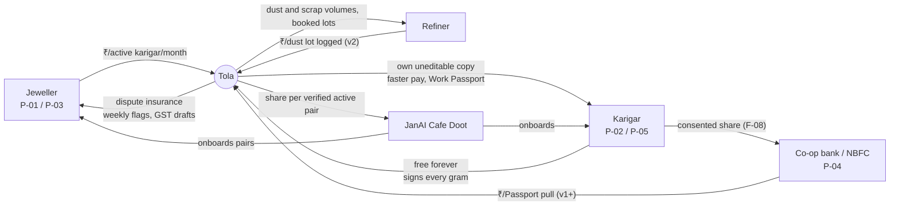

# Business Model
> Project: Tola · Owner: Field + pitch lead · Status: Draft v0.1 · Last updated: 2026-10-20
> Related: [Project Brief](../00-overview/PROJECT_BRIEF.md) · [PRD](../01-product/PRD.md) · [GTM](GTM.md) · [Financials](FINANCIALS.md) · [Impact](IMPACT.md) · [Competitive analysis](../01-product/COMPETITIVE_ANALYSIS.md) · [Pitch](../00-overview/PITCH.md)

**One line:** the jeweller pays for dispute insurance, the karigar uses it free forever, and his signed record pulls lenders, refiners and other jewellers onto the same ledger.

Conventions:
- **HUNCH** means a ₹ figure or behaviour we have not yet tested in the field. Every HUNCH is a field-interview question in [HACKATHON_PLAN.md §3](../00-overview/HACKATHON_PLAN.md).
- **[S#]** means a source from `research/domains/jeweltech.md` (see [PROJECT_BRIEF §17](../00-overview/PROJECT_BRIEF.md)).
- Gold price used throughout: 24K retail **₹1,49,041 per 10 g on 20 Oct 2026** [S47], so 1 g of 24K is about ₹14,904.

---

## 1. Lean canvas

| Block | Tola |
|---|---|
| **1. Problem** | (a) Gold issued to karigars is tracked in notebooks, wastage is "agreed verbally", and accounts are squared at month end (PS 2.2 [S1]). (b) A 1 g disagreement costs about ₹15,000, which is more than a month of a small-town goldsmith's income (₹10–20k/month [S18]). (c) The karigar has no proof of good work, so new jewellers trust him with only 100–250 g [S17], and banks find him hard to lend to [S18]. |
| **2. Customer segments** | **Payer 1:** jewellers with 2–30 karigars on job work (P-01 Suresh). **User, never charged:** karigars and head karigars (P-02 Rafiq, P-05). **Payer 2 (v1+):** co-op banks, NBFCs and PM Vishwakarma lending banks (P-04). **Payer 3 (v2):** refiners who recover gold from workshop dust and scrap. **Channel partner:** JanAI Cafe Doots. |
| **3. Unique value proposition** | **"Two signatures on every gram."** One number that both sides signed: the jeweller stops losing grams he can't explain, and the karigar owns a record that makes him creditworthy. |
| **4. Solution** | Scale-captured issue and return (F-01, F-04). Voice read-back in the karigar's language (F-02). A dual-signed, hash-chained log (F-03). A weekly reconciliation agent (F-05). A dispute thread that is never overwritten (F-06). Two-party settlement with a UPI intent (F-07). A consented Work Passport (F-08). GST job-work drafts (F-09). |
| **5. Channels** | KAVMS jeweller network and Avenue Road / Chickpet walk-ins (HUNCH). Karigar referrals to their other jewellers. JanAI Cafe Doots. Co-op bank branches. Jeweller associations. See [GTM.md](GTM.md). |
| **6. Revenue streams** | (a) Jeweller subscription per **active karigar** per month: **₹79 floor (Shop), ₹99 (Shop Pro)**; HUNCH within the brief's ₹49–99 range, floor set by [COST.md](../../implementation/scalable/docs/COST.md). (b) Lender fee per consented Work Passport pull (v1+). (c) Refiner fee on the dust and scrap line (v2). (d) JanAI Bazaar: Tola as a provider, with a revenue share paid to the Doot per verified active pair. |
| **7. Cost structure** | Speech (Sarvam STT/TTS), agent LLM calls (Lyzr), WhatsApp/IVR messages, GCP Mumbai hosting, Doot payouts, field onboarding, team. **Fully loaded cost per active karigar per month (optimised AI design): ₹147 at 100 karigars, ₹46 at 10k, ₹42.50 at 1M** ([COST.md §4](../../implementation/scalable/docs/COST.md)); the naïve design costs ≈ ₹408–513. Detailed in [FINANCIALS.md §2](FINANCIALS.md). |
| **8. Key metrics** | North star: **grams reconciled within 7 days with two signatures** ([VISION.md](../00-overview/VISION.md)). Plus: active jeweller–karigar pairs, unexplained variance (mg per karigar per week), days from return to labour payment, Passport shares accepted. |
| **9. Unfair advantage** | A two-sided record that only exists if both parties sign, and a karigar network that spans jewellers. Explained in §6. |

---

## 2. Customer segments in detail

| Segment | Who exactly | Size signal | Pain in ₹ | Why they adopt |
|---|---|---|---|---|
| **Jeweller (payer 1)** | Shop owner or manufacturer with 2–30 karigars on job work and 30–60 open custom orders in wedding season (P-01) | 2,36,624 BIS-registered jewellers [S2]; about 5,00,000 jewellers including unregistered ones [S16] | Each karigar holds ₹4–5 lakh of gold [S17]. Unexplained loss of 0.5 g per karigar per month across 8 karigars costs about ₹60,000 per month (arithmetic at ₹14,904/g; the loss rate is HUNCH) | Dispute insurance, same-week flags instead of month-end arguments, GST job-work drafts for the CA, fewer missed wedding dates |
| **Karigar (user, free)** | Goldsmith working for 1–4 jewellers, wastage-based pay (P-02); head karigar with 5–15 helpers (P-05) | Gems and jewellery employs about 6.1 million people [S17]; about 2.2 lakh karigars in Mumbai alone [S20] | Absorbs disputed grams ("the head karigar has to pay for gold loss" [S17]); waits weeks for pay [S1]; hard to get bank credit [S18] | His own signed copy, faster settlement, a Work Passport that replaces the "100–250 g first trust" rule [S17] |
| **Lender (payer 2, v1+)** | Co-op banks, NBFCs, PM Vishwakarma lending banks (P-04) | PM Vishwakarma offers collateral-free credit of up to ₹1 lakh, then up to ₹2 lakh, at a 5% concessional rate; goldsmith is one of its 18 trades; 26.87 lakh registered by Jan 2025 [S41] | Thin-file artisans; no record of work delivered | A consented, tamper-evident work history: grams handled, on-time %, variance against norm |
| **Refiner (payer 3, v2)** | Agencies that recover gold from floor mats, polishing dust and scrap | Today the dust collection is yearly, paid about ₹500–700 per mat swap [S17]; this is the only data point we have | Opaque, cash-based supply | Visibility of dust and scrap volumes per workshop, and booked collection lots |
| **Channel: JanAI Doot** | Local entrepreneur running a JanAI Cafe | 10 cafes live in 3 states (janai.ai, fetched 2026-10-20) [B §2] | Needs outcome-paid services to sell | A recurring share per verified active pair |

---

## 3. Value proposition by party

| Party | Gain | Pain relieved | Proof we will show |
|---|---|---|---|
| Jeweller | One number per karigar, signed by both; variance caught in the same week | Month-end arguments; grams lost with no owner | Demo: the reconciliation flag on Order #14 (+0.38 g) the same week (F-05) |
| Karigar | An uneditable copy; disputes stay open until both sign; pay released on approval | Absorbing losses he didn't cause; waiting weeks for pay | Demo: Bengali read-back, voice dispute, UPI QR (F-02, F-06, F-07) |
| Counter staff (P-03) | No typing of weights; the scale writes the number | Copying errors and blame | Demo: scale-captured issue (F-01) |
| Lender | A consented record with a verifiable hash chain | Lending blind to artisans | Demo: mocked lender view, labelled (F-08) |
| CA | Rule 55 challan and 5% labour-invoice drafts from signed events [S24] | Rebuilding job-work records from slips | Demo: GST draft PDF, labelled "draft" (F-09) |

---

## 4. Revenue streams and pricing (₹)

### 4.1 Jeweller subscription: priced per active karigar
A **billable active karigar** is one with at least one dual-signed event (E-06 + two E-07) in the calendar month. A shop pays nothing for karigars who did no work that month. (The product metric "active pair" in [METRICS.md §2](../01-product/METRICS.md) uses a 14-day window; billing uses the calendar month.)

| Plan | Price per active karigar per month | Includes | Status |
|---|---|---|---|
| **Founding pilot** | ₹0 for the first 90 days | Everything in Shop; at most 10 karigars; only the first 10 shops | GTM rung 1 ([GTM.md §3](GTM.md)) |
| **Trial** | ₹0 for 30 days | Everything in Shop | Every shop after the first 10 (matches the 30-day trial in [METRICS.md §3](../01-product/METRICS.md)) |
| **Shop** | **₹79** (HUNCH; the floor: below this, margin collapses) | F-01 to F-07, F-13, F-14; WhatsApp channel; weekly reconciliation; up to 40 voice read-backs per karigar per month | v1 |
| **Shop Pro** | **₹99** (HUNCH) | Shop + F-09 GST drafts, F-10 order and deadline tracker, Tally export, IVR channel for karigars without smartphones, priority dispute support | v1 |
| **Karkhana** | ₹99 per **head karigar**; helpers free | Shared-phone mode with per-person PIN keys (R-09) | v1.1 |

Annual prepay gets 2 months free (HUNCH). A typical P-01 shop (8 karigars on Shop at ₹79) pays **₹632 per month, ₹7,584 per year**. The price ladder tested in field interviews includes ₹49; we will **not** launch at ₹49 (see below).

**Why the price is credible:**
- **Below the ERP spend band.** Jewellery ERPs cost ₹12,000 to ₹2 lakh per year [S25]; Jwelly costs ₹15k–75k per year per shop and Marg ₹12k–50k [S25]. Tola is an add-on that sits next to them, not a replacement.
- **Tiny against the risk.** ₹79 per month is about **0.005 g** of 24K gold. The karigar holds ₹4–5 lakh of the jeweller's gold [S17].
- **Pays back on one avoided dispute.** One disputed gram (about ₹15,000) pays for 190 karigar-months at ₹79.

**Margin depends on the AI design.** The prices above only work with the **optimised AI design**.
- **Naïve design:** a Manager agent on every voice note puts AI cost at **≈ ₹398 per active karigar per month**.
- **Optimised design:** a deterministic numeral parser runs first, there is one reconciliation run per shop-week, and no Manager sits on the hot path. AI cost falls to **≈ ₹38** ([MODELS.md §5.1](../04-ai/MODELS.md)), inside the gate of **≤ ₹40**.
- **Fully loaded cost per active karigar** (optimised, [COST.md §4](../../implementation/scalable/docs/COST.md)): **₹147 at 100 karigars, ₹46 at 10k, ₹42.50 at 1M**.
- **Fully loaded margin at that cost:**
  - **₹49:** 6% at 10k, 13% at 1M. Not a business.
  - **₹79 (floor):** 42% at 10k, 46% at 1M.
  - **₹99:** 54% at 10k, 57% at 1M.
  - Full table: [FINANCIALS §2](FINANCIALS.md).
- **Year 1 is loss-making on every customer** (₹147 cost at 100 karigars); credits and grants cover it.
- **Risk:** AI cost above ₹40 per karigar per month means negative unit economics. Mitigation: the eval gate, a cost dashboard and the deterministic fallback ([FINANCIALS §4](FINANCIALS.md)).

### 4.2 Lender fee per consented Work Passport pull (v1+)
- A lender (P-04) pays per **consented pull**: the karigar creates a PassportShare (E-14) to a named lender, and the lender opens it inside the expiry window (API-15).
- **Price: ₹100–250 per pull (HUNCH)**, benchmarked against what a branch spends on a field visit to verify an artisan's income. That benchmark is itself not verified.
- **A flat data fee, never linked to a loan.** The fee is the same whether the lender approves, rejects or never decides. It is never a percentage of a loan, never charged per disbursal, and never contingent on an outcome, so Tola stays outside the role of a lending service provider under RBI's digital-lending rules.
- **No score, no origination fee.** Tola does not compute or sell a credit score (non-goal, R-06), does not take a fee from the borrower, and does not route loans. The fee is for a data service delivered with the data principal's consent, so we avoid acting as a credit bureau. RBI digital-lending rules for a lending service provider are not verified on 2026-10-20 ([COMPLIANCE.md](../06-security-compliance/COMPLIANCE.md)).
- Later path: Account Aggregator / ULI as a partner FIU (post-pilot, [PROJECT_BRIEF §9](../00-overview/PROJECT_BRIEF.md)).

### 4.3 Refiner dust and scrap line (v2)
- Every DUST_CREDIT and SCRAP_RETURN event (E-06) already records grams. Aggregated and consented, this tells a refiner where recoverable gold sits.
- **Model: ₹500 per collection lot booked through Tola (HUNCH)**, paid by the refiner. The karigar or jeweller receives the recovered-gold credit in the ledger as a DUST_CREDIT event.
- Status: v2, after 1,000 active pairs. The only data point is the ₹500–700 mat-swap payment [S17].

### 4.4 JanAI Bazaar and Doot channel
JanAI Bazaar's rule (janai.ai, fetched 2026-10-20 [B §2]): "Providers pay a share of revenue only on a completed outcome," and Doots "earn a share of every verified outcome."

**Tola's verified outcome = an active pair.** One jeweller and one karigar with at least 4 dual-signed events in their first 30 days, both with consent on file (E-14 notice accepted).

| Payment | To whom | Amount (HUNCH) |
|---|---|---|
| Onboarding bounty | Doot | ₹150 per verified active pair |
| Trailing share | Doot | 10% of that pair's subscription for 12 months |
| Platform share | JanAI Bazaar | 5% of subscription for Bazaar-sourced pairs (to be negotiated; JanAI's actual terms are not public) |

### 4.5 Free forever
- **Karigar access is free forever.** The karigar never pays to see, sign, dispute or share his own record. This is a product rule, not a promotion. Charging the weaker party would break the PS 2.2 boundary: "each karigar has full access to his own account" [S1].
- Karigar data is not sold. The Passport is shared only by the karigar, to a recipient he names, with an expiry and revocation (E-14, R-05).

### 4.6 Who pays: B2B / B2B2C / grants
| Model | Applies? | Note |
|---|---|---|
| B2B (jeweller SaaS) | **Yes, primary** | §4.1 |
| B2B2C (lender pays for an artisan's data, consented) | Yes, v1+ | §4.2 |
| B2B (refiner) | v2 | §4.3 |
| B2G | Not at first | PM Vishwakarma integration as an ID field only. A state artisan-credit pilot is possible later ([GTM.md §6](GTM.md)) |
| CSR / grants | Yes, early | Grants and prize money fund the first 12 months ([FINANCIALS.md §5](FINANCIALS.md)) |
| B2C | **No** | The karigar never pays |

---

## 5. Fintech hooks
1. **UPI settlement (F-07).** On dual approval of a Settlement (E-12), a PaymentIntent (E-13) opens a `upi://pay` link or QR. The demo is simulated; v1 uses a PSP (Razorpay, Cashfree or PhonePe PG) with a webhook (API-20). **Tola never holds money** (non-goal).
2. **Work Passport (F-08).** A consented credit file for thin-file artisans, built to sit next to PM Vishwakarma's collateral-free credit of up to ₹1 lakh, then up to ₹2 lakh [S41].
3. **Gold-metal credit (later, partner-led).** A co-op bank could issue gold, not cash, to a karigar against his Passport history. Tola never lends (Harvey and Sharma veto in the war room); we supply the record.
4. **Settlement-backed working capital (v2, HUNCH).** A dual-approved settlement is a receivable the jeweller has signed. A partner NBFC could advance labour pay on it. Needs a regulated partner.

---

## 6. Moat (Buffett + Thiel)

| Moat | Mechanism | Why a competitor can't copy fast |
|---|---|---|
| **Two-sided network** | Each karigar works for several jewellers [S1]. Once he has signed history with one shop, he asks his other shops to use Tola too, so every karigar onboarded pulls in jewellers. | ERPs (Marg, Jwelly, Online Munim, Synergics, SoniERP) are owner-side only [S25–S29]. To copy Tola they would need a karigar-facing product and a reason for the karigar to trust them. Their customer is the jeweller. |
| **The record compounds** | A Passport with 12 months of signed history is worth more than one with 1 month. A karigar who leaves loses nothing, because he keeps his copy, but the history keeps growing only on Tola. | History can't be backfilled. Signatures exist only from the day both parties start signing. |
| **Trust brand on the weak side** | "Free forever, your own copy, disputes never overwritten." | An ERP vendor that sells to jewellers can't credibly make this promise to karigars. |
| **Switching cost for the jeweller** | Wastage norms (E-05), open disputes (E-11) and signed settlements (E-12) live in Tola. | Moving out means losing the counter-signed audit trail. Export is open (no lock-in on data), but the counterparty signatures don't move. |
| **Channel** | JanAI Doots and co-op banks as distribution | Requires field presence a desktop-ERP company doesn't have |

**Thiel's secret, restated:** the karigar's record is worth more to him than to the jeweller, because it is his only collateral. Every incumbent builds for the jeweller; we build the one thing that needs the karigar's signature.

**What would kill the business (Munger):** jewellers refusing transparency (R-01); a large ERP adding a karigar app with signatures; **AI cost per karigar above the ₹40 gate**, which makes every customer loss-making. Our answers: sell to shops already losing grams, and move fast on karigar-network density in 3 clusters before an ERP notices ([GTM.md](GTM.md)).

---

## 7. MVP (hackathon) vs v1 (production)

| Item | MVP (hackathon) → [`implementation/demo`](../../implementation/demo/README.md) | v1 (production) → [`implementation/scalable`](../../implementation/scalable/README.md) |
|---|---|---|
| Pricing | Shown on one slide; no billing | Razorpay subscriptions per active karigar |
| Lender fee | Mocked lender view, labelled | Live pulls with 1 pilot co-op bank |
| Refiner | Dust line in the ledger only | v2 |
| Doot share | Narrated in the pitch | Tracked per verified active pair |
| UPI | Simulated intent / QR | PSP intent and webhook |

## 8. Open questions (owner, date)
| Question | Owner | Due |
|---|---|---|
| Will a jeweller pay ≥ ₹79 per active karigar? Ask 3 jewellers with a price ladder (₹49 / ₹79 / ₹99 / ₹149) | Field + pitch lead | 10 Nov 2026 |
| Do karigars trust a jeweller-paid tool? Ask 5 karigars | Field + pitch lead | 10 Nov 2026 |
| Will one co-op bank write a letter of interest for Passport pulls? | Field + pitch lead | 15 Dec 2026 |
| JanAI Bazaar provider terms and sandbox | Field + pitch lead (ask at 24 Dec AMA) | 24 Dec 2026 |
