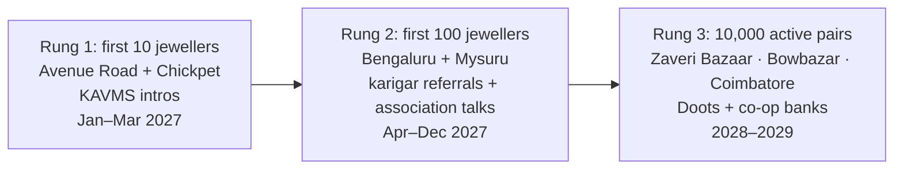

# Go-to-Market
> Project: Tola · Owner: Field + pitch lead · Status: Draft v0.1 · Last updated: 2026-10-20
> Related: [Business model](BUSINESS_MODEL.md) · [Financials](FINANCIALS.md) · [Impact](IMPACT.md) · [Personas](../01-product/PERSONAS.md) · [Roadmap](../01-product/ROADMAP.md) · [Pitch](../00-overview/PITCH.md)

**Strategy in one line:** win one street of jewellers in Bengaluru, let their karigars carry Tola to their other jewellers, then repeat in the three big karigar clusters.

Labels: **HUNCH** = untested assumption, to be checked in field interviews ([HACKATHON_PLAN §3](../00-overview/HACKATHON_PLAN.md)). **[S#]** = `research/domains/jeweltech.md`.

---

## 1. Beachhead: the smallest viable audience

**Who:** jewellers on **Avenue Road and Chickpet, Bengaluru**, with **2–30 karigars on job work**, reached through the **KAVMS jeweller network**.

Why this beachhead:
- **The organiser community is in the trade.** KAVMS is a trading-community body whose leaders include CAs and co-op bankers [biblehackathon §Organisers]. The hackathon's jeweltech problem statements mirror its own trades. **HUNCH:** a share of KAVMS members are Avenue Road / Chickpet jewellers. Not verified; confirm through the GAVS committee by 15 Nov 2026.
- **Density.** Avenue Road and Chickpet form Bengaluru's old gold and bullion market, so 30+ shops can be reached on foot in a day. **HUNCH:** the shop count is not verified.
- **Bengali karigars work there too.** Bengaluru jewellers employ migrant Bengali karigars (HUNCH; the [S17]/[S20] evidence covers Mumbai and Kolkata). That matches our Bengali voice path (F-02).
- **The team is in Bengaluru,** so a weekly visit costs a bus fare.

**Smallest viable audience = 10 jewellers and their ~60 karigars on two streets.** If they don't adopt, nothing else matters.

---

## 2. Positioning statement
For **jewellers who hand gold to karigars on trust**, Tola is the **job-work ledger both sides sign**. Unlike ERPs (Marg, Jwelly, Online Munim), which keep only the owner's books [S25–S29], Tola gives the karigar his own uneditable copy, so there is **one number nobody argues about**.

---

## 3. First 10 → 100 → 10,000

### Rung 1: the first 10 jewellers (Jan–Mar 2027)
| Step | Action | Target |
|---|---|---|
| 1 | The **hackathon pilot shop** (1 jeweller and 3 karigars, 16–22 Dec 2026) becomes reference customer #1 | 1 jeweller signed as reference by 31 Jan 2027 |
| 2 | Ask KAVMS / GAVS for **5 warm introductions** on Avenue Road and Chickpet (HUNCH: their network includes jewellers) | 5 intro meetings by 15 Feb 2027 |
| 3 | **Walk the street with the scale.** A 10-minute demo on the jeweller's own balance: issue → Bengali read-back → signed | 30 demos, 10 pilots |
| 4 | Free 90-day **Founding pilot** plan ([BUSINESS_MODEL §4.1](BUSINESS_MODEL.md)); the team onboards every karigar in person | 10 shops, 60 karigars active by 31 Mar 2027 (matches [METRICS.md §2](../01-product/METRICS.md)) |
| 5 | Measure the **week-1 aha**: the first same-week variance flag | ≥ 7 of 10 shops see a flag in the first 2 weeks |
| 6 | Convert: ₹79 per active karigar (Shop) after day 90 | ≥ 6 of 10 convert to paid |

### Rung 2: the first 100 jewellers (Apr–Dec 2027)
- **Karigar referral loop (the main engine).** Each onboarded karigar works for 1–4 jewellers [S1][S17]. A one-tap prompt in his language: "Ask your other seth to put your gold on Tola." Reward: the referring karigar gets a **free Passport pull for his own use** (no cash; HUNCH) and the new jeweller's pilot.
  - Target viral coefficient: **0.3 new jewellers per onboarded karigar** within 60 days (HUNCH).
- **Jeweller associations.** 15-minute talks at Bengaluru and Mysuru jeweller association meetings (associations to be identified; not verified).
- **CA channel.** CAs who file job-work GST for jewellers see the Rule 55 challan drafts (F-09). Target: 5 CA firms referring clients.
- **First co-op bank.** One co-op bank branch reading Passports for 20 karigars (letter of interest by Mar 2027).
- **Mysuru:** JanAI Cafes are live in Mysuru (janai.ai, fetched 2026-10-20). One Doot pilot.

### Rung 3: 10,000 active pairs (2028–2029)
Move to the three big **karigar clusters**, where one onboarding visit reaches hundreds of benches:

| Cluster | Why | Evidence | Entry |
|---|---|---|---|
| **Zaveri Bazaar, Mumbai** | About 2.2 lakh karigars in Mumbai, most of them Bengali-speaking | [S20] (NewsClick 2020, via search snippet) | Bengali-speaking karigar WhatsApp groups; head-karigar (P-05) karkhanas; jewellers whose karigars already use Tola in Bengaluru |
| **Bowbazar, Kolkata** | Field site of the IIMA/XLRI study; head-karigar workshops; wastage-based pay | [S17] | Head karigars first (Karkhana plan); migrant continuity, where a karigar's Passport follows him home |
| **Coimbatore** | 40,000+ goldsmiths (undated TN study) or about 600 traditional goldsmiths (2022 paper); income ₹10–20k/month; credit is a top problem | [S18][S19] (figures conflict) | Goldsmith associations; PM Vishwakarma credit angle; Tamil voice (v1 adds ta) |

- **Doots at scale:** 30–50 Doots, each serving about 30 shops (HUNCH).
- **Co-op banks:** 3 banks reading Passports.
- **Languages:** add mr and ta to bn/hi/kn (F-14).

---

## 4. Channels (Gary Vee)

| Channel | Audience | Content / action | Cost | Rung |
|---|---|---|---|---|
| **In-person street demos with a real balance** | Jewellers | 10-minute demo on the shop's own scale | Team time | 1, 2 |
| **Karigar WhatsApp groups** | Karigars | 30-second Bengali/Hindi voice note: "Your own copy of every gram. Free forever." | ₹0 | 2, 3 |
| **YouTube Shorts / Instagram Reels** in Kannada, Bengali and Hindi | Jewellers' sons and daughters (the next-generation decision makers; HUNCH) | "We caught a 0.38 g gap in one week" before-and-after stories, with consent | ₹0 + phone | 2, 3 |
| **KAVMS / GAVS events** | Jeweller-traders | Pitch at community meetings | ₹0 | 1 |
| **Jeweller associations** | Owners | Talks, association discount (10%, HUNCH) | Travel | 2, 3 |
| **CA firms** | CAs of jewellers | GST job-work drafts (F-09) as a reason to recommend | ₹0 | 2 |
| **JanAI Cafes (Doots)** | Small-town jewellers and karigars | Assisted onboarding, paid per verified active pair | Revenue share | 2, 3 |
| **Co-op bank branches** | Karigars wanting credit | "Show your Passport here" posters | Partner cost | 2, 3 |

---

## 5. Partnerships

| Partner | Type | What they get | What we get | First step | Owner · date |
|---|---|---|---|---|---|
| **KAVMS / GAVS** | Community body, hackathon owner | A visible community-led venture from the hackathon | Jeweller introductions on Avenue Road / Chickpet | Ask at the 27 Dec final and through the GAVS committee | Field + pitch lead · 27 Dec 2026 |
| **Co-op banks** (e.g. KAVMS-linked co-op banks; R P Ravishankar is President of Vasavi MSCM Co-operative Bank [biblehackathon §Organisers]) | Lender | Thin-file artisan borrowers with a verifiable record | Passport pull fees; credibility for karigars | Letter of interest for a 20-karigar pilot | Field + pitch lead · 31 Mar 2027 |
| **PM Vishwakarma** (MoMSME scheme; goldsmith is one of 18 trades; collateral-free credit up to ₹1 lakh then ₹2 lakh at 5% [S41]) | Government scheme | Evidence of trade activity for registered goldsmiths | A credit use-case for the Passport; ID field (E-03) | Map the scheme's lending banks in Bengaluru; meet the district MSME office | Field + pitch lead · 30 Apr 2027 |
| **JanAI Cafes / Bazaar** | Organiser's distribution | A provider whose outcome (verified active pair) is measurable | Doot-assisted onboarding outside metros | Ask about Bazaar provider terms at the 24 Dec AMA | Field + pitch lead · 24 Dec 2026 |
| **Lyzr** | AI partner | A BFSI-adjacent agent showcase (their customer base is about 70% BFSI [B §1]) | Credits; startup terms for production pricing | Share the agent graph and traces after the final | AI/voice lead · 15 Jan 2027 |
| **Sarvam** | Indic speech | Usage | Startup credits (not verified) | Apply after pilot | AI/voice lead · 31 Jan 2027 |
| **Scale makers / dealers** | Hardware | Upsell of serial/BLE balances | Certified-compatible list for F-01 | Contact 2 dealers in Avenue Road | Back end + crypto lead · 28 Feb 2027 |
| **Refiners** | v2 payer | Dust and scrap visibility | Refiner fee | One refiner conversation in Bengaluru | Field + pitch lead · 2028 |
| **Accelerate RVCE** (incubator named as a hackathon organiser) | Incubator | A student venture | Incubation; SISFS route via an incubator ([FINANCIALS §5](FINANCIALS.md)) | Ask at the final | Field + pitch lead · 27 Dec 2026 |

---

## 6. Government pilot path
- **Not B2G first.** The payer is the jeweller. Government partners are for credit access and credibility.
- **Path:** PM Vishwakarma ID field (MVP) → district MSME office demo in Bengaluru Urban (Apr 2027) → a state artisan-credit pilot with Karnataka (2028, HUNCH). Andhra Pradesh is a second option, since the Event Chair is the AP Industries Minister [C §2.2].
- **GeM:** not relevant at first. Tola is not sold to government buyers.

---

## 7. Launch plan
| Date | Milestone |
|---|---|
| 27 Dec 2026 | Hackathon final; announce the pilot shop as reference #1 |
| Jan 2027 | Incorporate (DPIIT recognition application); v1 private beta on the scalable build |
| Feb–Mar 2027 | Rung 1: 10 shops on Avenue Road / Chickpet |
| Apr 2027 | Paid conversion; first co-op bank letter of interest |
| Jun 2027 | Mysuru Doot pilot |
| Dec 2027 | 100 jewellers, 600 active pairs |
| 2028 | Zaveri Bazaar and Bowbazar; Passport pulls live |
| 2029 | Coimbatore; refiner line; 10,000+ active pairs |

---

## 8. Messaging per audience

| Audience | Headline | Proof | Language | Never say |
|---|---|---|---|---|
| **Jeweller (P-01)** | "Know where every gram is, every week." / "Dispute insurance for ₹79 a karigar." | The same-week flag on Order #14 | Kannada, English | "Surveillance of your karigars" |
| **Karigar (P-02)** | "Your own copy of every gram. Free forever." (bn: "প্রতিটি গ্রামের হিসাব আপনার নিজের কাছে।") | He hears the weight read back in Bengali and nobody can edit his copy | Bengali, Hindi | "The jeweller will see everything you do" |
| **Head karigar (P-05)** | "Stop paying for gold you didn't lose." | Dust and scrap logged, disputes stay open until both sign | Bengali, Marathi | — |
| **Counter staff (P-03)** | "The scale writes the number. You never type a weight." | F-01 | Kannada, Hindi | — |
| **Co-op bank (P-04)** | "A work history the artisan signed and the jeweller counter-signed." | Hash-chain verification in the lender view | English, Kannada | "Credit score" (we don't produce one) |
| **CA** | "Rule 55 challans and labour-invoice drafts from signed events." | F-09 draft | English | "Auto-filed" (we never file) |
| **JanAI / Doot** | "A Bazaar provider with a verifiable outcome: a signed active pair." | Doot share table | Kannada, Hindi | — |
| **Investor** | "The fine-gold ledger for India's informal jewellery manufacturing." | Network loop, unit economics | English | — |

---

## 9. GTM metrics and targets
| Metric | Rung 1 target | Rung 2 | Rung 3 |
|---|---|---|---|
| Paying jewellers | 6 | 100 | 1,500 |
| Active pairs | 60 | 600 | 10,000 |
| Karigar referral → new jeweller in 60 days | — | 0.3 | 0.3 |
| Pilot → paid conversion | ≥ 60% | ≥ 60% | ≥ 60% |
| Monthly jeweller churn | ≤ 5% | ≤ 3% | ≤ 2.5% |
| Blended CAC per shop | ≤ ₹5,000 | ≤ ₹3,500 | ≤ ₹3,200 |

Sources of each figure and the financial model: [FINANCIALS.md](FINANCIALS.md).
