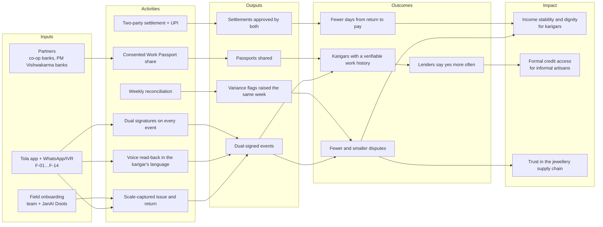

# Impact
> Project: Tola · Owner: Field + pitch lead · Status: Draft v0.1 · Last updated: 2026-10-20
> Related: [Vision](../00-overview/VISION.md) · [Business model](BUSINESS_MODEL.md) · [GTM](GTM.md) · [Metrics](../01-product/METRICS.md) · [Responsible AI](../04-ai/RESPONSIBLE_AI.md) · [Privacy](../06-security-compliance/PRIVACY.md)

**Impact thesis:** when the weaker party in a gold handover holds a signed copy of every gram, three things change. Disputes shrink, pay arrives faster, and the karigar's work becomes evidence a lender can read.

Labels: [S#] = `research/domains/jeweltech.md`. **Baseline** values marked "to measure" are collected in field interviews (Nov 2026) and the pilot week (16–22 Dec 2026). We do not invent baselines.

---

## 1. The problem in human terms
- About **6.1 million** people work in gems and jewellery [S17]. Mumbai alone has an estimated **2.2 lakh karigars**, most of them Bengali-speaking migrants [S20].
- Pay is wastage-based and fully variable, settled weekly or twice a month from a paper register [S17].
- A karigar holds **₹4–5 lakh** of someone else's gold [S17]. "In case of theft, the head karigar has to pay for gold loss" [S17].
- A Coimbatore survey (n=120) found monthly income of ₹10–20k, near-universal borrowing, and difficulty getting bank finance as a top problem [S18].
- At ₹14,904/g of 24K [S47], **one disputed gram costs more than a month's income** for many of them.
- New karigars get only **100–250 g** until trust is built [S17]. Reputation is their only collateral, and it lives in someone else's notebook.

---

## 2. Theory of change

**Assumptions the chain depends on** (each one is tested in §5):
1. Jewellers accept a record the karigar can see (R-01).
2. Spoken read-back is understood and trusted by low-literacy karigars (R-08).
3. Lenders treat a counter-signed work history as useful evidence (HUNCH, no lender asked yet).
4. Same-week flags settle disputes while they are small (the vendor observation is that monthly averaging makes losses untraceable [S28]).

---

## 3. Impact metrics

| ID | Metric | Definition | Baseline | Pilot week target (Dec 2026) | Year-1 target (2027) | Year-3 target (2029) |
|---|---|---|---|---|---|---|
| IM-01 | **Grams reconciled within 7 days with two signatures** (north star) | Grams issued whose return and variance reach a dual-signed reconciled state within 7 days of the return event | 0% (paper registers squared monthly [S1][S17]) | ≥ 90% of grams issued in the week | ≥ 85% | ≥ 90% |
| IM-02 | **Disputes avoided** | Variance flags resolved inside the week with both signatures, per 100 active pairs per month; plus the self-reported count of month-end arguments (before vs after) | To measure in interviews (3 jewellers, 5 karigars) | Every flag resolved or open-and-visible; 0 overwritten lines | Month-end disputes reported down 50% vs baseline | Down 70% |
| IM-03 | **Disputed grams absorbed by karigars** | Grams a karigar paid for without agreeing, self-reported per quarter | To measure | Report baseline | Down 50% | Down 70% |
| IM-04 | **Days to pay** | Days from the RETURN event to labour payment (PaymentIntent paid) | "Weeks" (PS 2.2 [S1]); exact number to measure | ≤ 3 days for pilot settlements | Median ≤ 7 days | Median ≤ 3 days |
| IM-05 | **Karigars with credit access** | Karigars who shared a Work Passport and received a lender decision; and how many were approved | 0 | 0 (the lender view is mocked in the MVP) | 50 shares, 1 partner bank | 2,000 shares; ≥ 500 approvals |
| IM-06 | **Karigars with their own record** | Karigars holding ≥ 3 months of dual-signed history | 0 | 3 | 500 | 8,000 |
| IM-07 | **Unexplained variance** | Milligrams of fine gold per karigar per week outside the agreed norm (E-05) | To measure | Report | Down 30% from each shop's first month | Down 50% |
| IM-08 | **Livelihoods created** | Doots earning ≥ ₹3,000/month from Tola payouts (HUNCH threshold) + Tola staff | 0 | 0 | 5 Doots + 4 staff | 50 Doots + 15 staff |
| IM-09 | **Women in the loop** | Share of active users who are women (counter staff P-03, women karigars, women Doots) | To measure | Report | Report and set a target | ≥ 25% of Doots are women (HUNCH) |

IM-01 to IM-07 come from the ledger itself (E-06, E-10, E-11, E-12, E-13, E-14), so they cannot be inflated by the team. Analytics events are defined in [METRICS.md](../01-product/METRICS.md).

---

## 4. SDG mapping

| SDG | Target | How Tola contributes | Metric |
|---|---|---|---|
| **SDG 8: Decent work and economic growth** | 8.3 (formalisation and growth of micro and small enterprises, incl. access to financial services); 8.8 (protect labour rights, including for migrant workers) | Formal, signed job-work records for informal goldsmiths, many of them migrants [S20]; faster, verifiable pay | IM-01, IM-04, IM-06 |
| **SDG 1: No poverty** | 1.4 (access to financial services for the poor and vulnerable) | A Work Passport that supports credit, e.g. PM Vishwakarma collateral-free loans of up to ₹1 lakh, then ₹2 lakh [S41] | IM-05 |
| **SDG 5: Gender equality** | 5.5 (women's participation in economic life); 5.a (access to financial services) | Women counter staff run issue and receipt (P-03); a share of Doots are women; women karigars in karkhanas get their own record. **Honest caveat:** the goldsmith bench is mostly male in our sources, so SDG 5 is a secondary contribution, not the headline | IM-09 |
| SDG 10: Reduced inequalities (secondary) | 10.2 (economic inclusion irrespective of origin) | Voice in Bengali and other languages for migrant karigars; the weaker party gets equal signing power | IM-02, IM-03 |

---

## 5. Measurement plan

| When | What | How | Owner |
|---|---|---|---|
| 25 Oct – 10 Nov 2026 | Baselines for IM-02, IM-03, IM-04, IM-07 | Structured interviews: 3 jewellers and 5 karigars, using the PS 2.2 field questions. Consent recorded in the interviewee's language. No names published | Field + pitch lead |
| 16–22 Dec 2026 | Pilot week: 1 jeweller, 3 karigars, real ledger | Ledger metrics IM-01, IM-04, IM-07 straight from the event log; exit interview | Field + pitch lead; Back end + crypto lead for the data pull |
| 2027 quarterly | All IM metrics | Ledger queries + quarterly 10-minute karigar voice survey (in bn/hi/kn) | Field + pitch lead |
| 2028 | Lender outcomes (IM-05) | Partner bank reports approvals on consented shares (aggregate counts only) | Field + pitch lead |
| Annually from 2028 | Independent check | Ask a university partner (e.g. RVCE faculty, or the IIMA gold centre that funded [S17]) to audit a sample (HUNCH: not approached) | Founders |

**Data ethics:** impact data is aggregated. No karigar-level data leaves Tola without that karigar's consent (E-14). See [PRIVACY.md](../06-security-compliance/PRIVACY.md).

**What would show we are causing harm** (Mike Ross test), checked every quarter:
- Jewellers using the record to pressure karigars (watch dispute outcomes by party).
- Karigars dropping out after a dispute.
- Lenders using Passport data to reject people they would otherwise have accepted.
Any such signal triggers a product review within 30 days.

---

## 6. Stories (Mike Ross)

All stories are **composites grounded in research**, not real people. Names are illustrative ([PERSONAS.md](../01-product/PERSONAS.md)).

### Rafiq: the 0.38 g that didn't become a fight
Rafiq, 34, works in a Zaveri-Bazaar-style workshop and holds about 180 g from three jewellers (P-02). Last year one jeweller's book said he owed 2.1 g more than his own slip did. Neither could prove anything, so Rafiq paid, as head karigars always have [S17].

With Tola, when Suresh's shop issues 40.000 g for Order #14 (a plain 22K bangle pair, wastage norm 2.50%), Rafiq hears the weight in Bengali on his own phone and taps yes. On Thursday he returns the bangles (38.120 g) and 0.500 g of scrap. On Saturday the reconciliation agent flags Order #14: **0.38 g above the agreed wastage**, about ₹5,188 at 22K. Rafiq records a voice reply: the solder joint cracked and he redid it. The line stays open and visible to both. They agree to accept 0.130 g as rework wastage, both sign, and 0.250 g stays on his balance. On Sunday the settlement goes to both of them; two ticks, and his labour pay of ₹5,040 opens as a UPI QR. That afternoon, not three weeks later. (Numbers: [USER_JOURNEYS §6](../01-product/USER_JOURNEYS.md).)

### Suresh: the jeweller who stopped arguing
Suresh Shetty, 52, runs a two-counter shop on Avenue Road with 8 karigars (P-01). In wedding season he has 30–60 custom orders open and spends month-end evenings reconciling notebooks. Tola gives him one number per karigar, signed by both, every week. He doesn't need to trust anyone's handwriting, including his own.

### Lakshmi: the scale writes the number
Lakshmi, 28, issues and receives gold at the counter (P-03). When grams go missing, the copying error is usually blamed on her. With Tola the balance writes the weight (F-01), and two signatures close the entry. She is no longer the weakest link in a chain of handwriting.

### The head karigar's Passport
A head karigar (P-05) in Bowbazar has 18 months of signed history with four jewellers: kilograms handled, 94% on time, wastage inside the agreed norm. He shares his Work Passport with a co-op bank for 7 days to apply for a PM Vishwakarma loan [S41]. The bank sees a hash-verified record that two parties signed, not a score. The decision stays the bank's. **(v1; mocked and labelled in the MVP.)**

---

## 7. MVP (hackathon) vs v1 (production)
| | MVP (hackathon) → `implementation/demo` | v1 (production) → `implementation/scalable` |
|---|---|---|
| Measurement | Seeded story + pilot-week ledger metrics | Live dashboards per IM metric |
| Credit access | Lender view mocked and labelled | Partner bank reporting |
| Stories | Composite personas; field clips with consent | Consented real stories |
