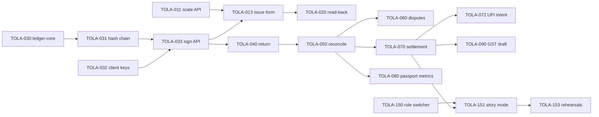

# Backlog
> Project: Tola · Owner: Field+Pitch lead · Status: Draft v0.1 · Last updated: 2026-10-20
> Related: [Project Brief](../00-overview/PROJECT_BRIEF.md) · [PRD](../01-product/PRD.md) · [User stories](../01-product/USER_STORIES.md) · [Hackathon plan](../00-overview/HACKATHON_PLAN.md) · [Team](TEAM.md) · [Glossary](GLOSSARY.md) · [Architecture](../03-engineering/ARCHITECTURE.md) · [Demo build](../../implementation/demo/README.md) · [Scalable build](../../implementation/scalable/README.md)

This backlog turns features **F-01 to F-14** from the [Project Brief](../00-overview/PROJECT_BRIEF.md) into tickets. Each ticket is ready to become a GitHub Issue; the script in [section 6](#6-import-into-github-issues) does the import.

- **MVP (hackathon)** tickets carry the label `track:demo`. They are built in `implementation/demo/`.
- **v1 (production)** tickets carry the label `track:scalable`. They are built in `implementation/scalable/`.
- Tickets for common work (contract, ledger rules, field research, pitch) are labelled with the track that needs them first.

---

## 1. Conventions

| Field | Values | Meaning |
|---|---|---|
| ID | `TOLA-001` … | Stable. Never reuse an ID; close it as "won't do" instead. |
| Epic | `EP-00` … `EP-17` | Groups tickets (table in section 3). |
| Features | `F-01` … `F-14` | Frozen feature IDs from the brief. |
| Track | `track:demo` · `track:scalable` | Which build the ticket lands in. |
| Sprint | `Idea round` · `Prototype W1` · `Prototype W2` · `Prototype W3` · `Polish` · `Post-hackathon` | Becomes the GitHub milestone. |
| Estimate | **S** ≤ 4 focused hours · **M** ≤ 1 day (8 h) · **L** 2–3 days | Students work part-time, so one person delivers about 20 focused hours a week. |
| Owner | **FE** Frontend+Design lead · **BE** Backend+Crypto lead · **AI** AI+Voice lead · **FP** Field+Pitch lead | The one Accountable role (see [TEAM.md](TEAM.md)). |

**Definition of Ready:** acceptance criteria written, dependencies named, estimate given, owner set.
**Definition of Done:** code merged to `main` through a PR; CI green; acceptance criteria ticked; for user-facing work it is visible in story mode; any new copy exists in en/hi/kn/bn.

## 2. Sprint calendar

| Sprint | Dates (2026) | Goal | Exit gate |
|---|---|---|---|
| Idea round | 20 Oct – 22 Nov | Field evidence, idea submission (**15 Nov**), repo skeleton | Submission sent; `pnpm dev` + `uvicorn` both start; 10 karigar/jeweller conversations logged |
| Prototype W1 | 23 – 29 Nov | Ledger core, signatures, scale issue, role switcher, i18n frame | An ISSUE event is created from a simulated scale reading and signed by both personas |
| Prototype W2 | 30 Nov – 6 Dec | Voice read-back, return + intake agent, reconciliation, disputes API, dashboard | "Run week" produces correct flags on seed data; karigar hears read-back in bn |
| Prototype W3 | 7 – 15 Dec | Settlement + UPI, Passport, GST draft, story mode end-to-end, cached path; **prototype submission 15 Dec** | Full 3-minute story runs end-to-end with `AI_FALLBACK_MODE=cached` and with `live` |
| Polish | 16 – 26 Dec | Motion and a11y polish, rehearsals, pitch, backup video; AMA **24 Dec** | 10 consecutive clean rehearsals under 3:00; demo freeze **22 Dec** |
| Post-hackathon | from 28 Dec (after the **27 Dec** final) | Scalable v1: auth, Postgres, offline, WhatsApp/IVR, PSP, GCP Mumbai, compliance | Pilot with 1 shop and its karigars (see [ROADMAP](../01-product/ROADMAP.md)) |

Capacity check (S = 4 h, M = 8 h, L = 20 h). Demo work is about 68 h in the Idea round, 92 h in W1, 128 h in W2, 136 h in W3 and 40 h in Polish. Per owner across W1 / W2 / W3:

| Owner | W1 | W2 | W3 | Note |
|---|---|---|---|---|
| FE | 24 h | 48 h | 36 h | W2 is the peak (dashboard + story mode); FP pairs on dashboard layout |
| BE | 40 h | 40 h | 40 h | Ledger core and chain are pulled into the Idea round so the signing API lands in W1 |
| AI | 20 h | 40 h | 44 h | Also owns the karigar confirm and dispute-voice screens |
| FP | 8 h | 0 h | 16 h | Plus field visits, juror prep and pitch work not ticketed by the hour |

That is roughly 35–48 focused hours per builder per week in W2–W3, which is too much for students in term time. The plan therefore depends on the cut list in [HACKATHON_PLAN](../00-overview/HACKATHON_PLAN.md). Cut in this order if W2 ends behind: TOLA-012 (Web Serial), TOLA-053 (anomaly score), TOLA-120 (phone frame), TOLA-100 (order list); this saves 28 h without touching the 3-minute story.

## 3. Epics

| Epic | Name | Features | Tickets | Demo / Scalable |
|---|---|---|---|---|
| EP-00 | Foundations and delivery | — | TOLA-001 – 008 | 8 / 0 |
| EP-01 | Scale-captured issue | F-01 | TOLA-010 – 016 | 4 / 3 |
| EP-02 | Voice read-back and confirm | F-02 | TOLA-020 – 024 | 4 / 1 |
| EP-03 | Ledger core, signatures and hash chain | F-03 | TOLA-030 – 037 | 6 / 2 |
| EP-04 | Return capture and intake agent | F-04 | TOLA-040 – 043 | 4 / 0 |
| EP-05 | Weekly reconciliation | F-05 | TOLA-050 – 055 | 5 / 1 |
| EP-06 | Dispute thread | F-06 | TOLA-060 – 062 | 3 / 0 |
| EP-07 | Settlement and UPI | F-07 | TOLA-070 – 073 | 3 / 1 |
| EP-08 | Work Passport | F-08 | TOLA-080 – 083 | 3 / 1 |
| EP-09 | GST job-work draft | F-09 | TOLA-090 – 092 | 2 / 1 |
| EP-10 | Order and deadline tracker | F-10 | TOLA-100 – 102 | 2 / 1 |
| EP-11 | Offline-first PWA and sync | F-11 | TOLA-110 – 112 | 0 / 3 |
| EP-12 | WhatsApp / IVR channel | F-12 | TOLA-120 – 122 | 1 / 2 |
| EP-13 | Jeweller dashboard | F-13 | TOLA-130 – 131 | 2 / 0 |
| EP-14 | Language and accessibility | F-14 | TOLA-140 – 143 | 3 / 1 |
| EP-15 | Demo shell: role switcher and story mode | F-13, F-14 | TOLA-150 – 154 | 5 / 0 |
| EP-16 | Field research, submission and pitch | — | TOLA-160 – 165 | 6 / 0 |
| EP-17 | Scalable platform and compliance | — | TOLA-170 – 179 | 0 / 10 |

Feature coverage:

| Feature | Demo tickets | Scalable tickets |
|---|---|---|
| F-01 | 010, 011, 012, 013 | 014, 015, 016 |
| F-02 | 020, 021, 022, 023 | 024 |
| F-03 | 030 – 035 | 036, 037 |
| F-04 | 040, 041, 042, 043 | 112 (offline return), 179 (evals) |
| F-05 | 050 – 054 | 055 |
| F-06 | 060, 061, 062 | 121 (dispute by WhatsApp) |
| F-07 | 070, 071, 072 | 073 |
| F-08 | 080, 081, 082 | 083 |
| F-09 | 090, 091 | 092 |
| F-10 | 100, 101 | 102 |
| F-11 | — (online demo, by design) | 110, 111, 112 |
| F-12 | 120 | 121, 122 |
| F-13 | 130, 131, 150 | 170 (real roles) |
| F-14 | 140, 141, 142 | 143 |



Critical path for the demo: TOLA-030 → 031 → 033 → 040 → 050 → 070 → 151 → 153.

---

## 4. Tickets: MVP (hackathon), `track:demo`

### EP-00 Foundations and delivery

### TOLA-001 · Scaffold the repository layout
- **Epic:** EP-00 · **Features:** — · **Track:** `track:demo` · **Sprint:** Idea round · **Estimate:** S · **Owner:** BE
- **Description:** Create the layout fixed in brief section 16: `docs/`, `api/openapi.yaml`, `implementation/demo/{web,api}`, `implementation/scalable/`, `.github/workflows/`. Add `README.md`, `CLAUDE.md`, `.editorconfig`, `.gitignore` and a root `.env.example` listing every env var from brief section 10.
- **Acceptance criteria:**
  - [ ] The tree matches brief section 16 exactly.
  - [ ] `.env.example` lists all 13 demo env vars and the 9 scalable-only vars, each with a comment and no real secret.
  - [ ] Branch protection on `main` requires one review and green CI.
- **Depends on:** —

### TOLA-002 · Web app shell with the Tola design tokens
- **Epic:** EP-00 · **Features:** F-13, F-14 · **Track:** `track:demo` · **Sprint:** Idea round · **Estimate:** M · **Owner:** FE
- **Description:** Next.js 16.4 (App Router), React 19.3, TypeScript 5.9, HeroUI v3.2, Tailwind CSS 4.3 and Motion 14.4 in `implementation/demo/web`. Port the Vakyam tokens (`docs/02-design/reference/vakyam-tokens.css`) and add the ember → amber → gold → periwinkle light arc. Load Fraunces, Figtree, DM Mono, Mukta, Noto Sans Bengali and Noto Sans Kannada via Fontsource.
- **Acceptance criteria:**
  - [ ] `pnpm dev` serves on port 3000 with canvas `#fcfcfc`, hairline cards and a translucent nav.
  - [ ] Every gram figure renders in DM Mono.
  - [ ] Lighthouse performance ≥ 90 on the empty shell (mobile profile).
  - [ ] No Sarvam proprietary font or logo is shipped.
- **Depends on:** TOLA-001

### TOLA-003 · API skeleton with health check
- **Epic:** EP-00 · **Features:** — · **Track:** `track:demo` · **Sprint:** Idea round · **Estimate:** S · **Owner:** BE
- **Description:** FastAPI 0.153, Pydantic 2.14, Uvicorn 0.54, SQLAlchemy 2.1 on SQLite in `implementation/demo/api`. Implement API-01 `GET /v1/health`. Configure CORS for `http://localhost:3000`.
- **Acceptance criteria:**
  - [ ] `uvicorn` serves on port 8000; `GET /v1/health` returns `200 {"status":"ok"}` in under 50 ms locally.
  - [ ] `DATABASE_URL` defaults to `sqlite:///./tola_demo.db`.
  - [ ] `pytest` runs with at least one passing test.
- **Depends on:** TOLA-001

### TOLA-004 · Freeze the OpenAPI contract and generate the typed client
- **Epic:** EP-00 · **Features:** F-01 – F-10, F-13 · **Track:** `track:demo` · **Sprint:** Prototype W1 · **Estimate:** M · **Owner:** BE
- **Description:** Write `api/openapi.yaml` (OpenAPI 3.1) for API-01 to API-20, marking API-17 to API-20 with `x-track: scalable`. Generate a TypeScript client for the web app from the file, and validate the request and response bodies with Zod 4 at the boundary.
- **Acceptance criteria:**
  - [ ] The spec lints clean (Redocly or Spectral, version pinned at install).
  - [ ] FastAPI's generated schema for the ✓ endpoints is diffed against `openapi.yaml` in CI; any drift fails the build.
  - [ ] The web app imports types only from the generated client.
- **Depends on:** TOLA-003

### TOLA-005 · Demo CI workflow
- **Epic:** EP-00 · **Features:** — · **Track:** `track:demo` · **Sprint:** Prototype W1 · **Estimate:** M · **Owner:** BE
- **Description:** `.github/workflows/demo-ci.yml`, path-filtered to `implementation/demo/**`, `api/**` and `docs/**`. Steps: lint (ESLint, Ruff), typecheck, Vitest 5, pytest 9, Playwright 1.64 smoke on the story-mode happy path.
- **Acceptance criteria:**
  - [ ] CI finishes in under 8 minutes on a PR.
  - [ ] A failing ledger-core test blocks merge.
  - [ ] The Playwright smoke runs with `AI_FALLBACK_MODE=cached`, so CI never calls Lyzr or Sarvam.
- **Depends on:** TOLA-002, TOLA-003

### TOLA-006 · Seed data and demo endpoints
- **Epic:** EP-00 · **Features:** F-13 · **Track:** `track:demo` · **Sprint:** Prototype W1 · **Estimate:** M · **Owner:** FP
- **Description:** Seed one shop (P-01 Suresh Shetty, Avenue Road), the staff member P-03 Lakshmi, 8 karigars including P-02 Rafiq Sheikh (holding about 180 g), wastage norms (plain 2.5%, studded 25%, antique 4%) and 12 orders. The scripted week contains one honest variance and one disputed return. Implement API-02 `GET /v1/demo/personas` and `POST /v1/demo/reset`.
- **Acceptance criteria:**
  - [ ] `POST /v1/demo/reset` restores the seed in under 2 s and returns the persona list.
  - [ ] Seed weights are integer milligrams, and the seeded chain verifies.
  - [ ] All names are marked as illustrative composites in the seed file header.
- **Depends on:** TOLA-030, TOLA-031

### TOLA-007 · Deploy the demo
- **Epic:** EP-00 · **Features:** — · **Track:** `track:demo` · **Sprint:** Prototype W2 · **Estimate:** S · **Owner:** AI
- **Description:** Web on Vercel, API on Render; one `docker compose up` fallback for a laptop on stage. Secrets live in the platform settings only.
- **Acceptance criteria:**
  - [ ] Public URL loads the role switcher in under 3 s on a 4G phone.
  - [ ] `docker compose up` runs the full demo with no internet when `AI_FALLBACK_MODE=cached`.
  - [ ] The Render cold-start is avoided before rehearsals by a warm-up call (documented in the demo README).
- **Depends on:** TOLA-005

### TOLA-008 · AI fallback mode plumbing
- **Epic:** EP-00 · **Features:** F-02, F-04, F-05 · **Track:** `track:demo` · **Sprint:** Prototype W1 · **Estimate:** S · **Owner:** AI
- **Description:** A single `AI_FALLBACK_MODE` switch (`live` | `cached` | `off`) read by every Lyzr and Sarvam call. In `cached` mode, responses come from versioned JSON and audio fixtures. Live calls time out after 4 s and drop to cached.
- **Acceptance criteria:**
  - [ ] Each AI response in the UI shows a small source tag: `live`, `cached` or `template`.
  - [ ] Killing the network mid-story does not break any beat (R-07).
- **Depends on:** TOLA-003

### EP-01 Scale-captured issue (F-01)

### TOLA-010 · Simulated scale widget
- **Epic:** EP-01 · **Features:** F-01 · **Track:** `track:demo` · **Sprint:** Prototype W1 · **Estimate:** M · **Owner:** FE
- **Description:** An on-screen 0.01 g balance with tare, a settling animation (spring, damping 1.0) and a "stable" indicator. Values come from the story script or a drag control. It is labelled "Simulated scale".
- **Acceptance criteria:**
  - [ ] The reading is emitted only when stable, as integer mg with `source: "simulated"`.
  - [ ] The weight is never typed by the user.
  - [ ] Under `prefers-reduced-motion`, the reading appears without the settle animation.
- **Depends on:** TOLA-002

### TOLA-011 · Scale reading ingest API
- **Epic:** EP-01 · **Features:** F-01 · **Track:** `track:demo` · **Sprint:** Prototype W1 · **Estimate:** S · **Owner:** BE
- **Description:** API-05 `POST /v1/scale/readings` stores an E-08 `ScaleReading`: integer mg, source (`serial`, `ble`, `display_ocr`, `simulated`), device id and photo ref.
- **Acceptance criteria:**
  - [ ] It rejects negative values, values above 5,000,000 mg (5 kg) and non-integers with `422`.
  - [ ] It returns a `readingId` that API-06 must reference; an event without a reading is rejected.
- **Depends on:** TOLA-003

### TOLA-012 · Web Serial reader for a real balance (optional)
- **Epic:** EP-01 · **Features:** F-01 · **Track:** `track:demo` · **Sprint:** Prototype W3 · **Estimate:** M · **Owner:** FE
- **Description:** In Chrome, connect to a serial balance via the Web Serial API. Parse ASCII weight lines with a configurable regex and stable-flag pattern, because the balance model is not chosen yet (R-03). If no port is granted, fall back to the simulated widget.
- **Acceptance criteria:**
  - [ ] With a bench serial device (or a USB-serial loopback that replays a recorded log), readings reach API-05 with `source: "serial"`.
  - [ ] Unplugging the cable shows a clear "scale disconnected" state within 2 s.
  - [ ] It is first on the cut list; the demo does not depend on it.
- **Depends on:** TOLA-010, TOLA-011

### TOLA-013 · Issue form: photo, order type and wastage norm
- **Epic:** EP-01 · **Features:** F-01, F-03 · **Track:** `track:demo` · **Sprint:** Prototype W1 · **Estimate:** M · **Owner:** FE
- **Description:** The jeweller (or P-03 Lakshmi) issues gold: chooses karigar and order, captures a photo, sees the order type and the agreed E-05 `WastageNorm`, enters the declared fineness (e.g. 916) and takes the weight from the scale. It produces an unsigned ISSUE payload via API-06.
- **Acceptance criteria:**
  - [ ] The weight field is read-only and bound to the latest stable reading.
  - [ ] Fine gold (weight × fineness / 1000) is shown as computed by the API, not by the browser.
  - [ ] The flow takes ≤ 4 taps after the scale settles.
- **Depends on:** TOLA-011, TOLA-033, TOLA-101

### EP-02 Voice read-back and confirm (F-02)

### TOLA-020 · TTS read-back endpoint
- **Epic:** EP-02 · **Features:** F-02 · **Track:** `track:demo` · **Sprint:** Prototype W2 · **Estimate:** M · **Owner:** AI
- **Description:** API-09 `POST /v1/voice/readback` renders an event in bn, hi or kn using Sarvam Bulbul v3 (M-02) through `sarvamai` 0.1.37. The text comes from deterministic templates (TOLA-021), never from an LLM. Audio is cached by `(eventHash, lang)`.
- **Acceptance criteria:**
  - [ ] p95 latency ≤ 2.5 s live; ≤ 200 ms when cached.
  - [ ] On a Sarvam error or timeout, it returns the pre-generated clip and `source: "cached"`.
  - [ ] Numbers in the audio match the event to the milligram (spot-checked by a native speaker in TOLA-141).
- **Depends on:** TOLA-008, TOLA-021

### TOLA-021 · Read-back templates per language
- **Epic:** EP-02 · **Features:** F-02, F-14 · **Track:** `track:demo` · **Sprint:** Prototype W1 · **Estimate:** M · **Owner:** AI
- **Description:** Templates for ISSUE, RETURN, SCRAP_RETURN, DUST_CREDIT, SETTLEMENT in bn, hi, kn and en. Grams are spoken as "one hundred eighty point two five grams" in the target language, then the fineness and the order name.
- **Acceptance criteria:**
  - [ ] Unit tests cover 0.01 g, 9.99 g, 100.00 g and 1,234.56 g in all four languages.
  - [ ] The FP lead signs off the wording after reading it with two karigars in the field.
- **Depends on:** TOLA-030

### TOLA-022 · Pre-generate cached audio for story mode
- **Epic:** EP-02 · **Features:** F-02 · **Track:** `track:demo` · **Sprint:** Prototype W3 · **Estimate:** S · **Owner:** AI
- **Description:** A script that renders every scripted read-back and stores it under `implementation/demo/web/public/audio/` with a manifest.
- **Acceptance criteria:**
  - [ ] Every story beat with audio has a clip in bn, hi and kn.
  - [ ] Total size ≤ 15 MB.
  - [ ] The script costs ≤ ₹100 of Sarvam credit (the free grant) per full run (HUNCH; measure on the first run).
- **Depends on:** TOLA-020, TOLA-151

### TOLA-023 · Karigar confirm screen
- **Epic:** EP-02 · **Features:** F-02, F-03, F-14 · **Track:** `track:demo` · **Sprint:** Prototype W2 · **Estimate:** M · **Owner:** AI
- **Description:** In the Karigar role, a full-screen card with the gram figure in large DM Mono, a play button and two 64 px buttons: **Haan** (confirm) and **Na** (dispute). Saying "haan" is recognised with Saaras STT (M-01). Confirming signs the event with the karigar's key.
- **Acceptance criteria:**
  - [ ] Audio auto-plays once; a replay is one tap.
  - [ ] "Haan" by voice and by tap both produce a valid karigar signature (API-07).
  - [ ] "Na" opens a dispute draft (TOLA-061) without signing.
- **Depends on:** TOLA-020, TOLA-033

### EP-03 Ledger core, signatures and hash chain (F-03)

### TOLA-030 · ledger-core arithmetic
- **Epic:** EP-03 · **Features:** F-03, F-05 · **Track:** `track:demo` · **Sprint:** Idea round · **Estimate:** M · **Owner:** BE
- **Description:** A pure Python module `ledger_core` with integer-milligram weights, fineness in parts per thousand and fine-gold calculation (`weight_mg * fineness // 1000`, with the rounding rule documented). This is the only place gram arithmetic happens.
- **Acceptance criteria:**
  - [ ] No `float` appears in `ledger_core` (enforced by a Ruff rule or a grep test in CI).
  - [ ] ≥ 95% line coverage; table tests cover 916, 750, 995 and 999.
  - [ ] Rounding is documented in [DATA_MODEL](../03-engineering/DATA_MODEL.md) and is the same in Python and in any TS display helper.
- **Depends on:** TOLA-003

### TOLA-031 · Canonical event serialisation and SHA-256 chain
- **Epic:** EP-03 · **Features:** F-03 · **Track:** `track:demo` · **Sprint:** Idea round · **Estimate:** M · **Owner:** BE
- **Description:** Canonical JSON (sorted keys, no whitespace, UTF-8) for E-06 `LedgerEvent`. `hash = SHA-256(prev_hash || canonical_payload)`, with one chain per shop–karigar pair and a fixed genesis value.
- **Acceptance criteria:**
  - [ ] Python and TypeScript produce byte-identical canonical payloads for 20 fixture events.
  - [ ] Changing any field of any stored event makes `verify_chain()` report the first broken index.
- **Depends on:** TOLA-030

### TOLA-032 · Client-side Ed25519 keys per persona
- **Epic:** EP-03 · **Features:** F-03 · **Track:** `track:demo` · **Sprint:** Prototype W1 · **Estimate:** M · **Owner:** BE
- **Description:** Generate and hold one Ed25519 key per demo persona in the browser with `@noble/ed25519` 3.2. Public keys are registered on E-02 `Person`. In the demo, private keys sit in IndexedDB and are clearly labelled "demo keys".
- **Acceptance criteria:**
  - [ ] Switching role switches the signing key.
  - [ ] `POST /v1/demo/reset` rotates nothing; the seed keys are deterministic so the seeded chain verifies.
- **Depends on:** TOLA-002

### TOLA-033 · Create-event and add-signature endpoints
- **Epic:** EP-03 · **Features:** F-03 · **Track:** `track:demo` · **Sprint:** Prototype W1 · **Estimate:** M · **Owner:** BE
- **Description:** API-06 `POST /v1/events` returns the canonical payload to sign. API-07 `POST /v1/events/{id}/signatures` verifies each signature with PyNaCl 1.6 and stores E-07 `Signature`. An event counts towards balances only when both parties have signed.
- **Acceptance criteria:**
  - [ ] An invalid signature returns `400` and is logged.
  - [ ] A third signature or a duplicate party returns `409`.
  - [ ] Events are append-only: no UPDATE or DELETE route exists.
- **Depends on:** TOLA-031, TOLA-032

### TOLA-034 · Ledger stream with chain status
- **Epic:** EP-03 · **Features:** F-03, F-13 · **Track:** `track:demo` · **Sprint:** Prototype W2 · **Estimate:** M · **Owner:** BE
- **Description:** API-08 `GET /v1/ledger?karigarId=&shopId=` returns events, signatures and `{chainValid, brokenAt}`. The karigar can read his whole account across shops (PS 2.2 boundary).
- **Acceptance criteria:**
  - [ ] Verifying 1,000 events takes ≤ 300 ms on a laptop.
  - [ ] A karigar persona sees events from all three of his shops; a jeweller sees only his own shop.
- **Depends on:** TOLA-033

### TOLA-035 · Chain badge and tamper beat
- **Epic:** EP-03 · **Features:** F-03 · **Track:** `track:demo` · **Sprint:** Prototype W3 · **Estimate:** S · **Owner:** FE
- **Description:** A "Chain verified · 2 signatures" badge on every event row. A hidden presenter control edits one SQLite row directly; the badge turns red at that event and every later one.
- **Acceptance criteria:**
  - [ ] The tamper beat takes ≤ 10 s on stage and is reversible with reset.
  - [ ] The badge text is localised in all four UI languages.
- **Depends on:** TOLA-034, TOLA-151

### EP-04 Return capture and intake agent (F-04)

### TOLA-040 · Return form: piece, scrap and dust
- **Epic:** EP-04 · **Features:** F-04 · **Track:** `track:demo` · **Sprint:** Prototype W2 · **Estimate:** M · **Owner:** FE
- **Description:** Weigh back the finished piece, scrap and dust separately. Each weighing becomes a RETURN, SCRAP_RETURN or DUST_CREDIT event linked to the order, each dual-signed.
- **Acceptance criteria:**
  - [ ] Three weighings take ≤ 90 s in the story.
  - [ ] The open fine-gold balance for the order updates as soon as both signatures land.
- **Depends on:** TOLA-013, TOLA-033

### TOLA-041 · Voice intake endpoint (STT → IntakeAgent → fields)
- **Epic:** EP-04 · **Features:** F-04 · **Track:** `track:demo` · **Sprint:** Prototype W2 · **Estimate:** L · **Owner:** AI
- **Description:** API-10 `POST /v1/voice/intake` takes a karigar voice note (bn, hi or kn) and runs Sarvam Saaras `saaras:v3` (M-01), then the Lyzr `IntakeAgent` (M-03, `gpt-4o-mini`), which returns `{orderRef, pieceCount, notes, claimedGrams?, confidence}`. The result is a draft that a human reviews (HITL gate) and the scale weight always wins.
- **Acceptance criteria:**
  - [ ] Output validates against a Pydantic schema; invalid output falls back to a template.
  - [ ] If `claimedGrams` differs from the scale reading by more than 10 mg, the UI shows both and asks; it never auto-picks the spoken value (R-02).
  - [ ] p95 end-to-end ≤ 6 s live.
- **Depends on:** TOLA-008, TOLA-043

### TOLA-042 · Intake eval set
- **Epic:** EP-04 · **Features:** F-04 · **Track:** `track:demo` · **Sprint:** Prototype W3 · **Estimate:** M · **Owner:** AI
- **Description:** 40 recorded utterances (bn 15, hi 15, kn 10) from consenting volunteers and karigars, labelled by the FP lead, stored without names. A pytest-based runner scores field accuracy.
- **Acceptance criteria:**
  - [ ] Field-level accuracy ≥ 90% for `orderRef` and `pieceCount`.
  - [ ] The results table is published in [AI_EVALS](../04-ai/AI_EVALS.md).
  - [ ] A consent record exists for each recording (DPDP).
- **Depends on:** TOLA-041, TOLA-160

### TOLA-043 · Lyzr agent graph setup
- **Epic:** EP-04 · **Features:** F-04, F-05, F-07 · **Track:** `track:demo` · **Sprint:** Prototype W1 · **Estimate:** M · **Owner:** AI
- **Description:** In Lyzr Agent Studio (`lyzr-adk` 0.1.12), create `Manager`, `IntakeAgent`, `ReconcileAgent` and `SettleAgent`. Store the IDs in `LYZR_AGENT_ID_MANAGER`, `LYZR_AGENT_ID_INTAKE`, `LYZR_AGENT_ID_RECONCILE` and `LYZR_AGENT_ID_SETTLE`. Prompts are versioned in [PROMPTS](../04-ai/PROMPTS.md).
- **Acceptance criteria:**
  - [ ] A smoke script calls each agent and gets a schema-valid reply.
  - [ ] The Manager agent is used for exactly one visible orchestration step, to control cost.
  - [ ] Lyzr credit use is logged per run.
- **Depends on:** TOLA-008

### EP-05 Weekly reconciliation (F-05)

### TOLA-050 · Deterministic reconciliation engine
- **Epic:** EP-05 · **Features:** F-05 · **Track:** `track:demo` · **Sprint:** Prototype W2 · **Estimate:** L · **Owner:** BE
- **Description:** In `ledger_core`, compute per karigar and per order: fine gold issued − fine gold returned (piece + scrap) − dust credit − allowed wastage (E-05 norm). Create E-10 `VarianceFlag` when the shortfall exceeds the norm. Only signed events count.
- **Acceptance criteria:**
  - [ ] On the seed week, it produces exactly the scripted flags (one honest variance, one disputed line).
  - [ ] Results are identical across 3 reruns (no randomness, no AI).
  - [ ] A hand-computed spreadsheet for 3 orders matches to the milligram (shown to the CA juror lens).
- **Depends on:** TOLA-030, TOLA-040

### TOLA-051 · Reconciliation run endpoint and "Run week" button
- **Epic:** EP-05 · **Features:** F-05 · **Track:** `track:demo` · **Sprint:** Prototype W2 · **Estimate:** S · **Owner:** BE
- **Description:** API-11 `POST /v1/reconciliation/runs` and `GET /v1/reconciliation/runs/{id}`, triggered by one click in the Jeweller role.
- **Acceptance criteria:**
  - [ ] A run on the seed data completes in ≤ 1 s, excluding the AI explanation.
  - [ ] Every run is stored with its input event-hash range, so it can be reproduced.
- **Depends on:** TOLA-050

### TOLA-052 · ReconcileAgent explanations with a number guard
- **Epic:** EP-05 · **Features:** F-05 · **Track:** `track:demo` · **Sprint:** Prototype W3 · **Estimate:** M · **Owner:** AI
- **Description:** The Lyzr `ReconcileAgent` writes a 2-sentence plain-language explanation of each flag, in the reader's language. It receives only the numbers computed by `ledger_core`.
- **Acceptance criteria:**
  - [ ] A guard rejects any explanation that contains a number not present in the input; the template is used instead.
  - [ ] 0 guard escapes in 50 seeded runs.
- **Depends on:** TOLA-043, TOLA-051

### TOLA-053 · Variance anomaly score (M-05)
- **Epic:** EP-05 · **Features:** F-05 · **Track:** `track:demo` · **Sprint:** Prototype W3 · **Estimate:** M · **Owner:** AI
- **Description:** A robust z-score (median and MAD) of this week's variance against the karigar's own history. It is shown as "unusual for Rafiq" vs "normal for Rafiq", never as a score of the person.
- **Acceptance criteria:**
  - [ ] It needs at least 6 prior weeks of seed history; otherwise it shows "not enough history".
  - [ ] No cross-karigar ranking is displayed (R-06).
- **Depends on:** TOLA-050

### TOLA-054 · Reconciliation results screen
- **Epic:** EP-05 · **Features:** F-05, F-13 · **Track:** `track:demo` · **Sprint:** Prototype W3 · **Estimate:** M · **Owner:** FE
- **Description:** A list of flags with expected vs actual grams, the norm and the explanation, with a drill-down to the signed events behind each number.
- **Acceptance criteria:**
  - [ ] Every number links to the events that produced it.
  - [ ] It works at 360 px width with no horizontal scroll.
- **Depends on:** TOLA-051, TOLA-052

### EP-06 Dispute thread (F-06)

### TOLA-060 · Dispute endpoints
- **Epic:** EP-06 · **Features:** F-06 · **Track:** `track:demo` · **Sprint:** Prototype W2 · **Estimate:** M · **Owner:** BE
- **Description:** API-12: `POST /v1/disputes`, `POST /v1/disputes/{id}/messages` (text or voice ref), `POST /v1/disputes/{id}/resolve`. Open and resolve are DISPUTE_OPEN and DISPUTE_RESOLVE ledger events.
- **Acceptance criteria:**
  - [ ] Resolve needs both signatures; one signature leaves the status `pending_counterparty`.
  - [ ] A disputed line is excluded from settlement totals until it is resolved.
- **Depends on:** TOLA-033

### TOLA-061 · Dispute thread UI with voice reply
- **Epic:** EP-06 · **Features:** F-06, F-14 · **Track:** `track:demo` · **Sprint:** Prototype W3 · **Estimate:** M · **Owner:** AI
- **Description:** A thread under the disputed line. The karigar can hold to record a reply, which is transcribed by M-01; the transcript is shown under the audio.
- **Acceptance criteria:**
  - [ ] The original line stays visible with a "Disputed" chip; it is never edited.
  - [ ] A voice reply posts in ≤ 3 taps.
- **Depends on:** TOLA-060, TOLA-023

### TOLA-062 · Never-overwrite rule test
- **Epic:** EP-06 · **Features:** F-03, F-06 · **Track:** `track:demo` · **Sprint:** Prototype W3 · **Estimate:** S · **Owner:** BE
- **Description:** A resolution produces an ADJUSTMENT event that refers to the disputed event; the disputed event stays in the chain.
- **Acceptance criteria:**
  - [ ] An integration test proves that the event count only grows and the chain verifies after resolution.
- **Depends on:** TOLA-060

### EP-07 Settlement and UPI (F-07)

### TOLA-070 · Settlement draft
- **Epic:** EP-07 · **Features:** F-07 · **Track:** `track:demo` · **Sprint:** Prototype W3 · **Estimate:** M · **Owner:** BE
- **Description:** API-13 `POST /v1/settlements` builds an E-12 statement for a period: gold balance, labour ₹, dust credit and open disputes. The Lyzr `SettleAgent` writes a short narrative; all figures come from `ledger_core`.
- **Acceptance criteria:**
  - [ ] Totals equal the sum of the signed events in the period (property test).
  - [ ] Labour ₹ uses integer paise.
- **Depends on:** TOLA-050, TOLA-043

### TOLA-071 · Two-party approval UI
- **Epic:** EP-07 · **Features:** F-07 · **Track:** `track:demo` · **Sprint:** Prototype W3 · **Estimate:** M · **Owner:** FE
- **Description:** The statement goes to both parties. Each approves with a signature through API-13 `POST /v1/settlements/{id}/approve`. The karigar hears it read back first.
- **Acceptance criteria:**
  - [ ] The UPI step is disabled until both approvals exist.
  - [ ] Either party can reject with a reason, which opens a dispute.
- **Depends on:** TOLA-070, TOLA-023

### TOLA-072 · Simulated UPI intent and QR
- **Epic:** EP-07 · **Features:** F-07 · **Track:** `track:demo` · **Sprint:** Prototype W3 · **Estimate:** S · **Owner:** BE
- **Description:** API-14 builds `upi://pay?pa={TOLA_UPI_VPA}&pn={TOLA_UPI_PAYEE_NAME}&am={amount}&cu=INR&tn={settlementRef}` and a QR code. E-13 `PaymentIntent.status = "simulated"`.
- **Acceptance criteria:**
  - [ ] The screen says "Simulated: no money moves" in the active language.
  - [ ] The demo VPA is a team-controlled test VPA, never a real merchant.
- **Depends on:** TOLA-071

### EP-08 Work Passport (F-08)

### TOLA-080 · Passport metrics
- **Epic:** EP-08 · **Features:** F-08 · **Track:** `track:demo` · **Sprint:** Prototype W3 · **Estimate:** M · **Owner:** BE
- **Description:** From signed events only: grams handled (12 weeks), on-time delivery %, variance vs norm, number of shops, disputes opened and resolved.
- **Acceptance criteria:**
  - [ ] There is no composite score anywhere in the payload (R-06, CICRA).
  - [ ] Each metric shows its formula on tap.
- **Depends on:** TOLA-050

### TOLA-081 · Passport share, view and revoke
- **Epic:** EP-08 · **Features:** F-08 · **Track:** `track:demo` · **Sprint:** Prototype W3 · **Estimate:** M · **Owner:** BE
- **Description:** API-15: the karigar creates an E-14 `PassportShare` with scope, recipient and expiry (default 7 days); the recipient views it by token; the karigar revokes it.
- **Acceptance criteria:**
  - [ ] An expired or revoked token returns `410`.
  - [ ] Every view is logged and visible to the karigar.
- **Depends on:** TOLA-080

### TOLA-082 · Share flow and mocked lender view
- **Epic:** EP-08 · **Features:** F-08, F-14 · **Track:** `track:demo` · **Sprint:** Prototype W3 · **Estimate:** M · **Owner:** FE
- **Description:** A karigar-side consent sheet in his language (what is shared, with whom, for how long) and the Lender role view for P-04, with a permanent "Mock lender view" ribbon.
- **Acceptance criteria:**
  - [ ] Consent text is read aloud before the share is created.
  - [ ] The lender view shows only the scoped metrics.
- **Depends on:** TOLA-081, TOLA-150

### EP-09 GST job-work draft (F-09)

### TOLA-090 · Rule 55 challan and labour-invoice PDF draft
- **Epic:** EP-09 · **Features:** F-09 · **Track:** `track:demo` · **Sprint:** Prototype W3 · **Estimate:** M · **Owner:** BE
- **Description:** API-16 `GET /v1/settlements/{id}/gst-draft` renders a delivery-challan draft for gold sent for job work and a labour-invoice draft at 5% GST, both watermarked "DRAFT: for your CA". Suggested renderer: ReportLab (not yet in the brief's stack table; add it to [TECH_STACK](../03-engineering/TECH_STACK.md) if chosen).
- **Acceptance criteria:**
  - [ ] Weights and amounts match the settlement exactly.
  - [ ] Missing GSTIN shows "GSTIN not provided" rather than failing.
  - [ ] Nothing is filed or sent to any GST system.
- **Depends on:** TOLA-070

### TOLA-091 · CA review of the draft fields
- **Epic:** EP-09 · **Features:** F-09 · **Track:** `track:demo` · **Sprint:** Polish · **Estimate:** S · **Owner:** FP
- **Description:** A practising CA reviews the challan and invoice drafts against Rule 55 and the 5% labour rate cited in [S24].
- **Acceptance criteria:**
  - [ ] Written feedback is logged in [COMPLIANCE](../06-security-compliance/COMPLIANCE.md) and every "must fix" is closed before 22 Dec.
- **Depends on:** TOLA-090

### EP-10 Order and deadline tracker (F-10)

### TOLA-100 · Light order list with late-risk flags
- **Epic:** EP-10 · **Features:** F-10 · **Track:** `track:demo` · **Sprint:** Prototype W3 · **Estimate:** S · **Owner:** FP
- **Description:** A read-only list of orders with karigar, due date, customer occasion date and a late-risk chip (due within 3 days with no RETURN yet).
- **Acceptance criteria:**
  - [ ] Sorting by occasion date works; the list is static seed data.
- **Depends on:** TOLA-101

### TOLA-101 · Orders and karigars endpoints
- **Epic:** EP-10 · **Features:** F-10, F-13 · **Track:** `track:demo` · **Sprint:** Prototype W1 · **Estimate:** S · **Owner:** BE
- **Description:** API-03 `GET/POST /v1/shops/{shopId}/karigars` and API-04 `GET/POST /v1/orders`, `GET /v1/orders/{id}`.
- **Acceptance criteria:**
  - [ ] Order type is one of `plain`, `studded`, `antique`, and each links to an E-05 norm version.
- **Depends on:** TOLA-003

### EP-12 WhatsApp / IVR channel (F-12)

### TOLA-120 · Simulated phone frame
- **Epic:** EP-12 · **Features:** F-12 · **Track:** `track:demo` · **Sprint:** Prototype W3 · **Estimate:** M · **Owner:** FP
- **Description:** A phone frame beside the Karigar view showing a WhatsApp-style message ("180.25 g issued, reply 1 to confirm") and an IVR keypad. It is labelled "Simulated channel".
- **Acceptance criteria:**
  - [ ] Pressing 1 produces the same karigar signature as TOLA-023.
  - [ ] No Meta or WhatsApp trademark artwork is used.
- **Depends on:** TOLA-023

### EP-13 Jeweller dashboard (F-13)

### TOLA-130 · Jeweller dashboard
- **Epic:** EP-13 · **Features:** F-13 · **Track:** `track:demo` · **Sprint:** Prototype W2 · **Estimate:** L · **Owner:** FE
- **Description:** Fine-gold balance by karigar, open orders, the latest flags and the chain status, built from API-03, API-04, API-08 and API-11. No new endpoint.
- **Acceptance criteria:**
  - [ ] The total gold out with karigars equals the sum of per-karigar balances.
  - [ ] First meaningful paint ≤ 1.5 s on a mid-range Android on 4G.
- **Depends on:** TOLA-034, TOLA-101

### TOLA-131 · Number formatting helpers
- **Epic:** EP-13 · **Features:** F-13, F-14 · **Track:** `track:demo` · **Sprint:** Idea round · **Estimate:** S · **Owner:** FE
- **Description:** Format grams to 2 decimals from integer mg, ₹ with Indian grouping (1,49,000) and fineness as 916 / 22K. Display only; no arithmetic.
- **Acceptance criteria:**
  - [ ] Vitest table tests cover all four locales.
- **Depends on:** TOLA-002

### EP-14 Language and accessibility (F-14)

### TOLA-140 · i18n frame
- **Epic:** EP-14 · **Features:** F-14 · **Track:** `track:demo` · **Sprint:** Idea round · **Estimate:** M · **Owner:** FE
- **Description:** `next-intl` 4.14 with en, hi, kn and bn message files; a language switch inside each role; Indic fonts per script.
- **Acceptance criteria:**
  - [ ] There are no hard-coded user-facing strings (an ESLint rule fails the build on one).
  - [ ] Switching language keeps the role and the story position.
- **Depends on:** TOLA-002

### TOLA-141 · Native-speaker copy review
- **Epic:** EP-14 · **Features:** F-14, F-02 · **Track:** `track:demo` · **Sprint:** Prototype W3 · **Estimate:** S · **Owner:** FP
- **Description:** One native speaker per language (bn, kn, hi) reviews the UI strings and listens to every cached read-back.
- **Acceptance criteria:**
  - [ ] A reviewer sign-off note per language is logged; all number errors are fixed.
- **Depends on:** TOLA-022, TOLA-140

### TOLA-142 · Accessibility pass
- **Epic:** EP-14 · **Features:** F-14 · **Track:** `track:demo` · **Sprint:** Polish · **Estimate:** M · **Owner:** FE
- **Description:** 44 px minimum targets (64 px for Haan/Na), WCAG 2.2 AA contrast, full `prefers-reduced-motion`, focus order, and labels for screen readers.
- **Acceptance criteria:**
  - [ ] axe (via Playwright) reports 0 serious or critical issues on every story screen.
  - [ ] The whole story can be completed with the keyboard alone.
- **Depends on:** TOLA-151

### EP-15 Demo shell: role switcher and story mode

### TOLA-150 · Role switcher (no login)
- **Epic:** EP-15 · **Features:** F-13, F-14 · **Track:** `track:demo` · **Sprint:** Prototype W1 · **Estimate:** M · **Owner:** FE
- **Description:** A segmented control for Jeweller · Karigar · Lender that changes the persona, key, language default and visible screens. The demo has no login (`NEXT_PUBLIC_DEMO_MODE=true`).
- **Acceptance criteria:**
  - [ ] Switching takes ≤ 300 ms with a shared-element transition; it is instant under reduced motion.
  - [ ] Each role sees only what its real counterpart could see.
- **Depends on:** TOLA-002, TOLA-006

### TOLA-151 · Guided story mode: one scripted week
- **Epic:** EP-15 · **Features:** F-01 – F-09, F-13, F-14 · **Track:** `track:demo` · **Sprint:** Prototype W2 · **Estimate:** L · **Owner:** FE
- **Description:** A presenter-driven script with beats: issue on the scale → karigar hears and confirms → return with dust → run week → a flag is explained → dispute and resolution → dual-approved settlement and UPI → Work Passport shared with the lender. Next/back keys, a progress rail and a reset.
- **Acceptance criteria:**
  - [ ] The full story runs in ≤ 3:00 with the presenter talking.
  - [ ] Any beat can be jumped to directly (deep link `?beat=n`) for Q&A.
  - [ ] It works in both `live` and `cached` AI modes.
- **Depends on:** TOLA-150, TOLA-013, TOLA-040. Later beats are wired in as TOLA-051, TOLA-060 and TOLA-071 land; the story is complete by the end of W3.

### TOLA-152 · Fully offline demo path
- **Epic:** EP-15 · **Features:** F-02, F-04, F-05 · **Track:** `track:demo` · **Sprint:** Prototype W3 · **Estimate:** M · **Owner:** AI
- **Description:** With `AI_FALLBACK_MODE=cached` and the laptop on `docker compose`, the entire story runs with Wi-Fi off (R-07).
- **Acceptance criteria:**
  - [ ] A Playwright run with network blocked to Lyzr and Sarvam hosts passes.
  - [ ] Signatures and the hash chain stay real in cached mode.
- **Depends on:** TOLA-008, TOLA-022, TOLA-151

### TOLA-153 · Stage rehearsals
- **Epic:** EP-15 · **Features:** — · **Track:** `track:demo` · **Sprint:** Polish · **Estimate:** M · **Owner:** FP
- **Description:** Timed rehearsals on the stage laptop and a backup phone, including a forced failure (Wi-Fi off mid-demo) and a 2-minute Q&A drill.
- **Acceptance criteria:**
  - [ ] 10 consecutive clean runs, each under 3:00, logged with timings before 26 Dec.
  - [ ] The presenter and a backup presenter can each run it.
- **Depends on:** TOLA-151, TOLA-152

### TOLA-154 · Backup demo video
- **Epic:** EP-15 · **Features:** — · **Track:** `track:demo` · **Sprint:** Polish · **Estimate:** S · **Owner:** FP
- **Description:** A 3-minute screen recording with voice-over, stored offline on two devices.
- **Acceptance criteria:**
  - [ ] 1080p, captions in English, plays from a USB stick without internet.
- **Depends on:** TOLA-153

### EP-16 Field research, submission and pitch

### TOLA-160 · Field interviews
- **Epic:** EP-16 · **Features:** F-01 – F-08 · **Track:** `track:demo` · **Sprint:** Idea round · **Estimate:** M · **Owner:** FP
- **Description:** Talk to 5 jewellers and 10 karigars (e.g. around Avenue Road, Bengaluru). Use a consent script; ask how gold is issued and weighed, how wastage is agreed and how disputes end. Collect permission to record sample voice notes.
- **Acceptance criteria:**
  - [ ] 15 interview notes with no names, logged in `docs/01-product/research/`.
  - [ ] At least 3 direct quotes usable in the pitch, with consent.
  - [ ] At least 1 jeweller willing to look at the prototype in December.
- **Depends on:** —

### TOLA-161 · Idea-round submission package
- **Epic:** EP-16 · **Features:** — · **Track:** `track:demo` · **Sprint:** Idea round · **Estimate:** M · **Owner:** FP
- **Description:** Everything the portal asks for by **15 Nov 2026**: problem, solution, Lyzr and Sarvam use, business model and job creation (JanAI Cafe / Doot channel).
- **Acceptance criteria:**
  - [ ] Submitted by 14 Nov 23:59 IST (one day of buffer); a confirmation screenshot is saved.
  - [ ] All claims cite a source [S#] or are labelled HUNCH.
- **Depends on:** TOLA-160

### TOLA-162 · Validate wastage norms
- **Epic:** EP-16 · **Features:** F-05 · **Track:** `track:demo` · **Sprint:** Idea round · **Estimate:** S · **Owner:** FP
- **Description:** Check the seed norms (plain 2–3%, studded 20–30%, antique about 4% [S17]) with at least 3 jewellers and 3 karigars.
- **Acceptance criteria:**
  - [ ] Confirmed or corrected values are written into the seed (TOLA-006) and the sources noted.
- **Depends on:** TOLA-160

### TOLA-163 · Pitch deck and 3-minute script
- **Epic:** EP-16 · **Features:** — · **Track:** `track:demo` · **Sprint:** Polish · **Estimate:** M · **Owner:** FP
- **Description:** Deck and script per [PITCH](../00-overview/PITCH.md): villain (the notebook), hero (two signatures), live demo, money flow, jobs per district, ask.
- **Acceptance criteria:**
  - [ ] ≤ 10 slides; every ₹ number traceable to [S#] or labelled HUNCH.
  - [ ] Answers ready for the 10 likeliest jury questions (Padaki, CA, KAVMS, RVCE, Lyzr lenses).
- **Depends on:** TOLA-151

### TOLA-164 · Letters of intent and pilot plan
- **Epic:** EP-16 · **Features:** — · **Track:** `track:demo` · **Sprint:** Polish · **Estimate:** M · **Owner:** FP
- **Description:** Ask 1 jeweller and 1 karigar group for a letter of intent to pilot in January 2027; draft a JanAI Cafe / Doot onboarding pilot outline.
- **Acceptance criteria:**
  - [ ] At least 1 signed letter of intent before 26 Dec, or a recorded verbal commitment with consent.
- **Depends on:** TOLA-160

### TOLA-165 · Confirm rules with the organisers
- **Epic:** EP-16 · **Features:** — · **Track:** `track:demo` · **Sprint:** Idea round · **Estimate:** S · **Owner:** FP
- **Description:** Email tech4bharath@rvce.edu.in to confirm team size (official rules say 4, HackCulture says 1–4), the Lyzr credit amount and whether hosted demos are allowed at the final. Bring any open points to the 24 Dec AMA.
- **Acceptance criteria:**
  - [ ] Replies are logged in [HACKATHON_PLAN](../00-overview/HACKATHON_PLAN.md) by 10 Nov.
- **Depends on:** —

---

## 5. Tickets: v1 (production), `track:scalable`

### TOLA-014 · Scale display OCR (M-04)
- **Epic:** EP-01 · **Features:** F-01 · **Track:** `track:scalable` · **Sprint:** Post-hackathon · **Estimate:** L · **Owner:** AI
- **Description:** Read a seven-segment balance display from the phone camera with OpenCV template matching or a small CNN, for balances without serial or BLE output.
- **Acceptance criteria:**
  - [ ] ≥ 99.5% exact-match accuracy on 500 labelled photos from at least 3 balance models.
  - [ ] Below 0.98 confidence, it falls back to the two-person typed confirm.
- **Depends on:** TOLA-011

### TOLA-015 · BLE scale adapter
- **Epic:** EP-01 · **Features:** F-01 · **Track:** `track:scalable` · **Sprint:** Post-hackathon · **Estimate:** M · **Owner:** FE
- **Description:** A Web Bluetooth adapter with the same reading contract as TOLA-012, for BLE-capable balances.
- **Acceptance criteria:**
  - [ ] Works on Chrome for Android on a ₹8k phone with one tested balance model.
- **Depends on:** TOLA-012

### TOLA-016 · Record the shop balance's verification
- **Epic:** EP-01 · **Features:** F-01 · **Track:** `track:scalable` · **Sprint:** Post-hackathon · **Estimate:** S · **Owner:** BE
- **Description:** Store each balance's Legal Metrology verification certificate number and validity, and warn when it lapses (R-04). Tola records weights; it is not a weighing instrument.
- **Acceptance criteria:**
  - [ ] Readings from a balance with a lapsed certificate are flagged on the event.
- **Depends on:** TOLA-011

### TOLA-024 · Marathi and Tamil voices plus an audio cache
- **Epic:** EP-02 · **Features:** F-02, F-14 · **Track:** `track:scalable` · **Sprint:** Post-hackathon · **Estimate:** M · **Owner:** AI
- **Description:** Add mr and ta templates and voices; cache audio in Cloud Storage (`GCS_BUCKET`) keyed by event hash and language.
- **Acceptance criteria:**
  - [ ] Native-speaker sign-off for mr and ta; cache hit ratio ≥ 60% after one week of pilot use.
- **Depends on:** TOLA-020

### TOLA-036 · Key custody: passkeys, PIN and delegation
- **Epic:** EP-03 · **Features:** F-03 · **Track:** `track:scalable` · **Sprint:** Post-hackathon · **Estimate:** L · **Owner:** BE
- **Description:** Per-person keys protected by PIN; WebAuthn/passkey storage (v1.1); key rotation and recovery; head-karigar delegation for shared karkhana phones (R-09).
- **Acceptance criteria:**
  - [ ] Losing a phone does not invalidate past signatures; a new key is linked by an event co-signed by the shop.
  - [ ] Delegated signatures name both the helper and the head karigar.
- **Depends on:** TOLA-170

### TOLA-037 · Database-level append-only enforcement
- **Epic:** EP-03 · **Features:** F-03 · **Track:** `track:scalable` · **Sprint:** Post-hackathon · **Estimate:** M · **Owner:** BE
- **Description:** In PostgreSQL 16, revoke UPDATE and DELETE on the event and signature tables from the app role, and add a trigger that rejects changes. Migrations via Alembic 1.20.
- **Acceptance criteria:**
  - [ ] An integration test shows that UPDATE as the app role fails.
  - [ ] A nightly job verifies every chain and alerts on a break.
- **Depends on:** TOLA-171

### TOLA-055 · Scheduled weekly reconciliation and notifications
- **Epic:** EP-05 · **Features:** F-05 · **Track:** `track:scalable` · **Sprint:** Post-hackathon · **Estimate:** M · **Owner:** BE
- **Description:** A weekly job (Cloud Tasks, or RQ with Redis 7) runs reconciliation per shop and notifies both parties by WhatsApp.
- **Acceptance criteria:**
  - [ ] Runs are idempotent per shop per ISO week; a missed run is retried within 1 h.
- **Depends on:** TOLA-051, TOLA-121

### TOLA-073 · PSP integration for UPI
- **Epic:** EP-07 · **Features:** F-07 · **Track:** `track:scalable` · **Sprint:** Post-hackathon · **Estimate:** L · **Owner:** BE
- **Description:** A UPI intent/collect through one PSP (Razorpay, Cashfree or PhonePe PG); API-20 `POST /v1/webhooks/psp` with signature verification and idempotency. Money goes PSP → bank; Tola holds none.
- **Acceptance criteria:**
  - [ ] The webhook signature is verified; replays are ignored.
  - [ ] The settlement shows `paid` only after a verified webhook.
- **Depends on:** TOLA-072, TOLA-170

### TOLA-083 · AA / ULI lender path
- **Epic:** EP-08 · **Features:** F-08 · **Track:** `track:scalable` · **Sprint:** Post-hackathon · **Estimate:** L · **Owner:** FP
- **Description:** Find one partner FIU (co-op bank or NBFC) and map the Work Passport to an Account Aggregator or ULI-compatible consented data flow. Sandbox access is not yet known.
- **Acceptance criteria:**
  - [ ] A written partner decision and a data-flow diagram in [INTEGRATIONS](../03-engineering/INTEGRATIONS.md).
- **Depends on:** TOLA-081

### TOLA-092 · Tally / CA export
- **Epic:** EP-09 · **Features:** F-09 · **Track:** `track:scalable` · **Sprint:** Post-hackathon · **Estimate:** M · **Owner:** BE
- **Description:** Export challans and labour invoices in a format the shop's CA can import (CSV first; Tally format after a CA confirms which one).
- **Acceptance criteria:**
  - [ ] A pilot CA imports one month of data without manual fixes.
- **Depends on:** TOLA-090

### TOLA-102 · Late-risk rules and reminders
- **Epic:** EP-10 · **Features:** F-10 · **Track:** `track:scalable` · **Sprint:** Post-hackathon · **Estimate:** M · **Owner:** BE
- **Description:** Late-risk from due date, occasion date and the karigar's on-time history; a reminder to the jeweller 3 days before the due date.
- **Acceptance criteria:**
  - [ ] Pilot jeweller confirms at least 80% of flags as useful in a 4-week pilot.
- **Depends on:** TOLA-100, TOLA-055

### TOLA-110 · Offline-first PWA with a signed-event queue
- **Epic:** EP-11 · **Features:** F-11 · **Track:** `track:scalable` · **Sprint:** Post-hackathon · **Estimate:** L · **Owner:** FE
- **Description:** A service worker plus Dexie 4.4 (IndexedDB) queue. Events are created and signed offline and keep their client timestamps.
- **Acceptance criteria:**
  - [ ] Issue, confirm and return all work in airplane mode.
  - [ ] The app shell loads offline in ≤ 2 s on a ₹8k Android.
- **Depends on:** TOLA-036

### TOLA-111 · Batch sync endpoint
- **Epic:** EP-11 · **Features:** F-11 · **Track:** `track:scalable` · **Sprint:** Post-hackathon · **Estimate:** L · **Owner:** BE
- **Description:** API-18 `POST /v1/sync` accepts batches of signed events, re-verifies signatures and the chain, and returns conflicts (e.g. two offline devices extending the same chain).
- **Acceptance criteria:**
  - [ ] Conflicts never drop an event; they are surfaced to both parties.
  - [ ] A 200-event batch syncs in ≤ 5 s on 3G.
- **Depends on:** TOLA-110, TOLA-171

### TOLA-112 · Low-connectivity field test
- **Epic:** EP-11 · **Features:** F-11, F-04 · **Track:** `track:scalable` · **Sprint:** Post-hackathon · **Estimate:** M · **Owner:** FP
- **Description:** A day in a pilot karkhana on a shared phone with poor signal, including offline returns.
- **Acceptance criteria:**
  - [ ] All events sync within 30 s of reconnecting; no data loss.
- **Depends on:** TOLA-111

### TOLA-121 · WhatsApp Cloud API channel
- **Epic:** EP-12 · **Features:** F-12, F-06 · **Track:** `track:scalable` · **Sprint:** Post-hackathon · **Estimate:** L · **Owner:** BE
- **Description:** Meta WhatsApp Cloud API (`WHATSAPP_TOKEN`, `WHATSAPP_PHONE_ID`) sends read-back audio and a confirm/dispute choice; API-19 `POST /v1/webhooks/whatsapp` receives the reply. Signing by a server-held delegated key is recorded as channel `whatsapp`.
- **Acceptance criteria:**
  - [ ] The webhook signature is verified; message templates are approved.
  - [ ] The confirmation mode (app key vs channel) is visible on every event.
- **Depends on:** TOLA-170, TOLA-036

### TOLA-122 · IVR channel
- **Epic:** EP-12 · **Features:** F-12 · **Track:** `track:scalable` · **Sprint:** Post-hackathon · **Estimate:** L · **Owner:** AI
- **Description:** An outbound call that reads the entry and accepts 1 (confirm) or 2 (dispute) or a spoken "haan", via Exotel or Sarvam Voice Agents (`IVR_PROVIDER_KEY`); API-19 `POST /v1/webhooks/ivr`.
- **Acceptance criteria:**
  - [ ] Works on a feature phone; call cost per confirmation is measured and recorded in [COST](../../implementation/scalable/docs/COST.md).
- **Depends on:** TOLA-121

### TOLA-143 · Marathi and Tamil UI
- **Epic:** EP-14 · **Features:** F-14 · **Track:** `track:scalable` · **Sprint:** Post-hackathon · **Estimate:** M · **Owner:** FE
- **Description:** Add mr and ta message files and fonts.
- **Acceptance criteria:**
  - [ ] 100% string coverage; native-speaker sign-off.
- **Depends on:** TOLA-140

### TOLA-170 · Phone OTP authentication and roles
- **Epic:** EP-17 · **Features:** F-13 · **Track:** `track:scalable` · **Sprint:** Post-hackathon · **Estimate:** L · **Owner:** BE
- **Description:** API-17 `POST /v1/auth/otp/request` and `/verify` (`OTP_PROVIDER_KEY`), sessions and role-based access (jeweller owner, staff, karigar, head karigar, lender).
- **Acceptance criteria:**
  - [ ] Rate-limited to 5 OTP requests per phone per hour.
  - [ ] A karigar can always read his full account across shops (PS 2.2 boundary), enforced by a test.
- **Depends on:** TOLA-171

### TOLA-171 · Move to PostgreSQL 16 with Alembic
- **Epic:** EP-17 · **Features:** F-03 · **Track:** `track:scalable` · **Sprint:** Post-hackathon · **Estimate:** M · **Owner:** BE
- **Description:** Port the SQLite schema to PostgreSQL 16 (Cloud SQL) with SQLAlchemy 2.1 and Alembic 1.20 migrations.
- **Acceptance criteria:**
  - [ ] The full demo seed migrates and its chains verify.
- **Depends on:** TOLA-033

### TOLA-172 · GCP Mumbai infrastructure as code
- **Epic:** EP-17 · **Features:** — · **Track:** `track:scalable` · **Sprint:** Post-hackathon · **Estimate:** L · **Owner:** BE
- **Description:** Terraform for asia-south1: Cloud Run (web, api, worker), Cloud SQL, Cloud Storage, Secret Manager and Redis 7.
- **Acceptance criteria:**
  - [ ] `terraform apply` from clean creates a working staging stack; all data stays in India.
- **Depends on:** TOLA-171

### TOLA-173 · Scalable CI/CD and evals workflows
- **Epic:** EP-17 · **Features:** — · **Track:** `track:scalable` · **Sprint:** Post-hackathon · **Estimate:** M · **Owner:** BE
- **Description:** `scalable-ci.yml`, `scalable-deploy.yml` (staging on merge, production on tag) and `evals.yml`, path-filtered as in brief section 16.
- **Acceptance criteria:**
  - [ ] Deploys use Workload Identity Federation; no long-lived keys in GitHub.
- **Depends on:** TOLA-172

### TOLA-174 · Observability with PII redaction
- **Epic:** EP-17 · **Features:** — · **Track:** `track:scalable` · **Sprint:** Post-hackathon · **Estimate:** M · **Owner:** BE
- **Description:** OpenTelemetry traces, metrics and structured logs (`OTEL_EXPORTER_OTLP_ENDPOINT`); phone numbers and names redacted; Lyzr/Sarvam latency and cost per call.
- **Acceptance criteria:**
  - [ ] Alerts fire on chain-verification failure and on API p95 > 800 ms for 10 min.
- **Depends on:** TOLA-172

### TOLA-175 · DPDP notice, consent and rights flows
- **Epic:** EP-17 · **Features:** F-08, F-14 · **Track:** `track:scalable` · **Sprint:** Post-hackathon · **Estimate:** M · **Owner:** FP
- **Description:** A notice in the karigar's language, read aloud; consent records; access, correction and erasure requests. Erasure must be reconciled with append-only ledger retention (mark and redact personal fields; keep hashes), with a legal review.
- **Acceptance criteria:**
  - [ ] A written legal opinion on retention vs erasure is in [PRIVACY](../06-security-compliance/PRIVACY.md).
  - [ ] Every passport share links to a consent record (R-05).
- **Depends on:** TOLA-170

### TOLA-176 · CERT-In incident procedure and log retention
- **Epic:** EP-17 · **Features:** — · **Track:** `track:scalable` · **Sprint:** Post-hackathon · **Estimate:** S · **Owner:** FP
- **Description:** A runbook for reporting cyber incidents to CERT-In within 6 hours and keeping system logs for 180 days in India (CERT-In directions of 28 Apr 2022).
- **Acceptance criteria:**
  - [ ] The playbook is in [RUNBOOK](../../implementation/scalable/docs/RUNBOOK.md); one tabletop drill is done.
- **Depends on:** TOLA-174

### TOLA-177 · Threat-model verification
- **Epic:** EP-17 · **Features:** F-03 · **Track:** `track:scalable` · **Sprint:** Post-hackathon · **Estimate:** M · **Owner:** BE
- **Description:** Test each STRIDE item in [THREAT_MODEL](../06-security-compliance/THREAT_MODEL.md): signature forgery, replay, chain rewrite, prompt injection in voice notes, token leakage of passport links.
- **Acceptance criteria:**
  - [ ] Every "high" threat has an automated test or a documented accepted risk with an owner.
- **Depends on:** TOLA-170, TOLA-037

### TOLA-178 · Contract and load tests
- **Epic:** EP-17 · **Features:** — · **Track:** `track:scalable` · **Sprint:** Post-hackathon · **Estimate:** M · **Owner:** BE
- **Description:** Schemathesis against `api/openapi.yaml`; a k6 test at 50 shops × 10 karigars × 20 events per day.
- **Acceptance criteria:**
  - [ ] p95 ≤ 400 ms for API-06 and API-07 at 20 requests per second; 0 contract failures.
- **Depends on:** TOLA-172

### TOLA-179 · Continuous AI evals
- **Epic:** EP-17 · **Features:** F-04, F-05 · **Track:** `track:scalable` · **Sprint:** Post-hackathon · **Estimate:** M · **Owner:** AI
- **Description:** `evals.yml` runs the intake set (grown to 300 utterances across bn, hi, kn, mr, ta) and the number-guard tests on every prompt or model change.
- **Acceptance criteria:**
  - [ ] A drop of more than 2 points in field accuracy blocks the merge.
- **Depends on:** TOLA-042, TOLA-173

---

## 6. Import into GitHub Issues

The script below reads this file, creates labels and milestones, and opens one issue per `### TOLA-xxx` block. The body of each issue is the block itself. It skips tickets whose ID already exists in an issue title, so it is safe to rerun. It defaults to a dry run.

Save as `scripts/backlog-to-issues.sh` and run from the repo root in Git Bash, macOS or Linux. You need the `gh` CLI with `gh auth login` done.

```bash
#!/usr/bin/env bash
# Usage: DRY_RUN=0 scripts/backlog-to-issues.sh [docs/08-project/BACKLOG.md]
set -euo pipefail
FILE="${1:-docs/08-project/BACKLOG.md}"
REPO="${REPO:-$(gh repo view --json nameWithOwner -q .nameWithOwner)}"
DRY_RUN="${DRY_RUN:-1}"
run() { if [ "$DRY_RUN" = "1" ]; then echo "DRY: $*"; else "$@"; fi; }

# 1) Labels
labels=( "track:demo|0E8A16" "track:scalable|1D76DB"
         "size:S|C2E0C6" "size:M|FEF2C0" "size:L|F9D0C4"
         "owner:FE|D4C5F9" "owner:BE|D4C5F9" "owner:AI|D4C5F9" "owner:FP|D4C5F9" )
for i in $(seq -w 1 14); do labels+=( "F-$i|BFD4F2" ); done
for i in $(seq -w 0 17); do labels+=( "EP-$i|EDEDED" ); done
for l in "${labels[@]}"; do
  run gh label create "${l%%|*}" --color "${l##*|}" --repo "$REPO" --force
done

# 2) Milestones (= sprints); "|| true" because an existing title returns 422
for m in "Idea round" "Prototype W1" "Prototype W2" "Prototype W3" "Polish" "Post-hackathon"; do
  run gh api "repos/$REPO/milestones" -f title="$m" >/dev/null 2>&1 || true
done

# 3) Split the backlog into one file per ticket
tmp="$(mktemp -d)"
awk -v dir="$tmp" '
  /^### TOLA-[0-9]+ / { if (f) close(f); f = dir "/" $2 ".md"; print > f; next }
  /^#/                { if (f) close(f); f = ""; next }
  f                   { print > f }
' "$FILE"

# 4) Create the issues
for t in "$tmp"/TOLA-*.md; do
  id="$(basename "$t" .md)"
  title="$(head -n1 "$t" | sed 's/^### //')"
  meta="$(grep -m1 '^- \*\*Epic:\*\*' "$t")"
  epic="$(grep -o 'EP-[0-9][0-9]' <<<"$meta" | head -n1)"
  feats="$(grep -o 'F-[0-9][0-9]' <<<"$meta" | sort -u | paste -sd, - || true)"
  track="$(grep -o 'track:[a-z]*' <<<"$meta" | head -n1)"
  sprint="$(sed -n 's/.*\*\*Sprint:\*\* \([A-Za-z0-9 -]*[A-Za-z0-9]\).*/\1/p' <<<"$meta")"
  size="$(sed -n 's/.*\*\*Estimate:\*\* \([SML]\).*/\1/p' <<<"$meta")"
  owner="$(sed -n 's/.*\*\*Owner:\*\* \([A-Z]*\).*/\1/p' <<<"$meta")"
  lbl="$track,size:$size,owner:$owner,$epic${feats:+,$feats}"

  exists="$(gh issue list --repo "$REPO" --state all --search "\"$id\" in:title" \
            --json number -q 'length')"
  if [ "$exists" != "0" ]; then echo "skip $id (exists)"; continue; fi

  tail -n +2 "$t" > "$t.body"
  run gh issue create --repo "$REPO" --title "$title" --body-file "$t.body" \
      --label "$lbl" --milestone "$sprint"
done
rm -rf "$tmp"
```

Notes:
- The script depends on the exact metadata line format: `- **Epic:** … · **Features:** … · **Track:** … · **Sprint:** … · **Estimate:** … · **Owner:** …`. Keep it when editing tickets.
- Ticket bodies must not contain lines that start with `#`; such a line would end the block.
- Feature ranges such as `F-01 – F-10` only produce the two end labels (`F-01`, `F-10`). Add the middle labels by hand, or list the features one by one in the metadata line.
- For a sprint board, filter issues with `label:track:demo milestone:"Prototype W2"`, or add them to a GitHub Projects board grouped by milestone and owner label.
