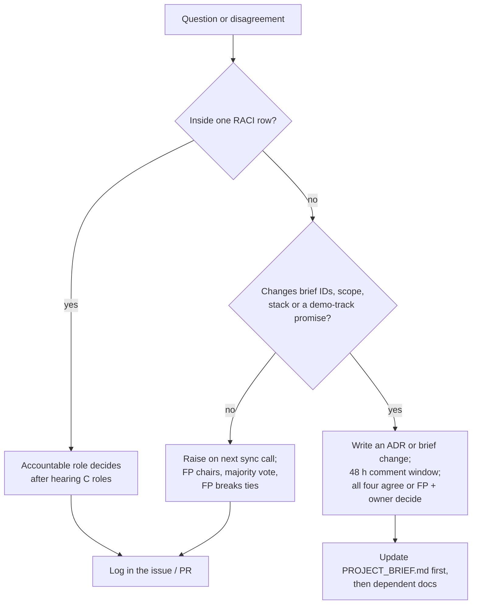

# Team
> Project: Tola · Owner: Field+Pitch lead · Status: Draft v0.1 · Last updated: 2026-10-20
> Related: [Project Brief](../00-overview/PROJECT_BRIEF.md) · [Backlog](BACKLOG.md) · [Hackathon plan](../00-overview/HACKATHON_PLAN.md) · [Git workflow](../../implementation/scalable/docs/GIT_WORKFLOW.md) · [ADRs](../03-engineering/adr/) · [Glossary](GLOSSARY.md)

Tola is built by four STEM students (brief section 13). The official rules say 4 members and HackCulture says 1–4; TOLA-165 confirms this with the organisers by 10 Nov 2026. This file defines who owns what in both builds:
- **MVP (hackathon)** = `implementation/demo/`;
- **v1 (production)** = `implementation/scalable/`.

Names go in the table once the team is fixed. Owner of that update: FP, by 1 Nov 2026.

---

## 1. Roles

| Code | Role | Name | Owns (Accountable) | Backup for |
|---|---|---|---|---|
| **FE** | Frontend + Design lead | _to fill by 1 Nov_ | Design system and tokens, web app, role switcher, story mode, motion, accessibility, i18n frame | AI (UI of voice screens) |
| **BE** | Backend + Crypto lead | _to fill by 1 Nov_ | `api/openapi.yaml`, FastAPI, `ledger_core`, Ed25519 + hash chain, reconciliation maths, settlement, UPI intent, GST draft, CI/CD, hosting | FE (API client), AI (deploy) |
| **AI** | AI + Voice lead | _to fill by 1 Nov_ | Lyzr agent graph (M-03), Sarvam STT/TTS (M-01, M-02), read-back templates, fallback mode, evals, karigar confirm and dispute-voice screens | BE (reconciliation explanations) |
| **FP** | Field + Pitch lead | _to fill by 1 Nov_ | Field interviews, wastage-norm validation, seed story, copy review, CA review, compliance notes, submission, deck, rehearsals, jury Q&A, team logistics | Everyone (product scope) |

### 1.1 What each role does, by phase

| Phase | FE | BE | AI | FP |
|---|---|---|---|---|
| Idea round (20 Oct – 22 Nov) | Shell, tokens, i18n frame (TOLA-002, 131, 140) | Repo, API skeleton, ledger core, chain (TOLA-001, 003, 030, 031) | Sarvam + Lyzr accounts and keys; voice spike | 15 field interviews, idea submission 15 Nov (TOLA-160, 161, 162, 165) |
| Prototype W1–W3 (23 Nov – 15 Dec) | Scale widget, forms, dashboard, story mode | Signing API, reconciliation, disputes, settlement, passport, GST | Read-back, intake agent, explanations, cached path | Seed data, copy review, field re-checks, prototype submission 15 Dec |
| Polish (16 – 26 Dec) | Motion, a11y, visual QA | Stability, deploy, tamper beat | Cached audio, offline path | Deck, script, rehearsals, letters of intent, AMA 24 Dec |
| Final (27 Dec) | Drives the laptop | Backup laptop + server on `docker compose` | Watches AI mode; flips to `cached` if needed | Presents |
| Post-hackathon | PWA, BLE, mr/ta UI | Auth, Postgres, GCP, PSP, WhatsApp | IVR, OCR, evals pipeline | Pilot shop, DPDP, AA/ULI partner, CERT-In runbook |

**Presenter rule:** FP presents; BE is the backup presenter and must complete 3 rehearsals as presenter (TOLA-153).

---

## 2. RACI by workstream

R = Responsible (does the work) · A = Accountable (one per row, makes the call) · C = Consulted · I = Informed.

### 2.1 Common (docs, contract, ledger rules)

| Workstream | FE | BE | AI | FP |
|---|---|---|---|---|
| Product scope, F-IDs, [PROJECT_BRIEF](../00-overview/PROJECT_BRIEF.md) | C | C | C | **A/R** |
| Design system and UI spec (Sarvam/Vakyam style, Apple fluid rules) | **A/R** | I | C | C |
| API contract `api/openapi.yaml` | C | **A/R** | C | I |
| Data model, integer-mg units, chain format | C | **A/R** | C | I |
| Reconciliation and wastage rules | I | **A/R** | C | C (field truth) |
| Prompts, model choice, AI evals | I | C | **A/R** | C |
| Localisation copy (en/hi/kn/bn) | R | I | C | **A** (native review) |
| Privacy, consent text, compliance notes | C | C | C | **A/R** |
| Field research and personas | I | I | C | **A/R** |
| Business model, GTM, pitch | C | C | C | **A/R** |

### 2.2 Demo track (`implementation/demo`)

| Workstream | FE | BE | AI | FP |
|---|---|---|---|---|
| Web shell, role switcher, story mode (TOLA-002, 150, 151) | **A/R** | C | C | C |
| Scale capture UI and simulated scale (F-01) | **A/R** | C | I | I |
| Scale ingest, events, signatures, chain (F-03) | C | **A/R** | I | I |
| Voice read-back and karigar confirm (F-02) | C | I | **A/R** | C |
| Return capture + intake agent (F-04) | R (form) | C | **A/R** | C |
| Reconciliation engine + "Run week" (F-05) | R (screen) | **A/R** | R (explanations) | C |
| Disputes (F-06) | C | **A** / R (API) | R (voice UI) | I |
| Settlement + simulated UPI (F-07) | R (UI) | **A/R** | R (narrative) | I |
| Work Passport + mock lender (F-08) | R (UI) | **A/R** | I | C (consent copy) |
| GST draft (F-09) | I | **A/R** | I | R (CA review) |
| Orders list, phone frame (F-10, F-12) | C | C | I | **A/R** |
| Dashboard (F-13) | **A/R** | C | I | C |
| i18n and accessibility (F-14) | **A/R** | I | C | R (review) |
| Seed data and the scripted week | C | R | C | **A/R** |
| AI fallback / offline demo path (R-07) | C | C | **A/R** | I |
| Demo CI and deploy (Vercel + Render + compose) | C | **A/R** | R (deploy) | I |
| Rehearsals, backup video, stage logistics | R | R | R | **A/R** |

### 2.3 Scalable track (`implementation/scalable`)

| Workstream | FE | BE | AI | FP |
|---|---|---|---|---|
| OTP auth and roles (API-17) | C | **A/R** | I | C |
| Postgres, Alembic, append-only enforcement | I | **A/R** | I | I |
| Key custody, passkeys, delegation (R-09) | R | **A/R** | I | C |
| Offline PWA + sync (F-11, API-18) | **A/R** | R | I | C (field test) |
| WhatsApp channel (F-12, API-19) | I | **A/R** | C | C |
| IVR channel (F-12, API-19) | I | C | **A/R** | C |
| PSP integration (API-20) | I | **A/R** | I | C |
| Scale OCR and BLE (M-04) | R (BLE) | I | **A/R** | C |
| GCP Mumbai infra, CI/CD, observability | I | **A/R** | C | I |
| Continuous evals (`evals.yml`) | I | C | **A/R** | I |
| DPDP rights, CERT-In runbook, Legal Metrology record | I | R | I | **A/R** |
| AA / ULI lender partnership | I | C | I | **A/R** |
| Pilot shop and karigar onboarding (JanAI Doot channel) | C | C | C | **A/R** |

---

## 3. Cadence

All times IST. The team works part-time around classes, so most rituals are async.

| Ritual | When | Length | Format | Output |
|---|---|---|---|---|
| Async check-in | Daily by 22:00 | 3 lines each | Team WhatsApp group: done / next / blocked | Blockers picked up by the next morning |
| Sync call | Wed and Sun, 21:00 | 30 min | Video call; FP chairs | Decisions logged as a comment on the sprint's tracking issue |
| Sprint planning | Monday of each sprint, 21:00 | 45 min | GitHub milestone review | Every ticket in the sprint has an owner and an estimate |
| Demo-to-each-other | Sunday call | 15 of the 30 min | Run the story mode on `main` | Bugs filed as issues the same night |
| PR review | Within 12 h of request | — | One reviewer from another role | No PR waits overnight twice |
| Field day | 2 per month in the Idea round; 1 in each prototype week | Half day | FP + one builder | Notes in `docs/01-product/research/` |
| Rehearsal block | Daily, 18 – 26 Dec | 45 min | Timed full run + Q&A drill | Timing log (TOLA-153) |

**Key dates:** idea submission **15 Nov** · prototype round **23 Nov – 15 Dec** · feature freeze **13 Dec** · prototype submission **15 Dec** · demo freeze **22 Dec** · AMA **24 Dec** · offline final **27 Dec, Bangalore Palace**.

After the demo freeze, only fixes to bugs seen in rehearsal are merged, and each one needs FP and BE to approve.

---

## 4. Decision process

Rules:
1. **One Accountable per decision.** The RACI tables above name it. That role decides and the others commit, even if they disagree ("disagree and commit").
2. **Timebox.** No technical debate runs longer than 24 hours. If it does, the Accountable role picks the reversible option.
3. **The brief wins.** A change to an ID (F-, E-, API-, M-, R-, P-), a version, a port or an env var goes into [PROJECT_BRIEF](../00-overview/PROJECT_BRIEF.md) first, in the same PR as the code that needs it.
4. **ADRs for architecture.** Stack, database, model or hosting changes get an ADR in [`docs/03-engineering/adr/`](../03-engineering/adr/) in MADR format.
5. **Scope cuts.** FP calls cuts using the cut list in [HACKATHON_PLAN](../00-overview/HACKATHON_PLAN.md) and the order in [BACKLOG](BACKLOG.md) section 2. A cut never removes a PS 2.2 boundary: settlement goes to both parties, and the karigar sees his full account.
6. **Non-negotiables that no vote overrides:**
   - AI never does gram arithmetic;
   - weights are never typed;
   - events are never edited or deleted;
   - simulated things (UPI, lender, channel, scale) are labelled as simulated on screen.

---

## 5. Working agreements

- **Branching and commits** per [GIT_WORKFLOW](../../implementation/scalable/docs/GIT_WORKFLOW.md): short-lived branches named `<type>/<track>-<area>-<short-desc>` (for example `feat/demo-hash-chain`), with the TOLA ticket ID in the PR title, Conventional Commits, squash merge.
- **Every PR links a TOLA ticket.** Closing words (`Closes #n`) move the board automatically.
- **Secrets** never go into Git or the WhatsApp group. Share them only through a password manager vault; BE owns the vault.
- **Credits:** AI watches Lyzr and Sarvam spend weekly and posts it in the Sunday call. Sarvam's ₹100 free credit is reserved for TOLA-022 and live rehearsals.
- **Field ethics:** FP collects consent for every recording and quote. No real names in the repo.
- **Bus factor:** every A has a named backup (section 1). Before the demo freeze, each backup runs the full demo locally from a clean clone.
- **Wellbeing:** no work between 00:30 and 07:00 in the final 72 hours. A tired presenter costs more than one missing feature.
