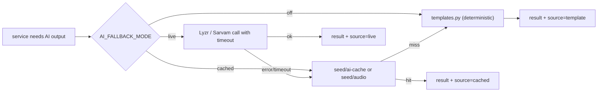

# Back End (demo build)
> Project: Tola · Owner: Back-end + crypto lead · Status: Draft v0.1 · Last updated: 2026-10-20
> Related: [Demo spec](./DEMO_SPEC.md) · [Front end](./FRONTEND.md) · [API spec](../../../docs/03-engineering/API_SPEC.md) · [OpenAPI](../../../api/openapi.yaml) · [Data model](../../../docs/03-engineering/DATA_MODEL.md) · [AI models](../../../docs/04-ai/MODELS.md) · [Project brief §6–8](../../../docs/00-overview/PROJECT_BRIEF.md) · [Testing](./TESTING.md)

The demo API lives in `implementation/demo/services/api`. It is a small FastAPI app on SQLite. Its core is **`ledger_core`**, a pure-Python module that owns every gram of arithmetic, the hash chain and the signature checks. Pinned versions are in [`pyproject.toml`](../services/api/pyproject.toml).

## 1. Stack
| Concern | Choice (exact version) |
|---|---|
| Runtime | Python ≥ 3.12 |
| Web | FastAPI **0.153.0**, Uvicorn **0.54.0** (`[standard]`), python-multipart 0.0.32 (audio upload) |
| Models | Pydantic **2.14.1**, pydantic-settings 2.16.1 |
| DB | SQLite file via SQLAlchemy **2.1.5** (sync engine, `check_same_thread=False`, WAL mode) |
| Crypto | PyNaCl **1.6.2** (Ed25519 verify + server signing); `hashlib.sha256` |
| HTTP | httpx **0.28.1** |
| AI | `lyzr-adk` **0.1.12** (`from lyzr import Studio`), `sarvamai` **0.1.37** (`from sarvamai import SarvamAI`) |
| PDF | ReportLab 5.0.1 |
| Tests | pytest **9.1.1**, Hypothesis 6.170.5; ruff 0.17.1 for lint and format |

## 2. App layout
```
services/api/
├─ pyproject.toml · Dockerfile
├─ tola_api/
│  ├─ main.py               create_app(): CORS, routers under /v1, exception handlers, run()
│  ├─ config.py             Settings (pydantic-settings) reading the env names from the brief
│  ├─ db.py                 engine, SessionLocal, WAL pragma, get_db dependency
│  ├─ models.py             SQLAlchemy ORM for E-01..E-14
│  ├─ schemas.py            Pydantic request/response models (ints only for mg and paise)
│  ├─ routers/              health, demo, shops, orders, scale, events, ledger, voice,
│  │                        reconciliation, disputes, settlements, passport
│  ├─ services/             thin orchestration: load rows → call ledger_core → call ai → persist
│  ├─ ledger_core/          PURE: no FastAPI, no SQLAlchemy, no I/O, no floats
│  │  ├─ units.py           Mg, Fineness, Paise types; fine_mg(); bp_of(); format helpers
│  │  ├─ canonical.py       canonical JSON bytes (sorted keys, no spaces, UTF-8, ints only)
│  │  ├─ chain.py           event_hash(), append(), verify_chain() → ChainStatus
│  │  ├─ signing.py         demo_seed(person_id), sign(), verify() over the 32-byte hash
│  │  ├─ reconcile.py       reconcile(orders, events, norms) → rows + flags
│  │  ├─ settle.py          settle(period, events, labour) → Statement
│  │  └─ passport.py        summarise(events, window) → PassportSummary
│  ├─ ai/
│  │  ├─ fallback.py        with_fallback(live_fn, cache_key, template_fn, timeout_ms)
│  │  ├─ cache.py           read/write seed/ai-cache/<sha256>.json and seed/audio/*
│  │  ├─ lyzr_client.py     Manager / Intake / Reconcile / Settle agents
│  │  ├─ sarvam_client.py   TTS (Bulbul v3), STT (Saaras v3)
│  │  └─ templates.py       deterministic text when AI is off or unreachable
│  ├─ pdf/gst_draft.py      Rule 55 challan + labour invoice draft (watermarked)
│  └─ seed/
│     ├─ loader.py          reset(to_step=None); CLI `tola-seed --reset | --if-empty`
│     └─ story.py           typed view of seed/story.json + step fast-forward
└─ tests/                   test_units, test_canonical, test_chain, test_signing, test_reconcile,
                            test_settle, test_story_numbers, test_reset_deterministic, test_api_story
```

## 3. ledger_core
### 3.1 Units
- `Mg = NewType("Mg", int)`. Every weight is an integer number of milligrams. Floats raise `TypeError` at every public function (checked with `type(x) is int`).
- `Fineness` is an int in ‰ (999, 995, 916, 875, 750).
- `fine_mg(mg, fineness) = (mg * fineness + 500) // 1000` (round half up). Example: 40,000 × 916 → **36,640**; 250 × 916 → **229**; 380 × 916 → **348**.
- `bp_of(mg, bp) = mg * bp // 10000` (floor). Example: 40,000 at 250 bp → **1,000**.
- Money is `Paise` (int). GST = `labour_paise * 500 // 10000`. Example: 480,000 → **24,000**.

### 3.2 Events, canonical bytes and the chain
Every `LedgerEvent` (E-06) has a payload:
```json
{"v":1,"chain":"shop-shetty:p-rafiq","seq":17,"type":"ISSUE","order":"#14",
 "gold_mg":40000,"fineness":916,"stone_mg":0,"norm_bp":250,"norm_version":1,
 "scale_reading_id":"sr_…","occurred_at":"2026-10-12T10:02:30+05:30",
 "parties":["p-suresh","p-rafiq"],"prev_hash":"<64 hex>"}
```
- **Canonical bytes**: `json.dumps(payload, sort_keys=True, separators=(",", ":"), ensure_ascii=False).encode("utf-8")`. Integers only, so there are no float-format ambiguities. The browser never re-serialises: it signs the hash the server returns, and it can recompute that hash from the returned canonical bytes to check it.
- **Hash**: `hash = sha256(canonical_bytes).hexdigest()`. `prev_hash` sits inside the payload, so the chain is `H_n = SHA256(canon(payload_n ∋ H_{n-1}))`. Genesis `prev_hash` is `"0" * 64`.
- **One chain per shop–karigar pair** (`chain = "<shopId>:<karigarId>"`). That is the karigar's own account (PS 2.2: "each karigar has full access to his own account").
- **Append-only**: the `ledger_events` table has no UPDATE path in code. A SQLite trigger `BEFORE UPDATE ON ledger_events BEGIN SELECT RAISE(ABORT,'append-only'); END;` blocks updates (and the same for DELETE outside `reset`).
- **Sealed** = both party signatures present and valid. Only sealed events count in reconciliation and settlement. Unsealed events show as "awaiting karigar" (EC-1).

### 3.3 Signatures (Ed25519)
- Message signed = the **32 raw bytes** of the event hash.
- Party keys in the demo: `seed = sha256(b"tola-demo:v1:" + person_id.encode())`, then `nacl.signing.SigningKey(seed)`. The browser derives the same 32-byte seed with `@noble/hashes` and signs with `@noble/ed25519` `signAsync(hash, seed)`. RFC 8032 keys from the same seed are identical in both libraries, so the server can verify browser signatures. **Demo only**, and labelled in the UI.
- Server key `TOLA_SERVER_SIGNING_KEY` (64 hex chars) signs reconciliation runs, settlement statements, passport summaries and a `checkpoint` (chain head hash + length) after each step. If it is empty, a fixed demo key from `"tola-demo:v1:server"` is used and a warning is logged.
- `verify_chain(events)` → `ChainStatus{valid, length, head_hash, broken_at, missing_signatures[]}`. It recomputes every hash and every signature in O(n). 1,000 events take < 50 ms on the stage laptop (target, measured in `test_chain.py`).

### 3.4 Reconciliation (F-05)
For each order returned in the window (sealed events only):
```
issued   = Σ ISSUE.gold_mg
returned = Σ RETURN.net_gold_mg + Σ SCRAP_RETURN.gold_mg + Σ DUST_CREDIT.gold_mg
loss     = issued − returned
allowed  = bp_of(issued, norm_bp at issue) + Σ ADJUSTMENT.allowance_mg
variance = loss − allowed
flag     = variance > 50            # flag_tolerance_mg from the seed
```
The story-week result is #12 −105, #13 −70 and **#14 +380 (flag)**. M-05 (robust z-score over the karigar's own history) is computed and shown as context ("first over-norm in 15 orders"). It never changes the flag.

### 3.5 Settlement (F-07)
`settle()` produces gold lines (opening, issued, returned, scrap, dust, allowed, adjustments, closing, carried shortfall fine) and rupee lines (labour, GST, payable). Disputed and unresolved lines are excluded and carried over (EC-7). Gold is never netted against rupees (EC-12). For Rafiq's week the closing balance is **18,250 mg**, the carried shortfall **250 mg (229 fine)**, and the payable **504,000 paise**. Full table: [DEMO_SPEC §8.3](./DEMO_SPEC.md#83-rafiqs-settlement-s08-all-integers).

## 4. Database (SQLite)
Tables map 1:1 to the entities: `shops` (E-01), `persons` (E-02, `public_key_hex`), `karigar_profiles` (E-03), `orders` (E-04), `wastage_norms` (E-05, versioned, signed), `ledger_events` (E-06: `id, chain, seq, type, payload_json, canonical_b64, prev_hash, hash, occurred_at, recorded_at`), `signatures` (E-07: `event_id, person_id, sig_hex, signed_at`), `scale_readings` (E-08: `mg, source ∈ {serial, ble, display_ocr, simulated, manual_dual}, device_id, photo_ref`), `voice_notes` (E-09), `reconciliation_runs` + `variance_flags` (E-10), `disputes` + `dispute_messages` (E-11), `settlements` (E-12), `payment_intents` (E-13, status `simulated` / `simulated_paid`), `passport_shares` (E-14: `token_hash`, scopes, expires_at, revoked_at).
- Unique `(chain, seq)`; index on `(chain, occurred_at)`.
- All weight columns are `INTEGER NOT NULL CHECK (x >= 0)`. There is no `REAL` column anywhere (a test greps the DDL).
- `PRAGMA journal_mode=WAL; PRAGMA foreign_keys=ON;`

## 5. AI clients and fallback
**Principle: AI never does gram arithmetic** (brief §8). Agents receive numbers computed by `ledger_core` and return text or extracted *non-weight* fields. Every agent output passes a human gate (a tap to sign) before it affects the ledger.


`with_fallback()` returns `{value, source: live|cached|template, latency_ms}`. The UI shows a pill whenever `source != live`. Timeouts come from the seed: TTS 3.5 s, STT 5 s, Lyzr 6 s. Cache key: `sha256(role + "\n" + canonical(input))`.

**Sarvam** (`sarvam_client.py`), checked against `sarvamai` 0.1.37 source on 2026-10-20:
```python
from sarvamai import SarvamAI
client = SarvamAI(api_subscription_key=settings.sarvam_api_key)   # SDK also reads SARVAM_API_KEY

tts = client.text_to_speech.convert(text=readback_bn, language_code="bn-IN", model="bulbul:v3", speaker=SPEAKER_BN)
audio_b64 = tts.audios[0]                                          # base64 audio

stt = client.speech_to_text.transcribe(file=wav_bytes, model="saaras:v3", language_code="bn-IN")
text = stt.transcript
```
`SPEAKER_BN` is a constant. Which Bulbul v3 voices suit Bengali is not verified (2026-10-20); the AI/voice lead picks one by listening and records it in `MODELS.md` by 20 Nov 2026.

**Lyzr** (`lyzr_client.py`), checked against `lyzr-adk` 0.1.12 source on 2026-10-20:
```python
from lyzr import Studio
studio = Studio(api_key=settings.lyzr_api_key)                     # also reads LYZR_API_KEY
intake = studio.get_agent(settings.lyzr_agent_id_intake)
resp = intake.run(message=json.dumps(intake_input), session_id=f"demo-{step_id}")
fields = IntakeFields.model_validate_json(resp.response)          # strict schema; weights ignored
```
| Agent (env id) | Input | Output | Human gate |
|---|---|---|---|
| Manager (`LYZR_AGENT_ID_MANAGER`) | step context | routes to a sub-agent (live mode only; cached mode calls sub-agents directly) | — |
| Intake (`LYZR_AGENT_ID_INTAKE`) | transcript + scale readings + open orders | `{order, note, tags, confidence}`; weight fields are **discarded**, because the scale wins | Both parties sign the RETURN |
| Reconcile (`LYZR_AGENT_ID_RECONCILE`) | computed rows from `ledger_core.reconcile` | one-paragraph explanation per flag | Jeweller reads it before asking the karigar |
| Settle (`LYZR_AGENT_ID_SETTLE`) | computed statement | plain-language narrative (en + bn) | Two approvals |

The provider is `gpt-4o-mini` as configured in Lyzr Studio (brief M-03). Prompts and evals belong to [MODELS.md](../../../docs/04-ai/MODELS.md); this build only consumes them.

## 6. Seed and demo reset
- `seed/story.json` is the single source of the scripted week ([DEMO_SPEC §8](./DEMO_SPEC.md#8-seed-data-spec)). The seed directory resolves as `./seed` from the working directory (Docker `/app/seed`), or `../../seed` from `services/api` in a repo checkout.
- `reset(to_step=None)` performs the following steps inside **one transaction**:
  1. drop and recreate all tables;
  2. insert shop, persons (public keys from the demo derivation), profiles and norms;
  3. expand `history.orders` into dual-signed events;
  4. insert `preseeded_events`;
  5. if `to_step` is set, replay every scripted step before it with its exact payload, `occurred_at` and demo signatures;
  6. write a server checkpoint.

  `recorded_at` for seeded and replayed rows equals `occurred_at`, so the hashes are deterministic.
- Targets: full reset ≤ 800 ms; two resets give an identical head hash per chain (pytest).
- CLI: `tola-seed --reset` (always) and `tola-seed --if-empty` (Docker start).

## 7. Endpoints implemented (✓ subset of [openapi.yaml](../../../api/openapi.yaml))
| ID | Method · path | Demo behaviour |
|---|---|---|
| API-01 | `GET /v1/health` | `{status, ai_mode, db, chain_heads}` |
| API-02 | `GET /v1/demo/personas` · `POST /v1/demo/reset` | Personas from the seed. Reset takes an optional `{"to_step": "S05"}` for stepper replay. **Demo only.** |
| API-03 | `GET/POST /v1/shops/{shopId}/karigars` | List with fine-gold balance per karigar; POST adds a karigar (Explore mode) |
| API-04 | `GET/POST /v1/orders` · `GET /v1/orders/{id}` | Orders with the computed status (open, returned, flagged, disputed, settled) |
| API-05 | `POST /v1/scale/readings` | Stores mg (int) + `source`; rejects non-integers with 422 |
| API-06 | `POST /v1/events` | Validates, builds the canonical payload, returns `{id, canonical_b64, hash, required_signers}` (unsigned) |
| API-07 | `POST /v1/events/{id}/signatures` | Verifies Ed25519 over the hash with the signer's public key; returns `{signatures, sealed}` |
| API-08 | `GET /v1/ledger?karigarId=&shopId=` | Events + `chain` status. Demo extra: `&sandbox=tamper:R6` verifies an in-memory copy with one byte flipped |
| API-09 | `POST /v1/voice/readback` | `{event_id, lang}` → `{text, audio_b64, source}` via Bulbul or cache |
| API-10 | `POST /v1/voice/intake` | multipart audio, or `{clip_id}` in cached mode → transcript + intake fields + scale comparison |
| API-11 | `POST /v1/reconciliation/runs` · `GET /v1/reconciliation/runs/{id}` | Runs `ledger_core.reconcile`, then the Reconcile agent explanation; server-signed |
| API-12 | `POST /v1/disputes` · `POST /v1/disputes/{id}/messages` · `POST /v1/disputes/{id}/resolve` | Opens DISPUTE_OPEN; messages (text/voice); resolve creates ADJUSTMENT + DISPUTE_RESOLVE drafts for both to sign |
| API-13 | `POST /v1/settlements` · `POST /v1/settlements/{id}/approve` | Draft statement (server-signed) + two approvals = SETTLEMENT event sealed |
| API-14 | `POST /v1/settlements/{id}/payment-intent` | `{uri: "upi://pay?pa=…&am=5040.00&cu=INR&tn=…", status: "simulated"}`; 409 until both approvals exist |
| API-15 | `POST /v1/passport/shares` · `GET /v1/passport/{token}` · `DELETE /v1/passport/shares/{id}` | Token is 128-bit random, stored hashed; GET returns a server-signed summary; revoked or expired gives 410 |
| API-16 | `GET /v1/settlements/{id}/gst-draft` | `application/pdf`, two pages, watermark "DRAFT, for your CA. Not filed." |

**Not implemented here:** API-17 (OTP), API-18 (sync), API-19 (WhatsApp/IVR webhooks) and API-20 (PSP webhook). They belong to the scalable build. **There is no auth middleware.** CORS allows `http://localhost:3000` and the configured web origin.

Errors use RFC 9457 problem+json: `{type, title, status, detail, code}` with codes such as `NOT_INTEGER_MG`, `CHAIN_CONFLICT`, `BAD_SIGNATURE`, `NOT_SEALED` and `APPROVALS_MISSING`.

## 8. Config
`config.py` reads exactly the brief's names: `DATABASE_URL`, `AI_FALLBACK_MODE`, `LYZR_API_KEY`, `LYZR_AGENT_ID_MANAGER`, `LYZR_AGENT_ID_INTAKE`, `LYZR_AGENT_ID_RECONCILE`, `LYZR_AGENT_ID_SETTLE`, `SARVAM_API_KEY`, `TOLA_SERVER_SIGNING_KEY`, `TOLA_UPI_VPA`, `TOLA_UPI_PAYEE_NAME`. See [`.env.example`](../.env.example). With `live` mode and missing keys, the app logs once and behaves as `cached`.

## 9. MVP (hackathon) vs v1 (production)
| Area | MVP (this build) | v1 ([scalable](../../scalable/README.md)) |
|---|---|---|
| DB | SQLite file, reset on demand | PostgreSQL 16 + Alembic 1.20, no reset |
| Keys | Demo-derived from persona ids | Per-device keys; signed key rotation (EC-9) |
| Jobs | Inline, button-triggered | Cloud Tasks / RQ + Redis 7 |
| Auth | None | OTP (API-17) |
| AI | Live or cached; cache baked into the repo | Live with evals, tracing and budgets |
| Payments | URI only | PSP + webhook |

## Story-mode endpoints (added 2026-10-21)
| Endpoint | What it does |
|---|---|
| `GET /v1/demo/state` (API-02a) | One read-only snapshot for the stage: `done[]`, orders, Rafiq's events with signature flags, chain check (server recompute), run, dispute, settlement, payment, passport and `passport_preview`, karigar balances, `audio_source` |
| `POST /v1/demo/steps/{S01–S13}/perform` (API-02b) | Performs one beat with the seed's payload through the idempotent `apply_step_sNN` functions, under the same lock as reset. S08 takes `{"party": "jeweller" \| "karigar"}`; with no party it drafts the statement. Returns the new snapshot |

`DemoState.current_step` only moves forward (`S00` before the week). Tests: `tests/test_story_perform.py` (live run equals
replay, GETs never invent data, replays never rewind).
