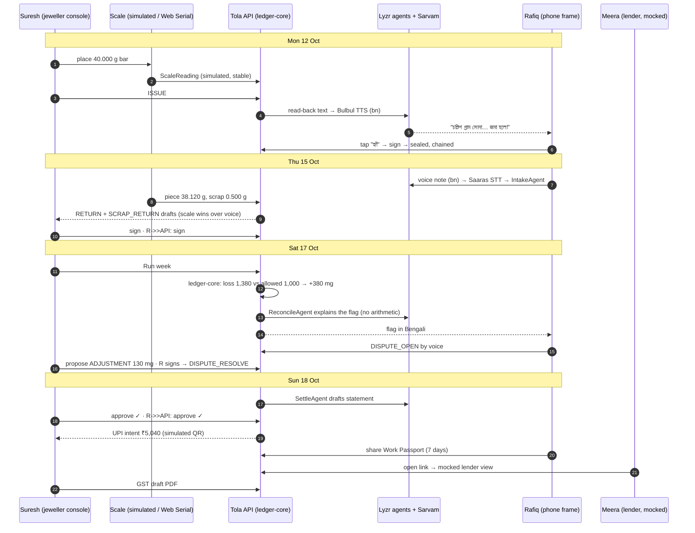
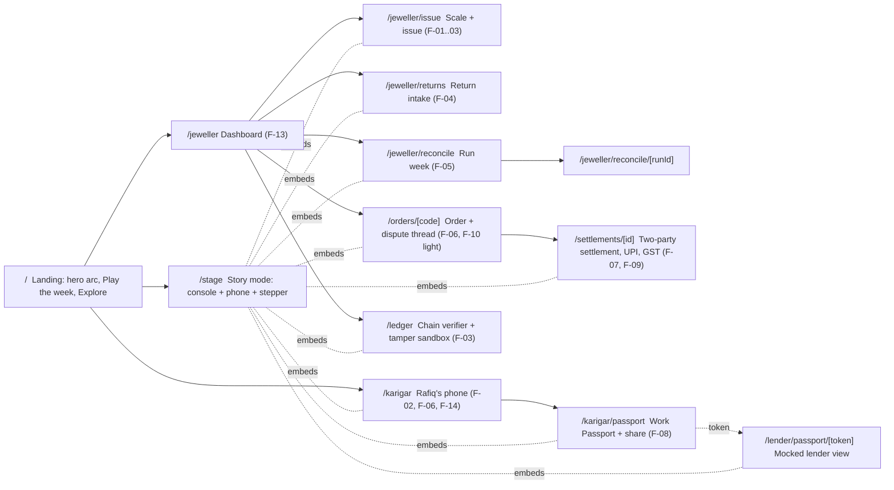
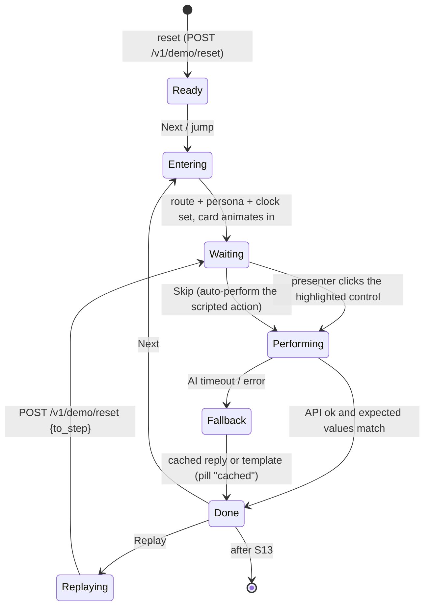

# Demo Spec: "One week at Shetty Jewellers"
> Project: Tola · Owner: Product lead + Front-end lead (demo track) · Status: Built v0.2 · Last updated: 2026-10-21
> Related: [Project brief](../../../docs/00-overview/PROJECT_BRIEF.md) · [User journeys §6](../../../docs/01-product/USER_JOURNEYS.md) · [PRD](../../../docs/01-product/PRD.md) · [Design](../../../docs/02-design/DESIGN.md) · [Front end](./FRONTEND.md) · [Back end](./BACKEND.md) · [Testing](./TESTING.md) · [Seed](../seed/story.json)

This is the heart of the demo build. It defines the scripted story, every screen and click, what is real and what is mocked, the seed, the failure fallbacks and the 3-minute stage choreography. The canonical numbers come from [PROJECT_BRIEF §2](../../../docs/00-overview/PROJECT_BRIEF.md) and [USER_JOURNEYS §6](../../../docs/01-product/USER_JOURNEYS.md). If they change there, change [`seed/story.json`](../seed/story.json), this file and the tests together.

---

## 1. Goal and success criteria
**Goal.** In 3 minutes, with no login, a judge sees one gram line go out, come back, get flagged, get disputed, get resolved with two signatures, get paid and become the karigar's credit record. Every number on screen must survive a chartered accountant's check.

| # | Criterion | Target | How we check |
|---|---|---|---|
| SC-1 | Full story runs end to end with no network | 100% of 13 steps with `AI_FALLBACK_MODE=cached` and Wi-Fi off | Manual run in [TESTING §5](./TESTING.md) + Playwright `story.spec.ts` |
| SC-2 | Stage runtime | 2:50–3:00 for the scripted path | Rehearsal stopwatch, 3 runs in a row |
| SC-3 | Arithmetic | Every gram and rupee figure equals `steps[].expected` in the seed | pytest `test_story_numbers.py` |
| SC-4 | Responsiveness | Press feedback ≤ 100 ms; step transition settles ≤ 600 ms; no frame drops below 55 fps on the stage laptop | Chrome Performance panel, see [FRONTEND §9](./FRONTEND.md) |
| SC-5 | Determinism | Two resets produce identical event hashes | pytest `test_reset_deterministic.py` |
| SC-6 | Recovery | Any step can be replayed or skipped in ≤ 1 s | Playwright `stepper.spec.ts` |
| SC-7 | Honesty | Every simulated or mocked surface carries a visible label | Checklist §11 |

## 2. The cast (seeded, illustrative composites)
| Persona id | Name | Brief ID | Role in the story | Language |
|---|---|---|---|---|
| `p-suresh` | Suresh Shetty, 52 | P-01 | Owner, Shetty Jewellers, Avenue Road, Bengaluru. Issues, runs the week, settles. | UI en; voice kn |
| `p-lakshmi` | Lakshmi, 28 | P-03 | Counter staff. Receives Thursday's return. | kn |
| `p-rafiq` | Rafiq Sheikh, 34 | P-02 | Karigar. Hears read-backs in Bengali, disputes, shares his passport. | bn (some hi) |
| `p-manju` | Manjunath Achar | P-02 | Second karigar; clean week (Order #12), one open order (#15). | kn |
| `p-subrata` | Subrata Pal | P-05 | Head karigar, antique work (Order #13), clean week. | bn |
| `p-meera` | Meera Rao | P-04 | Credit officer, Sahyadri Co-operative Credit Society (**fictional**). Opens the shared passport. | en |

One shop, three karigars, one lender. All names are illustrative.

## 3. The story at a glance

| Step | Day · clock (IST) | Who acts | What the audience sees | Feature · API | Canonical numbers |
|---|---|---|---|---|---|
| S01 | Mon 10:02 | Suresh | Scale widget: digits roll up and jitter, then lock at **40.000 g** with a soft tick; "Stable" pill. | F-01 · API-05 | reading 40,000 mg, `source: simulated` |
| S02 | Mon 10:02 | Suresh | Issue card: Rafiq, Order #14 plain 22K bangle pair, norm **2.50%** (allowed **1.000 g**), photo. Suresh taps **Sign**; first tick turns indigo. | F-01, F-03 · API-06, API-07 | 40,000 mg gross = **36,640 mg fine** |
| S03 | Mon 10:03 | Rafiq | Phone frame lights up: the Bengali read-back plays with live captions. Rafiq taps **হ্যাঁ (haan)**. Both ticks go green; a new block snaps onto the chain strip. | F-02, F-03 · API-09, API-07 | event R5 sealed, 2/2 signatures |
| S04 | Thu 16:10 | Rafiq + Lakshmi | Phone: Rafiq's voice note (waveform). Console: intake agent card fills: order #14, piece **38.120 g**, scrap **0.500 g**, note "solder joint cracked, redone". A "Scale matches voice ✓" chip shows. Both sign. | F-04 · API-10, API-05, API-06, API-07 | returned 38,620 mg |
| S05 | Sat 18:00 | Suresh | **Run week**. Three order rows animate in; #12 and #13 green; **#14 amber flag +0.380 g** with the agent's one-paragraph explanation. | F-05, F-13 · API-11 | loss 1,380, allowed 1,000, variance **+380 mg** (348 mg fine, ≈ **₹5,188**) |
| S06 | Sat 18:20 | Rafiq | Phone gets the flag in Bengali. Rafiq holds the mic and replies; the transcript appears in a dispute thread. Line #14 turns pink "Open dispute". | F-06 · API-10, API-12 | disputed 380 mg |
| S07 | Sat 19:05 | Suresh + Rafiq | Suresh proposes "Accept 0.130 g as rework wastage". Rafiq taps agree. ADJUSTMENT + DISPUTE_RESOLVE seal with two ticks. The thread stays visible, struck through, never deleted. | F-06, F-03 · API-12, API-07 | **130 mg** allowed; **250 mg gross (229 mg fine)** stays on Rafiq's balance |
| S08 | Sun 11:00 | Both | Settlement sheet rises: gold carried 0.229 g fine, labour ₹4,800, GST 5% ₹240, payable **₹5,040**. Two approve buttons, one per side; ticks land one after the other. | F-07 · API-13 | 480,000 + 24,000 = **504,000 paise** |
| S09 | Sun 11:02 | Suresh | UPI intent card with QR and the `upi://pay` string, banner **"Simulated, no money moves"**. Tap **Mark paid (simulated)**. | F-07 · API-14 | ₹5,040.00 |
| S10 | Sun 11:10 | Rafiq | Phone: "My Work Passport". 194.000 g handled in 180 days, 13 of 14 on time, used 83.7% of agreed wastage, 1 dispute resolved in 45 min. Share sheet: Meera, 7 days, scopes. | F-08 · API-15 | see §8.4 |
| S11 | Sun 11:12 | Meera | Lender view in a browser frame, banner **"Mocked lender view. Tola does not score or lend."** Signed by Tola's server key, verifiable. | F-08 · API-15 | same figures, read-only |
| S12 | Sun 11:15 | Suresh | GST draft PDF opens in a sheet: Rule 55 delivery challan + labour invoice, watermark **DRAFT, for your CA. Not filed.** | F-09 · API-16 | taxable ₹4,800, GST ₹240 |
| S13 | Sun 11:16 | Suresh | `/ledger`: Rafiq's chain, 12 events, all 2/2 signatures, "Chain valid". Optional: **Tamper** flips one byte of R6 in a sandbox → red "broken at event R6". | F-03 · API-08 | 7 events in the story week |

Per-step payloads, expected values and Bengali texts are in [`seed/story.json`](../seed/story.json) → `steps[]`.

### 3.1 Step details that matter on stage
**S01 Scale.** The simulated scale emits the `jitter_mg` sequence `[40130, 39960, 40020, 39990, 40000, 40000, 40000]` every 200 ms. The capture button stays disabled until 3 consecutive readings sit within 10 mg over at least 1.5 s (EC-2). Digits use `spring.counter` (critically damped, so a weight never overshoots). With a real serial balance connected ([FRONTEND §7](./FRONTEND.md)), the same stability rule applies to live frames and `source` becomes `serial`. The figure is **never typed**. If the scale fails, the fallback is `manual_dual`: Suresh and Rafiq each enter the number, and it is accepted only if both match.

**S02 Issue.** The draft is returned unsigned by API-06 with its canonical bytes and `hash`. The browser signs the 32-byte hash with Suresh's demo key and posts it to API-07. The card shows "1 of 2 signatures" until Rafiq signs. The norm (2.50% of gross issued) is part of the signed payload, so it is "agreed up front".

**S03 Read-back.** Text (bn): *"অর্ডার চোদ্দো। চল্লিশ দশমিক শূন্য শূন্য শূন্য গ্রাম সোনা, বাইশ ক্যারেট, জমা হলো। ঘাটতির সীমা দুই দশমিক পাঁচ শতাংশ, মানে এক গ্রাম।"* English caption: "Order 14. 40.000 grams of gold, 22 carat, received. Wastage limit 2.5 percent, that is 1 gram." Numbers are always spoken digit by digit after the decimal point (F-14). The **হ্যাঁ** button is 56 px tall. A **না (na)** button sits beside it. "Na", or no answer within 30 s, leaves the event at "awaiting karigar" (EC-1); the stepper offers "Simulate haan" to recover.

**S04 Return intake.** Weights come from the three scale captures. The transcript only fills the order number, the note and a tag (`REWORK_SOLDER`). If the voice says 38.12 and the scale says 38.120, the chip reads "Scale matches voice ✓". If they differ, the chip turns amber and reads "Scale used: 38.120 g (voice said …)" (EC-4). Dust is 0 mg on this order. The DUST_CREDIT event type is visible on #11, #12 and #13.

**S05 Run week.** The button calls API-11. `ledger_core.reconcile()` computes the rows, then `ReconcileAgent` writes one paragraph of explanation from those computed numbers (cached text in the seed). Rows enter with a staggered `spring.default` (60 ms apart). The flag colour is ember, not red: a flag is a question, not an accusation.

**S06 Dispute.** Rafiq's phone shows the flag in Bengali with a speaker button. He holds the mic button (press-and-hold, released by lifting the finger) to record. On stage the cached clip `S06_dispute_bn.webm` plays when the presenter clicks the mic. With the network on and `live`, it records from the laptop mic. DISPUTE_OPEN is signed by Rafiq, and Suresh's signature on it means "seen", not "agreed".

**S07 Resolve.** Suresh's proposal chips: "Accept 0.130 g" (scripted), "Accept all 0.380 g" and "Reject". Rafiq's phone shows the proposal with the read-back, then **হ্যাঁ**. Two events seal: `ADJUSTMENT` (+130 mg allowance) and `DISPUTE_RESOLVE` (250 mg carried). The disputed line stays in the thread with a struck-through amount and the resolution under it. Nothing is overwritten.

**S08 Settlement.** The sheet rises from the bottom (`spring.sheet` only if it was dragged, otherwise `spring.gentle`). The order of lines is: gold (issued, returned, scrap, allowed, adjustment, carried), then rupees (labour, GST, payable). Gold is settled in grams and never netted against rupees (EC-12). Two approve buttons: Suresh on the console, Rafiq on the phone. Payment is unlocked only after both.

**S09 UPI.** API-14 returns `upi://pay?pa=<TOLA_UPI_VPA>&pn=<TOLA_UPI_PAYEE_NAME>&am=5040.00&cu=INR&tn=Tola%20wk42%20Order%2014`. The QR is rendered client-side (`qrcode.react`). **No PSP is called.** The status becomes `simulated_paid` only when the presenter taps it.

**S10–S11 Passport.** The share creates a `PassportShare` (E-14) with a random 128-bit token, scopes, `expires_at = now + 7 days` and a revoke button. The lender page fetches API-15 `GET /v1/passport/{token}`. It shows raw figures and a server signature, with **no score** and no approve/decline wording (R-06). If revoked, it returns 410 and the page shows "Revoked by the karigar" (EC-8).

**S12 GST draft.** API-16 renders a 2-page PDF with ReportLab: page 1 is the Rule 55 delivery challan for the 40.000 g issue; page 2 is the job-worker's labour invoice (taxable ₹4,800, GST 5% ₹240). Both carry the diagonal watermark "DRAFT, for your CA. Not filed." HSN/SAC codes are printed as "(CA to confirm)". The codes are not verified as of 2026-10-20.

**S13 Verify.** API-08 returns events plus `chain: {valid, length, head_hash, broken_at}`. The "Tamper" button calls the same endpoint with `?sandbox=tamper:R6`, which copies the chain in memory, flips one byte of R6's stored payload and re-verifies. The real DB is never touched.

## 4. Route map

| Route | Default persona | Purpose | Server/Client |
|---|---|---|---|
| `/` | none | Sarvam-style landing: arc of light, the one-liner, "Play the week" (→ `/stage?step=S01`), "Explore freely" (→ `/jeweller`), persona chips | Server component, static |
| `/stage` | follows the step | **The stage route.** Left: jeweller console (≥ 1280 px wide: 60%). Right: Rafiq's phone frame (390 × 844 logical, scaled). Bottom: story stepper. Lender and PDF steps open as sheets over the console. | Client island inside a server layout |
| `/jeweller` | Suresh | Fine-gold balance per karigar, open orders, flags (F-13) | Server fetch + client refresh |
| `/jeweller/issue` | Suresh / Lakshmi | Scale widget + issue form | Client |
| `/jeweller/returns` | Lakshmi | Return capture + intake agent card | Client |
| `/jeweller/reconcile` · `/[runId]` | Suresh | Run week; run result | Client |
| `/orders/[code]` | any | Order timeline, events with ticks, dispute thread | Server + client |
| `/settlements/[id]` | Suresh / Rafiq | Statement, two approvals, UPI QR, GST draft | Client |
| `/karigar` | Rafiq | Mobile-first karigar home. On a real phone it is full screen; on desktop it renders inside PhoneFrame. | Client |
| `/karigar/passport` | Rafiq | Passport summary, share sheet, revoke | Client |
| `/lender/passport/[token]` | Meera | Read-only mocked lender view | Server |
| `/ledger` | any | Chain strip, signature list, verify, tamper sandbox | Client |

There is no `/login`, no `/signup`, no `/settings/account` and no route guard. Unknown persona query values fall back to Suresh.

## 5. Role switcher (no login)
- **UI.** A translucent pill bar in the top nav with persona chips: avatar initials, name, and a role glyph (scale = jeweller, hammer = karigar, bank = lender). The active chip has an indigo ring. The chips group by role, with a thin separator between groups.
- **Behaviour.** Tapping a chip sets `persona` in the Zustand `session` store (persisted to `localStorage` key `tola-demo-persona`) and in the URL (`?as=rafiq`). Then it:
  1. switches the UI language to the persona's `ui_lang` (Rafiq → bn, Lakshmi → kn) unless the presenter pinned a language with **L**;
  2. navigates to the persona's home (`/jeweller`, `/karigar`, `/lender/passport/<latest token>`), except in `/stage`, where it only moves focus between panes;
  3. picks the signing key used by the **Sign** buttons (the demo key derived for that persona).
- **Honesty.** A small "Demo keys" tag sits next to the chips. Its tooltip says: "In the demo, each persona's key is derived from a public string. In production, keys live on the person's own phone."
- **Permissions in demo.** The UI hides actions a persona would not have (Rafiq cannot issue; Meera sees only the shared passport). The API does **not** enforce identity, by design: signatures prove who signed, and that is the property we demo.
- **Shortcut.** **P** cycles personas; **Shift+P** opens the chip bar for the keyboard.

## 6. Story mode stepper
**Placement.** A floating, translucent bar at the bottom centre of `/stage` (`backdrop-filter: blur(20px) saturate(180%)`). It holds: day label (Mon/Thu/Sat/Sun), step title, 13 progress dots, ◀ Back, ▶ Next, ↻ Replay, ⏭ Skip, ⋯ (Reset week, Explore freely, Real vs mocked).

| Control | Key | What it does | Server effect |
|---|---|---|---|
| Next | → or Space | Enter the next step: set clock, persona focus and route; pulse the control to click (a 2 px indigo ring that breathes once, then stays still) | none until performed |
| Back | ← | Go to the previous step's **Done** state | `reset {to_step: previous+1}` |
| Replay | R | Re-run the current step from its start | `reset {to_step: current}` |
| Skip | Shift+→ | Perform the step automatically with the scripted payload, then go to Next | same API calls as a manual run; demo keys sign |
| Jump | 1–9, 0 (=S10), - (=S11), = (=S12), \ (=S13) | Fast-forward to that step | `reset {to_step}` |
| Reset week | Shift+R | Back to S01, fresh seed | `reset {}` |
| Explore freely | E | Hide the stepper and keep the data; persona chips stay | none |
| Real vs mocked | ? | Sheet with the table from §7 | none |
| Language | L | Cycle en → bn → kn → hi for the console | none |
| Theme | D | Toggle light/dark (eased cross-fade, no flash) | none |
| Scale source | S | Toggle simulated ↔ Web Serial | none |

**Replay mechanics.** `POST /v1/demo/reset` (API-02) accepts an optional body `{"to_step": "S05"}`. The server rebuilds the seed, then fast-forwards the scripted steps before S05 with their exact payloads, clocks and demo-key signatures. Hashes are deterministic, so a replayed S05 is byte-identical to the first run. Target: ≤ 800 ms on the stage laptop.

**Story clock.** Every step carries a `clock` (business time). The client sends it as `occurred_at` on writes. The server stores `occurred_at` and its own `recorded_at`. Dashboards filter by `occurred_at ≤ clock`, so Monday never shows Saturday's returns from the other karigars.

**Live mirror.** In `/stage`, TanStack Query polls `GET /v1/ledger` every 1 s (`refetchInterval: 1000`). A real Android phone on the same network can open `http://<laptop-ip>:3000/karigar?as=rafiq` and will receive the issue within about 1 s: "the number jumps onto two phones at once".

## 7. Real vs mocked
| Surface | Status | On-screen label |
|---|---|---|
| Gram arithmetic, fine gold, variance, balances | Real (`ledger_core`) | none needed; "Computed, not AI" tooltip on figures |
| SHA-256 hash chain, Ed25519 signatures, verification | Real | "Demo keys" tag on persona chips |
| Tamper detection | Real, on an in-memory sandbox copy | "Sandbox" pill |
| Scale | Simulated widget; Web Serial optional real | "Simulated scale" / "Serial: <port>" |
| TTS read-back | Live Bulbul v3 or cached audio | "cached" pill when cached |
| STT voice notes | Live Saaras v3 or seeded clip + transcript | "cached" pill when cached |
| Lyzr agents (intake, reconcile, settle) | Live or cached reply or template | "cached" / "template" pill |
| UPI intent + QR | Real URI format; no PSP; no money | "Simulated, no money moves" |
| Work Passport link | Real token, expiry, revoke | "Expires in 7 days" |
| Lender view | Mocked page | "Mocked lender view. Tola does not score or lend." |
| GST PDF | Real PDF, draft only | Watermark "DRAFT, for your CA. Not filed." |
| WhatsApp / IVR | Phone frame only | "Simulated phone" under the frame |
| History before 12 Oct | Synthetic orders (H-xx) on a real chain | "Seeded history" in the passport footer |

## 8. Seed data spec
File: [`seed/story.json`](../seed/story.json) (schema tag `tola-demo-story/1`). The loader is `services/api/tola_api/seed/loader.py` ([BACKEND §6](./BACKEND.md)).

### 8.1 Units and rules
- Weights: integer **mg**. Fineness: ‰ (all story gold is 916). Fine mg = `(mg × fineness + 500) // 1000`.
- Money: labour in whole rupees in the seed, converted to **paise** in the DB. GST = labour × 500 bp.
- Wastage norms (E-05), as basis points of **gross issued**: plain **250**, studded **2,500**, antique **400** ([S17] field norms 2–3% / 20–30% / ~4%). Flag tolerance: **50 mg**.
- `loss = issued − net_returned − scrap − dust`; `allowed = issued × bp // 10000 + approved adjustments`; flag if `loss − allowed > 50`.
- ₹ figures are display-only at ₹14,904/g 24K ([S47], 20 Oct 2026): `₹ = variance_mg × 916/1000 /1000 × 14,904`.

### 8.2 Orders in the story week
| Order | Karigar | Type | Issued | Returned (piece · scrap · dust) | Loss | Allowed | Variance | Flag |
|---|---|---|---|---|---|---|---|---|
| #09 | Rafiq | plain, chain 18 in | 18.000 g (5 Oct) | open, due 24 Oct | — | — | — | — |
| #11 | Rafiq | plain, jhumka pair | 8.000 g (9 Oct) | 7.780 · 0 · 0.020 (10 Oct, settled wk 41) | 0.200 | 0.200 | 0 | no |
| #12 | Manjunath | plain, rope chain | 25.000 g (12 Oct) | 24.400 · 0.050 · 0.030 (16 Oct) | 0.520 | 0.625 | −0.105 | no |
| #13 | Subrata | antique, temple necklace | 30.000 g (13 Oct) | 28.650 · 0.100 · 0.120 (17 Oct) | 1.130 | 1.200 | −0.070 | no |
| **#14** | **Rafiq** | **plain 22K bangle pair** | **40.000 g (12 Oct)** | **38.120 · 0.500 · 0 (15 Oct)** | **1.380** | **1.000** | **+0.380** | **yes** |
| #15 | Manjunath | plain, kada pair | 18.500 g (14 Oct) | open, due 21 Oct | — | — | — | — |

The Saturday run checks the orders returned in the week: **#12, #13, #14 → 3 rows, 1 flag.**

### 8.3 Rafiq's settlement (S08), all integers
| Line | mg | Note |
|---|---|---|
| Opening gold with Rafiq (Shetty only) | 18,000 | #09 open |
| + Issued #14 | 40,000 | |
| − Returned net gold | 38,120 | |
| − Scrap | 500 | |
| − Allowed wastage (2.50%) | 1,000 | |
| − Approved rework adjustment | 130 | S07 |
| **= Closing gold with Rafiq** | **18,250** | 18,000 open + **250 carried** |
| Carried shortfall, fine | 229 | 250 × 916 / 1000 |

| Line | paise | ₹ |
|---|---|---|
| Labour, Order #14 (HUNCH seed value) | 480,000 | 4,800.00 |
| GST 5% (Rafiq is GST-registered in the seed; HUNCH) | 24,000 | 240.00 |
| **Payable by UPI (simulated)** | **504,000** | **5,040.00** |

### 8.4 Work Passport (S10), window 21 Apr – 18 Oct 2026
Computed from Rafiq's chain (synthetic H-03…H-14 + #09, #11, #14):

| Metric | Value |
|---|---|
| Orders in window | 15 (14 returned, 1 open) |
| Grams handled (gross issued) | **194.000 g** |
| On time | **13 of 14 (92.9%)**; H-07 was 2 days late |
| Agreed wastage allowance | 8.794 g |
| Actual wastage | 7.490 g, of which 0.130 g was an approved rework adjustment |
| Allowance used | **83.7%**; net variance −1.434 g (inside the norm) |
| Disputes | 1 opened, 1 resolved, in 45 min |
| Jewellers | 1 on Tola of 3 declared |

### 8.5 Pre-seeded events and chains
- One chain per **shop–karigar pair**. Genesis `prev_hash` = 64 zeros.
- At reset: history orders expand to ISSUE / RETURN / SCRAP_RETURN / DUST_CREDIT events (issued 11:00, returned 17:00 IST). Then the `preseeded_events` are added: R1–R4 plus R4s (week-41 settlement) for Rafiq, M1–M5 for Manjunath and S1–S4 for Subrata. All of them are dual-signed with the demo keys.
- Scripted events created live: R5 (issue), R6 (return), R7 (scrap), R8 (dispute open), R9 (adjustment), R10 (dispute resolve), R11 (settlement). That gives Rafiq **12 events from R1 to R11** (including R4s), **7 of them in the story week**.

### 8.6 Assets
| Path | Content | Produced by |
|---|---|---|
| `seed/audio/S03_readback_bn.mp3` | Bulbul v3 read-back of S03 text | `scripts/bake_audio.py` (live key, once) |
| `seed/audio/S04_return_note_bn.webm` | Rafiq's return note, recorded by a Bengali speaker with consent | team recording |
| `seed/audio/S06_dispute_bn.webm` | Rafiq's dispute reply | team recording |
| `seed/audio/S06_flag_bn.mp3`, `S07_proposal_bn.mp3` | Read-backs of the flag and proposal | `bake_audio.py` |
| `seed/ai-cache/<sha256>.json` | Lyzr replies keyed by `sha256(agent_role + canonical input)` | `scripts/bake_ai_cache.py` |
| `seed/photos/order14-bar.jpg` | Photo of a bar on a balance (team photo, no brand marks) | team |

Owner for recordings: AI/voice lead, due **20 Nov 2026** (before the prototype round opens on 23 Nov).

## 9. Failure fallbacks
| Failure | Detection | Automatic fallback | Presenter action |
|---|---|---|---|
| Lyzr slow or down | > 6 s or HTTP error | Cached reply from `seed/ai-cache`, else deterministic template; "cached" pill | none |
| Sarvam TTS down | > 3.5 s or error | `seed/audio/*.mp3`; captions always on | none |
| Sarvam STT down / mic blocked | > 5 s, error, or permission denied | Seeded clip + transcript | Click mic once; the clip plays |
| No internet at venue | `navigator.onLine` false or API health fails | Run the laptop-only stack: `docker compose up` with `AI_FALLBACK_MODE=cached` ([DEPLOYMENT §4](./DEPLOYMENT.md)) | Switch the browser to `localhost:3000/stage` |
| Hosted API cold start (Render free) | health > 2 s | Pre-warm 10 min before the slot with `scripts/stage-check.sh` | Use the laptop stack if still cold |
| Audio output fails on the venue PA | no sound | Captions on the phone frame carry the meaning | Say the line: "he hears it in Bengali" |
| Web Serial balance not detected | no port / no frames in 2 s | Toggle to simulated (**S**) | none |
| Browser tab crashes | — | Story state persists in `localStorage`; server state is intact | Reload, then press the step number |
| API process dies | health fails | Docker `restart: unless-stopped` (< 5 s); web shows "Reconnecting…" and retries with backoff | Wait, then **R** to replay the step |
| Running over time | stopwatch | Cut list: skip S12 (GST shown as a thumbnail in S08), skip S13 tamper | Shift+→ |
| Projector at 1024 × 768 | layout | `/stage` stacks the phone under the console below 1180 px | none |

`AI_FALLBACK_MODE` values: `live` (network first, fall back per call), `cached` (never call the network; stage default), `off` (templates only, for CI and the worst case).

## 10. Three-minute stage choreography
Setup: laptop on HDMI at 1920 × 1080, Chrome in full screen (F11), zoom 100%, `/stage` open at S01 after **Shift+R**, sound at 70%, `AI_FALLBACK_MODE=cached` unless the network is proven good 10 minutes before. Presenter A speaks and clicks. Presenter B holds an optional real Android phone showing `/karigar?as=rafiq` (the live mirror).

| Time | Step | Exact clicks / keys | Line (Presenter A) |
|---|---|---|---|
| 0:00–0:12 | Landing | (already on `/stage`; the hero intro card is the stepper's step 0) **Space** | "Every week, jewellers hand gold to karigars on trust. Tola puts two signatures on every gram." |
| 0:12–0:25 | S01 | Click the gold bar icon → it drops onto the scale; wait for "Stable"; click **Capture** | "The weight comes from the scale. Nobody types it." |
| 0:25–0:38 | S02 | Order #14 is pre-selected; click **Sign as Suresh** | "Forty grams, plain bangles, 2.5% wastage agreed before work starts. Suresh signs." |
| 0:38–0:55 | S03 | Audio plays on the phone frame; click **হ্যাঁ** on the phone | "Rafiq hears it in Bengali, in his own words, and says haan. Two signatures, chained. Neither of them can change it now." |
| 0:55–1:15 | S04 | **→**; click the mic on the phone (clip plays); click **Capture piece**, **Capture scrap**; click **Sign** on the console, **হ্যাঁ** on the phone | "Thursday. The bangles come back. A voice note and the scale become one structured return. The scale wins if they disagree." |
| 1:15–1:35 | S05 | **→**; click **Run week** | "Saturday. The agent runs the week, and the maths is code, not AI. Order 14 is 0.38 grams over: about ₹5,188. Caught this week, not at month end." |
| 1:35–1:50 | S06 | **→**; click the mic on the phone (dispute clip) | "Rafiq disagrees, by voice: the solder joint cracked and he redid it. The line stays open and visible." |
| 1:50–2:05 | S07 | **→**; click **Accept 0.130 g**; click **হ্যাঁ** on the phone | "They agree on 0.13 grams of rework. 0.25 grams stays on his account. Both sign. Nothing is overwritten." |
| 2:05–2:25 | S08–S09 | **→**; click **Approve** (console), **Approve** (phone); the QR appears; click **Mark paid (simulated)** | "Sunday: one statement to both. Two ticks, and payment opens: ₹5,040 by UPI. Simulated today." |
| 2:25–2:45 | S10–S11 | **→**; on the phone click **Share passport → Meera → 7 days → Share**; the lender sheet opens | "And this is the part no ERP gives him. Rafiq's own record: 194 grams handled, 93% on time, inside his wastage norm. He chooses who sees it, and he can take it back." |
| 2:45–2:55 | S13 | **\\** (jump to S13); click **Verify** → "Chain valid", then **Tamper** → red | "Change one byte and the chain breaks. That is why both sides can trust it." |
| 2:55–3:00 | Close | — | "Dispute insurance for the jeweller. A credit file for the karigar. Tola." |

S12 (GST draft) is shown only in Q&A, or as the thumbnail in the S08 sheet. Rehearse three times in a row; each run must land between 2:50 and 3:00.

## 11. Acceptance checklist (run before every rehearsal)
- [ ] `scripts/stage-check.sh` passes: API health, reset ≤ 1 s, cached audio files present, fonts self-hosted (no requests to external font hosts).
- [ ] All 13 steps pass with Wi-Fi off.
- [ ] Every figure in §8.2–8.4 matches the screen.
- [ ] The labels "Simulated, no money moves", "Mocked lender view", "DRAFT, for your CA" and "Demo keys" are visible.
- [ ] The Bengali read-back plays, and its captions show on the phone.
- [ ] Dark mode is off for the projector (the light canvas reads better on venue projectors) unless the room is dark.
- [ ] Reduced motion is tested once: the story still reads with cross-fades only.

## 12. MVP (hackathon) vs v1 (production)
| Area | MVP (hackathon), this folder | v1 (production), [`implementation/scalable`](../../scalable/README.md) |
|---|---|---|
| Identity | Persona chips, demo-derived keys | Phone OTP (API-17), keys on device (passkey, v1.1) |
| Karigar channel | Phone frame on screen; optional real phone mirror | WhatsApp Cloud API + IVR (API-19) |
| Reconciliation | Button "Run week" | Scheduled weekly job |
| Payments | UPI URI + QR, simulated | PSP intent/collect + webhook (API-20) |
| Lender | Mocked view | Partner FIU / AA path |
| Data | SQLite, seeded, resettable | Postgres 16, Cloud SQL Mumbai |
| Offline | Laptop-only stack | Offline-first PWA + sync (API-18) |

## 13. Build notes (review of the first implementation, 2026-10-21)
The first build (Antigravity, 20 Oct) is archived unchanged in `implementation/demo/_archive/antigravity-v1/` (and as a
tarball outside the repo). The review found, and this build fixes:

| Found | Fixed by |
|---|---|
| UI figures hard-coded and wrong (lender view "18 orders · 387.450 g · 94.4%", "Karigar Score Passport"; jeweller page "₹31,416", #14 returned 39.120 g) | Every figure now comes from `GET /v1/demo/state`; no score wording anywhere (R-06) |
| Settlement created already approved by both, so the two ticks were fake | `create_settlement_draft` + `approve_settlement_party`; R11 seals only after the second approval; payment 409s until then |
| GET endpoints created rows and moved the story (`GET /v1/passport/{token}` set S11; GET settlement/run invented data), causing 500s under React's double fetch | GETs are read-only and 404 before their step |
| `apply_step_s03` reset order #14 to IN_PROGRESS whenever a later step replayed it | Status changes only on the signature itself; regression test added |
| Placeholder tones labelled as Sarvam Bulbul audio | `seed/audio/SOURCE`; captions-only with "recording pending" until `bake_audio.py --live` |
| Hand-made buttons and icons (black text on black, nested buttons) | HeroUI v3 components throughout, `@gravity-ui/icons`, tuned in `heroui.css` |
| Auto-advance raced fast clicks; initial sync could wipe the first action | Reactive auto-advance (`autoNext` per beat), serialised navigation, rail waits for `ready` |

**Flow changes against §3/§10.** Each beat is one server call (`POST /v1/demo/steps/{id}/perform`); entering beat N resets to
"everything before N is done". Auto-advance only continues on the same surface (S01→S02→S03, S05→S06→S07, S08→S09,
S10→S11); results the room should read (S11 lender view, S12 PDF, S13 chain) wait for →. **Next** on an unfinished beat
performs it (Skip). S09 is one press ("Pay ₹5,040 by UPI") that shows the QR already marked paid (simulated). After S13,
**Finish** shows the closing line. The console stays in English; Rafiq's phone is Bengali-first with English under each line.

### 13.1 Second pass (2026-10-21, before the demo film)
A doc-vs-code audit (`video/research/demo-audit.md`) found these gaps; all are fixed and covered by tests:

| Found | Fixed by |
|---|---|
| No audio at all: every read-back and voice note was a silent placeholder | `scripts/bake_audio.py --gemini` bakes all five Bengali clips (Tola's read-back voice + a synthetic stand-in for Rafiq's notes) with Gemini TTS designed voices; `SOURCE = gemini-tts`; the phone labels them "Synthetic Bengali voice · cached audio"; voice notes last as long as the clip. Native-speaker review still due. |
| No way to take the Work Passport back, though the copy promised it | Phone shows "ফিরিয়ে নিন · Take it back" once the lender has opened it, and "আবার শেয়ার · Share again" after; the lender page shows "Revoked by the karigar" (410). Reset replay now counts S11's view like the live step. e2e `passport-revoke.spec.ts`. |
| GST PDF was one page with stated codes and an "RRN" for a simulated payment | Two pages (Rule 55 challan, SAC 9988 labour invoice), diagonal watermark, HSN/SAC "CA to confirm", "UPI intent … simulated" |
| Passport sub-line contradicted 83.7% | "7.360 g of 8.794 g agreed · 0.130 g agreed rework not counted" |
| → at S13 did not open the closing card | → now does what Finish does |
| "Chain valid · 68 events" read as a mismatch with the 12 lines shown | "Chain valid · 12 lines this week · 68 in all" |
| Real-vs-simulated modal claimed cached Sarvam audio, no WhatsApp/IVR row | Rows reworded; WhatsApp/IVR row added |
