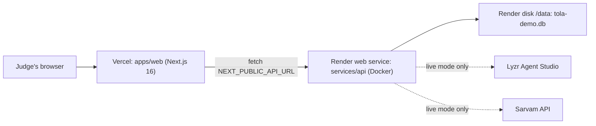

# Deployment (demo build)
> Project: Tola · Owner: Tech lead (demo track) · Status: Draft v0.1 · Last updated: 2026-10-20
> Related: [README](../README.md) · [Environment setup](./ENVIRONMENT_SETUP.md) · [Demo spec §9](./DEMO_SPEC.md#9-failure-fallbacks) · [docker-compose.yml](../docker-compose.yml) · [CI](../../../.github/workflows/demo-ci.yml) · [Scalable deployment](../../scalable/README.md)

The demo has three ways to run, in order of trust on stage:

| Mode | Where | When | Network needed |
|---|---|---|---|
| **Laptop-only stage mode** | `docker compose up` (or two local processes) on the presenting laptop | **The finale (27 Dec 2026, Bangalore Palace)** and any venue with doubtful Wi-Fi | none |
| One VM | Docker Compose on any small VM | Shared rehearsal URL for the team | yes |
| Vercel + Render | Web on Vercel, API on Render | Public link for the prototype-round submission and for judges to try later | yes |

## 1. Vercel (web) + Render (API)

**Vercel**
- Root directory: `implementation/demo/apps/web`. Framework preset: Next.js. Install: `npm ci`. Build: `npm run build`.
- Env: `NEXT_PUBLIC_API_URL=https://<render-service>.onrender.com`, `NEXT_PUBLIC_DEMO_MODE=1`.
- Ignore build step: `git diff --quiet HEAD^ HEAD -- implementation/demo/` (skips unrelated commits).

**Render**
- New Web Service → Docker. Dockerfile path `implementation/demo/services/api/Dockerfile`, Docker context `implementation/demo`.
- Env: `DATABASE_URL=sqlite:////data/tola-demo.db`, `AI_FALLBACK_MODE=live` (or `cached`), the Lyzr and Sarvam keys, `TOLA_SERVER_SIGNING_KEY` (generate once and store it as a secret), `TOLA_UPI_VPA`, `TOLA_UPI_PAYEE_NAME`.
- Health check path: `/v1/health`.
- Persistent disk at `/data` needs a paid instance. On the free tier the filesystem is ephemeral and the service sleeps when idle (plan details not verified 2026-10-20). That is acceptable here, because the container re-seeds on start (`tola-seed --if-empty`) and the demo is resettable anyway.
- Cold start: hit `/v1/health` 10 minutes before any live showing (`scripts/stage-check.sh <url>`).
- CORS: the API allows `http://localhost:3000` and the Vercel production origin, set in `config.py`.

Cost: ₹0 on the Vercel Hobby and Render free tiers for a hackathon (HUNCH; check the plan limits before the prototype round). A Render starter instance with a disk is the upgrade if cold starts hurt (price not verified 2026-10-20).

## 2. One VM with Docker Compose
Any Linux VM with 1 vCPU / 1 GB RAM is enough.
```bash
git clone <repo> && cd <repo>/implementation/demo
cp .env.example .env    # set NEXT_PUBLIC_API_URL=http://<vm-ip>:8000 before building
docker compose up -d --build
docker compose logs -f api
```
- Ports: web 3000, api 8000 (fixed by the brief). Put Caddy or nginx in front for HTTPS if you want the phone mirror's microphone over the internet.
- `NEXT_PUBLIC_*` values are baked into the web image at build time. Rebuild the web image after you change them.
- Data lives in the `tola-data` volume. `curl -X POST http://<vm>:8000/v1/demo/reset` restores the story.

## 3. CI to deploy
CI ([demo-ci.yml](../../../.github/workflows/demo-ci.yml)) only tests. Vercel and Render deploy from `main` through their Git integrations, so only commits that passed CI should be merged to `main` (protect the branch and require `demo-ci`). Feature branches follow `demo/TOLA-xxx-slug`, and Vercel gives each PR a preview URL.

## 4. Laptop-only stage mode (offline)
This is the default for the finale.
1. **The day before, online:** `docker compose build` (or `npm ci && npm run build` plus `uv sync`). Bake caches if any seed text changed (`scripts/bake_audio.py`, `scripts/bake_ai_cache.py`) and commit them.
2. **Set** `.env`: `AI_FALLBACK_MODE=cached`, `NEXT_PUBLIC_API_URL=http://localhost:8000`.
3. **At the venue**, with Wi-Fi off: `docker compose up`. Alternative without Docker: `tola-seed --reset && uvicorn tola_api.main:app --port 8000` and `npm run start` in `apps/web`.
4. Open `http://localhost:3000/stage`, F11, **Shift+R**.
5. Optional phone mirror: start a laptop hotspot and connect the Android phone to it. The phone opens `http://<laptop-hotspot-ip>:3000/karigar?as=rafiq`. Build with that `NEXT_PUBLIC_API_URL`, or run the dev server bound to 0.0.0.0 ([ENVIRONMENT_SETUP §6](./ENVIRONMENT_SETUP.md#6-optional-extras)).
6. Backup: a second laptop with the same build, and a 3-minute screen recording of a clean run (MP4 on a USB stick) as the last resort.

`scripts/stage-check.sh` (owner: tech lead, due 25 Nov 2026) checks: API health, reset time ≤ 1 s, presence of the `seed/audio` files, no external hosts in the page's network log (via a headless Playwright run), and battery/power plugged in (prints a reminder).

## 5. Rollback
- Vercel: "Promote previous deployment" (instant).
- Render: redeploy the previous image from the dashboard.
- Laptop: `git checkout <last-good-tag>` and rebuild. Tag every rehearsal-approved commit as `demo-rehearsal-YYYYMMDD`.

## 6. MVP (hackathon) vs v1 (production)
| Area | MVP (this build) | v1 ([scalable](../../scalable/README.md)) |
|---|---|---|
| Hosting | Vercel + Render free tiers, or one VM, or a laptop | GCP asia-south1: Cloud Run, Cloud SQL, Cloud Storage, Secret Manager; Terraform |
| Data residency | Not applicable (synthetic data only) | India region (DPDP) |
| Secrets | `.env` file / platform env | Secret Manager |
| Deploy pipeline | Git integrations | `scalable-deploy.yml` |
