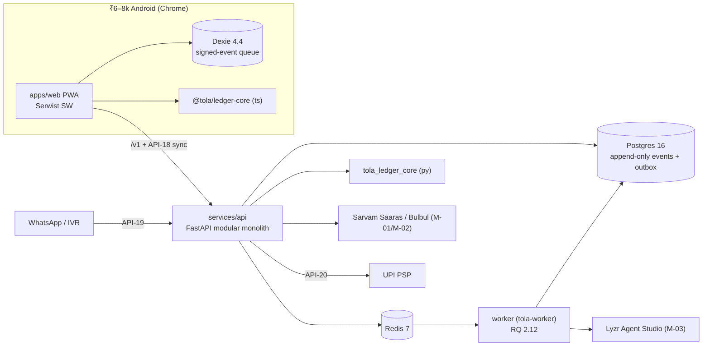

# Tola · Scalable build (v1 production path)
> Project: Tola · Owner: Tech lead (scalable track) · Status: Draft v0.1 · Last updated: 2026-10-20
> Related: [Project brief](../../docs/00-overview/PROJECT_BRIEF.md) · [PRD](../../docs/01-product/PRD.md) · [Architecture](../../docs/03-engineering/ARCHITECTURE.md) · [OpenAPI](../../api/openapi.yaml) · [Demo build](../demo/README.md) · [CLAUDE.md](CLAUDE.md)

**Two signatures on every gram.** This folder is the **production path** for Tola. It is a gold job-work ledger that jeweller and karigar both sign, built to run on a ₹6–8k Android phone with patchy 3G, plus WhatsApp/IVR for karigars without the app.

---

## 1. What this track is, and how it differs from the demo

| | `implementation/demo` · MVP (hackathon) | `implementation/scalable` · v1 (production), **this folder** |
|---|---|---|
| Goal | A smooth 3-minute stage walkthrough | Real shops, real karigars, real money movement through a PSP |
| Auth | **None**. Role switcher (Jeweller · Karigar · Lender) and story mode | **Phone OTP** (API-17), per-device Ed25519 keys protected by a PIN, RBAC + ABAC |
| Data | SQLite file, seeded | **PostgreSQL 16** (Cloud SQL), Alembic migrations, row-level security |
| Connectivity | Online only (F-11 is out of scope) | **Offline-first PWA**: Dexie 4.4 queue of signed events, sync via API-18 |
| Jobs | Button-triggered ("run week") | Worker on **Cloud Tasks** (prod) and **RQ 2.12 + Redis 7** (local, fan-out): weekly reconcile, reminders, outbox relay, nightly chain verification |
| Karigar channel | Simulated phone frame | **WhatsApp Cloud API + IVR** (API-19) |
| Payments | `upi://pay` intent + QR, labelled "simulated" | PSP intent/collect + status webhook (API-20) |
| Languages | UI en/hi/kn/bn; voice bn/hi/kn | + mr, ta |
| Hosting | Vercel + Render, or one Compose | **GCP asia-south1 (Mumbai)**: Cloud Run (web, api, worker), Cloud SQL, Cloud Storage, Secret Manager, Terraform |
| CI | `demo-ci.yml` | `scalable-ci.yml`, `scalable-deploy.yml`, `evals.yml` |

**What is shared.** Both tracks share:
- the API contract [`api/openapi.yaml`](../../api/openapi.yaml);
- the IDs in the [project brief](../../docs/00-overview/PROJECT_BRIEF.md);
- the ledger rules: integer milligrams, Ed25519 dual signatures, SHA-256 chain;
- the rule that **AI never does gram arithmetic**.

The demo implements the ✓ subset of the API. This track implements all of it except API-02, which is demo only and returns `404` here.

## 2. Monorepo layout

```
implementation/scalable/
├─ apps/
│  └─ web/                    Next.js 16.4 PWA (App Router): jeweller, staff, karigar, passport views
├─ services/
│  ├─ api/                    FastAPI 0.153 modular monolith (package tola_api), Alembic migrations, seed
│  └─ worker/                 Deployment unit for background jobs: Dockerfile + config.
│                             Runs `tola-worker` from the tola_api package (same code, different entrypoint)
├─ packages/
│  ├─ ui/                     @tola/ui: HeroUI v3.2 + Tailwind 4.3 + Motion 14.4 components, Sarvam/Vakyam tokens
│  └─ ledger-core/
│     ├─ ts/                  @tola/ledger-core: canonical encoding, hashing, signing, balances (client, offline)
│     └─ py/                  tola_ledger_core: the same maths on the server (source of truth)
├─ ai/
│  ├─ agents/                 Lyzr agent definitions: Manager, IntakeAgent, ReconcileAgent, SettleAgent (M-03)
│  ├─ prompts/                versioned prompt templates (see docs/04-ai/PROMPTS.md)
│  └─ evals/                  eval datasets (synthetic) + runners used by evals.yml
├─ infra/
│  ├─ docker/                 docker-compose.yml: postgres:16, redis:7, migrate, api, worker, web
│  └─ terraform/              GCP asia-south1: Cloud Run ×3, Cloud SQL, GCS, Secret Manager, Cloud Scheduler
├─ scripts/                   dev helpers (key generation, chain verify, fixture refresh)
├─ tests/                     cross-cutting tests: e2e (Playwright), load (k6), security,
│                             vectors/chain_v1.json (golden vectors both ledger-core builds must pass)
├─ docs/                      engineering practice for this track (below)
├─ package.json               pnpm workspace root (pnpm 12)
├─ pnpm-workspace.yaml
└─ .env.example               every env var, commented
```

Ports are fixed: **web 3000**, **api 8000**, Postgres 5432, Redis 6379.



## 3. Quick start

Prerequisites: Node 22 LTS, pnpm 12 (through Corepack), Python 3.12, uv 0.13, Docker 29+ with Compose v2, Git. Per-OS steps are in [ENVIRONMENT_SETUP.md](docs/ENVIRONMENT_SETUP.md).

```bash
cd implementation/scalable
cp .env.example .env                 # defaults work offline: AI_FALLBACK_MODE=cached, OTP_DELIVERY=console
corepack enable && pnpm install      # JS workspace
uv sync --directory services/api     # Python API + worker + ledger-core (editable)
pnpm infra:up                        # postgres:16 + redis:7
pnpm db:migrate                      # Alembic upgrade head
pnpm seed                            # synthetic shops, karigars, one week of events (no real PII)
pnpm api:dev                         # http://localhost:8000/v1/health
pnpm worker:dev                      # second terminal
pnpm dev                             # third terminal: http://localhost:3000
```

**Logging in locally.**
- Use any seeded phone number printed by `pnpm seed`.
- The OTP appears in the API log, because `OTP_DELIVERY=console` is the local default. The API refuses that setting when `TOLA_ENV=prod`.

**Full stack in containers:** `pnpm stack:up` (Compose profile `app`).

**Status.** The Dockerfiles that Compose references do not exist yet. They are part of backlog epic "Scalable skeleton". Owner: back-end lead. Due: 2027-01-15. Until they land, run the app processes on the host as shown above.

## 4. Docs for this track

| Doc | What it covers |
|---|---|
| [FRONTEND.md](docs/FRONTEND.md) | Offline-first PWA, Dexie queue of signed events, service worker, key storage, routing (incl. OTP), i18n, perf budget |
| [BACKEND.md](docs/BACKEND.md) | Modules, RBAC/ABAC, idempotent sync, outbox, jobs, validation, error model |
| [CODING_STANDARDS.md](docs/CODING_STANDARDS.md) | TS/Python style, lint configs, logging with PII redaction, review checklist |
| [GIT_WORKFLOW.md](docs/GIT_WORKFLOW.md) | Trunk-based, Conventional Commits, path-scoped PRs, semver tags |
| [TESTING.md](docs/TESTING.md) | Pyramid, Hypothesis property tests, Schemathesis, Playwright, k6, security |
| [PERFORMANCE.md](docs/PERFORMANCE.md) | SLOs, 2G/3G targets, low-end device budget, load plan |
| [ENVIRONMENT_SETUP.md](docs/ENVIRONMENT_SETUP.md) | Windows/macOS/Linux setup, Compose, seed, troubleshooting |
| [CLAUDE.md](CLAUDE.md) | Rules for AI coding agents working in this folder |

Common docs live in [`docs/`](../../docs/): architecture, data model, API spec, security, privacy, CI/CD and runbook.
