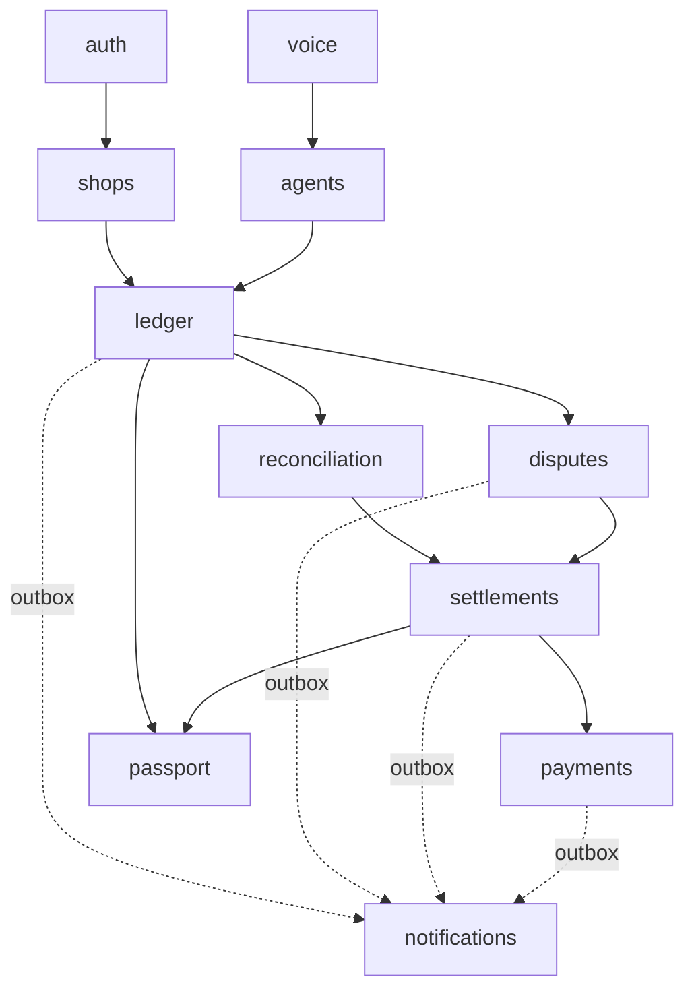

# Backend · Scalable track
> Project: Tola · Owner: Back-end + crypto lead · Status: Draft v0.1 · Last updated: 2026-10-20
> Related: [README](../README.md) · [Architecture](../../../docs/03-engineering/ARCHITECTURE.md) · [Data model](../../../docs/03-engineering/DATA_MODEL.md) · [API spec](../../../docs/03-engineering/API_SPEC.md) · [OpenAPI](../../../api/openapi.yaml) · [Security architecture](../../../docs/06-security-compliance/SECURITY_ARCHITECTURE.md) · [Frontend](FRONTEND.md) · [Testing](TESTING.md)

This doc covers `services/api` (package `tola_api`) and the worker in **v1 (production)**.

The **MVP (hackathon)** back end is in `implementation/demo/services/api`. It uses FastAPI + SQLite with no auth, inline jobs and the same ledger maths.

---

## 1. Service layout: a modular monolith
There is one deployable codebase with three runtime roles. Each runs on Cloud Run in asia-south1.

| Role | Entrypoint | Scaling (v1 start) |
|---|---|---|
| `api` | `uvicorn tola_api.main:app` on port 8000 | min 1 / max 40, 2 vCPU / 1 GiB, concurrency 40 ([ARCHITECTURE §7.2](../../../docs/03-engineering/ARCHITECTURE.md#72-v1-production-gcp-asia-south1)) |
| `worker` | `tola-worker --queues high,default,low --with-scheduler` | min 0 / max 10 |
| `migrate` | `alembic upgrade head` (Cloud Run job, run on each deploy) | one-shot |

**Why a monolith.**
- At pilot scale (≤ 50 shops) and year-1 scale (2,000 shops / 15,000 karigars, see [PERFORMANCE.md](PERFORMANCE.md)), one Postgres plus one codebase is cheaper and simpler.
- It is also safer for a ledger that needs transactional integrity.
- Module boundaries are enforced in code, so any module can be extracted later. `reconciliation` and `voice` are the likely candidates.

```
services/api/src/tola_api/
├─ main.py                 app factory, middleware (request id, OTel, CORS, problem+json handlers)
├─ core/                   config (pydantic-settings), db (async engine, RLS session), authz, errors,
│                          idempotency, outbox, logging (structlog + redaction), clock, ids (UUIDv7)
├─ auth/  shops/  ledger/  voice/  agents/  reconciliation/  disputes/
├─ settlements/  payments/  passport/  notifications/
│   └─ each: router.py · service.py (public) · repo.py · models.py · schemas.py · jobs.py · tests/
├─ worker/main.py          RQ worker + scheduler bootstrap
├─ scripts/seed.py         synthetic seed (Faker en_IN/hi_IN), never real PII
└─ migrations/             Alembic env + versions
```

**Boundary rules.**
- A module may import another module's `service` only. It may not import that module's `repo`, `models` or `router`.
- This is enforced by `import-linter` contracts in CI (version not verified 2026-10-20; owner: back-end lead; due 2027-01-15).

## 2. Modules


| Module | Owns (entities) | Endpoints | Key rules |
|---|---|---|---|
| **auth** | Person (E-02) + `person_keys`, sessions, `otp_challenges` | API-17 | OTP: 6 digits, 5 min TTL, 3 verify attempts, 3 sends per 15 min per phone, 10 per hour per IP. `device_public_key` registered on verify; **proposed addition:** a proof-of-possession signature over `challenge_id` (field `device_key_proof`, not yet in `api/openapi.yaml`). JWT access 15 min, rotating refresh 30 days with reuse detection. |
| **shops** | Shop (E-01), KarigarProfile (E-03) + `shop_karigar_links` (the **pair**), memberships, WastageNorm (E-05), Order (E-04) | API-03, API-04, API-21 | A norm is versioned in basis points (`norm_bps`, e.g. 250 = 2.50% of gross issued) and both parties sign it (API-21) before it is used. A new norm never rewrites past events. |
| **ledger** | LedgerEvent (E-06), Signature (E-07), ScaleReading (E-08), per-pair chain head | API-05, API-06, API-07, API-08, API-18 | **The only writer of events.** It recomputes `body_hash` and `fine_mg` with `tola_ledger_core`, verifies Ed25519 signatures (PyNaCl 1.6), assigns `seq`/`prev_hash`/`hash` under a per-pair lock and adds the server **witness** signature (`TOLA_SERVER_SIGNING_KEY`). Append-only, enforced by a DB trigger. Status moves `pending_signatures` → `committed` once both party signatures are valid. |
| **voice** | VoiceNote (E-09), TTS cache | API-09, API-10 | Sarvam Saaras `saaras:v3` (M-01) and Bulbul v3 (M-02). Audio is stored in GCS asia-south1. Transcripts count as PII. `AI_FALLBACK_MODE` decides between live, cached and off. |
| **agents** | AgentRun (input, output, model, fallback mode, latency, cost) | internal only | Lyzr `Manager` → `IntakeAgent` / `ReconcileAgent` / `SettleAgent` (M-03). Outputs are **drafts** with a mandatory human gate. Numbers in agent output are discarded and replaced by `ledger-core` values. |
| **reconciliation** | ReconciliationRun, VarianceFlag (E-10) | API-11 | Deterministic: balance and variance against the norm come from `ledger-core`. Robust z-score over the karigar's own history (M-05). The agent only explains. |
| **disputes** | Dispute (E-11) + messages | API-12 | A disputed line stays visible and is never overwritten. Resolution creates a `DISPUTE_RESOLVE` event (plus an `ADJUSTMENT` if needed) that needs both signatures. |
| **settlements** | Settlement (E-12) | API-13, API-16 | The statement is computed by `ledger-core`. It is approved when **both** parties sign the statement hash. It is blocked while a dispute in its period is open. The GST Rule 55 challan and 5% labour invoice are produced as **drafts** only. |
| **payments** | PaymentIntent (E-13) | API-14, API-20 | Only created after dual approval. PSP intent/collect. The webhook signature is verified, and webhooks are idempotent on the PSP event id. Tola never holds funds. |
| **passport** | PassportShare (E-14) | API-15 | The karigar creates and revokes shares: scope, recipient label, expiry ≤ 30 days. Tokens are 128-bit random and stored hashed. Views are logged. **No score** (R-06). |
| **notifications** | NotificationLog, channel prefs | API-19 (inbound) | WhatsApp Cloud API templates, IVR, SMS fallback. Inbound "haan/na" maps to a signature with the karigar's **custodial key** (`person_keys.key_label = custodial`, KMS-held), which only unlocks with his PIN (F-12). |

## 3. Ledger write path
```mermaid
sequenceDiagram
  autonumber
  participant C as Client (PWA / WhatsApp adapter)
  participant R as ledger.router
  participant S as ledger.service
  participant LC as tola_ledger_core
  participant DB as Postgres 16
  C->>R: POST /v1/events or /v1/sync (Idempotency-Key)
  R->>S: validated DTO (Pydantic strict)
  S->>S: authz.require(person, "event:create", pair)
  S->>LC: body_hash = SHA-256(JCS(body)); recompute fine_mg; verify sigs over sign_msg(pair_id, body_hash)
  alt units / fine_mg / signature invalid
    S-->>R: 400 FINE_MG_MISMATCH | WEIGHT_NOT_FROM_SCALE | BAD_SIGNATURE
  else ok
    S->>DB: BEGIN; SELECT head_seq, head_hash FROM shop_karigar_links WHERE id=pair FOR UPDATE
    S->>LC: seq = head_seq+1; hash = SHA-256("tola:v1:chain:" ‖ head_hash ‖ u64be(seq) ‖ body_hash); witness
    S->>LC: double-count / stale-norm / clock-skew checks → warnings[]
    S->>DB: INSERT ledger_events, signatures; UPDATE pair head; INSERT outbox_jobs(event.appended)
    S->>DB: COMMIT
    S-->>R: 201 {event, seq, hash, status, warnings}
  end
```

**Immutability.** The migration creates this trigger:
```sql
CREATE FUNCTION tola_forbid_mutation() RETURNS trigger LANGUAGE plpgsql AS $$
BEGIN
  RAISE EXCEPTION 'ledger is append-only (table %, op %)', TG_TABLE_NAME, TG_OP
    USING ERRCODE = 'P0001';
END $$;
CREATE TRIGGER ledger_events_immutable BEFORE UPDATE OR DELETE ON ledger_events
  FOR EACH ROW EXECUTE FUNCTION tola_forbid_mutation();
CREATE TRIGGER signatures_immutable BEFORE UPDATE OR DELETE ON signatures
  FOR EACH ROW EXECUTE FUNCTION tola_forbid_mutation();
```

**Ownership, witness and checkpoints.**
- The app's DB role (`tola_app`) does not own these tables, so it cannot drop the trigger.
- Every appended event carries the server **witness** signature over `hash ‖ server_received_ms` ([ARCHITECTURE §9.2](../../../docs/03-engineering/ARCHITECTURE.md#92-hashes-and-signatures)).
- Every `SETTLEMENT` body includes `chain_head_hash` and `chain_head_seq`, and **both parties sign it**. That is the checkpoint a server cannot later rewrite.
- The nightly `ledger.verify_all_chains` job re-runs the verification algorithm on every pair.

## 4. Authorisation: RBAC + ABAC
**Roles (RBAC)** are scoped per shop membership. A person can hold different roles in different shops.

| Role | Scope | Typical persona |
|---|---|---|
| `shop_owner` | one shop | P-01 |
| `shop_staff` | one shop | P-03 |
| `karigar` | self, across **all** his shops | P-02 |
| `head_karigar` | self + delegated helpers (v1.1) | P-05 |
| `lender_viewer` | no account; holds a passport token only | P-04 |
| `platform_support` | break-glass, read-only metadata, every access audited | Tola ops |

**Attribute rules (ABAC)**, evaluated in `core/authz.py`. Each module's `service` calls them.

| Action | Allowed when |
|---|---|
| `ledger:read` | (`role ∈ {shop_owner, shop_staff}` **and** `event.shop_id ∈ memberships`) **or** (`event.karigar_id == me`). A karigar always sees his full account in every shop (PS 2.2 boundary). |
| `event:create` (ISSUE / RETURN / SCRAP_RETURN / DUST_CREDIT) | shop_owner or shop_staff of that shop, **and** an active shop–karigar link |
| `event:sign` | `signer == me` **and** I am a party to the event (the shop side by membership, the karigar side by identity) **and** the key is mine and not revoked |
| `norm:propose` / `norm:sign` | shop_owner proposes; both the shop_owner and the karigar sign |
| `dispute:open` / `dispute:message` | either party to the referenced event |
| `dispute:resolve` | both parties sign the resolution |
| `settlement:draft` | shop_owner, or the karigar (either side can start one) |
| `settlement:approve` | each party once; staff cannot approve for the owner |
| `payment:create` | shop_owner, only when `settlement.status == dual_approved` |
| `passport:share` / `passport:revoke` | `karigar == me` only. The jeweller can never share a karigar's passport. |
| `passport:view` | valid token hash, not expired, not revoked, within its rate limit. Read-only, scoped fields only. |
| `support:read` | `platform_support`, with a ticket id. Metadata only; PII fields are masked. |

**Defence in depth with Postgres RLS.** Each request sets `SET LOCAL app.person_id = '<uuid>'` and `app.shop_ids = '{…}'`.
```sql
ALTER TABLE ledger_events ENABLE ROW LEVEL SECURITY;
CREATE POLICY ledger_read ON ledger_events FOR SELECT USING (
  karigar_id = current_setting('app.person_id')::uuid
  OR shop_id = ANY (current_setting('app.shop_ids')::uuid[])
);
```
The worker uses a separate role (`tola_worker`) with `BYPASSRLS` and only the grants it needs. Every bypass read is logged with the job id.

**Authorisation tests.** The matrix in [TESTING.md §7](TESTING.md#7-security-tests) generates one test per (role × action × own/other shop). Any IDOR fails CI.

## 5. Idempotency and offline sync (API-18)
**Header idempotency** applies to every mutating endpoint.
- Clients send `Idempotency-Key` (≤ 128 chars).
- The server stores `(key, route) → {request_sha256, response_hash, status_code, response_body, created_at}` in the Postgres table `idempotency_keys` ([DATA_MODEL §4](../../../docs/03-engineering/DATA_MODEL.md)) for 24 h. Keys are namespaced by person (`<person_id>:<key>`). Redis is not used here: it must survive a Redis flush.
- Same key + same body → replay the stored response with header `Idempotent-Replay: true`.
- Same key + different body → `422 IDEMPOTENCY_REPLAY_MISMATCH` (API_SPEC).
- A concurrent duplicate → `409 IDEMPOTENCY_IN_FLIGHT` (proposed code), guarded by a `pg_advisory_xact_lock(hashtext(key))`.

**Natural idempotency** applies to events. `event_id` is a client-generated UUIDv7 and the primary key.
- A re-sent event with the same `event_id` and the same `body_hash` returns `duplicate`, with its original `seq` and `hash`.
- The same `event_id` with a different `body_hash` returns `rejected` and raises a security alert, because it indicates tampering.

**Sync contract** (shape from [API_SPEC](../../../docs/03-engineering/API_SPEC.md); `api/openapi.yaml` is authoritative):
```json
// POST /v1/sync  (Idempotency-Key: sync-<deviceId>-<firstEventId>-<lastEventId>)  ≤ 200 items
{ "device_id": "dev_01J…",
  "items": [ { "kind": "event",
               "body": { "v": 1, "event_id": "0192…", "pair_id": "…p1", "type": "ISSUE",
                         "weight_mg": 40000, "fineness_ppt": 916, "fine_mg": 36640, "reading_ids": ["…"], "…": "…" },
               "signatures": [ { "signer_id": "…", "role": "jeweller", "public_key": "…", "sig": "…" } ] } ],
  "last_known_heads": { "…p1": 7 } }
// 200
{ "results": [ { "event_id": "0192…", "status": "appended", "seq": 8, "hash": "…", "warnings": ["POSSIBLE_DOUBLE_COUNT"] },
               { "event_id": "0193…", "status": "rejected", "problem": { "code": "BAD_SIGNATURE" } } ],
  "server_events": [ "…events by the other party since last_known_heads…" ] }
```
- Items are appended in the order received. **Chain order is the server's arrival order.** This is safe because the parties sign the content, not the position ([ARCHITECTURE §10](../../../docs/03-engineering/ARCHITECTURE.md#10-offline-and-sync-strategy-v1-only-f-11)).
- Statuses are `appended`, `duplicate` and `rejected` (`duplicate` and `rejected` are proposed values; the API_SPEC example shows only `appended`).
- A rejected item does not block later items. Warnings (`POSSIBLE_DOUBLE_COUNT`, `NORM_STALE`, `CLOCK_SKEW`) never block; they create a review card for both parties.
- The response is always `200` with per-item results. A whole-batch `4xx` happens only for auth, schema or size errors.

## 6. Outbox pattern
Side effects never happen inside the request: notifications, WhatsApp messages, PSP calls, agent runs and passport cache invalidation.

```sql
CREATE TABLE outbox_jobs (
  id            uuid PRIMARY KEY,               -- UUIDv7
  topic         text NOT NULL,                  -- e.g. 'event.created', 'settlement.dual_approved'
  aggregate_id  uuid NOT NULL,
  payload       jsonb NOT NULL,                 -- IDs only; no PII
  created_at    timestamptz NOT NULL DEFAULT now(),
  published_at  timestamptz,
  attempts      int NOT NULL DEFAULT 0,
  last_error    text
);
CREATE INDEX outbox_jobs_unpublished ON outbox_jobs (created_at) WHERE published_at IS NULL;
```

**Relay.**
- `outbox.relay` runs every 2 s in the worker, plus `LISTEN tola_outbox` for low latency.
- It selects `… WHERE published_at IS NULL ORDER BY created_at LIMIT 100 FOR UPDATE SKIP LOCKED`, dispatches each row, then sets `published_at`.
- **Dispatch target depends on the job backend**, chosen by `TOLA_JOB_BACKEND` (proposed env var):
  - `cloudtasks` in prod: the Cloud Tasks queues `notify`, `webhooks` and `ai` ([ARCHITECTURE §7.2](../../../docs/03-engineering/ARCHITECTURE.md#72-v1-production-gcp-asia-south1)). The task name is `outbox.id`, so duplicates are dropped.
  - `rq` locally and in Compose: RQ jobs with `job_id = outbox.id`.
- Delivery is at-least-once. Consumers are idempotent on `outbox.id`.

**Housekeeping.** Published rows are kept for 7 days, then deleted. The outbox is not ledger data.

## 7. Background jobs (Cloud Tasks in prod; RQ 2.12 + Redis 7 locally and for worker fan-out)
- In prod, **Cloud Scheduler** triggers cron jobs through an authenticated internal endpoint that only enqueues work. Cloud Tasks pushes each job to the worker service.
- The weekly-run fan-out to per-karigar sub-jobs uses RQ on Memorystore Redis 7, so the worker can rate-limit Lyzr calls itself.
- Locally, `tola-worker --with-scheduler` runs the same schedule from `worker/schedule.py`, with everything on RQ.
- Times below are IST (Asia/Kolkata).

| Job | Queue | Schedule / trigger | What it does | Limits |
|---|---|---|---|---|
| `reconciliation.weekly_run` | default | Per shop: weekly, default **Monday 07:00**; the shop can change it (some markets close on a different weekday) | Fans out one sub-job per karigar → `ledger-core` balance and variance → flags (E-10) → `ReconcileAgent` explanation (draft) → outbox `reconciliation.completed` | PRD: 1,000 karigars ≤ 10 min. Timeout 120 s per karigar; 3 retries |
| `notifications.reminders` | low | Hourly 08:00–20:00 | Pending counter-signature > 24 h; settlement awaiting approval > 48 h; order due ≤ 7 days with no RETURN (F-10). Quiet hours 21:00–08:00 | ≤ 1 reminder per item per 24 h |
| `notifications.send` | high | Outbox | WhatsApp template → IVR → SMS fallback chain | 5 retries, exponential backoff |
| `outbox.relay` | high | Every 2 s + LISTEN | §6 | — |
| `ledger.verify_all_chains` | low | Nightly 02:30 | Run the ARCHITECTURE §9.3 verification on every pair, including witnesses and settlement checkpoints. Alert on any problem (FM-07: the pair becomes read-only) (Sev-1, see [RUNBOOK](RUNBOOK.md)) | — |
| `agents.intake` | high | After API-10 upload | Sarvam STT → IntakeAgent → draft event fields for human confirmation | p95 ≤ 6 s end to end |
| `payments.reconcile_psp` | default | Every 15 min | Poll the PSP for intents stuck in `created` > 30 min | — |
| `passport.expire_shares` | low | Hourly | Mark expired shares; purge cached views | — |
| `voice.retention_purge` | low | Daily 03:00 | Delete raw audio after its retention period (see [PRIVACY](../../../docs/06-security-compliance/PRIVACY.md)); transcripts follow the same policy | — |
| `idempotency.purge` | low | Daily 03:30 | Delete expired idempotency keys | — |

Failed jobs go to the RQ `FailedJobRegistry`. An alert fires when there are more than 20 failures in 15 minutes ([OBSERVABILITY](OBSERVABILITY.md)).

## 8. Error model
All errors are **RFC 9457** `application/problem+json`:
```json
{
  "type": "https://docs.tola.app/errors/open-dispute",
  "title": "Settle the open dispute first",
  "status": 409,
  "code": "OPEN_DISPUTE",
  "detail": "Dispute …d3 on pair …p1 is open for this period",
  "instance": "/v1/settlements/…s1/approve",
  "requestId": "01JB…",
  "i18nKey": "errors.settlement.openDispute"
}
```
- Codes follow [API_SPEC §1](../../../docs/03-engineering/API_SPEC.md) (`UPPER_SNAKE`). Codes marked *proposed* are not yet in `api/openapi.yaml` and must be added in a `contract/…` PR first.
- **No PII in errors.** `detail` is meant for developers. The client shows `i18nKey` in the user's language.
- The `docs.tola.app` domain in `type` is a placeholder (not verified 2026-10-20). The error catalogue is generated into `api/openapi.yaml` components.

| Code | HTTP | When |
|---|---|---|
| `VALIDATION` | 400 | Schema or field validation (Pydantic), with an `errors[]` array of `{pointer, code}` |
| `FINE_MG_MISMATCH` | 400 | `fine_mg` in the body ≠ `floor(weight_mg × fineness_ppt / 1000)` |
| `WEIGHT_NOT_FROM_SCALE` | 400 | A weight without `reading_ids`, outside the two-person `manual_dual` path |
| `UNITS` *(proposed)* | 400 | Float anywhere in the signed body, `weight_mg ≤ 0` on ISSUE/RETURN, or `fineness_ppt` outside 1–999 |
| `BAD_SIGNATURE` | 400 | Ed25519 verification failed, or the key is unknown or revoked |
| `CHAIN_BROKEN` | 409 | Verification of the pair chain failed (FM-07); the pair is read-only |
| `OPEN_DISPUTE` · `PENDING_EVENTS` | 409 | Settlement approval blocked by an open dispute or an uncommitted event in the period |
| `IDEMPOTENCY_REPLAY_MISMATCH` | 422 | §5 |
| `IDEMPOTENCY_IN_FLIGHT` *(proposed)* | 409 | §5 |
| `OTP_INVALID` · `OTP_EXPIRED` · `OTP_LOCKED` *(proposed)* | 401 · 401 · 429 | API-17 |
| `AUTH_REQUIRED` · `FORBIDDEN` *(proposed)* | 401 · 403 | Missing token; RBAC/ABAC denial. Another shop's resources return **404**, not 403, to avoid enumeration |
| `RATE_LIMITED` *(proposed)* | 429 | Includes `Retry-After` |
| `AI_UNAVAILABLE` *(proposed)* | 503 | Lyzr/Sarvam down **and** `AI_FALLBACK_MODE=off`. With `cached`, the call degrades instead of failing |
| `UPSTREAM_PSP` *(proposed)* | 502 | PSP error; the intent stays `created` |
| `INTERNAL` *(proposed)* | 500 | Unhandled. Logged with `requestId`; never echoes the exception |

## 9. Validation
- **Pydantic 2.14 in strict mode** (`ConfigDict(strict=True, extra="forbid")`). Weights are typed `Mg = Annotated[int, Field(le=100_000_000)]` (≤ 100 kg per event; sign rules per event type) and fineness `FinenessPpt = Annotated[int, Field(ge=1, le=999)]`. A JSON float for `weight_mg` is rejected even if it is integral (`40000.0`).
- **Canonical body.** The signed body is re-canonicalised server-side (RFC 8785 JCS with an integer-only profile) and `body_hash` recomputed. The client's `body_hash` must match.
- **Domain invariants** live in `service.py`:
  - a RETURN cannot exceed the outstanding fine gold for the order plus the norm tolerance; if it does, the event is flagged, not rejected, and a dispute is suggested;
  - a SETTLEMENT period cannot overlap another approved one;
  - a norm must be dual-signed before it is used.
- **Uploads** (API-10, photos). The content type is checked by magic bytes. Limits: audio ≤ 2 MB / 120 s Opus or AAC; photos ≤ 1.5 MB, re-encoded server-side with EXIF stripped.

## 10. Caching and rate limits
| Item | Where | TTL / limit |
|---|---|---|
| Chain head + balance per pair | Postgres pair row (authoritative) + Redis read-through | invalidated on write |
| TTS audio for a read-back phrase | GCS + Redis index keyed by `sha256(text, lang, voice)` | 30 days |
| Passport view | Redis | 5 min, purged on revoke |
| Rate limits (Redis token bucket) | per [API_SPEC §2](../../../docs/03-engineering/API_SPEC.md) catalogue (for example `/v1/sync` 30/min with ≤ 200 items; passport GET 30/min/IP; OTP 3 per 15 min per phone) | `429 RATE_LIMITED` |

## 11. Configuration
All settings come from env vars (see [`.env.example`](../.env.example)) through `pydantic-settings`.

**Startup refuses to boot** when any of these hold:
- `TOLA_ENV=prod` and `OTP_DELIVERY=console`;
- `TOLA_ENV=prod` and `AI_FALLBACK_MODE` is not `live`. Prod may degrade to `cached` per call at runtime, but it must be configured `live`.
- `TOLA_ENV=prod` and `TOLA_SERVER_SIGNING_KEY`, `TOLA_SESSION_SECRET` or `TOLA_PII_HASH_KEY` is empty;
- `NEXT_PUBLIC_DEMO_MODE=true` is detected in the web build of a prod deploy. CI checks this.
