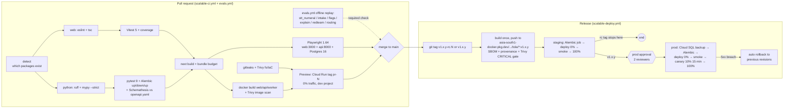
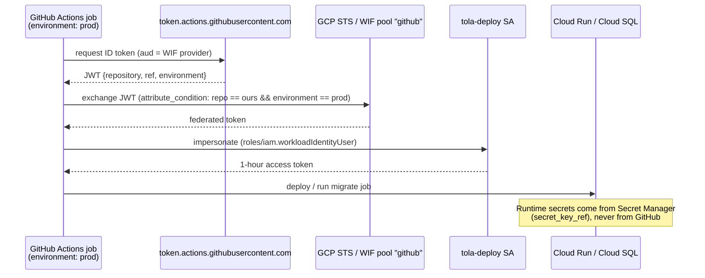

# CI/CD: Scalable Track
> Project: Tola · Owner: DevOps lead · Status: Draft v0.1 · Last updated: 2026-10-20
> Related: [Project Brief](../../../docs/00-overview/PROJECT_BRIEF.md) · [Architecture](../../../docs/03-engineering/ARCHITECTURE.md) · [Infrastructure](INFRASTRUCTURE.md) · [Deployment](DEPLOYMENT.md) · [Observability](OBSERVABILITY.md) · [Runbook](RUNBOOK.md) · [Cost](COST.md) · [Demo build](../../demo/README.md)

This document covers the **v1 (production)** pipeline for `implementation/scalable`. The **MVP (hackathon)** build (`implementation/demo`) has its own `demo-ci.yml` and deploys to Vercel and Render; see the [demo README](../../demo/README.md).

The workflow files are real and live at the repo root:

| Workflow | File | Trigger | Purpose |
|---|---|---|---|
| CI | [`.github/workflows/scalable-ci.yml`](../../../.github/workflows/scalable-ci.yml) | PR or push to `main` touching `implementation/scalable/**` or `api/openapi.yaml` | Lint, typecheck, unit, contract and e2e tests, build, security scan, preview deploy |
| Deploy | [`.github/workflows/scalable-deploy.yml`](../../../.github/workflows/scalable-deploy.yml) | Tag `v*`, or manual dispatch (rollback) | Build and push to Artifact Registry `asia-south1`, run Alembic, canary, promote |
| Evals | [`.github/workflows/evals.yml`](../../../.github/workflows/evals.yml) | PR touching `implementation/scalable/ai/**`, `packages/ledger-core/**`, the demo API or `docs/04-ai/PROMPTS.md`; nightly 02:00 IST; manual | AI quality gate for M-01, M-02, M-03 and M-05 (offline replay on PRs, live nightly) |

All three pass `actionlint` 1.7.12 with no findings (checked 2026-10-20).

---

## 1. Pipeline diagram

## 2. Stages and gates

| # | Stage | Tools (versions checked 2026-10-20) | Blocking gate |
|---|---|---|---|
| 1 | **Lint** | ESLint and `tsc --noEmit` (TypeScript 5.9); Ruff 0.17 (`check` + `format --check`); Mypy 2.4 `--strict` | Any error |
| 2 | **Test** | Vitest 5 (web, `packages/ui`); pytest 9 (`ledger-core`, api, worker) on Postgres 16 and Redis 7 service containers; Alembic 1.20 `upgrade → downgrade base → upgrade → check`; Schemathesis contract tests against [`api/openapi.yaml`](../../../api/openapi.yaml); Playwright 1.64 e2e | Coverage below **85 % for `ledger-core`** (gram arithmetic, hash chain, signatures) or below **75 %** elsewhere; any contract violation; any e2e failure |
| 3 | **Build** | `next build` (Next.js 16.4); Docker Buildx with GHA cache; images `web`, `api`, `worker` from `infra/docker/<svc>.Dockerfile` | Build error; first-load JS above **180 kB gz** on `/karigar` (low-end phone budget) |
| 4 | **Security scan** | gitleaks-action v3 (secrets, full PR history); Trivy 0.36 action (`fs`: deps, secrets, Terraform and Dockerfile misconfig; `image` for each service); SARIF uploaded to GitHub code scanning | Any **CRITICAL or HIGH** fixable vulnerability on a PR; **CRITICAL** at release |
| 5 | **Eval** | `evals.yml` (from [AI_EVALS.md §7](../../../docs/04-ai/AI_EVALS.md)): `python -m tola_evals run` with suites `stt_numeral`, `intake`, `flags`, `explain`, `redteam` and `routing` in replay mode, then `tola_evals gate`; prompt-sync check against [PROMPTS.md](../../../docs/04-ai/PROMPTS.md) | Any metric outside `ai/evals/thresholds.yaml` for the active stage (`mvp` or `v1`) (§5) |
| 6 | **Deploy** | `google-github-actions/auth@v3` (OIDC → Workload Identity), `setup-gcloud@v3`, `deploy-cloudrun@v3`; Alembic as Cloud Run job `tola-migrate` | Smoke test on the `candidate` tag; canary 5xx threshold (prod) |

**Branch protection on `main`:** require `web`, `python`, `e2e`, `security`, `images` and `evals` (when triggered); one review, or two for `packages/ledger-core/**` and `infra/**` via CODEOWNERS; linear history; signed commits.

## 3. Environments

| Env | GCP project (pattern) | Deployed by | Data | Scale | Approval |
|---|---|---|---|---|---|
| `dev` | `tola-dev` | PR preview (tag `pr-<n>`, 0 % traffic) and `main` pushes | Synthetic seed only; **no real karigar data, ever** | Min 0 instances; `db-custom-1-3840` zonal; Redis Basic 1 GB | None (same-repo PRs only; fork PRs never get credentials) |
| `staging` | `tola-staging` | Every `v*` tag, including `-rc.N` | Synthetic seed plus anonymised load fixtures | Like prod but zonal, min 0 | None |
| `prod` | `tola-prod` | Non-rc `v*` tag after staging passes | Real; DPDP scope | See [INFRASTRUCTURE.md](INFRASTRUCTURE.md) §4 | **Two required reviewers** on GitHub environment `prod`; deploy window Mon–Thu 11:00–17:00 IST; freeze in the week of Dhanteras/Diwali and the peak wedding-season fortnights |
| `build` | `tola-artifacts` | `build` job | Images only | — | None |
| `evals-live` | — (GitHub environment only) | `evals.yml` `live` job | DS-02 consented audio (read-only SA), recorded fixtures | — | Required reviewer for manual live runs; Lyzr and Sarvam keys with a spend cap |

Images are **built once and promoted by tag**, so staging and prod run the same digest.

## 4. Secrets handling

There are **no long-lived cloud keys in GitHub.**

- **GitHub environment variables** (not secrets, because they are not sensitive): `GCP_PROJECT_ID`, `GCP_ARTIFACT_PROJECT`, `GCP_WIF_PROVIDER`, `GCP_DEPLOY_SA`, `GCP_BUILD_SA`, `GCP_RUNTIME_SA`, `CLOUDSQL_INSTANCE`, `CLOUDSQL_CONNECTION_NAME`, `LYZR_AGENT_ID_*`. The values come from `terraform output` ([main.tf](../infra/terraform/main.tf)).
- **GitHub secrets** (only in the `evals-live` environment): `LYZR_API_KEY`, `SARVAM_API_KEY` and `LYZR_AGENT_ID_*`, using **separate eval keys** with a monthly cap (₹50/night budget in the workflow, ≈ ₹1,500/month). The optional `GITLEAKS_LICENSE` lives at the org level.
- **Runtime secrets** live only in **Secret Manager** (replica `asia-south1`) and are mounted by Cloud Run: `DATABASE_URL`, `REDIS_URL`, `TOLA_SERVER_SIGNING_KEY`, `LYZR_API_KEY`, `SARVAM_API_KEY`, `OTP_PROVIDER_KEY`, `WHATSAPP_TOKEN`, `IVR_PROVIDER_KEY`, `PSP_KEY_ID`, `PSP_KEY_SECRET`.
- **WIF is scoped per environment:** the provider's `attribute_condition` checks both `repository` and `environment`, so a job in `dev` cannot obtain a prod token.
- **Rotation:**
  - `TOLA_SERVER_SIGNING_KEY` every 180 days. The old public key stays in the verify set forever, because historic signatures must still verify.
  - PSP and WhatsApp tokens every 90 days.
  - The procedure is in [RUNBOOK.md](RUNBOOK.md) §5.8.

## 5. Eval gate contract (`evals.yml`)

The workflow is taken from [AI_EVALS.md §7](../../../docs/04-ai/AI_EVALS.md), which is the source of truth. It has two jobs.

- **`offline` (every matching PR):**
  - checks that prompt files mirror [PROMPTS.md](../../../docs/04-ai/PROMPTS.md) and that their versions were bumped;
  - generates the DS-01 synthetic months (10 seeds × 500 events);
  - runs the suites in **replay** mode, with recorded STT and Lyzr fixtures keyed by input hash. This costs **₹0**, runs deterministically, and works on fork PRs without secrets;
  - gates with `python -m tola_evals gate --stage $EVAL_STAGE`, which exits non-zero below the threshold;
  - comments the summary on the PR.
- **`live` (nightly at 02:00 IST, or manual with `mode=live`):**
  - hits Sarvam and Lyzr under `EVAL_BUDGET_INR=50`;
  - refreshes the replay fixtures;
  - gates on the same thresholds and adds the `perf` suite.

Thresholds live in `implementation/scalable/ai/evals/thresholds.yaml` and are defined in [AI_EVALS.md §5](../../../docs/04-ai/AI_EVALS.md).
- **Stage `mvp`** must pass before the 27 Dec 2026 final. Its hard gates are:
  - `explain.auto_faithfulness = 1.0`;
  - `intake.false_haan_rate ≤ 0.005`;
  - `routing.dispute_recall = 1.0`;
  - `redteam.attack_success_rate = 0`.
- **Stage `v1`** must pass before any pilot shop goes live. It tightens those gates and adds `cost.ai_inr_per_active_karigar_month ≤ 40` (see [COST.md](COST.md)).
- Switch stage with the repo variable `EVAL_STAGE`.

The AI lead owns the harness (`tola_evals` package, `requirements.txt`, `scripts/check_prompt_sync.py`, datasets), due before the prototype round opens on 23 Nov 2026. Until it exists, the job logs a warning and skips, so CI stays green on the skeleton.

## 6. Supply-chain hardening

- Actions are pinned to major tags today (`actions/checkout@v7`, `google-github-actions/auth@v3`, `docker/build-push-action@v7` and so on). **Before the first prod deploy, pin third-party actions to full commit SHAs** (owner: DevOps lead, by 15 Nov 2026), especially `aquasecurity/trivy-action` and `gitleaks/gitleaks-action`. Renovate opens the bump PRs.
- Images carry an **SBOM and SLSA provenance** (`sbom: true`, `provenance: true`). Binary Authorization can require them in v1.1.
- Base images: `python:3.12-slim` and `node:24-alpine`, rebuilt weekly from `main` so OS patches land without waiting for a release.
- The default workflow token is read-only (`permissions: contents: read`). Only `preview` and `evals` get `pull-requests: write`.

## 7. Preview deploys

On a same-repo PR, the `preview` job in `scalable-ci.yml`:
1. builds `web` and `api`;
2. pushes them as `pr-<n>-<sha>`;
3. deploys them to **dev** Cloud Run with `tag: pr-<n>` and `no_traffic: true`;
4. comments the tagged URLs on the PR.

Previews share the dev database. Migrations are not run for previews, so a PR that adds a migration needs the author to run the dev migrate job by hand (`gcloud run jobs execute tola-migrate --region asia-south1 --project tola-dev --wait`), and the migration must be expand-only so other previews keep working. A nightly job removes tags from closed PRs: `gcloud run services update-traffic --remove-tags`.

## 8. Rollback

| Situation | Action | Time to recover |
|---|---|---|
| Canary breach (5xx > 5 in 2 min on `candidate`) | Automatic: the `Automatic rollback on failure` step sends 100 % back to the recorded previous revisions | < 2 min |
| Bad release found after promote | `Actions → scalable-deploy → Run workflow` with `tag=<previous v*>`, `environment=prod`, `skip_migrations=true` | < 10 min |
| Emergency, CI unavailable | `gcloud run services update-traffic tola-api --to-revisions <prev>=100 --region asia-south1` (same for web and worker) | < 3 min |
| Bad migration | Schemas are **expand/contract** (see [DEPLOYMENT.md](DEPLOYMENT.md) §4), so old code runs on the new schema and the DB is not rolled back. If data is damaged, use PITR to a new instance ([RUNBOOK.md](RUNBOOK.md) §6) | RTO 1 h |

The ledger is append-only and hash-chained (F-03). **A rollback never deletes `LedgerEvent` rows.** If a bad release wrote wrong events, the fix is compensating `ADJUSTMENT` events signed by both parties.
