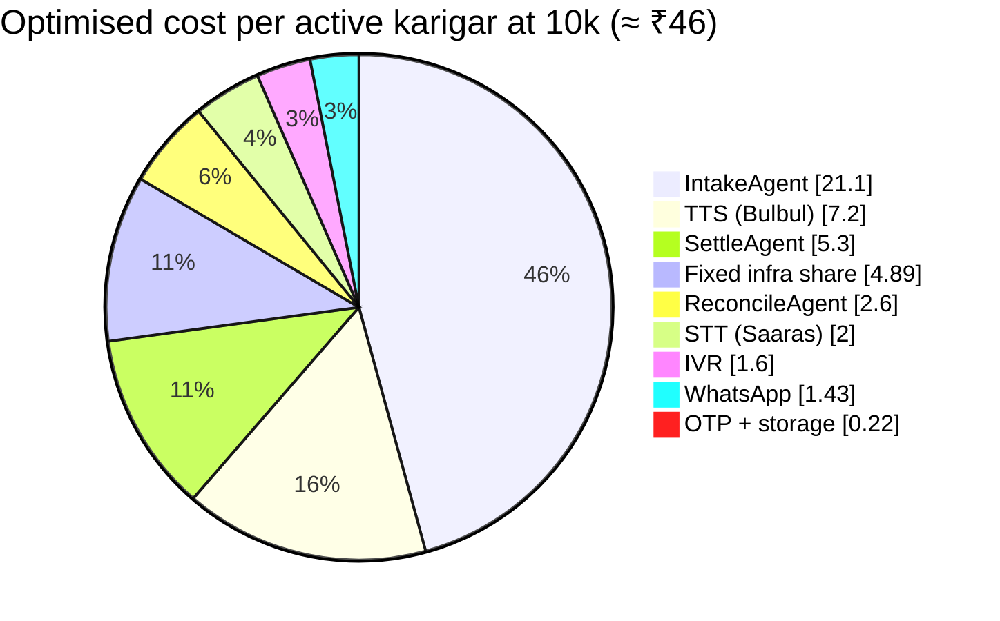

# Cost Model
> Project: Tola · Owner: Founder / DevOps lead · Status: Draft v0.1 · Last updated: 2026-10-20
> Related: [Project Brief](../../../docs/00-overview/PROJECT_BRIEF.md) · [AI models §5.1](../../../docs/04-ai/MODELS.md) · [AI evals](../../../docs/04-ai/AI_EVALS.md) · [Infrastructure](INFRASTRUCTURE.md) · [Observability](OBSERVABILITY.md) · [Business model](../../../docs/07-business/BUSINESS_MODEL.md) · [Financials](../../../docs/07-business/FINANCIALS.md)

**Unit of scale.** A "user" here is an **active karigar**: one who signed at least one ledger event in the last 30 days. That is the unit the jeweller pays for (brief §14, HUNCH ₹49–99/month). Jewellers are about 1 per 8 karigars (persona P-01); their staff and lender usage is folded into the per-karigar figures.

**Labels.**
- **VERIFIED** means the price is from `docs/04-ai/MODELS.md` §2 (fetched 2026-10-20), `research/B-sponsors.md`, or a fetch made today.
- **HUNCH** means an estimate.
- **NOT VERIFIED** means a published price exists but was not confirmed today.

**Exchange rate:** US$1 = ₹88 (HUNCH, same as MODELS.md).

**The AI cost lines are taken unchanged from [MODELS.md §5.1](../../../docs/04-ai/MODELS.md)**, which is the source of truth for AI unit cost. This file adds infrastructure, channels and totals.

**Gate (brief and [AI_EVALS.md](../../../docs/04-ai/AI_EVALS.md) v1 stage):**
- AI cost per active karigar must be **≤ ₹40/month** (`cost.ai_inr_per_active_karigar_month`);
- it is tracked on the AI dashboard ([OBSERVABILITY.md](OBSERVABILITY.md) §4) from `agent_run.cost_inr`.

**MVP (hackathon)** `implementation/demo` costs **≈ ₹0–1,500 in total**:
- Vercel hobby (₹0);
- Render starter on judging days (~US$7/month, NOT VERIFIED);
- Sarvam's ₹100 free credits: about 40 pre-generated read-back clips ≈ ₹20 (MODELS.md §2.1), plus a ₹500 top-up as insurance (HUNCH);
- the Lyzr free build tier plus hackathon credits.

The rest of this document covers **v1 (production)**, `implementation/scalable`.

## 1. Unit prices used

| Item | Price | Status / source |
|---|---|---|
| Sarvam Saaras STT (M-01) | **₹30 per hour**, billed per second (₹45/h with diarization). REST real-time clips are limited to **30 s**; longer audio goes to Batch | VERIFIED (MODELS.md §2.1) |
| Sarvam Bulbul v3 TTS (M-02) | **₹30 per 10,000 characters**; 2,500 chars per request | VERIFIED (MODELS.md §2.1) |
| Sarvam Voice Agents (IVR option) | ₹3.50/min; Indian number ₹59 per 30 days | VERIFIED (B-sponsors [28]); telephony billed separately |
| Lyzr Single Agent run (M-03) | **US$0.06/run** (≈ ₹5.3) SaaS · US$0.03 in customer VPC | VERIFIED (MODELS.md §2.2) |
| Lyzr Manager Agent, 1–4 executed sub-agents | **US$0.18/run** (≈ ₹15.8) SaaS · US$0.09 VPC | VERIFIED |
| Lyzr Manager Agent, 5–8 executed sub-agents | **US$0.36/run** (≈ ₹31.7) SaaS · US$0.18 VPC | VERIFIED |
| LLM tokens via Lyzr (`gpt-4o-mini`) | Pass-through at cost; ≈ ₹0.04/run at ~1,500 in / 300 out tokens | Token price NOT VERIFIED 2026-10-20 (MODELS.md §2.2); negligible next to run fees |
| WhatsApp Business Platform | **Per delivered message** since 1 Jul 2025 (conversation pricing deprecated). 1,000 free service messages per number per month. From **1 Oct 2026**, utility messages inside an open service window are **charged**. Eligible India accounts must move to INR billing by 31 Dec 2026 | Model VERIFIED via WebFetch of developers.facebook.com/docs/whatsapp/pricing on 2026-10-20 |
| WhatsApp India utility / authentication rate | **₹0.13 per message** used below | **NOT VERIFIED**: the India rate card is an interactive table/CSV that could not be fetched. Last known 2025 rate was about ₹0.115 (HUNCH). Owner: Founder to confirm from the Meta INR rate card by 15 Nov 2026 |
| IVR (Exotel-style DTMF IVR, cached prompts) | ₹1.0/min | HUNCH |
| OTP SMS (DLT-registered) | ₹0.20/SMS | HUNCH |
| GCP (Cloud Run, Cloud SQL, Memorystore, LB, NAT, Logging, GCS) in `asia-south1` | See §2 | HUNCH from last-known list prices; re-price with the GCP calculator (owner: DevOps lead, by 30 Nov 2026) |

## 2. Fixed infrastructure per month (prod + non-prod)

| Component | @100 karigars | @10k karigars | @1M karigars |
|---|---|---|---|
| Cloud Run (web, api, worker; api min 1) | ₹1,000 | ₹12,000 | ₹4,50,000 |
| Cloud SQL Postgres 16 (incl. storage and backups) | ₹4,600 (1 vCPU zonal) | ₹19,100 (2 vCPU HA) | ₹2,86,000 (16 vCPU HA + replica, ~2 TB) |
| Memorystore Redis 7 | ₹0 (not deployed; Cloud Tasks only) | ₹6,200 (1 GB HA) | ₹30,000 (5 GB HA) |
| HTTPS LB + Cloud Armor | ₹0 (domain mapping) | ₹3,100 | ₹40,000 |
| Cloud NAT + static IP | ₹1,800 | ₹2,500 | ₹15,000 |
| Logging (400-day CERT-In bucket), Monitoring, Trace | ₹100 | ₹1,000 | ₹1,08,000 |
| Cloud Storage (audio, photos, exports, DR copy) | ₹50 | ₹150 | ₹63,000 (≈60 TB cumulative after year 1, tiered) |
| Artifact Registry, KMS, Secret Manager, Tasks, Scheduler | ₹500 | ₹800 | ₹10,000 |
| dev + staging (scale to zero, small SQL) | ₹2,500 | ₹4,000 | ₹25,000 |
| **Fixed total / month** | **₹10,550** | **₹48,850** | **₹10,27,000** |
| Fixed ₹ per active karigar | ₹105.50 | ₹4.89 | ₹1.03 |

All figures are HUNCH.

## 3. Variable cost per active karigar per month

**AI assumptions** (from MODELS.md §5.1, HUNCH volumes):
- 30 events/month;
- 12 voice notes;
- 30 read-backs of 160 chars, 50 % played.

**Channel assumptions** (this file, HUNCH):
- 60 % of karigars on WhatsApp, 31 msgs/month, plus the jeweller's share;
- 20 % on IVR at 8 min/month;
- 1.5 OTP SMS/month.

| Line | Naïve design | Optimised design (target v1) | How the optimised design gets there |
|---|---|---|---|
| STT 12 × 20 s (Saaras) | ₹4.0 (two passes) | ₹2.0 | One `verbatim` pass only; display text derived from it |
| TTS read-backs (Bulbul) | ₹14.4 | ₹7.2 | Audio synthesised on demand (50 % played); cached by text hash |
| IntakeAgent (single) | 12 × ₹5.3 = ₹63.4 | 4 × ₹5.3 = ₹21.1 | Deterministic numeral parser first; LLM on ≤ 30 % of notes |
| ReconcileAgent (single) | 4 × ₹5.3 = ₹21.1 | ₹2.6 | One run per **shop-week** covering all its karigars (÷ 8) |
| SettleAgent (single) | 2 × ₹5.3 = ₹10.6 | ₹5.3 | Monthly |
| Manager hops | 18 × ₹15.8 ≈ ₹285 | ₹0 | Workers call specialists directly; no Manager on the hot path |
| **AI subtotal** (gate ≤ ₹40) | **≈ ₹398** | **≈ ₹38.2** ✅ | |
| WhatsApp (karigar 60 % × 31 msgs + jeweller share) | ₹2.91 | ₹1.43 | Daily digest; replies inside the 1,000 free service messages per number where possible |
| IVR (20 % × 8 min) | ₹5.60 (Sarvam Voice Agents ₹3.50/min) | ₹1.60 (DTMF ₹1/min) | Voice agent kept for disputes (F-06) only |
| OTP | ₹0.30 | ₹0.17 | 30-day sessions + WhatsApp auth template |
| Media storage growth | ₹0.05 | ₹0.05 | Lifecycle to Nearline/Coldline; audio deleted after 1 year unless disputed |
| **Variable per active karigar** | **≈ ₹407** | **≈ ₹41.5** | |

**Manager hops are 70 % of the naïve cost.** In the optimised design, **Lyzr runs are 70 % of the AI cost** (₹29.0 of ₹38.2). The optimised AI subtotal clears the ₹40 gate by only ₹1.8. Any new agent call on the hot path must therefore come with a matching saving.

## 4. Monthly totals at 100 / 10k / 1M active karigars

| Scale | Jewellers (÷8) | Fixed | Variable (naïve) | Variable (optimised) | **Total (optimised)** | **₹ per active karigar** (naïve → optimised) |
|---|---|---|---|---|---|---|
| **100** | ~13 | ₹10,550 | ₹40,700 | ₹4,150 | **₹14,700** | ₹513 → **₹147** |
| **10k** | ~1,250 | ₹48,850 | ₹40.7 lakh | ₹4.15 lakh | **₹4.63 lakh** | ₹412 → **₹46** |
| **1M** | ~125k | ₹10.27 lakh | ₹40.7 cr | ₹4.15 cr | **₹4.25 cr** | ₹408 → **₹42.5** |
| **1M, Lyzr in customer VPC** (US$0.03/run, VERIFIED rate; needs the enterprise plan, "Production starts at $100K a year") | | ₹10.27 lakh | — | ₹2.70 cr (Lyzr lines halved to ₹14.5) | **₹2.80 cr** | **₹28** |

**Margin check** against the pricing HUNCH of ₹49–99 per active karigar per month, using a ₹79 midpoint:

| Scale | Cost / karigar | Gross margin @ ₹79 | Gross margin @ ₹49 |
|---|---|---|---|
| 100 | ₹147 | **negative**; covered by credits (§6) | negative |
| 10k, optimised | ₹46 | 42 % | 6 % |
| 1M, optimised (SaaS Lyzr) | ₹42.5 | 46 % | 13 % |
| 1M, Lyzr customer VPC | ₹28 | 65 % | 43 % |

**Conclusions:**
- **The naïve design loses money at every scale and every price point.** The optimised design is a v1 requirement.
- At the ₹49 floor, margins are thin until Lyzr moves to VPC pricing. **Price at ₹79 or more for shops above 10 karigars** (input to [BUSINESS_MODEL.md](../../../docs/07-business/BUSINESS_MODEL.md)).

## 5. Optimisation levers (ranked by ₹ saved per karigar per month)

| # | Lever | Saves | Owner | Trade-off |
|---|---|---|---|---|
| 1 | No Manager agent on the hot path; workers call IntakeAgent, ReconcileAgent and SettleAgent directly. Keep Manager only for free-form karigar questions, and never let it fan out to 5–8 sub-agents (US$0.36/run) | ≈ ₹285 | AI lead | The Lyzr graph is still shown in the demo (MVP keeps the Manager visible) |
| 2 | Deterministic numeral parser + scale reading first; IntakeAgent on ≤ 30 % of notes | ≈ ₹42 | AI lead | Parser upkeep per language (bn/hi/kn/mr/ta) |
| 3 | ReconcileAgent once per shop-week, not per karigar-week; template text in no-flag weeks | ≈ ₹18.5 | AI lead | Explanation is batched per shop |
| 4 | Lyzr customer-VPC deployment (US$0.03/run) at > 50k karigars | ≈ ₹14.5 | Founder | Enterprise contract (US$100K/yr floor) |
| 5 | TTS on demand + cache by text hash | ≈ ₹7.2 | AI lead | First play adds ~1 s latency |
| 6 | Single verbatim STT pass; keep clips ≤ 30 s for REST (Batch only for long disputes) | ≈ ₹2.0 | AI lead | — |
| 7 | DTMF IVR instead of a full voice agent | ≈ ₹4.0 | Backend lead | Voice agent kept for disputes |
| 8 | WhatsApp daily digest; use free service-window replies | ≈ ₹1.5 | Backend lead | Fewer real-time pings |
| 9 | Cloud SQL committed-use discount (1 yr) at 10k+ | ≈ ₹0.5 (10k) | DevOps lead | Lock-in |
| 10 | Self-host AI4Bharat IndicConformer / IndicF5 at 1M scale | HUNCH ₹3–5 | AI lead | Ops burden; must pass `evals.yml` v1 thresholds |

**Spend guards (v1):**
- `evals.yml` v1 gate `cost.ai_inr_per_active_karigar_month ≤ 40` blocks a release whose eval run projects a higher cost;
- daily AI spend alert at 150 % of the 7-day average ([OBSERVABILITY.md](OBSERVABILITY.md) §6);
- per-shop monthly cap of 3× expected AI ₹, beyond which the shop falls back to templates;
- GCP budget alerts at 50/90/100 %;
- the live eval budget is ₹50/night.

## 6. Credits and offsets

| Source | Covers | Status |
|---|---|---|
| Sarvam ₹100 signup credit | ≈ 800 STT notes or ≈ 200 read-backs; demo only | VERIFIED (MODELS.md §2.1) |
| Lyzr hackathon credits | Agent runs during the prototype round | Amount UNKNOWN; ask at the 24 Dec AMA (owner: AI/voice lead) |
| Lyzr free build tier | All development and testing | VERIFIED ("Build: $0, Free forever") |
| Google for Startups Cloud Program | Would cover the whole 100- and 10k-karigar GCP bill for the credit period | NOT VERIFIED 2026-10-20; apply after incorporation (owner: Founder, Jan 2027) |
| JanAI / sponsor programmes | Possible pilot funding | Unknown |

**At the 100-karigar pilot**, the ₹10.5k/month fixed GCP cost is expected to be covered by credits. The ≈ ₹4.2k/month variable cost (Sarvam + Lyzr + WhatsApp) is roughly matched by 100 × ₹49 = ₹4,900 of pilot revenue.
