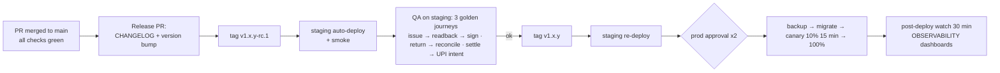

# Deployment
> Project: Tola · Owner: DevOps lead · Status: Draft v0.1 · Last updated: 2026-10-20
> Related: [Project Brief](../../../docs/00-overview/PROJECT_BRIEF.md) · [CI/CD](CICD.md) · [Infrastructure](INFRASTRUCTURE.md) · [Runbook](RUNBOOK.md) · [Observability](OBSERVABILITY.md) · [Demo build](../../demo/README.md)

## 1. MVP (hackathon): `implementation/demo`

The demo build has **no login**, seeded data, and `AI_FALLBACK_MODE` set to `live` with a cached fallback. The deploy target is the free or starter tier. **The demo never holds real karigar data.**

**Option A: Vercel (web) + Render (API).** This is the default for the prototype round, 23 Nov – 15 Dec 2026.

1. **API on Render.**
   1. New Web Service from the repo, root `implementation/demo/services/api`.
   2. Build: `pip install uv && uv sync --frozen`.
   3. Start: `uv run uvicorn app.main:app --host 0.0.0.0 --port $PORT`.
   4. Env:
      - `DATABASE_URL=sqlite:///./tola_demo.db`
      - `AI_FALLBACK_MODE=live`
      - `LYZR_API_KEY`
      - `LYZR_AGENT_ID_MANAGER`, `LYZR_AGENT_ID_INTAKE`, `LYZR_AGENT_ID_RECONCILE`, `LYZR_AGENT_ID_SETTLE`
      - `SARVAM_API_KEY`
      - `TOLA_SERVER_SIGNING_KEY`
      - `TOLA_UPI_VPA`, `TOLA_UPI_PAYEE_NAME`
   5. After the first boot: `curl -X POST $API/v1/demo/reset` (API-02) to seed.
   6. Render's free tier sleeps when idle (cold start ~30–60 s, HUNCH). **Use the starter plan (or option C) on judging days.**
2. **Web on Vercel.**
   1. Import the repo, root `implementation/demo/apps/web`, framework Next.js.
   2. Env: `NEXT_PUBLIC_API_URL=https://<render-app>.onrender.com`, `NEXT_PUBLIC_DEMO_MODE=true`.
3. **Verify.**
   - `GET /v1/health` (API-01) returns `ok`.
   - The story mode runs end to end with `AI_FALLBACK_MODE=cached` and with `live`.
   - `GET /v1/ledger` (API-08) shows `chain: verified`.

**Option B: one VM with Docker Compose** (finale fallback; any laptop works):
`docker compose -f implementation/demo/docker-compose.yml up -d`, serving web on `:3000` and API on `:8000`. Start it with `AI_FALLBACK_MODE=cached` if the venue Wi-Fi is unreliable.

**Option C: Cloud Run (Mumbai), using the scalable pipeline's infra.** Deploy the demo images to the `dev` project with `min_instances=1` for 27 Dec 2026, so there are no cold starts on stage.

The demo-day checklist and the offline fallbacks are in [RUNBOOK.md](RUNBOOK.md) §8.

## 2. v1 (production): `implementation/scalable`

### 2.1 One-time bootstrap (per environment)

1. Create the projects `tola-dev`, `tola-staging`, `tola-prod` and `tola-artifacts`. Link billing and set a budget alert at 50 %, 90 % and 100 % of the monthly plan in [COST.md](COST.md).
2. Bootstrap (`infra/terraform/bootstrap/`):
   - state bucket `tola-tfstate-<env>` (versioned, `asia-south1`);
   - org policies ([INFRASTRUCTURE.md](INFRASTRUCTURE.md) §5);
   - Artifact Registry repo `tola` in `asia-south1`.
3. Initialise and apply:
   - `terraform -chdir=implementation/scalable/infra/terraform init -backend-config=env/<env>.backend.hcl`
   - `terraform -chdir=... apply -var-file=env/<env>.tfvars`
4. Add the secret values, never through Terraform:
   `printf %s "$VALUE" | gcloud secrets versions add tola-database-url --data-file=- --project tola-<env>`. Repeat for all 10 secrets.
5. Copy the `terraform output` values into GitHub **environment variables** for `dev`, `staging` and `prod` (`GCP_WIF_PROVIDER`, `GCP_DEPLOY_SA` and so on; see [CICD.md](CICD.md) §4). In the `prod` environment, set **2 required reviewers** and a deployment branch rule that allows tags `v*` only.
6. Register the webhooks:
   - **WhatsApp:** callback `https://api.tola.in/v1/webhooks/whatsapp` (API-19) with the verify token from Secret Manager.
   - **PSP:** `https://api.tola.in/v1/webhooks/psp` (API-20).
   - **IVR:** `https://api.tola.in/v1/webhooks/ivr`.
   - Allow-list the NAT egress IP (`terraform output egress_ip`) where the provider needs it.
   - The `tola.in` domain is a placeholder (owner: Founder, by 15 Nov 2026).
7. First release: `git tag v0.1.0-rc.1 && git push --tags`. This deploys to staging.

### 2.2 Release process

- **Cadence:** weekly, Tuesday 11:00 IST. Hotfixes go any time via `v1.x.(y+1)` with the same gates.
- **Versioning:** SemVer. A MAJOR bump is required for any breaking change to `/v1` (API-xx) or to the signed event payload format of `LedgerEvent` (E-06).
- **Freeze windows:** Dhanteras and Diwali week, and the peak wedding-season fortnights agreed with pilot shops each year, because jewellers are busiest then.

## 3. Feature flags

- **Mechanism (v1):** a `feature_flag` table in Postgres plus an in-memory cache with a 30 s TTL. It is evaluated server-side and exposed to the PWA via `GET /v1/me` flags (scalable-only field; to be added to `api/openapi.yaml`).
- **Scopes:** global, per `shop_id`, per `person_id`, plus a percentage rollout. No third-party flag SaaS is used, which keeps data in India and costs ₹0.

| Flag | Default | Purpose |
|---|---|---|
| `ai.intake.lyzr` | on | Off means deterministic parser + template only (R-07 kill switch for M-03) |
| `ai.tts.live` | on | Off means pre-generated phrase audio only (M-02 fallback) |
| `channel.whatsapp` / `channel.ivr` | per shop | F-12 rollout by pilot cohort |
| `payments.psp.live` | off | F-07: show the UPI intent only until PSP KYC is complete |
| `passport.share` | per shop | F-08 consent flow rollout |
| `scale.display_ocr` | off | M-04 beta |
| `gst.draft` | on | F-09 |

`AI_FALLBACK_MODE` (`live` | `cached` | `off`) remains the **process-wide** override and takes precedence over the `ai.*` flags.

Every flag change is written to the audit log (actor, before, after). Flags are removed within 2 releases of reaching 100 %.

## 4. Database migrations (Alembic 1.20)

**Rules:**
1. **Expand → migrate → contract.** No migration may break the previous release:
   - add nullable columns or columns with defaults, plus new tables;
   - backfill in the worker in batches of 5,000 rows;
   - drop or rename only in a later release, after no deployed revision reads the old shape.
2. **`ledger_event` and `signature` are append-only.**
   - Migrations never `UPDATE` or `DELETE` existing rows in these tables.
   - A DB trigger rejects `UPDATE`/`DELETE` (`tola_ledger_append_only`).
   - Hash-relevant columns are never altered. Payload format changes bump `event_version`, and old versions stay verifiable.
3. Indexes are created with `op.create_index(..., postgresql_concurrently=True)` inside `with op.get_context().autocommit_block():`.
4. Every migration ships `downgrade()`. CI runs up → down → up → `alembic check` (see [CICD.md](CICD.md) §2), but production never runs `downgrade`; it rolls forward.
5. `lock_timeout = '3s'` and `statement_timeout = '60s'` are set in `env.py` for online migrations. A migration that needs longer becomes a worker backfill.

**Execution:** the Cloud Run job `tola-migrate` runs `alembic upgrade head` with the **new** image **before** traffic shifts (`scalable-deploy.yml`). In prod an on-demand Cloud SQL backup runs first.

**Local:**
- `cd implementation/scalable/services/api && uv run alembic revision --autogenerate -m "add dispute voice ref"`
- `uv run alembic upgrade head`

## 5. Zero-downtime strategy

| Concern | Approach |
|---|---|
| Code rollout | Cloud Run revisions deployed at **0 % traffic** with tag `candidate` → smoke test → **10 % canary for 15 min** → 100 %. The previous revision stays warm, so rollback is instant |
| Schema | Expand/contract (§4), so old and new code both run against the new schema |
| Long requests | API timeout 60 s. Agent and voice work runs in the worker via Cloud Tasks, so in-flight HTTP is short. Cloud Run drains old revisions gracefully |
| Background jobs | Cloud Tasks retries with backoff. Handlers are **idempotent** (idempotency key = event id or webhook id), so a task hitting an old or new revision during a switch is safe |
| Offline PWA (F-11) | `POST /v1/sync` (API-18) accepts signed events of any supported `event_version`. The service worker updates on next launch (`skipWaiting` only after the queue is flushed), so no queued signed event is lost during a release |
| Client/API skew | The API supports the current and previous PWA build. `X-Tola-Client` header; the API returns `426` with an update prompt only for builds older than N-2 |
| DB maintenance | Cloud SQL maintenance window Monday 02:30 IST; REGIONAL HA failover is under 60 s (Google-stated target; not verified 2026-10-20) |
| Secrets rotation | New secret version → new revision picks up `latest` → old version disabled after 24 h |

## 6. Post-deploy verification

1. Synthetic journeys run every 5 minutes (Cloud Monitoring synthetic checks, Playwright script): issue → read-back → dual sign → ledger verify.
2. Error budget burn below 2× for 30 minutes ([OBSERVABILITY.md](OBSERVABILITY.md) §5).
3. `chain_verify_failures_total == 0`.
4. Agent p95 latency and cost per run within 20 % of the previous release.
