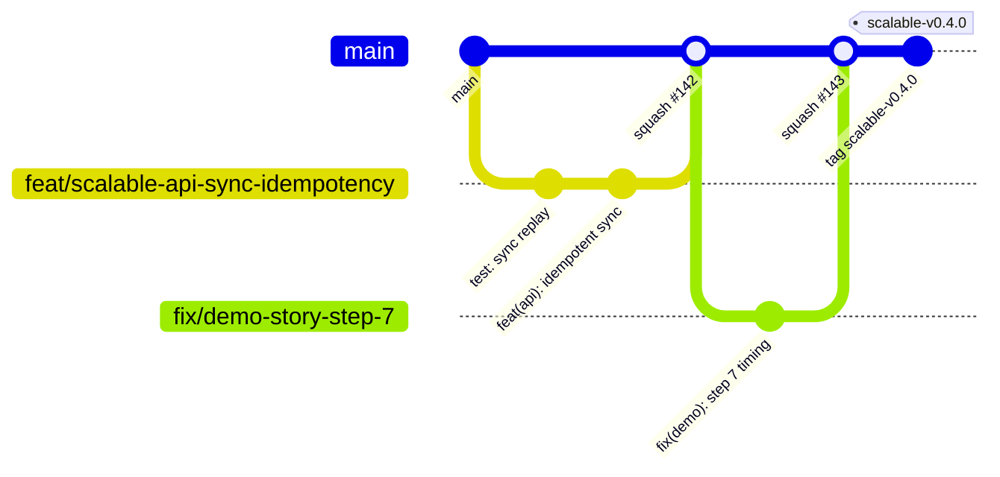

# Git workflow · Scalable track
> Project: Tola · Owner: Tech lead (scalable track) · Status: Draft v0.1 · Last updated: 2026-10-20
> Related: [README](../README.md) · [Coding standards](CODING_STANDARDS.md) · [Testing](TESTING.md) · [CI/CD](CICD.md) · [Deployment](DEPLOYMENT.md)

One repository holds `docs/`, `api/`, `implementation/demo` and `implementation/scalable`. This doc defines how changes flow so that the two tracks never block each other.

- **MVP (hackathon):** during the prototype round (23 Nov – 15 Dec 2026), demo work may merge with one review and the lighter `demo-ci.yml`.
- **v1 (production):** everything below is mandatory for `implementation/scalable/**`.

---

## 1. Branching: trunk-based with short-lived branches


**Branches.**
- `main` is the trunk. It must always be deployable to **staging**, and it is protected: no direct pushes, linear history, signed commits required.
- Feature branches live **≤ 2 working days** and stay under 400 changed lines, excluding generated files and lockfiles. Larger work lands behind a feature flag in several PRs.
- **No long-lived release branches.** Hotfixes branch from the release tag only if `main` has unreleasable changes. They are cherry-picked back to `main` the same day.

**Feature flags** are simple per-shop flags in the `shops` module, read through `flags.enabled("whatsapp_channel", shop_id)`. A flag is removed within 2 sprints of reaching 100%.

**Branch naming:** `<type>/<track>-<area>-<short-desc>`.

| Example | Meaning |
|---|---|
| `feat/scalable-web-offline-queue` | new feature in the scalable web app |
| `fix/scalable-api-otp-lockout` | bug fix |
| `chore/scalable-infra-cloudsql-tier` | infra, no behaviour change |
| `feat/demo-story-mode-lender` | demo track |
| `docs/common-data-model-e14` | common docs |
| `contract/openapi-sync-results` | API contract change (both tracks affected) |

## 2. Commits: Conventional Commits 1.0
Format: `type(scope): imperative summary ≤ 72 chars`, with an optional body and footers.

- **Types:** `feat`, `fix`, `perf`, `refactor`, `test`, `docs`, `build`, `ci`, `chore`, `revert`, `security`.
- **Scopes:** `web`, `ui`, `ledger-core`, `api`, `worker`, `ai`, `infra`, `ci`, `docs`, `deps`, `openapi`, `demo` and `release`. They are enforced by commitlint 21 (config in the root [`package.json`](../package.json)).
- **Footers:**
  - `Refs: F-11, API-18`. Use brief IDs; this is required for `feat` and `fix`.
  - `BREAKING CHANGE: …`
  - `Co-Authored-By: …` for pair and AI-assisted work.

Examples:
```
feat(api): return per-event results from /v1/sync

Each item gets appended | duplicate | rejected; a rejected item no longer blocks its pair.

Refs: F-11, API-18
```
```
fix(ledger-core): floor fine-gold and carry residue_mg explicitly

Py and TS disagreed by 1 mg on 916 × 3 mg. New vector v-0042 added.

Refs: F-03, F-05
```

Hooks: Husky 9 runs `lint-staged` on pre-commit and `commitlint` on commit-msg. **Never skip hooks** (`--no-verify` is not allowed). If a hook is wrong, fix the hook in its own PR.

## 3. Pull requests: path-scoped
CI workflows are **path-filtered**, so a PR runs only the checks for the code it touches. CODEOWNERS routes reviews by path.

| PR touches | Workflow(s) | Required reviewers (CODEOWNERS) | Merge rule |
|---|---|---|---|
| `implementation/demo/**` only | `demo-ci.yml` | 1 demo-track owner | 1 approval; green CI |
| `implementation/scalable/**` only | `scalable-ci.yml` (+ `evals.yml` if `ai/**` or `tola_api/agents/**`) | 1 owner of the touched area | 1 approval; green CI; coverage gates ([TESTING](TESTING.md)) |
| `implementation/scalable/packages/ledger-core/**`, `tola_api/ledger/**`, any migration | `scalable-ci.yml` | **2** approvals including the back-end + crypto lead | Property tests at the `ci` profile; vectors updated |
| `api/openapi.yaml` | `demo-ci.yml` **and** `scalable-ci.yml` (both run contract tests) | 1 from each track | Contract-only PR (`contract/…`), merged **before** implementation PRs |
| `docs/**` | markdown lint + link check | 1 doc owner | — |
| `.github/workflows/**`, `infra/terraform/**` | `scalable-ci.yml` (tf plan) | tech lead | `terraform plan` output attached |

**Mixing.** Do not mix demo and scalable changes in one PR. If a fix applies to both, open two PRs that link to each other. The tracks have different release cadences and different risk.

```yaml
# .github/CODEOWNERS (excerpt)
/implementation/demo/                         @tola/demo
/implementation/scalable/apps/                @tola/frontend
/implementation/scalable/packages/ui/         @tola/frontend
/implementation/scalable/packages/ledger-core/ @tola/crypto @tola/backend
/implementation/scalable/services/            @tola/backend
/implementation/scalable/ai/                  @tola/ai
/implementation/scalable/infra/               @tola/platform
/api/openapi.yaml                             @tola/backend @tola/demo
/docs/                                        @tola/docs
```

```yaml
# path filter used by scalable-ci.yml (full YAML in docs/05-ops/CICD.md)
on:
  pull_request:
    paths:
      - "implementation/scalable/**"
      - "api/openapi.yaml"
      - ".github/workflows/scalable-*.yml"
```

**PR template** (`.github/pull_request_template.md`):
- what and why, with brief IDs;
- screenshots or recordings for UI changes on a 360 × 800 viewport;
- test evidence;
- a rollback note;
- the review checklist from [CODING_STANDARDS §6](CODING_STANDARDS.md#6-review-checklist-copy-into-the-pr-template).

**Merging.**
- Use **squash merge**. The PR title must itself be a valid Conventional Commit, because it becomes the commit.
- Delete the branch after merge.

## 4. Releases and versioning (SemVer 2.0)
Each track and each deployable has its own tag namespace, so a demo release never bumps production.

| Artefact | Tag | Example | Triggers |
|---|---|---|---|
| Scalable stack (web + api + worker, deployed together) | `scalable-vMAJOR.MINOR.PATCH` | `scalable-v1.0.0` | `scalable-deploy.yml`: staging on merge to `main`, **prod on tag** with manual approval |
| `@tola/ledger-core` (TS + Py, versioned together) | `ledger-core-vX.Y.Z` | `ledger-core-v1.2.0` | Internal package publish; any change to hashing or canonical bytes is **MAJOR** |
| API contract | `info.version` in `api/openapi.yaml` + tag `openapi-vX.Y.Z` | `openapi-v1.3.0` | Breaking change → new base path `/v2`; `/v1` is kept ≥ 6 months |
| Demo | `demo-vX.Y.Z` | `demo-v0.9.0` (stage build 27 Dec 2026) | `demo-ci.yml` deploy |

**Version bumps:**
- `feat` → MINOR;
- `fix`, `perf` and `security` → PATCH;
- `BREAKING CHANGE` → MAJOR.

**Before 1.0.0**, MINOR may break. `scalable-v1.0.0` is reserved for the first paid pilot go-live; owner: tech lead; target date set at the post-hackathon planning on 2027-01-10.

**Changelog.** Generated per track from Conventional Commits into `implementation/scalable/CHANGELOG.md` (Keep a Changelog format). A human edits it before tagging.

**Database migrations** ship in the same release as the code that needs them and follow expand → migrate → contract:
1. Release N adds the new column or table.
2. Release N+1 switches reads.
3. Release N+2 drops the old column.

Ledger tables are never contracted.
