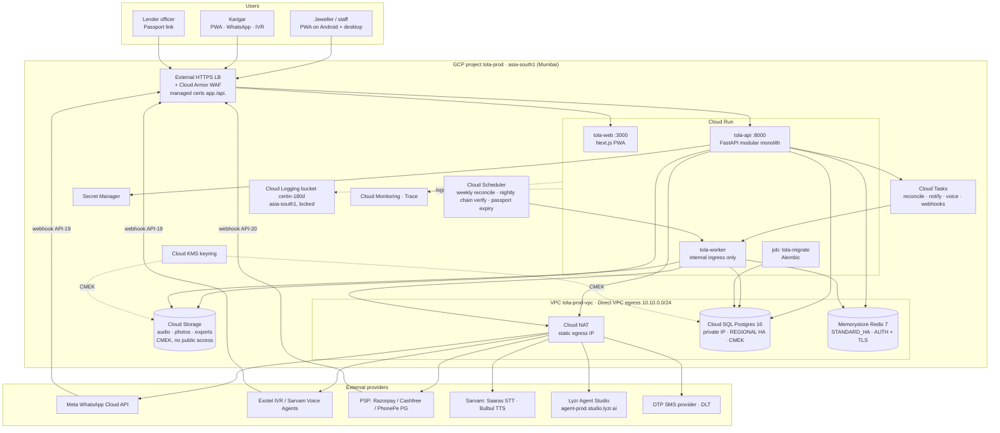

# Infrastructure: Scalable Track
> Project: Tola · Owner: DevOps lead · Status: Draft v0.1 · Last updated: 2026-10-20
> Related: [Project Brief](../../../docs/00-overview/PROJECT_BRIEF.md) · [Architecture](../../../docs/03-engineering/ARCHITECTURE.md) · [CI/CD](CICD.md) · [Deployment](DEPLOYMENT.md) · [Observability](OBSERVABILITY.md) · [Runbook](RUNBOOK.md) · [Cost](COST.md) · [Terraform](../infra/terraform/main.tf)

## 1. Hosting choice

| | MVP (hackathon): `implementation/demo` | v1 (production): `implementation/scalable` |
|---|---|---|
| Web | Vercel (Next.js 16.4) | Cloud Run `tola-web` |
| API | Render free/starter, or Docker Compose on one VM | Cloud Run `tola-api` (FastAPI 0.153, port 8000) |
| Jobs | Inline, button-triggered ("run week") | Cloud Run `tola-worker` + Cloud Tasks + Cloud Scheduler; RQ on Redis 7 for in-process fan-out |
| DB | SQLite file, seeded | Cloud SQL **PostgreSQL 16** |
| Files | Local disk / bundled cached audio | Cloud Storage (single-region `ASIA-SOUTH1`) |
| Secrets | `.env` | Secret Manager |
| Region | Wherever the free tier runs; **no real personal data** | **GCP `asia-south1` (Mumbai)** for everything |

**Why GCP Mumbai.**
1. **Data residency.** Ledger events hold personal data of karigars and jewellers (phone, voice, work history). The DPDP Act 2023 does not mandate localisation today, but keeping all primary data, backups and logs in India is the conservative default, and it is what a co-op bank or NBFC partner reading a Work Passport (F-08) will ask for. CERT-In's April 2022 directions also require logs to be kept **within Indian jurisdiction** for 180 days.
2. **Cloud Run** scales to zero for dev and staging, and gives tagged zero-traffic revisions for canaries.
3. **Startup credits** (§8).

`asia-south2` (Delhi) is the **DR region** for backup copies only (§6). Both regions are in India.

## 2. Network diagram



**Network rules:**
- Cloud SQL and Memorystore have **no public IP**. Only Cloud Run, via Direct VPC egress, reaches them.
- All outbound traffic leaves through **one static NAT IP**, so PSP and IVR providers can allow-list it.
- `tola-worker` has `INGRESS_TRAFFIC_INTERNAL_ONLY`. Cloud Tasks and Scheduler call it with OIDC tokens from `tola-tasks`.
- Cloud Armor applies the OWASP CRS ruleset, **20 req/min/IP on `/v1/auth/otp/*`** (API-17), and 300 req/min/IP elsewhere.
- Webhooks (API-19, API-20) are verified by HMAC signature: Meta `X-Hub-Signature-256`, PSP signature header. They also carry an idempotency key stored in Redis for 72 h.

## 3. Components

| Component | Service | Prod config (10k karigars) | Notes |
|---|---|---|---|
| Web | Cloud Run `tola-web` | 1 vCPU / 512 MiB, min 1, max 20 | PWA shell + static assets; CDN via LB (Cloud CDN on `/_next/static/*`) |
| API | Cloud Run `tola-api` | 1 vCPU / 1 GiB, min 1, max 10 (1M: max 200), concurrency 40, startup CPU boost | All `/v1` endpoints; signs nothing on behalf of users (clients sign with Ed25519 keys) |
| Worker | Cloud Run `tola-worker` | 1 vCPU / 1 GiB, min 0, max 20, concurrency 4, timeout 900 s | Lyzr agent calls, Sarvam STT/TTS, notifications, reconciliation fan-out, chain verify |
| Migrations | Cloud Run job `tola-migrate` | Same image as API | Executed by the deploy workflow |
| DB | Cloud SQL Postgres 16, Enterprise | `db-custom-2-7680`, REGIONAL HA, PD-SSD 20 GB autoresize, PITR 7 days | IAM DB auth; `log_min_duration_statement=500` |
| Cache / queue | Memorystore Redis 7.2 | 1 GB STANDARD_HA | RQ queues, OTP throttles, idempotency keys, session denylist |
| Object storage | Cloud Storage `audio`, `photos`, `exports` | Standard → Nearline at 90 d → Coldline at 365 d | Signed URLs (15 min) for upload and playback; no public objects |
| Secrets | Secret Manager | User-managed replica `asia-south1` | 10 secrets (see [CICD.md](CICD.md) §4) |
| Async | Cloud Tasks (4 queues) + Cloud Scheduler (3 jobs) | Retry 8×, 5 s → 600 s backoff | Weekly reconcile on Saturday 20:00 IST; chain verify nightly at 02:30 IST |
| Keys | Cloud KMS | CMEK for SQL and GCS, 90-day rotation | `TOLA_SERVER_SIGNING_KEY` lives in Secret Manager; migrating it into KMS asymmetric signing is a v1.1 item (Ed25519 support in KMS not verified 2026-10-20) |
| Images | Artifact Registry `asia-south1-docker.pkg.dev/<artifacts>/tola` | Cleanup policy: keep the last 30 tags and every `v*` tag for 180 days | — |

**Scaling approach:**
- The API is stateless, so it scales horizontally on Cloud Run.
- The DB is the bottleneck. Per-shop data is small, so vertical scaling plus **one read replica** for Passport and dashboard reads covers growth to about 1M karigars (see [COST.md](COST.md)). Partition `ledger_event` by `shop_id` hash at more than 500M rows (owner: Backend lead, review at 100k karigars).
- Agent calls run only in the worker, behind Cloud Tasks rate limits (voice queue at 10 dispatches/s), so a Lyzr or Sarvam slowdown cannot exhaust API instances.

## 4. Environment sizing

| | dev | staging | prod @100 | prod @10k | prod @1M |
|---|---|---|---|---|---|
| Cloud SQL tier | db-custom-1-3840 zonal | db-custom-1-3840 zonal | db-custom-1-3840 zonal | db-custom-2-7680 HA | db-custom-16-61440 HA + 1 read replica |
| Redis | Basic 1 GB | Basic 1 GB | — (Cloud Tasks only) | Standard HA 1 GB | Standard HA 5 GB |
| api min/max | 0/3 | 0/3 | 1/5 | 1/10 | 5/200 |
| LB + Cloud Armor | no | no | no (Cloud Run URL + domain mapping) | yes | yes |

## 5. Terraform outline

The skeleton is in [`infra/terraform/main.tf`](../infra/terraform/main.tf) (google provider `~> 8.7`, Terraform ≥ 1.9; latest releases checked 2026-10-20 are provider v8.7.0 and Terraform v1.16.6). **It has not been run through `terraform validate` yet** (owner: DevOps lead, by 15 Nov 2026).

```
infra/terraform/
├─ main.tf                 # everything below, single root module (split into modules at v1.1)
├─ env/
│  ├─ dev.tfvars           # project_id, env=dev, db_tier, alert_email, github_repo
│  ├─ staging.tfvars
│  ├─ prod.tfvars          # db_ha=true, api_min_instances=1, redis_memory_gb=1
│  └─ <env>.backend.hcl    # bucket = "tola-tfstate-<env>", prefix = "tola"
└─ bootstrap/              # one-off: state bucket, artifacts project, org policies
```

| Section in `main.tf` | Resources |
|---|---|
| APIs | `google_project_service` × 15 |
| Network | VPC, `/24` subnet for Direct VPC egress, PSA range + `service_networking_connection`, Cloud Router + NAT with static IP |
| Keys | KMS key ring + `data` key (90-day rotation, `prevent_destroy`) |
| Data | `google_sql_database_instance` (POSTGRES_16, private IP, `ENCRYPTED_ONLY`, PITR, backups in `asia-south1`), `google_redis_instance` (REDIS_7_2, AUTH, TLS), 3 × `google_storage_bucket` (CMEK, lifecycle) |
| Logs | `google_logging_project_bucket_config` `certin-180d` (400-day retention, locked in prod) + sink |
| Secrets | 10 × `google_secret_manager_secret` (values added out-of-band) |
| Identity | SAs `tola-runtime`, `tola-web`, `tola-deploy`, `tola-tasks`; least-privilege bindings; **WIF pool `github` + provider `github-oidc`** restricted to repo **and** GitHub environment |
| Compute | `google_cloud_run_v2_service` × 3 (`ignore_changes` on image and traffic, since CI owns them), `google_cloud_run_v2_job` `tola-migrate` |
| Async | `google_cloud_tasks_queue` × 4, `google_cloud_scheduler_job` × 3 |
| Edge | External LB + serverless NEGs + Cloud Armor (outlined, commented) |
| Monitoring | Email channel, uptime check, 5xx alert (the full alert set is in [OBSERVABILITY.md](OBSERVABILITY.md) §6) |

**Org policies** (set in bootstrap):
- `constraints/gcp.resourceLocations = in:asia-south1-locations, in:asia-south2-locations`;
- `iam.disableServiceAccountKeyCreation = true`;
- `sql.restrictPublicIp = true`;
- `storage.publicAccessPrevention = true`.

## 6. Backups

| Asset | Mechanism | Frequency | Retention | Location | RPO / RTO |
|---|---|---|---|---|---|
| Postgres | Cloud SQL automated backup + **PITR** (WAL, 7 days) | Daily 02:00 IST + continuous | 30 backups (prod) | `asia-south1` | RPO ≤ 5 min / RTO ≤ 1 h |
| Postgres (pre-deploy) | On-demand backup in `scalable-deploy.yml` | Every prod release | Until manually deleted (cleanup after 30 days) | `asia-south1` | — |
| Postgres (DR copy) | Scheduled `gcloud sql export sql` → `exports` bucket, copied to a dual-bucket in `asia-south2` | Daily | 90 days | `asia-south2` (Delhi) | RPO ≤ 24 h / RTO ≤ 4 h (region loss) |
| Ledger integrity | Nightly **signed chain-head snapshot**: for each shop–karigar chain, latest `hash` + both signatures, written to `exports` with object versioning | Nightly | 7 years (GST/Income-Tax record horizon, HUNCH; confirm with CA) | `asia-south1` + `asia-south2` | Detects any tampering with a restored DB |
| Audio / photos | GCS object versioning (photos), lifecycle to Coldline | Continuous | Audio 1 year then delete unless attached to a dispute (F-06); photos 7 years | `asia-south1` | — |
| Secrets | Secret Manager versions | On change | All versions kept; disabled, not destroyed | `asia-south1` | — |
| Terraform state | GCS bucket with versioning | Each apply | 100 versions | `asia-south1` | — |

Restore drills run **quarterly** on staging (procedure in [RUNBOOK.md](RUNBOOK.md) §6). A drill passes only if `verify-all` reports **0 broken chains** after the restore.

## 7. Containers

| Image | Base | Build | Runtime user | Size target |
|---|---|---|---|---|
| `web` | `node:24-alpine` | `pnpm --filter web build`, Next.js `output: "standalone"` | `node` (uid 1000) | < 180 MB |
| `api` | `python:3.12-slim` | `uv sync --frozen --no-dev`; includes `alembic/` | `app` (uid 10001), read-only root FS | < 250 MB |
| `worker` | `python:3.12-slim` | Shares `packages/ledger-core` with api | `app` | < 250 MB |

Dockerfiles live at `implementation/scalable/infra/docker/{web,api,worker}.Dockerfile` (owner: DevOps lead, by 23 Nov 2026). CI builds them only once they exist.

## 8. Credits and cost-saving

| Program | What it gives | Status |
|---|---|---|
| **Google for Startups Cloud Program** | Cloud credits for eligible startups; historically up to US$200k over 2 years (more for AI-first) | Amount and eligibility **not verified 2026-10-20**; apply once incorporated (owner: Founder, by Jan 2027) |
| GCP Free Tier | Cloud Run monthly free requests and vCPU-seconds; Cloud Logging first 50 GiB/project/month | Exact quotas **not verified 2026-10-20** |
| **Lyzr hackathon credits** | "Credits from Lyzr AI" per the hackathon brief; amount unknown. Precedent: ₹500 per participant at a 2025 Lyzr hackathon (`research/B-sponsors.md`) | Ask at registration or the AMA (24 Dec) |
| **Sarvam** | ₹100 free signup credits (never expire); about 3 h of STT | Verified in `research/B-sponsors.md` |
| MeitY Startup Hub / JanAI programme | Possible cloud and credit partnerships | **Not verified** |

**Cost-saving levers** (detail in [COST.md](COST.md) §5):
- dev and staging scale to zero and use zonal SQL;
- Cloud SQL committed-use discount once prod usage is stable;
- the TTS phrase cache in GCS;
- Lyzr is called only when deterministic parsing fails.
