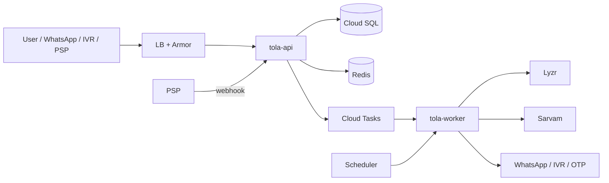

# Runbook
> Project: Tola · Owner: SRE / DevOps lead · Status: Draft v0.1 · Last updated: 2026-10-20
> Related: [Project Brief](../../../docs/00-overview/PROJECT_BRIEF.md) · [Observability](OBSERVABILITY.md) · [Infrastructure](INFRASTRUCTURE.md) · [Deployment](DEPLOYMENT.md) · [CI/CD](CICD.md) · [Security & compliance](../../../docs/06-security-compliance/) · [Demo build](../../demo/README.md)

**Scope.**
- **v1 (production)** `implementation/scalable`: §1–§7.
- **MVP (hackathon)** `implementation/demo`: §8, the demo-day emergency plan.

## 1. On-call basics

| Item | Value |
|---|---|
| Rotation | Weekly, Monday 10:00 IST handover; primary + secondary (pilot phase: 2 founders) |
| Hours | 24×7 for SEV-1/2; SEV-3/4 handled 09:00–21:00 IST |
| Ack targets | SEV-1 5 min · SEV-2 15 min · SEV-3 4 h · SEV-4 next business day |
| Tools | Cloud Monitoring alerts → email + paging; `gcloud` with break-glass group `tola-sre` (just-in-time IAM, 4 h); this runbook |
| Comms | Incident channel `#inc-YYYYMMDD-<slug>`; status updates to affected shops by WhatsApp template `service_notice` (utility) in their language |
| Handover note | Open incidents, alerts silenced, pending CERT-In or DPDP clocks |

**First 5 minutes, any incident:**
1. Acknowledge the page.
2. Open the incident channel and assign roles: **IC** (incident commander), **Ops**, **Comms**.
3. Note `T0` (detection time in IST). It starts the **CERT-In 6-hour clock** if the incident is reportable (§7.1).
4. Check the dashboards (OBSERVABILITY §4) and recent deploys (`gcloud run revisions list --service tola-api --region asia-south1 --limit 5`).
5. If a deploy happened in the last 2 h and the symptoms match, **roll back first and investigate after** (§5.1).

## 2. Severity levels

| Sev | Definition (Tola-specific) | Examples | Response |
|---|---|---|---|
| **SEV-1** | Ledger integrity in doubt, personal-data breach, or total outage | Hash-chain verify failure; an accepted event with an invalid signature; DB exposed; prod down > 5 min | All hands; IC within 5 min; updates every 30 min; CERT-In / DPDP assessment within 1 h |
| **SEV-2** | Core journey broken for many users, or money/settlement flow at risk | 5xx > 2 %; PSP webhooks lost; OTP failing; WhatsApp channel down at peak | IC within 15 min; updates hourly |
| **SEV-3** | Degraded with a working fallback | Sarvam or Lyzr outage (auto-fallback active); queue backlog; one shop affected | Fix within 1 business day |
| **SEV-4** | Cosmetic or single user | Wrong translation string; one stuck sync | Backlog ticket |

Blameless post-mortems are due within **5 business days** for SEV-1/2 and stored in `docs/08-project/postmortems/`.

## 3. Key commands

```bash
# Context
export R=asia-south1 P=tola-prod
gcloud config set project $P

# Service state
gcloud run services describe tola-api --region $R --format='yaml(status.traffic)'
gcloud run revisions list --service tola-api --region $R --limit 5

# Logs (last 15 min, errors only)
gcloud logging read 'resource.type="cloud_run_revision" AND resource.labels.service_name="tola-api" AND severity>=ERROR' --freshness=15m --limit 50

# Kill switches (feature flags, DEPLOYMENT.md §3), via the admin CLI shipped in the api image
gcloud run jobs execute tola-admin --region $R --args="flags,set,ai.intake.lyzr,off" --wait
# Process-wide AI fallback
gcloud run services update tola-api    --region $R --update-env-vars AI_FALLBACK_MODE=cached
gcloud run services update tola-worker --region $R --update-env-vars AI_FALLBACK_MODE=cached

# Ledger verification (all chains, or one pair)
gcloud run jobs execute tola-admin --region $R --args="ledger,verify-all" --wait
gcloud run jobs execute tola-admin --region $R --args="ledger,verify,--shop,shp_X,--karigar,per_Y" --wait
```

`tola-admin` is a Cloud Run job using the api image with entrypoint `python -m app.admin` (owner: Backend lead, by 15 Jan 2027). It is not yet in the Terraform skeleton.

## 4. Service map for triage



## 5. Playbooks: top 10 failures

### 5.1 API down or 5xx spike (often a bad deploy)
- **Detect:** `API 5xx`, `Uptime check fail`, burn-rate alerts.
- **Mitigate:**
  1. If a deploy happened in the last 2 h:
     `gcloud run services update-traffic tola-api --region $R --to-revisions <previous>=100`. Do the same for `tola-web` and `tola-worker` if they were released together.
  2. No recent deploy: check DB (§5.9), then check Secret Manager access errors in the logs (`PERMISSION_DENIED` after a secret rotation).
  3. Instances at max: raise the limit with `gcloud run services update tola-api --max-instances 50`.
- **Verify:** 5xx < 0.5 % for 15 min; synthetic journey green.
- **Data:** none lost. PWA clients queue signed events offline (F-11) and resync through API-18.

### 5.2 Sarvam outage (STT M-01 / TTS M-02)
- **Detect:** `Sarvam degraded`; `fallback_used` rising.
- **Automatic:** the worker circuit breaker opens after 5 consecutive failures or p95 > 5 s. Then:
  - **TTS** serves the pre-generated phrase and number audio from GCS. Numbers are composed from per-digit clips per language, so read-back (F-02) still speaks the exact grams.
  - **STT** returns `needs_tap_confirm`, and the karigar confirms with the big **haan / na** buttons, or keypad 1/2 on IVR.
- **Manual:**
  1. Confirm on Sarvam's status or changelog page.
  2. If the outage lasts > 30 min, set `AI_FALLBACK_MODE=cached` (§3) to stop retry storms.
  3. For a long outage (> 4 h), enable the self-hosted **AI4Bharat IndicConformer** fallback for STT, if deployed (v1.1), and IndicF5 for TTS.
  4. Send a WhatsApp notice to shops: "Voice is slow; use tap confirm."
- **Never:** let the agent guess numbers. The scale reading is the source of truth (R-02).
- **Verify:** error rate < 2 % for 15 min, then close the breaker (automatic half-open probe every 60 s).

### 5.3 Lyzr outage or bad agent output (M-03)
- **Detect:** `Lyzr degraded`, `Agent faithfulness`, `AI spend spike`.
- **Automatic:**
  - **IntakeAgent** → deterministic parser (regex + grammar for "N piece, X gram") + the scale reading; the draft is marked "manual review".
  - **ReconcileAgent** → template explanation generated from ledger-core flags. Reconciliation arithmetic never depends on Lyzr.
  - **SettleAgent** → template statement.
  - All fallbacks still go through the human-in-the-loop gate before signing.
- **Manual:**
  1. Flag `ai.intake.lyzr=off` (§3).
  2. If faithfulness failures are the cause, roll back `prompt_version` (prompts are versioned in `ai/prompts/`, and the previous version is redeployed by tag).
  3. If cost spikes, check for a retry loop (`agent_run` grouped by `request_id` with count > 3) and cap the `voice` queue rate.
  4. Escalate to Lyzr support with the `lyzr_session_id` values.
- **Verify:** faithfulness failures = 0 for 1 h; fallback rate < 5 %.

### 5.4 Hash-chain verification failure (SEV-1)
- **Detect:** `chain_verify_failures_total` > 0, from the nightly `verify-all` or on-read verification in `GET /v1/ledger` (API-08).
- **Meaning:** a stored event's `hash` ≠ SHA-256(canonical payload ‖ `prev_hash`), or a `prev_hash` link is broken. Either the data was tampered with, a bug wrote a non-canonical payload, or the restore was partial.
- **Immediately:**
  1. **Freeze writes for the affected chain(s)** (shop–karigar pair): `tola-admin ledger freeze --shop … --karigar …`. API-06 then returns `423 Locked` for that pair; other pairs continue.
  2. **Preserve evidence:** export the affected rows, the nightly **signed chain-head snapshot** (INFRASTRUCTURE §6), Cloud SQL audit logs and Cloud Audit Logs for the window to `exports/incidents/<id>/` (versioned).
  3. **Locate the first bad event:** `tola-admin ledger verify --shop … --karigar … --verbose` prints the first index where the recomputed hash diverges.
  4. **Compare with the last good snapshot.**
     - If the snapshot's head hash matches events up to N and diverges after N, **events after N were altered**.
     - Both parties hold signatures over the original payloads, and the karigar's device keeps his copy (F-03, F-11), so the true history can be rebuilt from client copies.
  5. **Classify.**
     - *Bug* (canonicalisation change, for example a library upgrade altering JSON key order or number format): fix the code. Never rewrite hashes. Verify against the original canonical form by `event_version`.
     - *Tampering or unauthorised access*: treat it as a **security incident**. Start the CERT-In assessment (§7.1) and the DPDP assessment (§7.2).
  6. **Restore.** Restore from PITR to a **new** instance at a time before the first bad write (§6). Verify the chain there, then replay legitimately signed later events from client sync queues.
  7. **Tell both parties** (jeweller and karigar) of the affected chain, in their language. The PS 2.2 boundary is that each karigar has full access to his own account.
- **Never:** "fix" hashes in place, delete events, or unfreeze before both parties re-confirm the restored balance.

### 5.5 Signature mismatch
- **Detect:** `signature_invalid_total`.
- **Cases:**
  - **A. Rejected at submit (API-07)**, the normal guard. A spike usually means:
    - a client bug (wrong canonical payload);
    - a stale PWA build;
    - a key rotated on the device without re-registration (R-09: lost key, shared phone).
    - **Action:** check the `X-Tola-Client` version distribution. If one build dominates, ship a hotfix and force an update (426). For a single person, run the key-recovery flow (re-verify by OTP, register a new public key, old key marked `revoked_at`; past signatures stay valid).
  - **B. An already-accepted event now fails verification.** This is **SEV-1**: either the stored public key or signature was changed, or the verifier changed.
    - **Action:** as in §5.4 (freeze, evidence, compare with snapshot), and diff the `person_public_key` history table.
- **Server key (`TOLA_SERVER_SIGNING_KEY`):** used for server attestations such as receipt stamps. If it is compromised, follow §5.8. Historic events remain verifiable by the old public key, which is published in the key registry.

### 5.6 PSP webhook loss (UPI status, API-20)
- **Detect:** `PSP webhook loss`; settlements stuck in `payment_pending`.
- **Mitigate:**
  1. Check the PSP status page and dashboard for webhook delivery failures. Our endpoint returns 2xx only after persisting; check for 4xx caused by signature-verification failures after a secret rotation.
  2. **Reconcile by pull:** the worker job `psp.reconcile` (every 10 min during an incident; hourly normally) calls the PSP's payment-status API for every `PaymentIntent` (E-13) in `created`/`pending` for more than 15 min and updates the status idempotently.
  3. If the webhook secret rotated, add the new secret version and keep the old one valid for 24 h (dual verification).
  4. Ask the PSP to **replay** webhooks for the window. The handlers are idempotent on the PSP event id.
- **Never:** mark a settlement as paid without a PSP-confirmed status. Tola never holds money (non-goal).
- **Verify:** zero intents `pending` > 20 min; the settlement statuses of both parties are consistent.

### 5.7 WhatsApp / IVR / OTP channel failure (F-12, API-17, API-19)
- **WhatsApp:**
  - Check the Meta status page, token expiry (`WHATSAPP_TOKEN`), template status (paused or rejected after quality drops) and the per-number messaging limit tier.
  - **Fallback:** confirmations wait in the PWA and appear in the karigar's next app open. For time-critical issues (ISSUE events awaiting the karigar's signature), switch the shop to IVR call-back with the flag `channel.ivr`.
- **IVR:** check the provider status and the DID number. Fallback to WhatsApp and SMS.
- **OTP:**
  - Check the SMS provider and the DLT template/header approval.
  - Fallback to WhatsApp OTP (authentication template).
  - Throttles stay on: 3 OTPs per phone per 15 min; Cloud Armor 20/min/IP.

### 5.8 Secret or key compromise
1. Rotate in Secret Manager (`gcloud secrets versions add …`).
2. Redeploy or restart the revisions so they pick up `latest`.
3. Disable the old version after 1 h, or immediately if it is actively abused.
4. For `TOLA_SERVER_SIGNING_KEY`:
   - generate a new Ed25519 key;
   - publish the new public key in the key registry with `valid_from`;
   - mark the old one `revoked_at` (keeping it for verification);
   - run `verify-all`.
5. For PSP or WhatsApp tokens, also rotate at the provider and check provider logs for abuse.
6. Assess CERT-In reportability (§7.1).

### 5.9 Database or queue saturation
- **DB CPU or connections high:**
  1. Check Query Insights for the top queries.
  2. Common culprits: the dashboard aggregate (F-13) without the `(shop_id, karigar_id, created_at)` index, and Passport views.
  3. Mitigate by moving reads to the replica (1M tier), raising `max_instances` with care (the connection pool is 5 per instance; cap total connections at 80 % of `max_connections`), or a temporary tier bump (`gcloud sql instances patch --tier`, about 1–2 min of downtime on zonal instances, less on HA).
- **Disk > 85 %:** autoresize is on; check for runaway `agent_io` growth (30-day purge job).
- **Cloud Tasks backlog:** check worker errors. Raise queue rate only if Lyzr and Sarvam are healthy. The weekly reconcile must finish by Saturday 23:59 IST (SLO); if at risk, run it per shop in priority order of open disputes.

### 5.10 Suspected unauthorised access or data exfiltration
1. Preserve logs (the bucket is locked).
2. Revoke the sessions involved: JWT denylist in Redis, and a forced OTP re-login for affected users.
3. Rotate secrets (§5.8).
4. Tighten Cloud Armor (block IPs/ASNs).
5. Review the IAM audit logs.
6. Start the CERT-In clock (§7.1) and the DPDP breach procedure (§7.2) **in parallel**.

## 6. Backup and restore

| Target | RPO | RTO | Source |
|---|---|---|---|
| Single-table or row damage | ≤ 5 min | ≤ 1 h | PITR clone |
| Instance loss (zone) | 0 (HA sync replica) | ≤ 5 min | REGIONAL HA failover |
| Region loss (`asia-south1`) | ≤ 24 h | ≤ 4 h | Daily export in `asia-south2` + client sync queues (signed events newer than the export are re-submitted by devices through API-18) |
| Media (audio/photos) | ≤ 24 h | ≤ 4 h | GCS versioning; DR copy |

**PITR restore to a new instance (never in place):**
```bash
gcloud sql instances clone tola-prod-pg tola-prod-pg-restore-$(date +%Y%m%d%H%M) \
  --point-in-time "2026-12-27T04:40:00Z" --region asia-south1   # 10:10 IST
# Verify on the clone
gcloud run jobs execute tola-admin --region $R --args="ledger,verify-all,--db,restore" --wait
# Compare chain heads with the nightly signed snapshot; then switch DATABASE_URL secret to the clone:
printf %s "postgresql+psycopg://…@/tola?host=/cloudsql/<clone-conn>" | gcloud secrets versions add tola-database-url --data-file=-
gcloud run services update tola-api --region $R --set-cloudsql-instances <clone-conn>   # and worker, migrate job
```

**Drill:** quarterly on staging. It is recorded with measured RPO/RTO and passes only if `verify-all` reports 0 broken chains.

## 7. Regulatory incident reporting

### 7.1 CERT-In: report within 6 hours
- **Source:** CERT-In Directions under Section 70B(6) of the IT Act, 28 Apr 2022. Reportable incidents (Annexure I of the directions) include:
  - targeted scanning;
  - compromise of systems or data;
  - unauthorised access;
  - website defacement;
  - malicious code;
  - attacks on servers or applications;
  - **data breaches and data leaks**;
  - attacks or suspicious activity affecting cloud systems.
- **Clock:** **6 hours from noticing** the incident, or from being told of it.
- **How:** email `incident@cert-in.org.in` with the incident report form from cert-in.org.in (address and form from the 2022 directions; **re-verify before first use**, not verified 2026-10-20). Phone and fax options are also listed there.
- **Who:** the **Point of Contact** registered with CERT-In (Compliance lead; registration due before the v1 launch; owner: Founder, by 31 Jan 2027).

| T+ | Action |
|---|---|
| 0:00 | IC notes `T0`; Comms opens the CERT-In draft from template `docs/06-security-compliance/templates/certin-report.md` |
| ≤ 1:00 | IC + Compliance decide: reportable yes/no (when in doubt, report) |
| ≤ 5:00 | Send the initial report with known facts: time, systems affected, type, indicators, actions taken. **Do not wait for root cause.** |
| Ongoing | Follow-up reports as facts emerge; provide logs (OBSERVABILITY §7) if CERT-In requests them |

### 7.2 DPDP Act 2023: personal-data breach notification
- **What counts:** any unauthorised processing, or accidental disclosure, acquisition, sharing, use, alteration, destruction or loss of access to personal data that compromises its confidentiality, integrity or availability. This **includes integrity breaches**, so a tampered ledger with karigar data qualifies.
- **Duties** (as Data Fiduciary; DPDP Rules 2025 as summarised in [docs/06-security-compliance](../../../docs/06-security-compliance/); re-verify against the gazetted Rules):
  1. **Data Protection Board:** an intimation **without delay**, then a detailed report **within 72 hours** (facts, circumstances, reasons, mitigation, findings about the responsible person, remedial measures, report of notifications to principals).
  2. **Each affected Data Principal:** **without delay**, in plain language, through their registered channel (WhatsApp/SMS in **their language**, plus IVR voice for low-literacy users). Include:
     - what happened and when;
     - the likely consequences;
     - what we are doing;
     - what they can do;
     - a contact person.
- **Lenders and Passport recipients** (E-14) who viewed affected data are told too, and active shares are revoked if needed.
- **Owner:** Compliance lead (DPO role) with the IC. Log every step in `audit_log`.

## 8. Demo-day emergency plan (MVP, `implementation/demo`)

**Event:** offline final, **27 Dec 2026, Bangalore Palace**. A 3-minute stage walkthrough in story mode on `/stage`.

The fallbacks themselves are specified and built into the demo; see **[DEMO_SPEC.md §9 "Failure fallbacks"](../../demo/docs/DEMO_SPEC.md)**, §10 (choreography), §11 (acceptance checklist) and the [demo README](../../demo/README.md). This section is the operator's checklist around them.
- **Stage default:** `AI_FALLBACK_MODE=cached`. It never touches the network; audio and agent text come from `seed/audio` and `seed/ai-cache`, and a "cached" pill shows on cached output.
- **`live`** is used only for the one scripted live moment.

**T-24 h:**
1. Run the full DEMO_SPEC §11 checklist in `cached` mode, then once in `live` mode, recording the screen as **video fallback**.
2. Check the Sarvam and Lyzr balances. About 40 pre-generated clips cost ≈ ₹20 of the ₹100 Sarvam credit (MODELS.md §2.1). Top up ₹500 (HUNCH).
3. Commit all read-back audio for the scripted week (bn/hi/kn) to `seed/audio`.
4. Run `POST /v1/demo/reset` (API-02) and confirm the ledger shows `chain: verified`.

**T-2 h at the venue:**
1. Laptop A runs the laptop-only stack (`docker compose up` in `implementation/demo`, web `:3000`, API `:8000`, `AI_FALLBACK_MODE=cached`), with **no internet dependency**.
2. Laptop B or a phone hotspot runs the hosted version (Vercel + Render starter, or Cloud Run `min_instances=1`).
3. Pre-warm 10 min before the slot with `scripts/stage-check.sh`.
4. Bring a USB balance or the HX711 bench rig (R-03, labelled "not for trade"). The simulated scale is one key (**S**) away.

| Failure on stage | Switch to (≤ 10 s) | What to say |
|---|---|---|
| Venue Wi-Fi dies | Laptop A, `localhost:3000/stage` | "Tola is built for low connectivity; this is running fully offline." |
| Sarvam slow or down | Automatic: seeded audio + captions | "Same Bulbul voice, cached." |
| Lyzr slow or down | Automatic: `seed/ai-cache`, else template; "cached" pill | "The numbers never come from the AI; ledger-core computed them." |
| Scale / Web Serial fails | **S** toggles to the simulated scale | "In the shop this reads the verified balance." |
| Browser tab crashes | Reload; story state persists in `localStorage`; press the step number | — |
| API process dies | Docker restarts it in < 5 s; **R** replays the step | — |
| Running over time | Cut list in DEMO_SPEC §9 (skip S12, S13) | — |
| Both laptops fail | Video fallback on a phone or USB stick + printed signed-ledger handout | — |

- **Roles on stage:** presenter, driver (laptop), and a backup operator who watches health and switches laptops.
- **Rule:** never debug live. Switch first, explain later.
